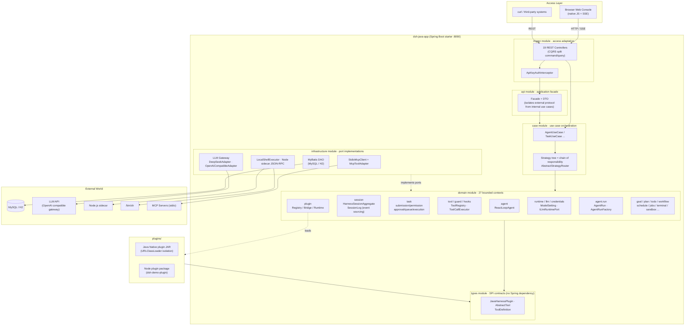
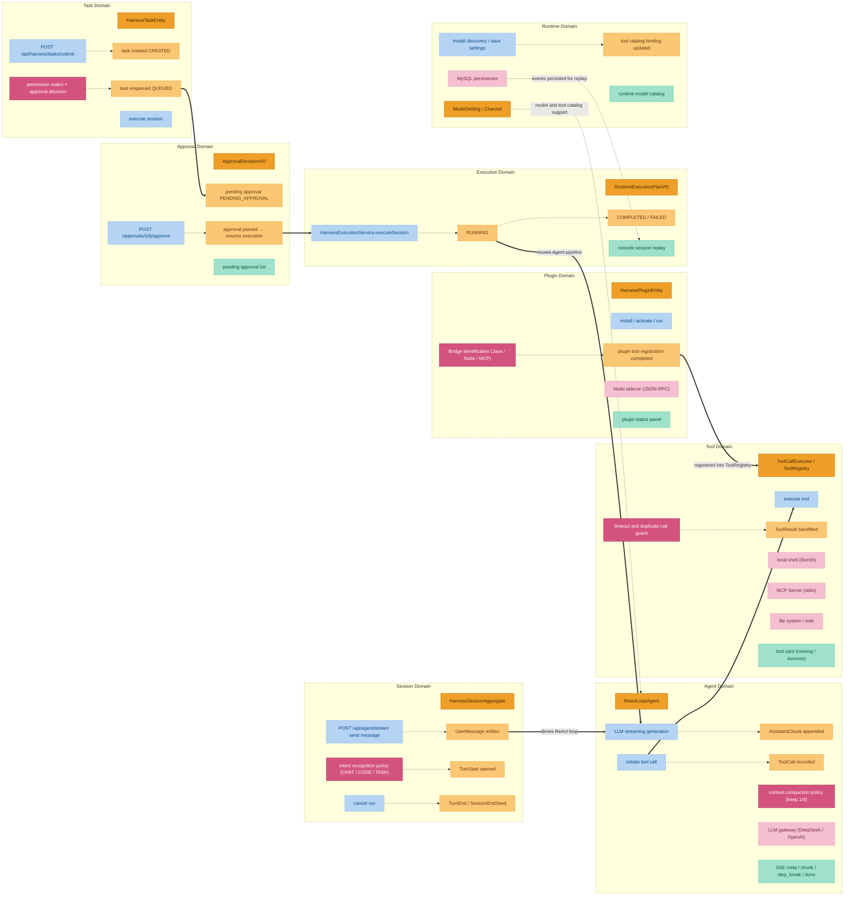
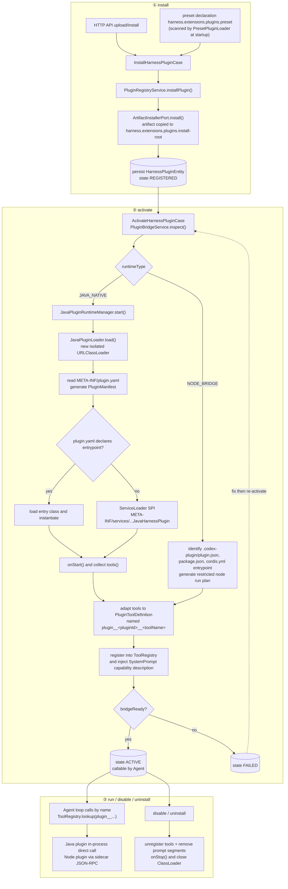

# DeepSeek Harness Java (dsh-java)


> **An extended fork of fuzhengwei's DeepSeek Harness Java** — based on Java 17 + Spring Boot 3, with adjustments layered on top for Linlan's business scenarios.
- **Original author**: <https://github.com/fuzhengwei>

[](./LICENSE)
[](#21-requirements)
[](#21-requirements)

---

**English**

DeepSeek Harness Java (dsh-java) is a modular agent runtime framework in which **model adapters, tool registries, session event logs, and the ReAct agent loop** are organized behind unified ports and plugin mechanisms, allowing them to be replaced or extended as needed. Built on **Java 17, Spring Boot 3.3, and a DDD hexagonal architecture**, the Domain layer defines ports and domain capabilities, the Infrastructure layer provides default adapters, and Java SPI, Node Bridge, and MCP plugins mount external capabilities. When a plugin stops or is unloaded, the host automatically revokes its tool, system prompt, and hook registrations.

The project is currently in **developer preview**. Its APIs and plugin protocols are evolving quickly, and future releases may introduce breaking changes.

- **Repository**: <https://github.com/linlannet/dsh-java>
- **Port**: `8090` (works out of the box)
- **License**: see repository root

---

## Version History

[CHANGELOG](./CHANGELOG.md)


## Table of Contents

- [1. Project Introduction](#1-project-introduction)
  - [1.1 What Is This](#11-what-is-this)
  - [1.2 Applicable Scenarios](#12-applicable-scenarios)
  - [1.3 Feature Overview](#13-feature-overview)
- [2. Quick Start](#2-quick-start)
  - [2.1 Requirements](#21-requirements)
  - [2.2 Build](#22-build)
  - [2.3 Startup Option 1: Standalone (H2, zero external dependencies)](#23-startup-option-1-standalone-h2-zero-external-dependencies)
  - [2.4 Startup Option 2: MySQL (default profile)](#24-startup-option-2-mysql-default-profile)
  - [2.5 Startup Option 3: Docker Compose](#25-startup-option-3-docker-compose)
  - [2.6 Open the Web Console](#26-open-the-web-console)
  - [2.7 Send the First Message with curl](#27-send-the-first-message-with-curl)
  - [2.8 Install the DSH Java Mall Plugin](#28-install-the-2d-weekend-mall-plugin)
- [3. Overall Architecture Design](#3-overall-architecture-design)
  - [3.1 Overall Architecture Diagram](#31-overall-architecture-diagram)
  - [3.2 Dependency Direction and Core Constraints](#32-dependency-direction-and-core-constraints)
  - [3.3 Maven Module Division](#33-maven-module-division)
  - [3.4 Request Processing Pipeline (Conversation Mainline)](#34-request-processing-pipeline-conversation-mainline)
  - [3.5 Task and Approval Pipeline (Task Mainline)](#35-task-and-approval-pipeline-task-mainline)
- [4. Domain Design](#4-domain-design)
  - [4.1 Event Storming Overview](#41-event-storming-overview)
  - [4.2 Bounded Contexts](#42-bounded-contexts)
  - [4.3 Core Aggregates](#43-core-aggregates)
  - [4.4 Domain Event Mechanism (Session Event Log)](#44-domain-event-mechanism-session-event-log)
  - [4.5 Strategy Tree: How Features Are Chained](#45-strategy-tree-how-features-are-chained)
  - [4.6 Port-Adapter Mapping](#46-port-adapter-mapping)
- [5. Core Mechanisms In Depth](#5-core-mechanisms-in-depth)
  - [5.1 ReactLoopAgent: ReAct Loop](#51-reactloopagent-react-loop)
  - [5.2 Intent Recognition](#52-intent-recognition)
  - [5.3 Session Compaction](#53-session-compaction)
  - [5.4 SSE Streaming Protocol](#54-sse-streaming-protocol)
- [6. Tool System](#6-tool-system)
- [7. Plugins and Extensions](#7-plugins-and-extensions)
  - [7.1 Java Native Plugin](#71-java-native-plugin)
  - [7.2 Node Bridge Plugin](#72-node-bridge-plugin)
  - [7.3 MCP Tool Adaptation](#73-mcp-tool-adaptation)
  - [7.4 Plugin Lifecycle](#74-plugin-lifecycle)
  - [7.5 Secondary Development Guide](#75-secondary-development-guide)
  - [7.6 Plugin Loading Flow Diagram](#76-plugin-loading-flow-diagram)
- [8. REST API Overview](#8-rest-api-overview)
- [9. Web Console](#9-web-console)
- [10. Key Configuration](#10-key-configuration)
- [11. Persistence Model](#11-persistence-model)
- [12. Security and Execution Boundary](#12-security-and-execution-boundary)
- [13. Production Notes](#13-production-notes)
- [14. Current Boundaries and Known Issues](#14-current-boundaries-and-known-issues)
- [15. Document Index](#15-document-index)

---

## 1. Project Introduction

### 1.1 What Is This

`dsh-java` is a **single-instance runnable Agent Harness**. It provides a complete runtime environment that lets LLM-driven agents:

- Autonomously call tools to complete tasks through the **ReAct loop** (Reason → Act → Observe);
- Operate real environments such as the **file system, shell, web search/fetch**;
- Extend capabilities via **Java SPI plugins / Node sidecar plugins / MCP Server**;
- Accept governance constraints from **permission assessment and manual approval**;
- Persist the entire process via **event sourcing** for replay and auditing.

The project ships with a **native JS Web console** (no frontend build chain); open the browser to chat, manage workspaces, approve tasks, and inspect plugins and models.

### 1.2 Applicable Scenarios

| Scenario | Capabilities Provided |
| --- | --- |
| Local agent workbench | Browser UI, SSE chat, Markdown rendering, session and workspace management |
| Java native agent runtime | Spring Boot assembly, ReAct loop, tool registration and execution, session events |
| Enterprise internal extension platform | Java SPI plugins, Node sidecar plugins, MCP tool adaptation, plugin lifecycle API |
| Task automation system | Task submission, queue, approval, goals, plans, todos, workflows, background jobs |
| Replaceable infrastructure | Domain defines ports, Infrastructure provides database, LLM, and execution environment adapters |

> **Positioning note**: It is currently a **single-instance agent runtime**, not an out-of-the-box distributed multi-tenant SaaS. Before production deployment, you still need to supplement auth policies, auditing, cluster coordination, observability, and full integration tests according to enterprise requirements (see [13. Production Notes](#13-production-notes)).

### 1.3 Feature Overview

- 🤖 **Agent chat**: blocking `POST /api/agent/message` and SSE streaming `POST /api/agent/stream`, supports cancellation, status query, and `agentId` session reuse
- 🔁 **ReAct loop**: `ReactLoopAgent` drives model output → tool call → result backfill → continuation, up to 50 steps per turn
- 🧰 **Tool system**: `fs_*` file tools, `shell_execute`, `web_search/web_fetch`, `ask_user_question`, unified `ToolCallExecutor` + PRE/POST Hook
- 🧩 **Dual-mode plugins**: Java Native (in-process `URLClassLoader` isolation) and Node Bridge (sidecar process JSON-RPC), plus MCP stdio tools
- 🛡️ **Approval pipeline**: submission-time permission matrix assessment + approval decision; high-risk tools (shell, file write, plugins, subprocesses) require manual approval by default
- 💾 **Persistence**: session/task/goal/approval/model settings persisted; default MySQL, standalone profile uses H2 file database
- 🖥️ **Web console**: native JS (about 3300 lines) + marked + DOMPurify + highlight.js, localized loading with no external network dependency
- 🐳 **Docker Compose**: one command brings up the complete environment

---

## 2. Quick Start

### 2.1 Requirements

| Software | Version | Required |
| --- | --- | --- |
| JDK | 17+ | Required |
| Maven | 3.9+ | Required for build |
| Node.js | 18+ | Required only when using Node Bridge Plugin |
| MySQL | 5.7+ | Required only for the default (MySQL) profile |
| Docker | 24+ | Optional, for Compose startup |

### 2.2 Build

```bash
git clone git@github.com:linlannet/dsh-java.git
cd dsh-java

# Full build (with tests)
mvn clean verify

# Quick package (skip tests)
mvn clean package -DskipTests
```

Test cases and the subsequent test supplementation process are documented in [docs/md/test-cases.md](docs/md/test-cases.md).

Build artifacts:

```text
dsh-java-app/target/dsh-java-app-1.0.0-SNAPSHOT.jar
```

To distribute a non-Docker local startup package, run:

```bash
scripts/package-local.sh --zip
```

The artifacts are located at `dist/dsh-java-local` and `dist/dsh-java-local-<version>.zip`. After extraction, run:

```bash
cd dsh-java-local
./start.sh
```

This package enables the `standalone` profile by default, uses an H2 file database, and only requires JDK 17+ on the local machine; on Windows, run `start.bat`.

### 2.3 Startup Option 1: Standalone (H2, zero external dependencies)

Suitable for quick local experience and demos—no MySQL required, uses an embedded H2 file database:

```bash
export LLM_API_KEY='your-model-api-key'

java -jar dsh-java-app/target/dsh-java-app.jar \
  --spring.profiles.active=standalone
```

H2 data files are written to `./data/dsh-java.mv.db` by default.

To override the default model service:

```bash
java -jar dsh-java-app/target/dsh-java-app.jar \
  --spring.profiles.active=standalone \
  --harness.llm.deepseek.base-url='http://127.0.0.1:28080/v1' \
  --harness.llm.deepseek.api-key="$LLM_API_KEY" \
  --harness.llm.deepseek.default-model='Deepseek-V4.0-Pro'
```

### 2.4 Startup Option 2: MySQL (default profile)

#### Import the MySQL Schema

Recommended: directly import the MySQL 8 dump from the repository, which contains 12 Harness tables:

```bash
mysql -u root -p < docs/dev-ops/mysql/sql/dsh_java.sql
```

The script creates and switches to `dsh_java`. If you use an existing database instance, you can also let Spring SQL init auto-create via `schema.sql` at startup; importing the full dump is suitable when you need a table structure consistent with the dev environment, or when manually managing the schema.

#### Configure and Start

The default `application.yml` targets an external MySQL. Override connection info via environment variables; the database name must match the imported schema name:

```bash
export SPRING_DATASOURCE_URL='jdbc:mysql://127.0.0.1:3306/dsh_java?useUnicode=true&characterEncoding=UTF-8&serverTimezone=Asia/Shanghai&useSSL=false&allowPublicKeyRetrieval=true'
export SPRING_DATASOURCE_USERNAME='root'
export SPRING_DATASOURCE_PASSWORD='your-db-password'
export LLM_API_KEY='your-model-api-key'

java -jar dsh-java-app/target/dsh-java-app-1.0.0-SNAPSHOT.jar
```

If you imported the repository dump, the app still executes `dsh-java-app/src/main/resources/schema.sql` at startup; the `CREATE TABLE IF NOT EXISTS` statements will not clear existing data.

#### Update API / LLM Configuration After Startup

After the database import is complete, you need to save the model service configuration to Harness rather than relying only on startup parameters. Open the Web console **Settings → Models**:

1. Select a provider from the **Channel Template** dropdown (OpenAI / DeepSeek / Tongyi Qianwen / Zhipu GLM / Doubao / Kimi / Anthropic Claude / Ollama / Custom…), which auto-fills the protocol and default address;
2. Fill in the API Key and click **⟳ Sync Models** to pull the available model list from upstream (auto-selects `/models` or `/api/tags` by protocol; failure does not clear the saved configuration);
3. Select a model and save.

| Field | Description |
| --- | --- |
| Channel Code | Primary key for selecting the model channel at runtime, e.g. `default` / `qwen-max` / `local-ollama` |
| Provider | Channel identifier, any code is allowed (providers outside the templates are dynamically routed by their protocol) |
| Protocol | `openai` (OpenAI compatible, default) / `anthropic` (Messages protocol) / `ollama` (native) |
| Model | Model code; can be pulled from upstream via the sync button and then selected from the dropdown |
| Base URL | Channel base address |
| API Key | Channel secret (can be left empty for local Ollama) |
| Enabled | Enable |

`channelCode=default` is the global default model channel for the Agent. After saving, the database configuration takes precedence; only when no usable channel is configured does it fall back to `LLM_*` environment variables and the `harness.yml` file. `web` / `headless` are only used for tool and approval profiles and no longer need separate model configuration.

You can also save via API:

```bash
curl -X POST http://localhost:8090/api/harness/settings/models \
  -H 'Content-Type: application/json' \
  -d '{
    "channelCode": "default",
    "providerCode": "deepseek",
    "modelCode": "Deepseek-V4.1-Flash",
    "baseUrl": "http://127.0.0.1:28080/v1",
    "apiKeyRef": "your-model-api-key",
    "protocol": "openai",
    "enabled": true
  }'
```

Channel-related APIs:

| Endpoint | Description |
| --- | --- |
| `GET /api/harness/channels/presets` | Query built-in channel templates (protocol, default address, recommended models), read-only, not persisted |
| `GET /api/harness/settings/models` | Query all model channels and the current active channel |
| `POST /api/harness/settings/models` | Save model channel configuration (includes `protocol` field, defaults to `openai`) |
| `POST /api/harness/settings/models/active` | Activate the specified channel, request body: `{ "channelCode": "qwen" }` |
| `DELETE /api/harness/settings/models/{channelCode}` | Delete the specified model channel |
| `POST /api/harness/settings/models/discover` | Sync upstream model list, request body: `{ "baseUrl", "apiKeyRef", "protocol" }` |

### 2.5 Startup Option 3: Docker Compose

```bash
export LLM_API_KEY='your-model-api-key'
docker compose up --build -d
```

Compose configuration: exposes `8090:8090`; default `standalone` profile; mounts `./data`, `./plugins`, `./.dsh`, `./workspaces`; injects model credentials via `LLM_API_KEY` / `OPENAI_API_KEY`.

### 2.6 Open the Web Console

After startup, visit:

```text
http://localhost:8090/
```

The console supports: create/switch/rename/delete workspaces, create and restore Agent sessions, streaming chat with tool card rendering, cancel runs, model settings management, plugin start/stop, pending approval task handling, and historical session replay.

### 2.7 Send the First Message with curl

Blocking chat:

```bash
curl -X POST http://localhost:8090/api/agent/message \
  -H 'Content-Type: application/json' \
  -d '{
    "agentId": "local-agent",
    "message": "Hello!",
    "channelCode": "default",
    "maxTokens": 8192,
    "cwd": "."
  }'
```

> `agentId` and `message` are required; when `channelCode`, `maxTokens`, and `cwd` are omitted, the currently activated model channel in `harness_model_setting` is used; file configuration is only used for first-time initialization when the database has no usable channel.

SSE streaming chat:

```bash
curl -N -X POST http://localhost:8090/api/agent/stream \
  -H 'Content-Type: application/json' \
  -d '{"agentId": "local-agent", "message": "Introduce the architecture of this project"}'
```

If `harness.auth.api-keys` is configured, you need to additionally carry `-H 'X-API-Key: your-api-key'` or `-H 'Authorization: Bearer your-api-key'`.

### 2.8 Install the DSH Java Mall Plugin

The mall service of `2d-weekend-mall` can run independently; however, the **AI customer service** in the mall page depends on first importing the `dsh-java-mall-plugin` plugin into Harness. Without the plugin, Harness does not have mall order, product, and logistics query tools.

```bash
cd /Users/mac/liubai/mydsh/dsh-java/dsh-java-mall
mvn clean package -DskipTests

# Start the mall first, port 18080
mvn -pl mall-app spring-boot:run

# Then start Harness in another terminal, port 8090
cd /Users/mac/liubai/mydsh/dsh-java
java -jar dsh-java-app/target/dsh-java-app-1.0.0-SNAPSHOT.jar
```

Open the Harness console **Settings → Plugins** and select:

```text
/Users/mac/liubai/mydsh/dsh-java/dsh-java-mall/dsh-java-mall-plugin/target/mall-agent-plugin-1.0.0-SNAPSHOT.jar
```

The console parses `META-INF/plugin.yaml`, and after confirmation installs and starts the plugin.

You can also install, activate, and run via API:

```bash
curl -X POST http://localhost:8090/api/harness/plugins/install \
  -H 'Content-Type: application/json' \
  -d '{
    "pluginId": "dsh-java-mall-plugin",
    "displayName": "DSH Java Mall App",
    "pluginVersion": "1.0.0-SNAPSHOT",
    "runtimeType": "JAVA_NATIVE",
    "sourcePath": "/Users/mac/liubai/mydsh/dsh-java/dsh-java-mall/dsh-java-mall-plugin/target/mall-agent-plugin-1.0.0-SNAPSHOT.jar",
    "entrypoint": "mall-agent-plugin-1.0.0-SNAPSHOT.jar"
  }'

curl -X POST http://localhost:8090/api/harness/plugins/activate \
  -H 'Content-Type: application/json' \
  -d '{"pluginId":"dsh-java-mall-plugin"}'

curl -X POST http://localhost:8090/api/harness/plugins/run \
  -H 'Content-Type: application/json' \
  -d '{"pluginId":"dsh-java-mall-plugin"}'
```

After the plugin starts successfully, the Agent's available tools include `plugin__dsh-java-mall-plugin__search_products`, `plugin__dsh-java-mall-plugin__get_product`, `plugin__dsh-java-mall-plugin__query_orders`, `plugin__dsh-java-mall-plugin__get_order`, and `plugin__dsh-java-mall-plugin__query_logistics`.

Finally, click **Configure** on the plugin card and save two key-value pairs:

| Key | Value |
| --- | --- |
| `mall.base-url` | `http://127.0.0.1:18080` |
| `mall.service-token` | consistent with the mall's `MALL_SERVICE_TOKEN` / `mall.security.service-token` |

After saving the configuration, it is recommended to disable and re-enable the plugin to ensure `configure(context)` reads the latest values. Then open AI customer service in the upper-right corner of the mall page to complete chat and tool calls through Harness.

---

## 3. Overall Architecture Design

### 3.1 Overall Architecture Diagram

The overall design is a **hexagonal architecture (ports-adapters) + DDD layering**, with 10 Maven modules and strictly unidirectional dependencies:



> The complete architecture diagram (draw.io source) is at [`docs/architecture.drawio`](docs/md/architecture.drawio), editable with draw.io / diagrams.net.

### 3.2 Dependency Direction and Core Constraints

```text
App → Trigger → API/Case → Domain ← Infrastructure
Domain → Types(SPI) ← Plugins
```

| Layer | Constraint |
| --- | --- |
| `Trigger` | No business rules; only handles protocol, auth, parameter binding, and routing |
| `API` | Exposes application layer Facade and DTO; only depends on Case, isolating external protocol from internal use cases |
| `Case` | Orchestrates cross-domain flows; does not directly depend on specific databases, HTTP clients, or process implementations |
| `Domain` | Holds entities, value objects, domain services, **ports**, and repository interfaces |
| `Infrastructure` | Implements Domain ports; handles MySQL/H2, LLM, Node, Shell, MCP and other external adaptations |
| `Types` | Lightweight SPI contract package for plugins and tools; **no Spring dependency** |

Case internally uses two fixed forms to avoid "every module wraps a strategy tree" or "every module directly calls domain services":

1. **Thin use case**: single-step query/command placed directly in `*CaseImpl`, only doing command validation, DTO mapping, and domain service delegation.
2. **Process use case**: flows spanning multiple domain services or containing branch decisions are placed in `factory` + `node`:
   - `*Factory` creates a `CasePipeline`;
   - `*Node` executes one step and explicitly routes via `getNext()`;
   - `DynamicContext` carries state between steps;
   - `orchestration` only provides general executors, no business rules.

### 3.3 Maven Module Division

| Module | Responsibility |
| --- | --- |
| `dsh-java-app` | Spring Boot starter, static UI, profile config, preset plugin loading |
| `dsh-java-trigger` | 19 REST Controllers, API Key interceptor, Web MVC config |
| `dsh-java-api` | Application layer Facade, Command/Query DTO, response objects |
| `dsh-java-case` | Agent, Session, Task, Plugin and other use case orchestration; complex flows use `factory + node` |
| `dsh-java-domain` | 27 bounded contexts, entities, value objects, ports, domain services, and AgentRun runtime domain |
| `dsh-java-infrastructure` | Repository, DAO, Gateway, protocol and execution environment adapters |
| `dsh-java-types` | SPI contracts such as `JavaHarnessPlugin`, `AbstractTool`, `ToolDefinition` |
| `plugins/*` | Example plugins (Java JAR + Node demo), plugin Archetype |
| `docs/` | Architecture diagrams, domain design details, plugin development guide |

### 3.4 Request Processing Pipeline (Conversation Mainline)

Taking `POST /api/agent/stream` as an example, the complete path of a message through the system:

```text
Browser UI → AgentController → AgentUseCase
  → AgentResolveNode   reuse/create Agent by agentId, resolve model, token, working directory
  → AgentIntentNode    regex rule classification CHAT / CODE_QUESTION / TASK_EXECUTION / CLARIFICATION
  → AgentDispatchNode  construct user message, agent.send(userMessage, NEXT_TURN, true)
  → AgentCollectNode   wait for idle, project User/Assistant/ToolCall/ToolResult messages, merge by callId
  → ReactLoopAgent     LLM streaming → append AssistantChunk → ToolCallExecutor → append ToolCall/ToolResult
  → SSE push meta / chunk / step_break / done
```

### 3.5 Task and Approval Pipeline (Task Mainline)

```text
POST /api/harness/tasks/submit
  → SubmissionRootNode → ProfileResolutionNode → PermissionCheckNode → ToolResolutionNode → EnqueueNode
      │                                        │
      │                                        ├─ PermissionPolicyService.assess(tools)   permission matrix assessment
      │                                        └─ ApprovalPolicyService.decide(profile, assessment)
      │
      ├─ no approval needed → executeSession (RUNNING)
      └─ approval needed → PENDING_APPROVAL
                     │
POST /api/harness/approvals/{sessionId}/approve
                     └─→ state QUEUED persisted → HarnessExecutionService.executeSession → RUNNING → COMPLETED/FAILED
```

Task state machine: `CREATED → PENDING_APPROVAL → QUEUED → RUNNING → COMPLETED/FAILED`. The execution entry throws an exception for `PENDING_APPROVAL` state as a fallback to prevent bypassing approval.

---

## 4. Domain Design

The `domain` module has 27 top-level sub-packages, modeled following Event Storming, with six-color legend throughout.

### 4.1 Event Storming Overview



Two business mainlines: **conversation mainline** (session → Agent ReAct loop → tool execution → plugin extension) and **task mainline** (task submission → permission/approval → queue → execution, execution phase reuses the Agent pipeline); the runtime domain horizontally provides model channel, execution profile, and tool catalog support, with process events persisted for console replay.

### 4.2 Bounded Contexts

| Capability Face | Bounded Contexts | Core Objects |
| --- | --- | --- |
| Agent execution core | `agent`, `llm`, `session` | `ReactLoopAgent`, `Phase` (Idle/Running/Maintenance), `ILlmRuntimePort`, `HarnessSessionAggregate`, `SessionLog` |
| Task and goals | `task`, `goal`, `plan`, `todo`, `workflow`, `schedule`, `jobs` | `HarnessTaskEntity`, `GoalAggregate`, `WorkflowRun` |
| Tools and plugins | `tool`, `plugin`, `typert`, `sdk` | `ToolRegistry`, `ToolCallExecutor`, `RuntimeApprovalGate` |
| Runtime and environment | `runtime`, `credentials`, `coderuntime`, `terminal`, `lsp`, `sandbox`, `e2b`, `acp` | `ModelSetting`, `Profile`, various ports |
| Governance and storage | `guard`, `hooks`, `storage` | timeout policies, Hook engine, KV storage |
| Sharing and skills | `shared`, `skill` | cross-domain enums like `HarnessStatusEnumVO` |

The `task` domain is split into five sub-domains by responsibility:

| Sub-domain | Responsibility | Key Objects |
| --- | --- | --- |
| `submission` | submission parameter validation and filtering | `TaskSubmissionVO` |
| `permission` | permission matrix assessment | `PermissionAssessmentVO`, `IPermissionMatrixPort` |
| `approval` | approval decision and commands | `ApprovalDecisionVO`, `ApprovalPolicyService`, `ApprovalCommandService` |
| `queue` | task queue persistence | `IHarnessTaskQueueRepository` |
| `execution` | session execution | `HarnessExecutionService`, `IModelExecutionPort` |

The `plugin` domain is split into three boundaries: **Registry** (`PluginRegistryService`, install/metadata/start-stop), **Bridge** (`PluginBridgeService`, identifies `JAVA_NATIVE`/`DSH_NODE_BRIDGE`/`CODEX`/`CORDIS` and generates binding plans), **Runtime** (`PluginRuntimeService`, start/stop/query instances).

> To look up "which package contains what, key classes and ports" by module name, see [`docs/md/domain-modules-reference.md`](docs/md/domain-modules-reference.md) (**Domain Module Quick Reference**: explains the purpose, sub-package layering, key classes, and ports of 37 capability points one by one). This section is the narrative perspective of "why divided this way + how it flows", while the module quick reference is the dictionary perspective of "what is in each package".

### 4.3 Core Aggregates

- **Agent**: aggregate root service `ReactLoopAgent`, holds `SessionLog`, `Inbox`, `ILlmRuntimePort`, `ToolRegistry`, `ToolCallExecutor`, `SystemPromptAssembler`. Up to 50 steps per turn, max_tokens controlled continuation up to 4 times; after a tool call, the `midTurnContinuation` flag skips the inbox check and continues directly; cancellation uses `AtomicBoolean` + 100ms polling.
- **Session**: aggregate root `HarnessSessionAggregate`; `SessionLog` is an in-memory append-only WAL, `SurfaceProjector` projects events into `SurfaceOp` (Append/Replace); `BasicCompactionEngine` keeps the most recent 1/4 events, the rest are summarized by the LLM.
- **Task**: `HarnessTaskEntity`, state machine `CREATED → PENDING_APPROVAL → QUEUED → RUNNING → COMPLETED/FAILED`.
- **Goal**: `GoalAggregate` (`GoalAction`, `GoalSnapshotVO`, `GoalStatus`), persisted by `IGoalRepository`.

### 4.4 Domain Event Mechanism (Session Event Log)

No generic `DomainEvent` base class; **the event mechanism is the event sourcing of the session event log**. `SessionEvent` is a sealed interface:

| Category | Events |
| --- | --- |
| Turn/step boundaries | `TurnStart`, `TurnEnd(reason)`, `StepStart`, `StepEnd` |
| Messages | `UserMessage`, `AssistantChunk`, `AssistantMessage` |
| Tools | `ToolCall(callId, name, arguments)`, `ToolResult(callId, ...)` |
| Others | `TodoWrite`, `RequestHeader`, `RequestContext`, `SessionEndSeed`, `PlanModeChange`, `AgentInboxSpliced` |

SSE events of streaming chat correspond to domain events: `meta` (start frame), `chunk` (AssistantChunk text delta), `step_break` (tool call boundary, frontend inserts tool card and resets message bubble accordingly), `done` (terminal state + full messages including tool role, for frontend to rebuild tool card state), `error`.

### 4.5 Strategy Tree: How Features Are Chained

Cross-domain orchestration is done in the `case` module, uniformly using the `AbstractStrategyRouter` chain of responsibility (`doApply` handles the current node, `getNext` returns the successor).

- **Agent message chain**: `AgentResolveNode → AgentIntentNode → AgentDispatchNode → AgentCollectNode` (see [3.4](#34-request-processing-pipeline-conversation-mainline)).
- **Task submission chain**: `SubmissionRootNode → ProfileResolutionNode → PermissionCheckNode → ToolResolutionNode → EnqueueNode` (see [3.5](#35-task-and-approval-pipeline-task-mainline)).
- **Approval recovery**: `approve(sessionId)` → state QUEUED persisted → `HarnessExecutionService.executeSession` → RUNNING → COMPLETED/FAILED.
- **Plugin lifecycle**: `install` (persist `HarnessPluginEntity`) → `activate` (Bridge identification + recordBinding) → `run` (`PluginRuntimeService.start`). Plugin tools are registered into `ToolRegistry` as `plugin__<pluginId>__<toolName>`, then go through the same Hook/guard/event backfill pipeline as built-in tools.
- **Workflow**: `IWorkflowService.start` → `IWorkflowEnginePort` (`LocalWorkflowEnginePort`) → `WorkflowRun` (CompletableFuture), streaming reuses `ReactLoopAgent`'s deltaSink/toolCallSink to push SSE.

### 4.6 Port-Adapter Mapping

Domain defines ports, Infrastructure implements. Key ports:

| Domain Port | Infrastructure Implementation |
| --- | --- |
| `ILlmRuntimePort` | `InMemoryLlmRuntimePort` (streaming generation, retry at this layer) |
| `IModelExecutionPort` | `ModelExecutionPort` |
| `IModelProviderPort` | `ModelProviderPort` |
| `IRuntimeApprovalBroker` | `RuntimeApprovalBroker` (Domain AgentRun) |
| `IPermissionMatrixPort` / `IApprovalPolicyPort` | `PermissionMatrixPort` / `ApprovalPolicyPort` |
| `IToolCatalogPort` | `ToolCatalogPort` |
| `IPluginArtifactInstallerPort` / `IPluginRuntimeBridgePort` / `IPluginProcessPort` | `PluginArtifactInstallerPort` / `PluginRuntimeBridgePort` / `PluginProcessPort` |
| `IHarnessSessionRepository` / `ISessionEventStore` / `IHarnessTaskQueueRepository` / `IGoalRepository` | MyBatis Repository corresponding implementations |
| `IWorkflowEnginePort` | `LocalWorkflowEnginePort` |
| `AgentRunFactoryPort` | `AgentRunFactory` (Domain AgentRun: assembles `AgentRun` + `ToolCallExecutor`) |

> For a more complete domain description (event list, all ports, sub-domain details), see [`docs/domain-design.md`](docs/md/domain-design.md); for **per-module quick reference (covering 37 modules' purpose/sub-packages/key classes/ports/relationships)**, see [`docs/domain-modules-reference.md`](docs/md/domain-modules-reference.md).

---

## 5. Core Mechanisms In Depth

### 5.1 ReactLoopAgent: ReAct Loop

- **turn loop**: up to 50 steps per turn; each step = one LLM streaming generation + optional tool call.
- **max_tokens continuation**: controlled continuation up to 4 times when output is truncated.
- **tool continuation**: after tool execution, the `midTurnContinuation` flag skips the inbox empty check and continues directly, ensuring tool results always return to the model context.
- **Phase state machine**: `Idle / Running / Maintenance`; cancellation uses `AtomicBoolean` + 100ms polling, cooperative interruption.
- **timeout**: LLM HTTP total timeout 120s; tool timeout uses `orTimeout` cooperative cancellation.

### 5.2 Intent Recognition

`AgentIntentNode.classify()` uses **pure regex rules** for classification (no additional model calls):

| Intent | Description | Handling |
| --- | --- | --- |
| `CHAT` | casual chat | can skip tools via `[no-tools]` prefix, direct conversation |
| `CODE_QUESTION` | code Q&A | enters tool path |
| `TASK_EXECUTION` | task execution | injects "call tools first" instruction then enters tool path |
| `CLARIFICATION` | clarification | can skip tools |

### 5.3 Session Compaction

`SessionLog` is an in-memory append-only WAL; `SurfaceProjector` projects events into `SurfaceOp` (Append/Replace) for UI rendering. When the context is too long, `BasicCompactionEngine` starts compaction: **keeps the most recent 1/4 events as-is, the rest are summarized by the LLM** into summary events, controlling token usage (context-window defaults to 128000).

### 5.4 SSE Streaming Protocol

Event sequence of `POST /api/agent/stream`:

| Event | Meaning |
| --- | --- |
| `meta` | start frame (session, model, time info) |
| `chunk` | text delta (corresponds to `AssistantChunk`) |
| `step_break` | tool call boundary: carries `toolName/callId/args/status`, frontend completes the current bubble, inserts a tool card, and opens a new bubble |
| `done` | terminal state + full messages (including `tool` role), frontend rebuilds the final tool card state |
| `error` | error frame |

> Design note: `step_break` is an **independent event** rather than a string marker mixed in chunk text, avoiding garbled text when multi-step tool calls are concatenated into the same bubble.

---

## 6. Tool System

Built-in tools cover common Agent operation surfaces:

| Category | Tool / Mechanism | Description |
| --- | --- | --- |
| File system | `fs_read`, `fs_search`, `fs_write`, `str_replace_editor` | read, search, write, and precisely replace file content |
| Process execution | `shell_execute` | execute commands via local shell, subject to approval and sandbox policies |
| Network | `web_search`, `web_fetch` | search and fetch web content |
| Plugin | `plugin__<pluginId>__<toolName>` | Java Native or Node Bridge plugin tools |
| MCP | `mcp__<serverName>__<toolName>` | MCP Server tool adaptation |
| Interaction | `ask_user_question` | ask the user a clarifying question |

Tool calls go through the unified `ToolCallExecutor`: **parameter parsing → PRE_TOOL_USE Hook → execution → POST Hook → result backfill to session event**. In the default config, `shell_execute`, `fs_write`, `plugin.run`, and `subprocess.spawn` are listed as high-risk capabilities requiring approval; the `web` profile requires approval as a whole.

---

## 7. Plugins and Extensions

### 7.1 Java Native Plugin

Java Native Plugin is installed as a JAR, loaded by the host using an **isolated `URLClassLoader`** (in-process, class isolation):

1. Implement `JavaHarnessPlugin` or extend `AbstractHarnessPlugin`.
2. Implement `AbstractTool`, declaring `name()`, `description()`, `parameters()`, `run()`.
3. Declare plugin metadata in `META-INF/plugin.yaml`.
4. Register the entry class in `META-INF/services/net.linlan.dsh.domain.spi.JavaHarnessPlugin`.
5. Package as a JAR and place it in the directory pointed to by `harness.extensions.plugins.install-root` (default `./plugins`).

The registered name format of plugin tools: `plugin__<pluginId>__<toolName>`.

### 7.2 Node Bridge Plugin

`DSH_NODE_BRIDGE` is used for compatibility with Node-side plugins:

- Plugin packages are copied to `harness.extensions.plugins.install-root`;
- Identify `.codex-plugin/plugin.json`, `package.json`, `cordis.yml` entrypoints;
- Generate a restricted `node <entrypoint>` run plan for executable Node plugins, communicating via **sidecar process + JSON-RPC**, without shell concatenation;
- Entrypoints are restricted to `.js`, `.mjs`, `.cjs` files within the plugin install directory.

### 7.3 MCP Tool Adaptation

- `StdioMcpClient`: communicates with MCP Server via stdin/stdout using JSON-RPC 2.0;
- `HttpMcpClient`: supports `sse` and `streamable-http` transports, request headers configurable in `headers`;
- `McpToolAdapter` registers remote tools as `mcp__<serverName>__<toolName>`, executed in the same chain as built-in tools;
- Configure `transport` in `harness.extensions.mcp.servers`; stdio uses `name/command/args/env/cwd`, HTTP uses `name/transport/url/headers`, auto-connects at startup.

### 7.4 Plugin Lifecycle

```text
install → activate → run → disable → uninstall
```

Preset plugins can be declared in `harness.extensions.plugins.preset` (supports `auto-start` / legacy field `auto-enable`), auto-loaded at startup. Complete Archetype commands, code templates, and HTTP installation examples are in [`docs/md/java-plugin-development.md`](docs/md/java-plugin-development.md).
Complete Java plugin example at [`plugins/sample-tools-plugin`](plugins/sample-tools-plugin); complete Node Bridge example at [`plugins/dsh-demo-plugin`](plugins/dsh-demo-plugin).

### 7.5 Secondary Development Guide

#### 7.5.1 Choose the Extension Method First

| What to Extend | Recommended Method | Suitable Scenarios |
| --- | --- | --- |
| Add tools callable by the Agent | **Java Native Plugin** | type-safe, in-process direct call, suitable for Java ecosystem and enterprise intranet capabilities |
| Reuse existing Node.js capabilities | **Node Bridge Plugin** | called via sidecar + JSON-RPC, suitable for Node ecosystem and process isolation |
| Integrate third-party tool services | **MCP Server** | just configure `harness.extensions.mcp.servers`, no need to write Harness plugin code |
| Modify Agent strategy / domain logic | directly modify `case` / `domain` modules | only suitable for deep customization after fork, not recommended for plugin authors |

#### 7.5.2 Java Plugin: Minimal Implementation

Recommended to extend `AbstractHarnessPlugin` and implement each capability as an `AbstractTool`. The plugin only depends on `dsh-java-types`, not directly on the Spring Boot host.

```xml
<dependency>
  <groupId>net.linlan.dsh</groupId>
  <artifactId>dsh-java-types</artifactId>
  <version>1.0.0-SNAPSHOT</version>
  <scope>provided</scope>
</dependency>
```

```java
package com.acme.weather;

import net.linlan.dsh.domain.model.entity.AbstractTool;
import net.linlan.dsh.domain.model.entity.ToolDefinition;
import net.linlan.dsh.domain.model.entity.ToolExecutionResult;
import net.linlan.dsh.domain.model.entity.ToolRunContext;
import net.linlan.dsh.domain.spi.AbstractHarnessPlugin;
import net.linlan.dsh.domain.spi.PluginContext;

import java.util.List;
import java.util.Map;
import java.util.concurrent.CompletableFuture;

public class WeatherPlugin extends AbstractHarnessPlugin {
    public WeatherPlugin() {
        super("acme-weather");
    }

    @Override
    public List<ToolDefinition> tools() {
        return List.of(new CurrentWeatherTool());
    }

    @Override
    public void configure(PluginContext context) {
        super.configure(context); // do not omit; tools() registration depends on this
        context.registerSystemPrompt("about", 100,
                "## Acme Weather\n- current_weather can query the current weather of a city.");
    }

    static class CurrentWeatherTool extends AbstractTool {
        @Override public String name() { return "current_weather"; }
        @Override public String description() { return "Query the current weather of a specified city."; }

        @Override
        public Map<String, Object> parameters() {
            return objectSchema()
                    .prop("city", stringSchema("City name, e.g. Hangzhou"))
                    .required("city")
                    .build();
        }

        @Override
        protected CompletableFuture<ToolExecutionResult> run(
                Map<String, Object> args, ToolRunContext ctx) {
            String city = str(args, "city");
            if (city.isBlank()) {
                return fail("city cannot be empty", "MISSING_CITY");
            }
            return ok("{\"city\":\"" + city + "\",\"weather\":\"sunny\"}");
        }
    }
}
```

The JAR must contain:

```text
META-INF/plugin.yaml
META-INF/services/net.linlan.dsh.domain.spi.JavaHarnessPlugin
```

The `entrypoint` in `plugin.yaml` is the fully qualified name of the plugin class:

```yaml
id: acme-weather
name: Acme Weather
version: 1.0.0
author: Acme
description: Weather query plugin.
entrypoint: com.acme.weather.WeatherPlugin
```

The SPI file content only needs one line:

```text
com.acme.weather.WeatherPlugin
```

#### 7.5.3 Install and Verify the Java Plugin

```bash
mvn package

curl -X POST http://localhost:8090/api/harness/plugins/install \
  -H 'Content-Type: application/json' \
  -d '{
    "pluginId": "acme-weather",
    "displayName": "Acme Weather",
    "pluginVersion": "1.0.0",
    "runtimeType": "JAVA_NATIVE",
    "sourcePath": "/absolute/path/to/acme-weather-1.0.0.jar",
    "entrypoint": "acme-weather-1.0.0.jar"
  }'

curl -X POST http://localhost:8090/api/harness/plugins/activate \
  -H 'Content-Type: application/json' \
  -d '{"pluginId":"acme-weather"}'

curl -X POST http://localhost:8090/api/harness/plugins/run \
  -H 'Content-Type: application/json' \
  -d '{"pluginId":"acme-weather"}'
```

After successful loading, the tool name the Agent sees is:

```text
plugin__acme-weather__current_weather
```

`sourcePath` is resolved relative to the working directory of the Spring Boot process. To avoid Maven/IDE working directory differences, prefer absolute paths for HTTP installation; `harness.extensions.plugins.install-root` points to the host-managed plugin directory, where both Java JARs and Node plugin directories are copied.

You can also pre-install in `harness.yml`:

```yaml
harness:
  extensions:
    plugins:
      install-root: ./plugins
      preset:
        - plugin-id: acme-weather
          display-name: Acme Weather
          plugin-version: 1.0.0
          runtime-type: JAVA_NATIVE
          source-path: /absolute/path/to/acme-weather-1.0.0.jar
          entrypoint: acme-weather-1.0.0.jar
          auto-start: true
```

#### 7.5.4 Using Plugin Context to Extend Governance Capabilities

`configure(PluginContext context)` is not just for registering tools; it can also extend the Agent's runtime observation surface:

| Capability | Method | Typical Use |
| --- | --- | --- |
| Tools | `registerTool(tool)` | default `tools()` auto-registers; suitable for dynamic tool sets |
| System prompts | `registerSystemPrompt(name, order, text)` | tell the model about plugin capabilities, call timing, and constraints |
| Event subscription | `subscribe(eventName, handler)` | observe plugin events like `tool.called`, `plugin.started` |
| Event publishing | `emit(eventName, payload)` | broadcast plugin internal state to other plugins |
| Hooks | `registerHook("PRE_TOOL_USE", hook)` | audit, rate limit, inject context; returning BLOCK/DENY can block actions |
| Resource release | `registerDisposer(autoCloseable)` | close connection pools, thread pools, file watchers, etc. |
| Config reading | `getConfig(key, defaultValue)` | read plugin config injected by the host; default impl is in-memory |

When a plugin stops, unloads, or hot-reloads, the host reclaims these registrations in reverse order; plugin authors should not hold long-term references to host components like ToolRegistry, HookRegistry, etc.

#### 7.5.5 Node Bridge Plugin

Node plugins are independent sidecar processes. The host sends newline-delimited JSON-RPC 2.0 messages via stdin/stdout; the plugin must implement at least:

| Method | Description |
| --- | --- |
| `initialize` | returns `serverInfo`, completes handshake |
| `notifications/initialized` | initialization notification from the host, plugin can ignore |
| `tools/list` | returns `{ "tools": [ { "name", "description", "inputSchema" } ] }` |
| `tools/call` | execute tool, returns `{ "content": [ { "type": "text", "text": "..." } ] }` |

Node Bridge currently mainly extends tools callable by the Agent; the Hook, event subscription, and system prompt registration capabilities provided by `PluginContext` are currently mainly for Java Native Plugin. If you need deep governance of the Agent execution pipeline, prefer Java plugins.

Minimal `package.json`:

```json
{
  "name": "acme-node-plugin",
  "version": "1.0.0",
  "main": "index.js"
}
```

A complete runnable JSON-RPC template is at [`plugins/dsh-demo-plugin/index.js`](plugins/dsh-demo-plugin/index.js). When installing a Node plugin, `sourcePath` points to the plugin directory and `entrypoint` points to a `.js/.mjs/.cjs` file within the directory:

```json
{
  "pluginId": "acme-node-plugin",
  "displayName": "Acme Node Plugin",
  "pluginVersion": "1.0.0",
  "runtimeType": "DSH_NODE_BRIDGE",
  "sourcePath": "/absolute/path/to/acme-node-plugin",
  "entrypoint": "index.js"
}
```

#### 7.5.6 Debug and Release Checklist

- `pluginId`, `plugin.yaml.id`, and the `pluginId()` returned by the SPI implementation class must all be consistent.
- `plugin.yaml.entrypoint` is the Java class fully qualified name; the `entrypoint` in the HTTP install request is the file path for the host to locate the artifact.
- Java plugin depends on `dsh-java-types` with `provided` scope; business dependencies are packed into the plugin JAR, do not repackage frameworks already in the host.
- Plugin IDs use lowercase hyphenated naming to avoid ambiguity with the database primary key's case-sensitive policy.
- `configure()` only does registration and lightweight initialization, do not execute long-blocking tasks; time-consuming resources should be lazily loaded and delegated to thread pools.
- Replacing the JAR in the install directory can trigger hot reload; the plugin first unregisters old tools/Hooks, then loads the new JAR.
- High-risk operations should be designed as explicit tools and rely on the host's sandbox, approval, Hook, and audit pipeline; do not implicitly perform dangerous actions in the plugin constructor.
- Business failures thrown by the plugin should return `fail(message, code)` so the model sees structured errors, rather than directly throwing exceptions to terminate the Agent.

#### 7.5.7 Reference Samples

| Sample | Description |
| --- | --- |
| [`plugins/sample-tools-plugin`](plugins/sample-tools-plugin) | Java plugin: weather query + file summary, demonstrates `PluginContext` registering prompts, events, and Hooks |
| [`plugins/dsh-demo-plugin`](plugins/dsh-demo-plugin) | Node Bridge plugin: minimal JSON-RPC sidecar, demonstrates `initialize`, `tools/list`, `tools/call` |

For smart customer service scenario plugin integration, example tools, installation verification, and production boundaries, see [`docs/md/smart-customer-service-plugin.md`](docs/md/smart-customer-service-plugin.md).

### 7.6 Plugin Loading Flow Diagram



---

## 8. REST API Overview

Below are the most commonly used API groups; paths are the actual paths exposed by Spring Boot.

| Group | Endpoint Examples | Description |
| --- | --- | --- |
| Agent | `POST /api/agent/message`, `POST /api/agent/stream` | regular chat and SSE streaming chat |
| Agent control | `GET /api/agent/{agentId}/status`, `POST /api/agent/{agentId}/cancel` | query status and cancel run |
| Workspace | `GET /api/agent/workspaces`, `POST /api/agent/workspaces` | query, create, rename, sort, delete workspaces |
| Task | `POST /api/harness/tasks/submit` | submit Harness Task |
| Goal | `GET /api/harness/goals/{sessionId}`, `POST /api/harness/goals/{sessionId}` | query and maintain goal state |
| Approval | `GET /api/harness/approvals/pending`, `POST /api/harness/approvals/{sessionId}/approve` | query pending approvals and approve |
| Model settings | `GET/POST /api/harness/settings/models`, `POST /api/harness/settings/models/active`, `DELETE /api/harness/settings/models/{channelCode}` | query, save, switch, delete model channels |
| Model discovery | `POST /api/harness/settings/models/discover`, `GET /api/harness/runtime/models` | discover models and query runtime catalog |
| Plugin | `GET /api/harness/plugins`, `POST /api/harness/plugins/install` | plugin list, install, activate, run, start/stop, uninstall |
| Terminal | `POST /api/harness/terminal/sessions`, `GET /api/harness/terminal/sessions/{id}/read` | open, send, read, close terminal |
| Workflow | `POST /api/workflow/start`, `POST /api/workflow/stream` | start workflow, cancel, and SSE output |
| Console | `GET /api/harness/console/sessions`, `GET /api/harness/console/sessions/{id}/messages` | session and message replay |

---

## 9. Web Console

After startup, visit `http://localhost:8090/`. The built-in static frontend is at `dsh-java-app/src/main/resources/static`, implemented in native JavaScript (about 3300 lines, no build framework), loading the following rendering libraries locally:

- `marked.min.js`: Markdown parsing;
- `purify.min.js`: HTML safety filtering;
- `highlight-core.min.js` / `highlight-common.min.js`: code highlighting.

Main operations covered by the console:

- Create, switch, rename, delete workspaces;
- Create and restore Agent sessions;
- Send regular or streaming messages (tool calls rendered as independent tool cards);
- Cancel a running Agent;
- Query, save, delete, and discover models;
- View and start/stop plugins;
- View pending approval tasks and perform approvals;
- View historical sessions and messages.

---

## 10. Key Configuration

Runtime capabilities are uniformly configured in `dsh-java-app/src/main/resources/harness.yml`. At deployment, you can place a same-named file in the process working directory, and Spring Boot will use it to override the in-package defaults; model, approval, sandbox, skills, MCP, and plugins all use the same entry. The legacy `harness-extensions.yml` is still loaded in optional compatibility mode, but new deployments are recommended to use only `harness.yml`.

The repository includes a Baidu AI Search example skill: `skills/baidu-ai-search/SKILL.md`. It is discovered by the `./skills` root directory in `harness.extensions.skills.roots` and guides the Agent to use the `mcp__baidu-ai-search__<tool-name>` tools.

| Config Item | Effect | Description |
| --- | --- | --- |
| `server.port` | HTTP port | default `8090` |
| `spring.datasource.*` | JDBC data source | default MySQL; standalone profile uses H2 |
| `harness.llm.deepseek.base-url` | model API address fallback | supports OpenAI compatible Chat Completions; takes effect when no corresponding DB setting |
| `harness.llm.deepseek.api-key` | model API Key fallback | **must inject via environment variable** (`${LLM_API_KEY}`), do not hardcode and commit |
| `harness.llm.deepseek.default-model` | default model seed | e.g. `Deepseek-V4.0-Pro`; does not override when DB already has a default setting |
| `harness.llm.deepseek.context-window` | context window | default `128000` |
| `harness.auth.api-keys` | host API Key list | multiple Keys separated by commas; **empty means local pass-through** |
| `harness.approval.required-tools` | tools requiring approval | default includes `shell_execute`, `fs_write`, `plugin.run`, `subprocess.spawn` |
| `harness.approval.required-profiles` | profiles requiring approval | default includes `web` |
| `harness.approval.runtime-timeout-ms` | runtime approval wait timeout | default `600000` (10 minutes) |
| `harness.sandbox.default-mode` | sandbox mode | `READ_ONLY / WORKSPACE_WRITE / DANGER_FULL_ACCESS` |
| `harness.extensions.skills.roots` | extra skill directories | supports `<name>/SKILL.md` and `<name>.md` |
| `harness.extensions.skills.home` | user skill root directory | falls back to `harness.credentials.home` when empty |
| `harness.extensions.mcp.servers` | MCP Server list | supports `stdio`, `sse`, `streamable-http` |
| `harness.extensions.plugins.install-root` | plugin install root directory | default `./plugins` |
| `harness.extensions.plugins.preset` | startup preset plugins | supports `auto-enable` |
| `harness.agent.temperature` | LLM sampling temperature | system property/env variable; empty means not sent (adapts to gateways that only accept temperature=1) |
| `GET /api/harness/config/effective` | view effective config | returns config after Spring environment merge; API Key, Password, Secret, Token are masked |

---

## 11. Persistence Model

The main tables currently initialized by `schema.sql` (12 in total) include:

| Table | Purpose |
| --- | --- |
| `harness_session` | Session aggregate base state |
| `harness_session_header` | session request headers and context fold state |
| `harness_session_event` / `harness_session_event_log` | session and Agent process events |
| `harness_task` | task submission and execution state |
| `harness_goal_state` | goal state |
| `harness_plugin_installation` | plugin install metadata |
| `harness_plugin_runtime_binding` | plugin runtime binding info |
| `harness_model_setting` | model channel and Provider config |
| `harness_tool_catalog` / `harness_tool_profile_binding` | tool catalog and Profile binding |

MySQL carries structured state and events (default profile); standalone profile uses H2 file database (`MODE=MySQL` compatibility mode), both share the same schema, `sql.init.mode=always` idempotent rerun.

---

## 12. Security and Execution Boundary

- `ApiKeyAuthInterceptor` supports `X-API-Key` and `Authorization: Bearer ...`; **when `harness.auth.api-keys` is empty, the API passes by default** (local dev mode), static resources and `/actuator` always pass.
- `guard` provides tool timeout policies and duplicate call reminders.
- `hooks` supports lifecycle hooks; blocking-type Hook output takes precedence.
- `sandbox` provides three modes (`READ_ONLY / WORKSPACE_WRITE / DANGER_FULL_ACCESS`), local dev defaults to `WORKSPACE_WRITE`—write operations are limited to the workspace, shell cwd cannot escape; `e2b` provides a replaceable remote sandbox port.

---

## 13. Production Notes

Before production deployment, it is recommended to complete the following checks:

1. **Authentication**: configure `harness.auth.api-keys`, do not expose the local service directly to the public network.
2. **Secret management**: inject model API Keys via environment variables, startup parameters, or external secret management systems (never hardcode into yml and commit to the repository).
3. **Approval policy**: confirm whether high-risk tools like Shell, file write, plugin execution, and subprocesses must require approval.
4. **Sandbox boundary**: restrict directory permissions for `cwd`, `workspaces`, `plugins`, `data`; prefer independent containers or remote sandboxes.
5. **Database**: use external MySQL, configure connection pooling, backup, and event table archival policies.
6. **Observability**: integrate log collection, Metrics, Tracing, and key business audit.
7. **Horizontal scaling**: the current design is a single-instance agent runtime; before multi-instance deployment, you need to handle Agent in-memory state, task locks, and session affinity.

---

## 14. Current Boundaries and Known Issues

- The project has evolved from an early skeleton to a runnable Agent Harness, but is still not a complete product promising enterprise-grade SLA.
- Some external capabilities depend on optional environments: E2B, ACP, MCP, Codex/Claude Code Subagent, etc. require the corresponding services or commands to exist.
- The Agent's runtime state and streaming execution pipeline lean toward a single-instance model; distributed task scheduling is not fully introduced.
- API authentication is currently a simple API Key interceptor, not yet a multi-tenant identity system.
- **Runtime approval gate is not enabled by default**: approval only intercepts at task submission time (`PermissionCheckNode`); `AgentRunFactory` constructs with `approvalBroker=null` by default, the tool executor uses allowAll, and high-risk tools in the conversation pipeline are not subject to runtime interception.
- **`shell_execute` zero sandbox**: `LocalShellExecutor` directly `/bin/sh -c`, no command whitelist, only relies on submission-time approval as a fallback; in production, always pair with approval policies and container isolation.
- **`ScheduleService` has no driver**: `drive()` has no `@Scheduled`/Quartz caller, and the repository is InMemory, lost on restart.
- **Thread pools and blocking**: `ReactLoopAgent.kick()` and `JobRegistryService` use unbounded `newCachedThreadPool`; `AgentCollectNode` uses `.join()` to block the request thread, needs attention under high concurrency.
- **Long session performance**: `deriveMessages` fully rebuilds O(n²); token budget estimated by `length/4`.
- **Stub/dead paths**: E2B sandbox only has Stub implementation; CODEX/CORDIS plugin package type identified but runnable=false; MCP and plugin Bridge are not interconnected; workflow SSE only pushes terminal events.

---

## 15. Document Index

| Document | Content |
| --- | --- |
| [`docs/architecture.drawio`](docs/md/architecture.drawio) | Overall architecture diagram (draw.io source) |
| [`docs/domain-design.md`](docs/md/domain-design.md) | Domain design details: event storming, full event list, ports and sub-domain details |
| [`docs/domain-modules-reference.md`](docs/md/domain-modules-reference.md) | **Domain module quick reference**: explains the purpose, sub-package layering, key classes, ports, and relationships of 37 domain modules one by one |
| [`docs/domain-course/`](docs/md/domain-course/README.md) | **Domain module course** (tutorial chapters): 9 chapters per module, organized by "learning objectives / key source code / design intent / relationships / thinking questions"; filenames have no sequence numbers for easy addition/deletion/reordering |
| [`docs/draw.io/dsh-java-plugin-integration.drawio`](docs/md/draw.io/dsh-java-plugin-integration.drawio) | DSH Java plugin integration architecture diagram: overall architecture, conversation sequence, plugin development and installation flow |
| [`docs/java-plugin-development.md`](docs/md/java-plugin-development.md) | Plugin development guide: Archetype commands, code templates, HTTP installation examples |
| [`docs/plugin-development-tutorial.md`](docs/md/plugin-development-tutorial.md) | Plugin development practical tutorial: based on dsh-java-mysql, from Tool writing to JAR upload verification |
| [`docs/plugin-design-implementation.md`](docs/md/plugin-design-implementation.md) | Plugin design and implementation plan: theoretical architecture, ClassLoader, lifecycle, conversation sequence, and security boundaries |


## Contribution
1.  Fork repository
2.  new Feat_1.0.0 branch
3.  commit
```
git config user.name linlaninfo
git config user.email linlannet@163.com
git config --global --list
git config --list
```
4. new Pull Request
5. create and commit tag
```
create
git tag -a 1.0.0 -m "initial version"
list
git tag
commit
git push origin --tags
delete
git tag -d 1.0.0

install: mvn clean install
deploy: mvn clean deploy

```
6. other

## Licence

[MIT 1.0 © dsh-java 2026](./LICENSE)
