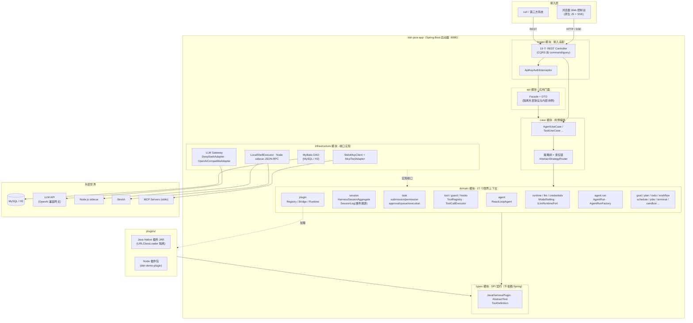
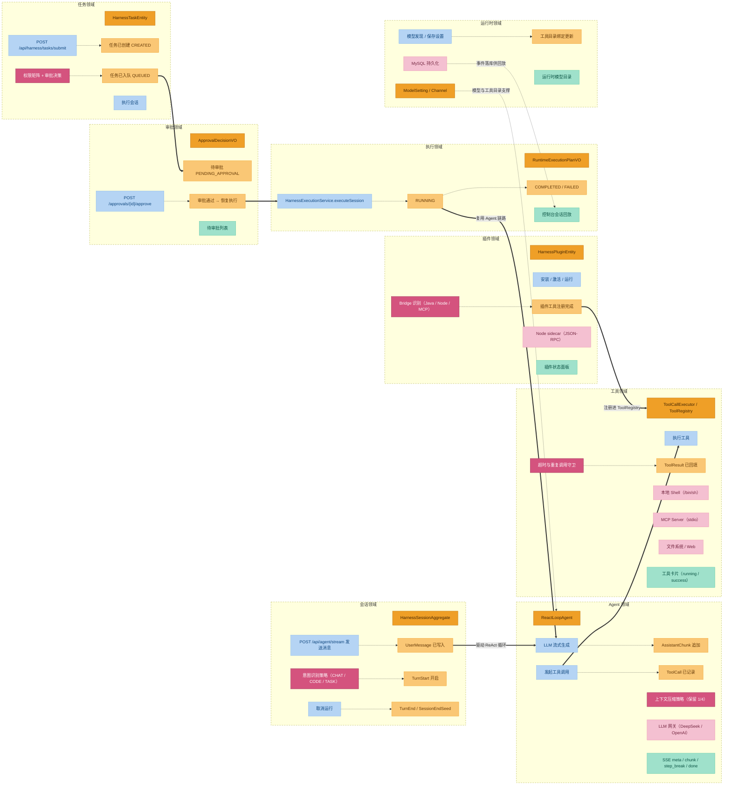
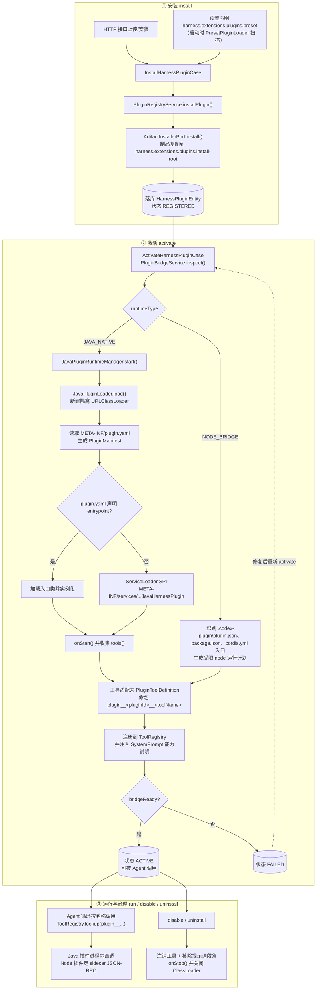

# DeepSeek Harness Java (dsh-java)


> **基于 小傅哥的Deepseek Harness Java 延伸扩展** —— Java 17 + Spring Boot 3 ，并叠加麟览业务形态进行调整。
- **小傅哥首页**：<https://github.com/fuzhengwei>


[](./LICENSE)
[](#技术栈)
[](#技术栈)

---


**中文**

DeepSeek Harness Java (dsh-java) 是一个模块化的智能体运行时框架，其中**模型适配器、工具注册表、会话事件日志和 ReAct 代理循环**，都通过统一的端口与插件机制组织，可以按需替换或扩展。项目基于 **Java 17、Spring Boot 3.5 与 DDD 六边形架构**构建：Domain 层定义端口与领域能力，Infrastructure 层提供默认适配器，Java SPI、Node Bridge 和 MCP 插件负责挂载外部能力；插件停止或卸载时，宿主会自动回收其工具、系统提示词和 Hook 等注册项。

该项目目前处于**开发者预览阶段**，接口与插件协议迭代较快，后续版本可能包含不兼容变更。

- **仓库**：<https://github.com/linlannet/dsh-java>
- **端口**：`8090`（启动即开箱）
- **License**：见仓库根目录

---

## 版本历史

[CHANGELOG](./CHANGELOG.md)


## 目录

- [1. 项目介绍](#1-项目介绍)
  - [1.1 这是什么](#11-这是什么)
  - [1.2 适用场景](#12-适用场景)
  - [1.3 特性一览](#13-特性一览)
- [2. 快速体验](#2-快速体验)
  - [2.1 环境要求](#21-环境要求)
  - [2.2 构建](#22-构建)
  - [2.3 启动方式一：Standalone（H2，零外部依赖）](#23-启动方式一standaloneh2零外部依赖)
  - [2.4 启动方式二：MySQL（默认 profile）](#24-启动方式二mysql默认-profile)
  - [2.5 启动方式三：Docker Compose](#25-启动方式三docker-compose)
  - [2.6 打开 Web 控制台](#26-打开-web-控制台)
  - [2.7 用 curl 发第一条消息](#27-用-curl-发第一条消息)
  - [2.8 安装 DSH Java Mall 插件](#28-安装-2d-weekend-mall-插件)
- [3. 整体架构设计](#3-整体架构设计)
  - [3.1 总体架构图](#31-总体架构图)
  - [3.2 依赖方向与核心约束](#32-依赖方向与核心约束)
  - [3.3 Maven 模块划分](#33-maven-模块划分)
  - [3.4 请求处理链路（对话主线）](#34-请求处理链路对话主线)
  - [3.5 任务与审批链路（任务主线）](#35-任务与审批链路任务主线)
- [4. 领域设计](#4-领域设计)
  - [4.1 事件风暴全景](#41-事件风暴全景)
  - [4.2 限界上下文](#42-限界上下文)
  - [4.3 核心聚合](#43-核心聚合)
  - [4.4 领域事件机制（Session Event Log）](#44-领域事件机制session-event-log)
  - [4.5 策略树：功能如何串联](#45-策略树功能如何串联)
  - [4.6 端口-适配器对照](#46-端口-适配器对照)
- [5. 核心机制深入](#5-核心机制深入)
  - [5.1 ReactLoopAgent：ReAct 循环](#51-reactloopagentreact-循环)
  - [5.2 意图识别](#52-意图识别)
  - [5.3 会话压缩](#53-会话压缩)
  - [5.4 SSE 流式协议](#54-sse-流式协议)
- [6. 工具系统](#6-工具系统)
- [7. 插件与扩展](#7-插件与扩展)
  - [7.1 Java Native Plugin](#71-java-native-plugin)
  - [7.2 Node Bridge Plugin](#72-node-bridge-plugin)
  - [7.3 MCP 工具适配](#73-mcp-工具适配)
  - [7.4 插件生命周期](#74-插件生命周期)
  - [7.5 二次开发指南](#75-二次开发指南)
  - [7.6 插件加载流程图](#76-插件加载流程图)
- [8. REST API 概览](#8-rest-api-概览)
- [9. Web 控制台](#9-web-控制台)
- [10. 关键配置](#10-关键配置)
- [11. 持久化模型](#11-持久化模型)
- [12. 安全与执行边界](#12-安全与执行边界)
- [13. 生产化注意事项](#13-生产化注意事项)
- [14. 当前边界与已知隐患](#14-当前边界与已知隐患)
- [15. 文档索引](#15-文档索引)

---

## 1. 项目介绍

### 1.1 这是什么

`dsh-java` 是一个**单实例可运行的 Agent Harness**。它提供一个完整的运行时环境，让 LLM 驱动的智能体可以：

- 通过 **ReAct 循环**（Reason → Act → Observe）自主调用工具完成任务；
- 操作**文件系统、Shell、Web 搜索/抓取**等真实环境；
- 通过 **Java SPI 插件 / Node sidecar 插件 / MCP Server** 扩展能力；
- 接受**权限评估与人工审批**的治理约束；
- 将全过程以**事件溯源**方式落库，支持回放与审计。

项目自带一个**原生 JS 实现的 Web 控制台**（无前端构建链），打开浏览器即可对话、管理工作区、审批任务、查看插件与模型。

### 1.2 适用场景

| 场景 | 项目提供的能力 |
| --- | --- |
| 本地智能体工作台 | 浏览器 UI、SSE 对话、Markdown 渲染、会话与工作区管理 |
| Java 原生 Agent 运行时 | Spring Boot 装配、ReAct Loop、工具注册与执行、会话事件 |
| 企业内部扩展平台 | Java SPI 插件、Node sidecar 插件、MCP 工具适配、插件生命周期 API |
| 任务自动化系统 | 任务提交、队列、审批、目标、计划、待办、工作流、后台作业 |
| 可替换基础设施 | Domain 定义端口，Infrastructure 提供数据库、LLM、执行环境适配 |

> **定位说明**：它当前是**单实例 Agent 运行时**，不是开箱即用的分布式多租户 SaaS。生产化部署前仍需根据企业要求补充鉴权策略、审计、集群协调、可观测性与完整集成测试（见 [13. 生产化注意事项](#13-生产化注意事项)）。

### 1.3 特性一览

- 🤖 **Agent 对话**：阻塞式 `POST /api/agent/message` 与 SSE 流式 `POST /api/agent/stream`，支持取消、状态查询、`agentId` 会话复用
- 🔁 **ReAct 循环**：`ReactLoopAgent` 驱动模型输出 → 工具调用 → 结果回填 → 续步，单 turn 上限 50 步
- 🧰 **工具系统**：`fs_*` 文件工具、`shell_execute`、`web_search/web_fetch`、`ask_user_question`，统一 `ToolCallExecutor` + PRE/POST Hook
- 🧩 **双模式插件**：Java Native（进程内 `URLClassLoader` 隔离）与 Node Bridge（sidecar 进程 JSON-RPC），另支持 MCP stdio 工具
- 🛡️ **审批链路**：提交期权限矩阵评估 + 审批决策，高风险工具（Shell、写文件、插件、子进程）默认需人工审批
- 💾 **持久化**：会话/任务/目标/审批/模型设置落库；默认 MySQL，standalone profile 用 H2 文件库
- 🖥️ **Web 控制台**：原生 JS（约 3300 行）+ marked + DOMPurify + highlight.js，本地化加载无外网依赖
- 🐳 **Docker Compose**：一条命令拉起完整环境

---

## 2. 快速体验

### 2.1 环境要求

| 软件 | 版本 | 必需性 |
| --- | --- | --- |
| JDK | 17+ | 必需 |
| Maven | 3.9+ | 构建必需 |
| Node.js | 18+ | 仅使用 Node Bridge Plugin 时必需 |
| MySQL | 5.7+ | 仅默认（MySQL）profile 需要 |
| Docker | 24+ | 可选，用于 Compose 启动 |

### 2.2 构建

```bash
git clone git@github.com:linlannet/dsh-java.git
cd dsh-java

# 完整构建（含测试）
mvn clean verify

# 快速打包（跳过测试）
mvn clean package -DskipTests
```

测试用例与后续功能补测流程见 [docs/md/test-cases.md](docs/md/test-cases.md)。

构建产物：

```text
dsh-java-app/target/dsh-java-app-1.0.0-SNAPSHOT.jar
```

如需分发一个非 Docker 的本地启动包（本地h2db方式），可执行：

```bash
scripts/package-local.sh --zip
```

如需分发一个非 Docker 的本地启动包（mysql数据库方式），可执行：

```bash
scripts/package-mysql.sh --zip
```

产物位于 `dist/dsh-java-local` 和 `dist/dsh-java-local-<version>.zip`。解压后运行：

```bash
cd dsh-java-local
./start.sh
```

该包默认启用 `standalone` Profile，使用 H2 文件库，只需要本机安装 JDK 17+；Windows 可运行 `start.bat`。

### 2.3 启动方式一：Standalone（H2，零外部依赖）

适合本机快速体验和演示，无需安装 MySQL——使用内嵌 H2 文件库：

```bash
export LLM_API_KEY='your-model-api-key'

java -jar dsh-java-app/target/dsh-java-app.jar \
  --spring.profiles.active=standalone
```

H2 数据文件默认写入 `./data/dsh-java.mv.db`。

如需覆盖默认模型服务：

```bash
java -jar dsh-java-app/target/dsh-java-app.jar \
  --spring.profiles.active=standalone \
  --harness.llm.deepseek.base-url='http://127.0.0.1:28080/v1' \
  --harness.llm.deepseek.api-key="$LLM_API_KEY" \
  --harness.llm.deepseek.default-model='Deepseek-V4.0-Pro'
```

### 2.4 启动方式二：MySQL（默认 profile）

#### 导入 MySQL 库表

推荐直接导入仓库内的 MySQL 8 dump，它包含 12 张 Harness 表：

```bash
mysql -u root -p < docs/dev-ops/mysql/sql/dsh_java.sql
```

脚本会创建并切换到 `dsh_java`。如果使用已有数据库实例，也可在启动时让 Spring SQL 初始化自动创建 `schema.sql`；导入完整 dump 适合需要拿到与开发环境一致的表结构，或手动管理库表的场景。

#### 配置并启动

默认 `application.yml` 面向外部 MySQL。通过环境变量覆盖连接信息，数据库名必须与导入的库名一致：

```bash
export SPRING_DATASOURCE_URL='jdbc:mysql://127.0.0.1:3306/dsh_java?useUnicode=true&characterEncoding=UTF-8&serverTimezone=Asia/Shanghai&useSSL=false&allowPublicKeyRetrieval=true'
export SPRING_DATASOURCE_USERNAME='root'
export SPRING_DATASOURCE_PASSWORD='your-db-password'
export LLM_API_KEY='your-model-api-key'

java -jar dsh-java-app/target/dsh-java-app-1.0.0-SNAPSHOT.jar
```

如果导入的是仓库 dump，应用启动时仍会执行 `dsh-java-app/src/main/resources/schema.sql`；其中的 `CREATE TABLE IF NOT EXISTS` 不会清空已有数据。

#### 启动后更新 API / LLM 配置

数据库导入完成后，需要把模型服务配置保存到 Harness，而不是只依赖启动参数。打开 Web 控制台的 **设置 → 模型**：

1. 从 **渠道模板** 下拉选择供应商（OpenAI / DeepSeek / 通义千问 / 智谱 GLM / 豆包 / Kimi / Anthropic Claude / Ollama / 自定义…），自动填充协议与默认地址；
2. 补全 API Key，点击 **⟳ 同步模型** 从上游拉取可用模型列表（按协议自动选择 `/models` 或 `/api/tags`，失败不会清空已保存配置）；
3. 选择模型并保存。

| 字段 | 说明 |
| --- | --- |
| 渠道编码 | 运行时选择模型渠道的主键，如 `default` / `qwen-max` / `local-ollama` |
| Provider | 渠道标识，任意编码均可（模板之外的 provider 会按其协议动态路由） |
| 协议 | `openai`（OpenAI 兼容，默认）/ `anthropic`（Messages 协议）/ `ollama`（原生） |
| 模型 | 模型编码，可用同步按钮从上游拉取后下拉选择 |
| Base URL | 渠道基础地址 |
| API Key | 渠道密钥（Ollama 本地可留空） |
| Enabled | 开启 |

`channelCode=default` 是 Agent 的全局默认模型渠道。保存后，数据库配置优先生效；只有未配置可用渠道时，才会回退到 `LLM_*` 环境变量和 `harness.yml` 文件兜底。`web` / `headless` 只用于工具与审批画像，不再需要各自重复配置模型。

也可以调用 API 保存：

```bash
curl -X POST http://localhost:8090/api/harness/settings/models \
  -H 'Content-Type: application/json' \
  -d '{
    "channelCode": "default",
    "providerCode": "deepseek",
    "modelCode": "Deepseek-V4.1-Flash",
    "baseUrl": "http://127.0.0.1:28080/v1",
    "apiKeyRef": "your-model-api-key",
    "protocol": "openai",
    "enabled": true
  }'
```

渠道相关 API：

| 接口 | 说明 |
| --- | --- |
| `GET /api/harness/channels/presets` | 查询内置渠道模板（协议、默认地址、推荐模型），只读不落库 |
| `GET /api/harness/settings/models` | 查询全部模型渠道及当前 active 渠道 |
| `POST /api/harness/settings/models` | 保存模型渠道配置（含 `protocol` 字段，缺省按 `openai`） |
| `POST /api/harness/settings/models/active` | 激活指定渠道，请求体：`{ "channelCode": "qwen" }` |
| `DELETE /api/harness/settings/models/{channelCode}` | 删除指定模型渠道 |
| `POST /api/harness/settings/models/discover` | 同步上游模型列表，请求体：`{ "baseUrl", "apiKeyRef", "protocol" }` |

### 2.5 启动方式三：Docker Compose

```bash
export LLM_API_KEY='your-model-api-key'
docker compose up --build -d
```

Compose 配置：暴露 `8090:8090`；默认 `standalone` Profile；挂载 `./data`、`./plugins`、`./.dsh`、`./workspaces`；通过 `LLM_API_KEY` / `OPENAI_API_KEY` 注入模型凭据。

### 2.6 打开 Web 控制台

启动后访问：

```text
http://localhost:8090/
```

控制台支持：新建/切换/重命名/删除工作区、创建和恢复 Agent 会话、流式对话与工具卡片渲染、取消运行、模型设置管理、插件启停、待审批任务处理、历史会话回放。

### 2.7 用 curl 发第一条消息

阻塞式对话：

```bash
curl -X POST http://localhost:8090/api/agent/message \
  -H 'Content-Type: application/json' \
  -d '{
    "agentId": "local-agent",
    "message": "Hello!",
    "channelCode": "default",
    "maxTokens": 8192,
    "cwd": "."
  }'
```

> `agentId` 和 `message` 必填；`channelCode`、`maxTokens`、`cwd` 省略后使用 `harness_model_setting` 中当前激活的模型渠道；文件配置只在数据库无可用渠道时用于首次初始化。

SSE 流式对话：

```bash
curl -N -X POST http://localhost:8090/api/agent/stream \
  -H 'Content-Type: application/json' \
  -d '{"agentId": "local-agent", "message": "介绍这个项目的架构"}'
```

如果配置了 `harness.auth.api-keys`，需额外携带 `-H 'X-API-Key: your-api-key'` 或 `-H 'Authorization: Bearer your-api-key'`。

### 2.8 安装 DSH Java Mall 插件

`2d-weekend-mall` 的商城服务可以独立运行；但商城页面里的 **AI 客服** 依赖先在 Harness 中导入 `dsh-java-mall-plugin` 插件。没有插件时，Harness 中不存在商城订单、商品和物流查询工具。

```bash
cd /Users/mac/DevOps/2d-weekend-mall
mvn clean package -DskipTests

# 先启动商城，端口 18080
mvn -pl mall-app spring-boot:run

# 再在另一个终端启动 Harness，端口 8090
cd /Users/mac/DevOps/dsh-java
java -jar dsh-java-app/target/dsh-java-app-1.0.0-SNAPSHOT.jar
```

打开 Harness 控制台的 **设置 → 插件**，选择：

```text
/Users/mac/DevOps/2d-weekend-mall/mall-agent-plugin/target/mall-agent-plugin-1.0.0-SNAPSHOT.jar
```

控制台会解析 `META-INF/plugin.yaml`，确认后安装并启动插件。

也可以用 API 安装、激活和运行：

```bash
curl -X POST http://localhost:8090/api/harness/plugins/install \
  -H 'Content-Type: application/json' \
  -d '{
    "pluginId": "dsh-java-mall-plugin",
    "displayName": "DSH Java Mall App",
    "pluginVersion": "1.0.0-SNAPSHOT",
    "runtimeType": "JAVA_NATIVE",
    "sourcePath": "/Users/mac/DevOps/2d-weekend-mall/mall-agent-plugin/target/mall-agent-plugin-1.0.0-SNAPSHOT.jar",
    "entrypoint": "mall-agent-plugin-1.0.0-SNAPSHOT.jar"
  }'

curl -X POST http://localhost:8090/api/harness/plugins/activate \
  -H 'Content-Type: application/json' \
  -d '{"pluginId":"dsh-java-mall-plugin"}'

curl -X POST http://localhost:8090/api/harness/plugins/run \
  -H 'Content-Type: application/json' \
  -d '{"pluginId":"dsh-java-mall-plugin"}'
```

插件启动成功后，Agent 可用工具包括 `plugin__dsh-java-mall-plugin__search_products`、`plugin__dsh-java-mall-plugin__get_product`、`plugin__dsh-java-mall-plugin__query_orders`、`plugin__dsh-java-mall-plugin__get_order` 和 `plugin__dsh-java-mall-plugin__query_logistics`。

最后在插件卡片点击 **配置**，保存两组键值：

| Key | Value |
| --- | --- |
| `mall.base-url` | `http://127.0.0.1:18080` |
| `mall.service-token` | 与商城 `MALL_SERVICE_TOKEN` / `mall.security.service-token` 一致 |

保存配置后，建议停用并重新启用插件，确保 `configure(context)` 读取到最新值。然后在商城页面右上角打开 AI 客服即可通过 Harness 完成对话和工具调用。

---

## 3. 整体架构设计

### 3.1 总体架构图

整体为**六边形架构（端口-适配器）+ DDD 分层**，共 10 个 Maven 模块，依赖严格单向：



> 完整架构图（draw.io 源文件）见 [`docs/architecture.drawio`](docs/md/architecture.drawio)，可用 draw.io / diagrams.net 打开编辑。

### 3.2 依赖方向与核心约束

```text
App → Trigger → API/Case → Domain ← Infrastructure
Domain → Types(SPI) ← Plugins
```

| 层 | 约束 |
| --- | --- |
| `Trigger` | 不写业务规则，只负责协议、认证、参数绑定和路由 |
| `API` | 暴露应用层 Facade 和 DTO，只依赖 Case，隔离外部协议与内部用例 |
| `Case` | 编排跨领域流程，不直接依赖具体数据库、HTTP Client 或进程实现 |
| `Domain` | 持有实体、值对象、领域服务、**端口（Port）**和仓库接口 |
| `Infrastructure` | 实现 Domain 端口，负责 MySQL/H2、LLM、Node、Shell、MCP 等外部适配 |
| `Types` | 插件与工具的轻量 SPI 契约包，**不依赖 Spring** |

Case 内部采用两种固定形态，避免“所有模块都套策略树”或“所有模块都直接调领域服务”：

1. **薄用例**：单步查询/命令直接放在 `*CaseImpl`，只做命令校验、DTO 映射和领域服务委托。
2. **流程用例**：跨多个领域服务或包含分支决策的流程，统一放在 `factory` + `node`：
   - `*Factory` 创建 `CasePipeline`；
   - `*Node` 执行一个步骤并通过 `getNext()` 显式路由；
   - `DynamicContext` 承载步骤间状态；
   - `orchestration` 只提供通用执行器，不写业务规则。

### 3.3 Maven 模块划分

| 模块 | 职责 |
| --- | --- |
| `dsh-java-app` | Spring Boot 启动器、静态 UI、Profile 配置、预置插件加载 |
| `dsh-java-trigger` | 19 个 REST Controller、API Key 拦截器、Web MVC 配置 |
| `dsh-java-api` | 应用层 Facade、Command/Query DTO、响应对象 |
| `dsh-java-case` | Agent、Session、Task、Plugin 等用例编排；复杂流程使用 `factory + node` |
| `dsh-java-domain` | 27 个限界上下文、实体、值对象、端口、领域服务与 AgentRun 运行域 |
| `dsh-java-infrastructure` | Repository、DAO、Gateway、协议和执行环境适配 |
| `dsh-java-types` | `JavaHarnessPlugin`、`AbstractTool`、`ToolDefinition` 等 SPI 契约 |
| `plugins/*` | 示例插件（Java JAR + Node demo）、插件 Archetype |
| `docs/` | 架构图、领域设计详解、插件开发指南 |

### 3.4 请求处理链路（对话主线）

以 `POST /api/agent/stream` 为例，一条消息穿过系统的完整路径：

```text
浏览器 UI → AgentController → AgentUseCase
  → AgentResolveNode   按 agentId 复用/创建 Agent，解析模型、Token、工作目录
  → AgentIntentNode    正则规则分类 CHAT / CODE_QUESTION / TASK_EXECUTION / CLARIFICATION
  → AgentDispatchNode  构造用户消息，agent.send(userMessage, NEXT_TURN, true)
  → AgentCollectNode   等待空闲，投影 User/Assistant/ToolCall/ToolResult 消息，按 callId 合并
  → ReactLoopAgent     LLM 流式 → append AssistantChunk → ToolCallExecutor → append ToolCall/ToolResult
  → SSE 推送 meta / chunk / step_break / done
```

### 3.5 任务与审批链路（任务主线）

```text
POST /api/harness/tasks/submit
  → SubmissionRootNode → ProfileResolutionNode → PermissionCheckNode → ToolResolutionNode → EnqueueNode
      │                                        │
      │                                        ├─ PermissionPolicyService.assess(tools)   权限矩阵评估
      │                                        └─ ApprovalPolicyService.decide(profile, assessment)
      │
      ├─ 免审批 → executeSession（RUNNING）
      └─ 需审批 → PENDING_APPROVAL
                    │
POST /api/harness/approvals/{sessionId}/approve
                    └─→ 状态 QUEUED 落库 → HarnessExecutionService.executeSession → RUNNING → COMPLETED/FAILED
```

任务状态机：`CREATED → PENDING_APPROVAL → QUEUED → RUNNING → COMPLETED/FAILED`。执行入口对 `PENDING_APPROVAL` 状态直接抛异常兜底，防止绕过审批。

---

## 4. 领域设计

`domain` 模块共 27 个一级子包，遵循事件风暴（Event Storming）建模，六色图例贯穿下文。

### 4.1 事件风暴全景



两条业务主线：**对话主线**（会话 → Agent ReAct 循环 → 工具执行 → 插件扩展）与**任务主线**（任务提交 → 权限/审批 → 排队 → 执行，执行阶段复用 Agent 链路）；运行时领域横向提供模型渠道、执行画像与工具目录支撑，过程事件落库供控制台回放。

### 4.2 限界上下文

| 能力面 | Bounded Contexts | 核心对象 |
| --- | --- | --- |
| Agent 执行核心 | `agent`, `llm`, `session` | `ReactLoopAgent`、`Phase`（Idle/Running/Maintenance）、`ILlmRuntimePort`、`HarnessSessionAggregate`、`SessionLog` |
| 任务与目标 | `task`, `goal`, `plan`, `todo`, `workflow`, `schedule`, `jobs` | `HarnessTaskEntity`、`GoalAggregate`、`WorkflowRun` |
| 工具与插件 | `tool`, `plugin`, `typert`, `sdk` | `ToolRegistry`、`ToolCallExecutor`、`RuntimeApprovalGate` |
| 运行时与环境 | `runtime`, `credentials`, `coderuntime`, `terminal`, `lsp`, `sandbox`, `e2b`, `acp` | `ModelSetting`、`Profile`、各类端口 |
| 治理与存储 | `guard`, `hooks`, `storage` | 超时策略、Hook 引擎、KV 存储 |
| 共享与技能 | `shared`, `skill` | `HarnessStatusEnumVO` 等跨域枚举 |

`task` 域按职责拆为五个子域：

| 子域 | 职责 | 关键对象 |
| --- | --- | --- |
| `submission` | 提交参数校验与过滤 | `TaskSubmissionVO` |
| `permission` | 权限矩阵评估 | `PermissionAssessmentVO`、`IPermissionMatrixPort` |
| `approval` | 审批决策与命令 | `ApprovalDecisionVO`、`ApprovalPolicyService`、`ApprovalCommandService` |
| `queue` | 任务队列持久化 | `IHarnessTaskQueueRepository` |
| `execution` | 会话执行 | `HarnessExecutionService`、`IModelExecutionPort` |

`plugin` 域拆为三条边界：**Registry**（`PluginRegistryService`，安装/元数据/启停）、**Bridge**（`PluginBridgeService`，识别 `JAVA_NATIVE`/`DSH_NODE_BRIDGE`/`CODEX`/`CORDIS` 并生成绑定计划）、**Runtime**（`PluginRuntimeService`，启动/停止/查询实例）。

> 想按"模块名"反查"哪个包里有什么、关键类与端口在哪"——见 [`docs/md/domain-modules-reference.md`](docs/md/domain-modules-reference.md)（**领域模块速查**：逐个讲解 37 个能力点的用途、子包分层、关键类、端口）。本节是"为什么这样分 + 怎么流"的叙事视角，模块速查是"每个包里有什么"的字典视角。

### 4.3 核心聚合

- **Agent**：聚合根服务 `ReactLoopAgent`，持有 `SessionLog`、`Inbox`、`ILlmRuntimePort`、`ToolRegistry`、`ToolCallExecutor`、`SystemPromptAssembler`。单 turn 上限 50 步，max_tokens 受控续写最多 4 次，工具调用后经 `midTurnContinuation` 标志跳过 inbox 检查直接续步；取消用 `AtomicBoolean` + 100ms 轮询。
- **会话**：聚合根 `HarnessSessionAggregate`；`SessionLog` 为内存追加式 WAL，`SurfaceProjector` 将事件投影为 `SurfaceOp`（Append/Replace）；`BasicCompactionEngine` 保留最近 1/4 事件，其余由 LLM 总结。
- **任务**：`HarnessTaskEntity`，状态机 `CREATED → PENDING_APPROVAL → QUEUED → RUNNING → COMPLETED/FAILED`。
- **目标**：`GoalAggregate`（`GoalAction`、`GoalSnapshotVO`、`GoalStatus`），`IGoalRepository` 持久化。

### 4.4 领域事件机制（Session Event Log）

无通用 `DomainEvent` 基类，**事件机制即会话事件日志的事件溯源**。`SessionEvent` 为 sealed 接口：

| 类别 | 事件 |
| --- | --- |
| 轮/步边界 | `TurnStart`、`TurnEnd(reason)`、`StepStart`、`StepEnd` |
| 消息 | `UserMessage`、`AssistantChunk`、`AssistantMessage` |
| 工具 | `ToolCall(callId, name, arguments)`、`ToolResult(callId, ...)` |
| 其他 | `TodoWrite`、`RequestHeader`、`RequestContext`、`SessionEndSeed`、`PlanModeChange`、`AgentInboxSpliced` |

流式对话的 SSE 事件与领域事件对应：`meta`（起始帧）、`chunk`（AssistantChunk 文本增量）、`step_break`（工具调用边界，前端据此插入工具卡片并重置消息气泡）、`done`（终态 + 全量 messages 含 tool 角色，供前端重建工具卡片状态）、`error`。

### 4.5 策略树：功能如何串联

跨领域编排在 `case` 模块完成，统一用 `AbstractStrategyRouter` 责任链（`doApply` 处理当前节点，`getNext` 返回后继）。

- **Agent 消息链**：`AgentResolveNode → AgentIntentNode → AgentDispatchNode → AgentCollectNode`（见 [3.4](#34-请求处理链路对话主线)）。
- **任务提交链**：`SubmissionRootNode → ProfileResolutionNode → PermissionCheckNode → ToolResolutionNode → EnqueueNode`（见 [3.5](#35-任务与审批链路任务主线)）。
- **审批恢复**：`approve(sessionId)` → 状态 QUEUED 落库 → `HarnessExecutionService.executeSession` → RUNNING → COMPLETED/FAILED。
- **插件生命周期**：`install`（落 `HarnessPluginEntity`）→ `activate`（Bridge 识别 + recordBinding）→ `run`（`PluginRuntimeService.start`）。插件工具以 `plugin__<pluginId>__<toolName>` 注册进 `ToolRegistry`，之后与内置工具走同一套 Hook/守卫/事件回填链路。
- **工作流**：`IWorkflowService.start` → `IWorkflowEnginePort`（`LocalWorkflowEnginePort`）→ `WorkflowRun`（CompletableFuture），流式复用 `ReactLoopAgent` 的 deltaSink/toolCallSink 推 SSE。

### 4.6 端口-适配器对照

Domain 定义端口，Infrastructure 实现。关键端口：

| Domain 端口 | Infrastructure 实现 |
| --- | --- |
| `ILlmRuntimePort` | `InMemoryLlmRuntimePort`（流式生成，重试在此层） |
| `IModelExecutionPort` | `ModelExecutionPort` |
| `IModelProviderPort` | `ModelProviderPort` |
| `IRuntimeApprovalBroker` | `RuntimeApprovalBroker`（Domain AgentRun） |
| `IPermissionMatrixPort` / `IApprovalPolicyPort` | `PermissionMatrixPort` / `ApprovalPolicyPort` |
| `IToolCatalogPort` | `ToolCatalogPort` |
| `IPluginArtifactInstallerPort` / `IPluginRuntimeBridgePort` / `IPluginProcessPort` | `PluginArtifactInstallerPort` / `PluginRuntimeBridgePort` / `PluginProcessPort` |
| `IHarnessSessionRepository` / `ISessionEventStore` / `IHarnessTaskQueueRepository` / `IGoalRepository` | MyBatis Repository 对应实现 |
| `IWorkflowEnginePort` | `LocalWorkflowEnginePort` |
| `AgentRunFactoryPort` | `AgentRunFactory`（Domain AgentRun：装配 `AgentRun` + `ToolCallExecutor`） |

> 更完整的领域说明（事件清单、全部端口、子域细节）见 [`docs/domain-design.md`](docs/md/domain-design.md)；**逐模块速查（含 37 个模块的用途/子包/关键类/端口/关系）**见 [`docs/domain-modules-reference.md`](docs/md/domain-modules-reference.md)。

---

## 5. 核心机制深入

### 5.1 ReactLoopAgent：ReAct 循环

- **turn 循环**：每个 turn 最多 50 步；每步 = 一次 LLM 流式生成 + 可选的工具调用。
- **max_tokens 续写**：输出被截断时受控续写最多 4 次。
- **工具续步**：工具执行后经 `midTurnContinuation` 标志跳过 inbox 空检查直接续步，保证工具结果一定回到模型上下文。
- **Phase 状态机**：`Idle / Running / Maintenance`；取消用 `AtomicBoolean` + 100ms 轮询，协作式中断。
- **超时**：LLM HTTP 总超时 120s；工具超时用 `orTimeout` 协作式取消。

### 5.2 意图识别

`AgentIntentNode.classify()` 用**纯正则规则**分类（无额外模型调用）：

| 意图 | 说明 | 处理方式 |
| --- | --- | --- |
| `CHAT` | 闲聊 | 可经 `[no-tools]` 前缀跳过工具，直接对话 |
| `CODE_QUESTION` | 代码问答 | 进入工具路径 |
| `TASK_EXECUTION` | 任务执行 | 注入"先调工具"指令后进入工具路径 |
| `CLARIFICATION` | 澄清 | 可跳过工具 |

### 5.3 会话压缩

`SessionLog` 是内存追加式 WAL；`SurfaceProjector` 把事件投影为 `SurfaceOp`（Append/Replace）供 UI 渲染。上下文过长时 `BasicCompactionEngine` 启动压缩：**保留最近 1/4 事件原文，其余由 LLM 总结**为摘要事件，控制 token 占用（context-window 默认 128000）。

### 5.4 SSE 流式协议

`POST /api/agent/stream` 的事件序列：

| 事件 | 含义 |
| --- | --- |
| `meta` | 起始帧（会话、模型、时间信息） |
| `chunk` | 文本增量（对应 `AssistantChunk`） |
| `step_break` | 工具调用边界：携带 `toolName/callId/args/status`，前端据此完成当前气泡、插入工具卡片、开新气泡 |
| `done` | 终态 + 全量 messages（含 `tool` 角色），前端重建工具卡片最终状态 |
| `error` | 错误帧 |

> 设计要点：`step_break` 是**独立事件**而非混在 chunk 文本里的字符串标记，避免多步工具调用时文本拼接到同一气泡产生乱码。

---

## 6. 工具系统

内置工具覆盖常见 Agent 操作面：

| 类别 | 工具 / 机制 | 说明 |
| --- | --- | --- |
| 文件系统 | `fs_read`, `fs_search`, `fs_write`, `str_replace_editor` | 读取、搜索、写入和精确替换文件内容 |
| 进程执行 | `shell_execute` | 通过本地 Shell 执行命令，受审批与沙箱策略约束 |
| 网络 | `web_search`, `web_fetch` | 搜索与抓取网页内容 |
| 插件 | `plugin__<pluginId>__<toolName>` | Java Native 或 Node Bridge 插件工具 |
| MCP | `mcp__<serverName>__<toolName>` | MCP Server 工具适配 |
| 交互 | `ask_user_question` | 向用户发起澄清问题 |

工具调用经过统一 `ToolCallExecutor`：**参数解析 → PRE_TOOL_USE Hook → 执行 → POST Hook → 结果回填会话事件**。默认配置中 `shell_execute`、`fs_write`、`plugin.run`、`subprocess.spawn` 被列为需要审批的高风险能力；`web` profile 整体需要审批。

---

## 7. 插件与扩展

### 7.1 Java Native Plugin

Java Native Plugin 以 JAR 方式安装，宿主使用**隔离 `URLClassLoader`** 加载（进程内、类隔离）：

1. 实现 `JavaHarnessPlugin` 或继承 `AbstractHarnessPlugin`。
2. 实现 `AbstractTool`，声明 `name()`、`description()`、`parameters()`、`run()`。
3. 在 `META-INF/plugin.yaml` 中声明插件元数据。
4. 在 `META-INF/services/net.linlan.dsh.domain.spi.JavaHarnessPlugin` 中注册入口类。
5. 打包为 JAR 并放入 `harness.extensions.plugins.install-root` 指向的目录（默认 `./plugins`）。

插件工具注册后的名称格式：`plugin__<pluginId>__<toolName>`。

### 7.2 Node Bridge Plugin

`DSH_NODE_BRIDGE` 用于兼容 Node 侧插件：

- 插件包复制到 `harness.extensions.plugins.install-root`；
- 识别 `.codex-plugin/plugin.json`、`package.json`、`cordis.yml` 入口；
- 对可执行的 Node 插件生成受限 `node <entrypoint>` 运行计划，通过 **sidecar 进程 + JSON-RPC** 通信，不经 Shell 拼接；
- 入口限制在插件安装目录内的 `.js`、`.mjs`、`.cjs` 文件。

### 7.3 MCP 工具适配

- `StdioMcpClient`：通过 stdin/stdout 与 MCP Server 做 JSON-RPC 2.0 通信；
- `HttpMcpClient`：支持 `sse` 与 `streamable-http` 传输，请求头可在 `headers` 中配置；
- `McpToolAdapter` 把远端工具注册为 `mcp__<serverName>__<toolName>`，与内置工具同链执行；
- 在 `harness.extensions.mcp.servers` 中配置 `transport`，stdio 使用 `name/command/args/env/cwd`，HTTP 使用 `name/transport/url/headers`，启动时自动连接。

### 7.4 插件生命周期

```text
install → activate → run → disable → uninstall
```

预置插件可在 `harness.extensions.plugins.preset` 中声明（支持 `auto-start` / 旧字段 `auto-enable`），启动时自动装载。完整 Archetype 命令、代码模板和 HTTP 安装示例见 [`docs/md/java-plugin-development.md`](docs/md/java-plugin-development.md)。
完整 Java 插件示例见 [`plugins/sample-tools-plugin`](plugins/sample-tools-plugin)；完整 Node Bridge 示例见 [`plugins/dsh-demo-plugin`](plugins/dsh-demo-plugin)。

### 7.5 二次开发指南

#### 7.5.1 先选扩展方式

| 你要扩展什么 | 推荐方式 | 适合场景 |
| --- | --- | --- |
| 新增 Agent 可调用的工具 | **Java Native Plugin** | 类型安全、进程内直调，适合 Java 生态和企业内网能力 |
| 复用已有 Node.js 能力 | **Node Bridge Plugin** | 通过 sidecar + JSON-RPC 调用，适合 Node 生态和进程隔离 |
| 接入第三方工具服务 | **MCP Server** | 只需配置 `harness.extensions.mcp.servers`，无需写 Harness 插件代码 |
| 修改 Agent 策略 / 领域逻辑 | 直接修改 `case` / `domain` 模块 | 只适合 fork 后深度定制，不建议插件作者这样扩展 |

#### 7.5.2 Java 插件：最小实现

推荐继承 `AbstractHarnessPlugin`，并把每个能力实现成 `AbstractTool`。插件只依赖 `dsh-java-types`，不要直接依赖 Spring Boot 宿主。

```xml
<dependency>
  <groupId>net.linlan.dsh</groupId>
  <artifactId>dsh-java-types</artifactId>
  <version>1.0.0-SNAPSHOT</version>
  <scope>provided</scope>
</dependency>
```

```java
package com.acme.weather;

import net.linlan.dsh.domain.model.entity.AbstractTool;
import net.linlan.dsh.domain.model.entity.ToolDefinition;
import net.linlan.dsh.domain.model.entity.ToolExecutionResult;
import net.linlan.dsh.domain.model.entity.ToolRunContext;
import net.linlan.dsh.domain.spi.AbstractHarnessPlugin;
import net.linlan.dsh.domain.spi.PluginContext;

import java.util.List;
import java.util.Map;
import java.util.concurrent.CompletableFuture;

public class WeatherPlugin extends AbstractHarnessPlugin {
    public WeatherPlugin() {
        super("acme-weather");
    }

    @Override
    public List<ToolDefinition> tools() {
        return List.of(new CurrentWeatherTool());
    }

    @Override
    public void configure(PluginContext context) {
        super.configure(context); // 不要省略；tools() 的注册依赖这里
        context.registerSystemPrompt("about", 100,
                "## Acme Weather\n- current_weather 可查询城市当前天气。");
    }

    static class CurrentWeatherTool extends AbstractTool {
        @Override public String name() { return "current_weather"; }
        @Override public String description() { return "查询指定城市的当前天气。"; }

        @Override
        public Map<String, Object> parameters() {
            return objectSchema()
                    .prop("city", stringSchema("城市名称，例如 Hangzhou"))
                    .required("city")
                    .build();
        }

        @Override
        protected CompletableFuture<ToolExecutionResult> run(
                Map<String, Object> args, ToolRunContext ctx) {
            String city = str(args, "city");
            if (city.isBlank()) {
                return fail("city 不能为空", "MISSING_CITY");
            }
            return ok("{\"city\":\"" + city + "\",\"weather\":\"sunny\"}");
        }
    }
}
```

JAR 内必须包含：

```text
META-INF/plugin.yaml
META-INF/services/net.linlan.dsh.domain.spi.JavaHarnessPlugin
```

`plugin.yaml` 的 `entrypoint` 填插件类全限定名：

```yaml
id: acme-weather
name: Acme Weather
version: 1.0.0
author: Acme
description: Weather query plugin.
entrypoint: com.acme.weather.WeatherPlugin
```

SPI 文件内容只需要一行：

```text
com.acme.weather.WeatherPlugin
```

#### 7.5.3 安装并验证 Java 插件

```bash
mvn package

curl -X POST http://localhost:8090/api/harness/plugins/install \
  -H 'Content-Type: application/json' \
  -d '{
    "pluginId": "acme-weather",
    "displayName": "Acme Weather",
    "pluginVersion": "1.0.0",
    "runtimeType": "JAVA_NATIVE",
    "sourcePath": "/absolute/path/to/acme-weather-1.0.0.jar",
    "entrypoint": "acme-weather-1.0.0.jar"
  }'

curl -X POST http://localhost:8090/api/harness/plugins/activate \
  -H 'Content-Type: application/json' \
  -d '{"pluginId":"acme-weather"}'

curl -X POST http://localhost:8090/api/harness/plugins/run \
  -H 'Content-Type: application/json' \
  -d '{"pluginId":"acme-weather"}'
```

加载成功后，Agent 看到的工具名是：

```text
plugin__acme-weather__current_weather
```

`sourcePath` 按 Spring Boot 进程的工作目录解析。为避免 Maven/IDE 工作目录差异，HTTP 安装时优先使用绝对路径；`harness.extensions.plugins.install-root` 指向宿主管理的插件目录，Java JAR 和 Node 插件目录都会复制到这里。

也可以在 `harness.yml` 预装：

```yaml
harness:
  extensions:
    plugins:
      install-root: ./plugins
      preset:
        - plugin-id: acme-weather
          display-name: Acme Weather
          plugin-version: 1.0.0
          runtime-type: JAVA_NATIVE
          source-path: /absolute/path/to/acme-weather-1.0.0.jar
          entrypoint: acme-weather-1.0.0.jar
          auto-start: true
```

#### 7.5.4 使用插件上下文扩展治理能力

`configure(PluginContext context)` 不只用来注册工具，还可以扩展 Agent 的运行时观测面：

| 能力 | 方法 | 典型用途 |
| --- | --- | --- |
| 工具 | `registerTool(tool)` | 默认 `tools()` 已会自动注册；适合动态工具集 |
| 系统提示词 | `registerSystemPrompt(name, order, text)` | 告诉模型插件能力、调用时机和约束 |
| 事件订阅 | `subscribe(eventName, handler)` | 观察 `tool.called`、`plugin.started` 等插件事件 |
| 事件发布 | `emit(eventName, payload)` | 把插件内部状态广播给其他插件 |
| Hook | `registerHook("PRE_TOOL_USE", hook)` | 审计、限流、注入上下文；返回 BLOCK/DENY 可阻止动作 |
| 资源释放 | `registerDisposer(autoCloseable)` | 关闭连接池、线程池、文件监听器等资源 |
| 配置读取 | `getConfig(key, defaultValue)` | 读取宿主注入的插件配置；默认实现为内存态 |

插件停止、卸载或热重载时，宿主会逆序回收这些注册项；插件作者不应自己长期持有对 ToolRegistry、HookRegistry 等宿主组件的引用。

#### 7.5.5 Node Bridge 插件

Node 插件是独立 sidecar 进程。宿主通过 stdin/stdout 发送换行分隔的 JSON-RPC 2.0 消息，插件至少实现：

| 方法 | 说明 |
| --- | --- |
| `initialize` | 返回 `serverInfo`，完成握手 |
| `notifications/initialized` | 宿主发出的初始化通知，插件可忽略 |
| `tools/list` | 返回 `{ "tools": [ { "name", "description", "inputSchema" } ] }` |
| `tools/call` | 执行工具，返回 `{ "content": [ { "type": "text", "text": "..." } ] }` |

Node Bridge 当前主要扩展 Agent 可调用的工具；`PluginContext` 提供的 Hook、事件订阅和系统提示词注册能力目前主要面向 Java Native Plugin。如果需要深度治理 Agent 执行链路，优先选择 Java 插件。

最小 `package.json`：

```json
{
  "name": "acme-node-plugin",
  "version": "1.0.0",
  "main": "index.js"
}
```

完整可运行的 JSON-RPC 模板见 [`plugins/dsh-demo-plugin/index.js`](plugins/dsh-demo-plugin/index.js)。安装 Node 插件时，`sourcePath` 指向插件目录，`entrypoint` 指向目录内的 `.js/.mjs/.cjs` 文件：

```json
{
  "pluginId": "acme-node-plugin",
  "displayName": "Acme Node Plugin",
  "pluginVersion": "1.0.0",
  "runtimeType": "DSH_NODE_BRIDGE",
  "sourcePath": "/absolute/path/to/acme-node-plugin",
  "entrypoint": "index.js"
}
```

#### 7.5.6 调试与发布检查清单

- `pluginId`、`plugin.yaml.id`、SPI 实现类返回的 `pluginId()` 三者必须一致。
- `plugin.yaml.entrypoint` 是 Java 类全限定名；HTTP 安装请求里的 `entrypoint` 是宿主定位制品的文件路径。
- Java 插件依赖 `dsh-java-types` 使用 `provided`，业务依赖打进插件 JAR，不要重复打包宿主已有框架。
- 插件 ID 使用小写短横线命名，避免和数据库主键的大小写敏感策略产生歧义。
- `configure()` 只做注册和轻量初始化，不要执行长阻塞任务；耗时资源建议懒加载并交给线程池。
- 替换安装目录中的 JAR 可触发热重载；插件会先注销旧工具/Hook，再加载新 JAR。
- 高风险操作应设计成显式工具，并依赖宿主的沙箱、审批、Hook 和审计链路；不要在插件构造函数中隐式执行危险动作。
- 插件抛出的业务失败应返回 `fail(message, code)`，让模型看到结构化错误，而不是直接抛异常终止 Agent。

#### 7.5.7 参考样例

| 样例 | 说明 |
| --- | --- |
| [`plugins/sample-tools-plugin`](plugins/sample-tools-plugin) | Java 插件：天气查询 + 文件摘要，并演示 `PluginContext` 注册提示词、事件和 Hook |
| [`plugins/dsh-demo-plugin`](plugins/dsh-demo-plugin) | Node Bridge 插件：最小 JSON-RPC sidecar，演示 `initialize`、`tools/list`、`tools/call` |

智能客服场景的插件接入、示例工具、安装验证和生产化边界见 [`docs/md/smart-customer-service-plugin.md`](docs/md/smart-customer-service-plugin.md)。

### 7.6 插件加载流程图



---

## 8. REST API 概览

以下是最常用的 API 分组；路径均为 Spring Boot 实际暴露路径。

| 分组 | 端点示例 | 说明 |
| --- | --- | --- |
| Agent | `POST /api/agent/message`, `POST /api/agent/stream` | 普通对话与 SSE 流式对话 |
| Agent 控制 | `GET /api/agent/{agentId}/status`, `POST /api/agent/{agentId}/cancel` | 查询状态和取消运行 |
| 工作区 | `GET /api/agent/workspaces`, `POST /api/agent/workspaces` | 查询、创建、重命名、排序、删除工作区 |
| 任务 | `POST /api/harness/tasks/submit` | 提交 Harness Task |
| 目标 | `GET /api/harness/goals/{sessionId}`, `POST /api/harness/goals/{sessionId}` | 查询与维护目标状态 |
| 审批 | `GET /api/harness/approvals/pending`, `POST /api/harness/approvals/{sessionId}/approve` | 查询待审批项并审批 |
| 模型设置 | `GET/POST /api/harness/settings/models`, `POST /api/harness/settings/models/active`, `DELETE /api/harness/settings/models/{channelCode}` | 查询、保存、切换、删除模型渠道 |
| 模型发现 | `POST /api/harness/settings/models/discover`, `GET /api/harness/runtime/models` | 发现模型和查询运行时目录 |
| 插件 | `GET /api/harness/plugins`, `POST /api/harness/plugins/install` | 插件列表、安装、激活、运行、启停、卸载 |
| 终端 | `POST /api/harness/terminal/sessions`, `GET /api/harness/terminal/sessions/{id}/read` | 打开、发送、读取、关闭终端 |
| 工作流 | `POST /api/workflow/start`, `POST /api/workflow/stream` | 启动工作流、取消和 SSE 输出 |
| 控制台 | `GET /api/harness/console/sessions`, `GET /api/harness/console/sessions/{id}/messages` | 会话与消息回放 |

---

## 9. Web 控制台

启动后访问 `http://localhost:8090/`。内置静态前端位于 `dsh-java-app/src/main/resources/static`，原生 JavaScript 实现（约 3300 行，无构建框架），本地化加载以下渲染库：

- `marked.min.js`：Markdown 解析；
- `purify.min.js`：HTML 安全过滤；
- `highlight-core.min.js` / `highlight-common.min.js`：代码高亮。

控制台覆盖的主要操作：

- 新建、切换、重命名、删除工作区；
- 创建和恢复 Agent 会话；
- 发送普通消息或流式消息（工具调用渲染为独立工具卡片）；
- 取消正在运行的 Agent；
- 查询、保存、删除和发现模型；
- 查看和启停插件；
- 查看待审批任务并执行审批；
- 查看历史会话与消息。

---

## 10. 关键配置

运行时能力统一在 `dsh-java-app/src/main/resources/harness.yml` 中配置。部署时可以在进程工作目录放置同名文件，Spring Boot 会用它覆盖包内默认值；模型、审批、沙箱、skills、MCP 和插件使用同一个入口。旧的 `harness-extensions.yml` 仍以 optional 方式兼容加载，但新部署建议只使用 `harness.yml`。

仓库内置了一个 Baidu AI Search 示例 skill：`skills/baidu-ai-search/SKILL.md`。它会被 `harness.extensions.skills.roots` 中的 `./skills` 根目录发现，并指导 Agent 使用 `mcp__baidu-ai-search__<tool-name>` 工具。

| 配置项 | 作用 | 说明 |
| --- | --- | --- |
| `server.port` | HTTP 端口 | 默认 `8090` |
| `spring.datasource.*` | JDBC 数据源 | 默认 MySQL；standalone profile 用 H2 |
| `harness.llm.deepseek.base-url` | 模型 API 地址兜底 | 支持 OpenAI 兼容 Chat Completions；数据库无对应设置时生效 |
| `harness.llm.deepseek.api-key` | 模型 API Key 兜底 | **务必用环境变量注入**（`${LLM_API_KEY}`），不要硬编码提交 |
| `harness.llm.deepseek.default-model` | 默认模型种子 | 例如 `Deepseek-V4.0-Pro`；数据库已有默认设置时不覆盖 |
| `harness.llm.deepseek.context-window` | 上下文窗口 | 默认 `128000` |
| `harness.auth.api-keys` | 宿主 API Key 列表 | 多个 Key 用英文逗号分隔；**为空则本地放行** |
| `harness.approval.required-tools` | 需要审批的工具 | 默认含 `shell_execute`、`fs_write`、`plugin.run`、`subprocess.spawn` |
| `harness.approval.required-profiles` | 需要审批的 Profile | 默认含 `web` |
| `harness.approval.runtime-timeout-ms` | 运行期审批等待超时 | 默认 `600000`（10 分钟） |
| `harness.sandbox.default-mode` | 沙箱模式 | `READ_ONLY / WORKSPACE_WRITE / DANGER_FULL_ACCESS` |
| `harness.extensions.skills.roots` | 额外技能目录 | 支持 `<name>/SKILL.md` 和 `<name>.md` |
| `harness.extensions.skills.home` | 用户技能根目录 | 留空时回退到 `harness.credentials.home` |
| `harness.extensions.mcp.servers` | MCP Server 列表 | 支持 `stdio`、`sse`、`streamable-http` |
| `harness.extensions.plugins.install-root` | 插件安装根目录 | 默认 `./plugins` |
| `harness.extensions.plugins.preset` | 启动预装插件 | 支持设置 `auto-enable` |
| `harness.agent.temperature` | LLM 采样温度 | 系统属性/环境变量；为空则不发送该参数（适配只接受 temperature=1 的网关） |
| `GET /api/harness/config/effective` | 查看有效配置 | 返回 Spring 环境合并后的配置；API Key、Password、Secret、Token 会被脱敏 |

---

## 11. 持久化模型

`schema.sql` 当前初始化的主要表（共 12 张）包括：

| 表 | 用途 |
| --- | --- |
| `harness_session` | Session 聚合基础状态 |
| `harness_session_header` | 会话请求头与上下文折叠状态 |
| `harness_session_event` / `harness_session_event_log` | 会话与 Agent 过程事件 |
| `harness_task` | 任务提交与执行状态 |
| `harness_goal_state` | 目标状态 |
| `harness_plugin_installation` | 插件安装元数据 |
| `harness_plugin_runtime_binding` | 插件运行绑定信息 |
| `harness_model_setting` | 模型渠道与 Provider 配置 |
| `harness_tool_catalog` / `harness_tool_profile_binding` | 工具目录与 Profile 绑定 |

MySQL 承载结构化状态和事件（默认 profile）；standalone profile 使用 H2 文件库（`MODE=MySQL` 兼容模式），两者共用同一套 schema，`sql.init.mode=always` 幂等重跑。

---

## 12. 安全与执行边界

- `ApiKeyAuthInterceptor` 支持 `X-API-Key` 与 `Authorization: Bearer ...`；**`harness.auth.api-keys` 为空时 API 默认放行**（本地开发模式），静态资源与 `/actuator` 始终放行。
- `guard` 提供工具超时策略和重复调用提醒。
- `hooks` 支持生命周期钩子，阻止类 Hook 输出优先。
- `sandbox` 提供三档模式（`READ_ONLY / WORKSPACE_WRITE / DANGER_FULL_ACCESS`），本地开发默认 `WORKSPACE_WRITE`——写操作限制在工作区内、shell cwd 不得越界；`e2b` 提供可替换的远程沙箱端口。

---

## 13. 生产化注意事项

生产部署前建议完成以下检查：

1. **认证**：配置 `harness.auth.api-keys`，不要将本机服务直接暴露到公网。
2. **密钥管理**：通过环境变量、启动参数或外部密钥管理系统注入模型 API Key（切勿硬编码进 yml 提交仓库）。
3. **审批策略**：确认 Shell、文件写入、插件执行和子进程等高风险工具是否必须审批。
4. **沙箱边界**：限制 `cwd`、`workspaces`、`plugins`、`data` 的目录权限；优先使用独立容器或远程沙箱。
5. **数据库**：使用外部 MySQL，配置连接池、备份和事件表归档策略。
6. **可观测性**：接入日志采集、Metrics、Tracing 和关键业务审计。
7. **横向扩展**：当前设计为单实例 Agent 运行时；多实例部署前需要处理 Agent 内存状态、任务锁和会话亲和性。

---

## 14. 当前边界与已知隐患

- 项目已从早期骨架演进为可运行 Agent Harness，但仍不是承诺企业级 SLA 的完整产品。
- 部分外部能力依赖可选环境：E2B、ACP、MCP、Codex/Claude Code Subagent 等需要对应服务或命令存在。
- Agent 的运行状态和流式执行链路偏向单实例模型；分布式任务调度尚未完整引入。
- API 认证目前是简单 API Key 拦截器，还不是多租户身份体系。
- **运行期审批 gate 默认未启用**：审批只在任务提交期拦截（`PermissionCheckNode`）；`AgentRunFactory` 默认构造时 `approvalBroker=null`，工具执行器走 allowAll，对话链路里的高风险工具不受运行期拦截。
- **`shell_execute` 零沙箱**：`LocalShellExecutor` 直接 `/bin/sh -c`，无命令白名单，仅靠提交期审批兜底；生产环境务必配合审批策略与容器隔离。
- **`ScheduleService` 无驱动方**：`drive()` 无 `@Scheduled`/Quartz 调用方，且仓储为 InMemory，重启即丢。
- **线程池与阻塞**：`ReactLoopAgent.kick()` 与 `JobRegistryService` 用无界 `newCachedThreadPool`；`AgentCollectNode` 用 `.join()` 阻塞请求线程，高并发下需关注。
- **长会话性能**：`deriveMessages` 全量重建 O(n²)；token 预算用 `length/4` 粗估。
- **Stub/死路径**：E2B 沙箱只有 Stub 实现；CODEX/CORDIS 插件包型识别后 runnable=false；MCP 与插件 Bridge 互不打通；工作流 SSE 只推终态事件。

---

## 15. 文档索引

| 文档 | 内容 |
| --- | --- |
| [`docs/architecture.drawio`](docs/md/architecture.drawio) | 总体架构图（draw.io 源文件） |
| [`docs/domain-design.md`](docs/md/domain-design.md) | 领域设计详解：事件风暴、全部事件清单、端口与子域细节 |
| [`docs/domain-modules-reference.md`](docs/md/domain-modules-reference.md) | **领域模块速查**：逐个讲解 37 个领域模块的用途、子包分层、关键类、端口、与谁打交道 |
| [`docs/domain-course/`](docs/md/domain-course/README.md) | **领域模块课程**（教程分章）：9 章逐模块讲解，按"学习目标 / 关键源码 / 设计意图 / 与谁打交道 / 思考题"组织；文件名不带序号，方便后续增删调序 |
| [`docs/draw.io/dsh-java-plugin-integration.drawio`](docs/md/draw.io/dsh-java-plugin-integration.drawio) | DSH Java 插件接入架构图：整体架构、对话时序、插件开发与安装流程 |
| [`docs/java-plugin-development.md`](docs/md/java-plugin-development.md) | 插件开发指南：Archetype 命令、代码模板、HTTP 安装示例 |
| [`docs/plugin-development-tutorial.md`](docs/md/plugin-development-tutorial.md) | 插件开发实战教程：基于 dsh-java-mysql，从 Tool 编写到 JAR 上传验证 |
| [`docs/plugin-design-implementation.md`](docs/md/plugin-design-implementation.md) | 插件设计与实现方案：理论架构、ClassLoader、生命周期、对话时序与安全边界 |


## 参与贡献
1.  Fork 本仓库
2.  新建 Feat_1.0.0 分支
3.  提交代码
```
git config user.name linlaninfo
git config user.email linlannet@163.com
git config --global --list
git config --list
git remote set-url origin git@github-linlannet:linlannet/dsh-java.git
```
4. 新建 Pull Request
5. 创建和提交tag
```
创建
git tag -a 1.0.0 -m "初始化版本"
查看
git tag
提交
git push origin --tags
删除
git tag -d 1.0.0

本地编译：mvn clean install
发布中央库：mvn clean deploy

```
6. 其他

## 版权

[MIT 1.0 © dsh-java 2026](./LICENSE)