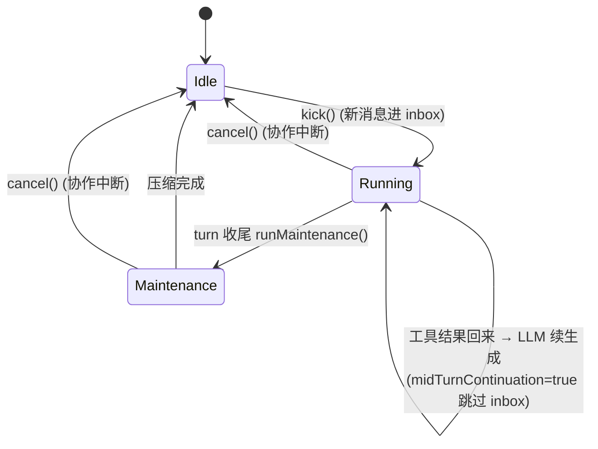

# 第 1 章 · Agent 执行核心

> 本章覆盖：`agent`、`agent.ask`、`agent.compaction`、`agent.subagent`。
> 解决的核心问题：**ReAct 循环是怎么转起来的？**

---

## 学习目标

读完本章你能：

1. 用一句话说清 `ReactLoopAgent` 在做什么。
2. 指出 Phase 状态机的三个状态和取消机制的位置。
3. 知道"工具调用后的多 step"是怎么不丢消息的（`midTurnContinuation`）。
4. 知道 `agent.ask` / `agent.compaction` / `agent.subagent` 怎么嵌入主循环。

---

## 章节导读

`agent` 包是整个领域层的"心脏"。所有用户消息最终都进 `ReactLoopAgent`；所有工具调用都从它的 turn 循环里发出去。

依赖关系图：

```
+-------------------+       发消息       +---------------------+
| trigger/send API  | -----------------> | agent.ReactLoopAgent|
+-------------------+                    +---------------------+
                                                 |   |   |
                +--------------------------------+   |   +------------------+
                |  llm.ILlmRuntimePort.stream     |   |                  |
                |  （流式 chunk）                  |   |                  |
                v                                  |                  |
       AssistantChunk 事件  -->  session.event     |                  |
                                            |      |                  |
                                            v      v                  |
                                tool.service.ToolCallExecutor  <------+
                                            |
                                            v
                                  tool.<family>.tool
                                            |
                                            v
                                  ToolResult 事件 --> session.event
                                            |
                                            +--> 再次 LLM 调用 ←---+
                                                                 |
                              +-------------------------+        |
                              | agent.compaction         |（turn 末）
                              | + agent.subagent         |
                              +-------------------------+
```

整章的关键源码都在 `dsh-java-domain/src/main/java/net/linlan/dsh/domain/agent/` 下，约 **1200+ 行 Java**。

---

## 1.1 `agent`（顶级）：ReactLoopAgent 主循环

### ① 解决什么问题

只要对话主线存在，每条用户消息都要走完"LLM 流式 → 工具调用（可能多轮）→ 回到 LLM → 收尾"这条链。这条链不能丢消息、不能因为 cancel 半途卡死、不能并发冲突。`ReactLoopAgent` 就是驱动这条链的**唯一驱动器**。

### ② 关键源码位置

| 文件 | 行数 | 角色 |
| --- | --- | --- |
| `service/ReactLoopAgent.java` | 767 | 主循环 / turn 控制器 |
| `service/Agent.java` | 77 | Agent 抽象接口（`send/cancel/runMaintenance`） |
| `agentrun/AgentRunFactoryPort.java` | 38 | 组合根端口（infra `AgentFactory` 实现） |
| `service/Inbox.java` | 323 | 用户消息收件箱 |
| `service/SystemPromptAssembler.java` + `ScopedSystemPromptAssembler.java` | — | 系统提示词组装（按 profile 注入） |
| `model/entity/Phase.java` | — | sealed 状态机（Idle/Running/Maintenance） |
| `model/entity/AgentOptions.java` | — | Agent 配置 |
| `model/valobj/AgentCancelCause.java` / `AgentStatus.java` / `InboxTarget.java` / `InboxSplice.java` | — | 值对象 |

### ③ 关键签名

```java
// Agent.java
public interface Agent {
    void send(Message message, InboxTarget target, boolean trackByUser);
    void cancel(AgentCancelCause cause, boolean mayInterruptIfRunning);
    void runMaintenance(...);     // 每个 turn 收尾调用（压缩 / 整理）
    void setStreamDeltaSink(Consumer<String> sink);
    void setStreamToolCallSink(Consumer<ToolCallEvent> sink);
}

// ReactLoopAgent.java（关键字段）
public final class ReactLoopAgent implements Agent {
    private final SessionLog sessionLog;
    private final Inbox inbox;
    private final ILlmRuntimePort llmPort;
    private final ToolRegistry toolRegistry;
    private final ToolCallExecutor toolExecutor;
    private final SystemPromptAssembler promptAssembler;
    private final AtomicReference<Phase> phase = new AtomicReference<>(Phase.Idle);
    private volatile boolean midTurnContinuation;          // 工具调用后跳过 inbox 检查
    // ...
}
```

### ④ 流程图



### ⑤ 设计意图

> **"一个会话一个 ReactLoopAgent"** —— 不维护全局消息队列，而是把每个会话建模成独立驱动器。这样取消、并发、压测都更自然（每会话自己的 `Inbox` + 自己的 `AtomicReference<Phase>`）。

### ⑥ 与谁打交道

| 方向 | 谁 | 干什么 |
| --- | --- | --- |
| 消费 | `llm.ILlmRuntimePort` | 流式生成 |
| 消费 | `tool.service.ToolCallExecutor` | 工具派发 |
| 消费 | `tool.adapter.ToolRegistry` | 工具查找 |
| 消费 | `session.event.SessionLog` | 追加事件 |
| 消费 | `session.event.SessionEventFactory` | 构造事件 |
| 消费 | `session.event.service.SurfaceProjector` | 把事件投影为 `SurfaceOp` |
| 触发 | `agent.compaction.BasicCompactionEngine` | turn 末压缩 |
| 被消费 | `case.AgentUseCase` | 通过 `AgentRunFactoryPort` 复用或创建 |
| 被消费 | `trigger.AgentController` | 推送 SSE |

### ⑦ 注意事项

1. **Phase 取消用 `AtomicBoolean` + 100ms 轮询**，不靠 Thread.interrupt，意味着 cancel 不是即时的；高频 cancel 场景不适合。
2. **单 turn 上限 50 步；`max_tokens` 受控续写最多 4 次**。
3. **`midTurnContinuation` 是关键修复**（已修复的工具结果丢失 Bug）—— 工具执行后的下一轮 step，`inbox.isEmpty()` 误判导致 break。

---

## 1.2 `agent.ask`：把"问用户"做成一个工具

### ① 解决什么问题

Agent 有时不能擅自决策（比如 `请确认是否允许写入这个文件？`）。需要把"向用户提问"建模成 LLM 能调用的一个**工具**，让 LLM 在合适的时机主动调用。

### ② 关键源码位置

| 文件 | 角色 |
| --- | --- |
| `ask/AskUserTool.java` | 工具类（`Tool` 接口实现，`name=ask_user_question`） |
| `ask/UserQuestionsPort.java` | 对外端口（case 层 / trigger 层实现） |

### ③ 关键签名

```java
// AskUserTool.java
public final class AskUserTool implements Tool {
    public static final String NAME = "ask_user_question";
    private final UserQuestionsPort port;

    @Override
    public ToolResult execute(Map<String, Object> args) {
        // 1. 解析 args（question, options[], header 等）
        // 2. 把问题转成 UI 弹窗事件（SSE / WebSocket）
        // 3. 阻塞等待用户答案（超时可配）
        // 4. 把答案作为 ToolResult 回填到会话
        return port.askUserQuestion(parsed);
    }
}
```

### ④ 调用栈

```
LLM 生成 → ToolCall(ask_user_question, {question, options, header})
                    ↓
   tool.service.ToolCallExecutor.execute()
                    ↓
   tool.adapter.ToolRegistry.lookup("ask_user_question").execute(args)
                    ↓
   agent.ask.AskUserTool.execute → UserQuestionsPort.askUserQuestion()
                    ↓
   [trigger 层] SSE 推送 → UI 弹窗 → 用户选 → 回包
                    ↓
   ToolResult(answer) → AgentCollectNode 投影到消息流
```

### ⑤ 设计意图

> **把"决策权交还给人"建模成一个普通工具** —— 而不是给 Agent 加一个独立的 `pauseForUser()` API。结果是：Agent 不需要任何特殊分支就能决定"该不该问人"，策略完全在 prompt 里。

### ⑥ 与谁打交道

- **被使用**：`tool.service.ToolCallExecutor`（注册到 `ToolRegistry`）。
- **依赖**：`UserQuestionsPort`（infra 由 case 层 `AskQuestionNode` 实现）。

### ⑦ 注意事项

- 用户**不响应**时（前端关掉 UI）→ 工具超时 → 视为拒绝或抛错，看策略；目前没有默认 fallback。
- 一次调用允许多问题（多选项 / 多字段），参数解析在 `AskUserTool` 内部完成。

---

## 1.3 `agent.compaction`：上下文压缩引擎

### ① 解决什么问题

会话持续累加 `UserMessage` / `AssistantMessage` / `ToolCall` / `ToolResult` 事件。token 涨到模型 context window 上限（默认 128k）就 GG。需要在每 turn 收尾做**压缩**：把旧事件 LLM 总结、保留近期一段原文。

### ② 关键源码位置

| 文件 | 角色 |
| --- | --- |
| `compaction/CompactionEngine.java` | 引擎接口 |
| `compaction/BasicCompactionEngine.java` | 默认实现：保留最近 1/4，其余 LLM 总结 |
| `compaction/CompactionResult.java` | 压缩结果 VO |

### ③ 关键签名

```java
// CompactionEngine.java
public interface CompactionEngine {
    CompactionResult compact(List<SessionEvent> events, AgentOptions options);
}

// BasicCompactionEngine.java（核心思路）
public CompactionResult compact(List<SessionEvent> all, AgentOptions options) {
    int keep = all.size() / 4;                       // 最近 1/4 保留原文
    List<SessionEvent> recent = all.subList(all.size() - keep, all.size());
    List<SessionEvent> old    = all.subList(0, all.size() - keep);

    String summary = llmPort.summarize(old);         // 让 LLM 把 old 总结
    return new CompactionResult(summary, recent);
}
```

### ④ 流程图

```
turn 收尾
   ↓
ReactLoopAgent.runMaintenance()
   ↓
events.size() > threshold ?
   ├─ no → 跳过
   └─ yes → CompactionEngine.compact(events, options)
                ├─ recent（最近 1/4）→ 保留
                └─ old（其余）→ LLM 总结
                       ↓
                 用 1 条 SummaryMessage 替换 old
                       ↓
                 SessionRebuilderService 从 events 重建 messages
```

### ⑤ 设计意图

> **压缩语义上是"事件流重写"，不是"消息删除"**。这是事件溯源（ES）思路：UI 想看什么就从事件流 derive，压缩只是重新描述一批事件的意义。

### ⑥ 与谁打交道

- **被触发**：`ReactLoopAgent.runMaintenance(...)` 每个 turn 末。
- **依赖**：`llm.ILlmRuntimePort`（总结要再调一次 LLM）。
- **影响下游**：`SessionRebuilderService.deriveMessages()` 全量重建 → **O(n²)**（已知隐患）。

### ⑦ 注意事项

1. **压缩不是事务化的**：旧事件仍在 `SessionLog`，重写只发生在 derive 阶段；如果数据库有 `session_event` 表，落库的是事件本身而不是压缩后的"逻辑 messages"。
2. **触发阈值是估算的 `length/4`** 简单粗暴，容易压太狠或不够（已知隐患）。
3. LLM 总结会消耗额外 token 和 latency；当前无后台异步化。

---

## 1.4 `agent.subagent`：子 Agent 注册与启动

### ① 解决什么问题

单 Agent 跑长任务容易跑偏（上下文被噪声淹没）。需要支持**子 Agent**：fork 出"共用父会话日志"的并行 turn，或 spawn 出"完全独立"的临时 Agent。

### ② 关键源码位置

| 文件 | 角色 |
| --- | --- |
| `subagent/SubagentRegistry.java` | 子 Agent 注册表（按 id 查定义） |
| `subagent/SubagentProvider.java` | 启动抽象接口 |
| `subagent/ForkInProcessProvider.java` | fork：复用父 Agent 的会话日志，独立 turn |
| `subagent/SpawnInProcessProvider.java` | spawn：全新子 Agent 跑一次性任务 |
| `subagent/SubagentTool.java` | LLM 调用的入口工具 |

### ③ 关键签名

```java
// SubagentProvider.java
public interface SubagentProvider {
    String kind();                          // "fork" | "spawn" | ...
    ReactLoopAgent spawn(SubagentDefinition def, AgentOptions options);
}

// ForkInProcessProvider.java：复用 sessionLog，独立 turn
// SpawnInProcessProvider.java：new 一个独立 SessionLog
```

### ④ 两种模式对比

| 维度 | fork | spawn |
| --- | --- | --- |
| 会话日志 | 共享父 Agent | 全新 |
| 子 turn 上下文 | 看得到父历史 | 只能拿到 prompt + 父总结 |
| 适用场景 | 探索性多方案并行 | 一次性 / 沙盒实验 |
| 回流父会话 | 工具结果回写父 log | 不回流（独立产出） |

### ⑤ 设计意图

> **子 Agent 不引入"调度器"概念**。每个子 Agent 就是一个普通 `ReactLoopAgent`，通过 `SubagentProvider` 决定"日志怎么来"。简洁、便于压测、便于隔离。

### ⑥ 与谁打交道

- **被触发**：`ReactLoopAgent.turn()` 检测到 LLM 调用 `SubagentTool` → 通过 `SubagentProvider` 创建子 Agent → 子 Agent 自己跑自己的 `turn()` → 结果以 `ToolResult` 回流。
- **依赖**：`agent.service.ReactLoopAgent`（复用）+ `session.event.SessionLog`（fork 时共享）。

### ⑦ 注意事项

1. **fork 共享 `SessionLog` 有并发写入风险**——子 Agent 写日志时父 Agent 可能也在写。当前用 `SessionLog.append(...)` 的内部锁兜底；不是真并发安全。
2. **spawn 子 Agent 默认无持久化**（不写 `session_event` 表），结束后只把摘要作为工具结果回父。

---

## 小结

1. **`ReactLoopAgent` 是单一驱动器**：每个会话一个实例，独立 turn、独立状态机、独立 inbox。
2. **Phase 状态机三态**：`Idle / Running / Maintenance`，取消用 `AtomicBoolean` + 100ms 轮询协作式。
3. **工具结果不丢靠 `midTurnContinuation` 标志**——是项目 09-05 修过的一个真实 Bug。
4. **三个子域的定位**：`agent.ask` 把"问用户"建模为工具、`agent.compaction` 把"上下文管理"建模为引擎接口、`agent.subagent` 把"派生 Agent"建模为 Provider。

---

## 思考题

1. **【Easy】** 为什么项目选择"`AtomicBoolean` + 100ms 轮询"而不是直接 `Thread.interrupt()`？这跟 LLM HTTP 客户端 + 协作取消有什么关系？
2. **【Medium】** 假如你要给 `ReactLoopAgent` 加一个"每 5 分钟强制持久化 in-flight 状态"，你会改哪几个文件？为什么？
3. **【Hard】** 设想一个场景：用户在工具中途 cancel，但 LLM 已经返回了 `tool_calls` 但还没派发。这种半成品状态怎么写 `SessionEvent` 才能让 UI 一致？翻 `ReactLoopAgent.cancel()` 看当前怎么处理这个 gap。

> 提示：所有答案都能在 `domain/agent/service/ReactLoopAgent.java` + `domain/agent/model/entity/Phase.java` + `domain/session/event/` 这三个目录下找到。
