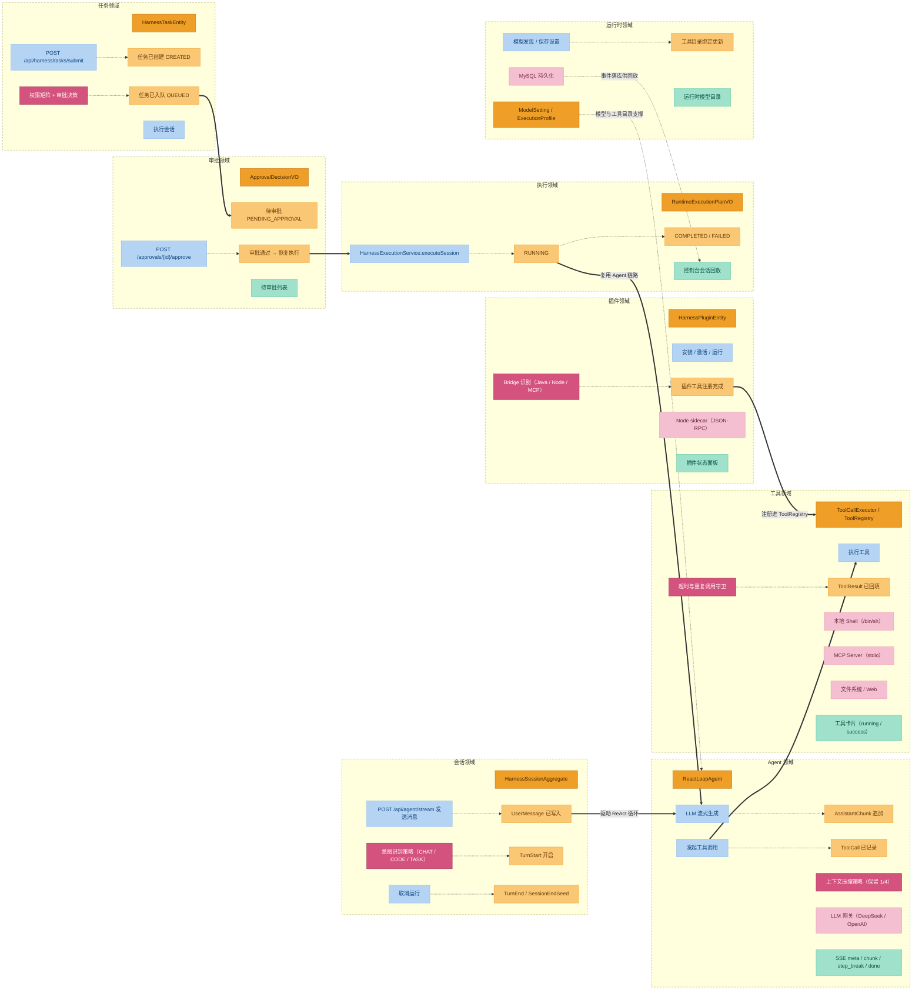

# 领域设计：DeepSeek Harness 领域模型与功能串联

本文档描述 `dsh-java` 的领域层（`dsh-java-domain`）设计：限界上下文划分、核心聚合与领域对象、领域事件机制，以及各功能如何通过策略树与端口-适配器串联起来。

阅读建议：配合 `docs/architecture.drawio`（分层架构图）一起看。本文聚焦"领域内部如何运转"。

## 1. 事件风暴全景

项目遵循事件风暴（Event Storming）六色约定：

| 颜色 | 含义 | 本项目示例 |
| --- | --- | --- |
| 蓝 | Command 决策命令 | `POST /api/agent/stream`、`POST /api/harness/tasks/submit`、插件 install/activate/run |
| 黄 | Domain Event 领域事件 | `UserMessage`、`AssistantChunk`、`ToolCall`、`ToolResult`、`TurnStart/TurnEnd` |
| 粉 | External System 外部系统 | LLM 网关、本地 Shell、MCP Server、Node sidecar、MySQL |
| 玫红 | Business Policy 业务流程 | 意图识别策略、权限矩阵+审批决策、Bridge 识别、超时守卫 |
| 绿 | Read Model 读模型 | SSE 输出、控制台会话回放、待审批列表、插件状态面板 |
| 橙 | 领域对象 entity/valobj/aggregate | `ReactLoopAgent`、`HarnessTaskEntity`、`HarnessSessionAggregate`、`HarnessPluginEntity` |



两条业务主线：

1. **对话主线**：会话领域 → Agent 领域（ReAct 循环）→ 工具领域 → 插件领域
2. **任务主线**：任务领域 → 审批领域 → 执行领域 →（复用对话主线的 Agent 链路）

运行时领域（模型渠道、执行画像、工具目录）横向支撑两条主线；所有过程事件最终落 MySQL，供控制台回放。

## 2. 限界上下文（Bounded Context）

`domain` 模块共 27 个一级子包，按能力面归为六组：

| 能力面 | 子包 | 核心对象 |
| --- | --- | --- |
| Agent 执行核心 | `agent`, `llm`, `session` | `ReactLoopAgent`、`Phase`（Idle/Running/Maintenance）、`ILlmRuntimePort`、`HarnessSessionAggregate`、`SessionLog` |
| 任务与目标 | `task`, `goal`, `plan`, `todo`, `workflow`, `schedule`, `jobs` | `HarnessTaskEntity`、`GoalAggregate`、`WorkflowRun` |
| 工具与插件 | `tool`, `plugin`, `typert`, `sdk` | `ToolRegistry`、`ToolCallExecutor`、`RuntimeApprovalGate` |
| 运行时与环境 | `runtime`, `credentials`, `coderuntime`, `terminal`, `lsp`, `sandbox`, `e2b`, `acp` | `ModelSetting`、`ExecutionProfile`、各类端口 |
| 治理与存储 | `guard`, `hooks`, `storage` | 超时策略、Hook 引擎、KV 存储 |
| 共享与技能 | `shared`, `skill` | `HarnessStatusEnumVO` 等跨域枚举 |

### 2.1 任务领域（task）子域拆分

`task` 域按职责继续拆为五个子域，每个子域有独立的 valobj 与端口：

| 子域 | 职责 | 关键对象 |
| --- | --- | --- |
| `submission` | 提交参数校验与过滤 | `TaskSubmissionVO`、Filter |
| `permission` | 权限矩阵评估 | `PermissionAssessmentVO`、`PermissionMatrixVO`、`IPermissionMatrixPort` |
| `approval` | 审批决策与命令 | `ApprovalDecisionVO`、`ApprovalPolicyService`、`ApprovalCommandService` |
| `queue` | 任务队列持久化 | `IHarnessTaskQueueRepository` |
| `execution` | 会话执行 | `HarnessExecutionService`、`IModelExecutionPort`、`RuntimeExecutionPlanVO` |

### 2.2 插件领域（plugin）三段边界

| 段 | 职责 | 关键服务/端口 |
| --- | --- | --- |
| Registry | 安装、元数据、启停 | `PluginRegistryService`、`IPluginArtifactInstallerPort` |
| Bridge | 识别接入方式并生成绑定计划 | `PluginBridgeService`、`IPluginRuntimeBridgePort`、`PluginBridgePlanVO` |
| Runtime | 启动、运行、停止、查询实例 | `PluginRuntimeService`、`IPluginProcessPort`、`PluginRunResultVO` |

接入方式识别：`JAVA_NATIVE`（进程内 URLClassLoader）、`DSH_NODE_BRIDGE`（Node sidecar，JSON-RPC stdio）、`DSH_PACKAGE`/`CODEX`/`CORDIS`（识别后 runnable=false，保留扩展点）。

> 想知道每个模块**怎么用、关键源码长啥样、怎么走**——见 [`docs/md/domain-course/`](domain-course/README.md)（**领域模块课程**：9 章 / 37 个模块的教程分章，从 agent 循环到协议工作流，附学习目标 + 思考题）。本文讲"为什么要这么分 + 怎么流"的叙事，那份讲"每个模块怎么写 / 怎么用"的教学。

## 3. 核心聚合与领域对象

### 3.1 Agent 聚合

- **聚合根服务**：`ReactLoopAgent`（implements `Agent`），持有 `SessionLog`、`Inbox`、`ILlmRuntimePort`、`ToolRegistry`、`ToolCallExecutor`、`SystemPromptAssembler`。
- **关键方法**：`send(Message, InboxTarget, boolean)`、`cancel(AgentCancelCause, boolean)`、`runMaintenance(...)`、`setStreamDeltaSink/setStreamToolCallSink`。
- **状态机**：`Phase` sealed 类型（`Idle` / `Running` / `Maintenance`），取消费用 `AtomicBoolean` + 100ms 轮询。
- **循环约束**：单 turn 上限 50 步；max_tokens 受控续写最多 4 次；工具调用后经 `midTurnContinuation` 标志跳过 inbox 检查直接续步（避免工具结果丢失）。

### 3.2 会话聚合

- **聚合根**：`HarnessSessionAggregate`（`session/registry/model/aggregate`）。
- **事件日志实体**：`SessionLog`（`session/event/model/entity`），内存追加式 WAL，`append(SessionEvent)`。
- **投影**：`SurfaceProjector` 将事件流投影为界面可见的 `SurfaceOp`（`Append` / `Replace(start, end)`）。
- **压缩**：`BasicCompactionEngine` 保留最近 1/4 事件，其余由 LLM 总结。

### 3.3 任务聚合

- **实体**：`HarnessTaskEntity`（`taskId, sessionId, prompt, enabledTools, status, submittedAt`）。
- **状态机**（`HarnessStatusEnumVO`）：`CREATED → PENDING_APPROVAL → QUEUED → RUNNING → COMPLETED/FAILED`。

### 3.4 目标聚合

- `GoalAggregate`（`goal/model/entity`），含 `GoalAction`、`GoalSnapshotVO`、`GoalStatus`，由 `IGoalRepository` 持久化。

## 4. 领域事件机制

本项目没有通用 `DomainEvent` 基类或 Spring ApplicationEvent，**事件机制即会话事件日志（Session Event Log）的事件溯源**。

`SessionEvent`（`session/event/model/entity/SessionEvent.java`）是 sealed 接口，record 变体：

| 类别 | 事件 |
| --- | --- |
| 轮/步边界 | `TurnStart`、`TurnEnd(reason)`、`StepStart`、`StepEnd` |
| 消息 | `UserMessage(Message)`、`AssistantChunk`、`AssistantMessage(Message)` |
| 工具 | `ToolCall(callId, name, arguments)`、`ToolResult(callId, ...)` |
| 其他 | `TodoWrite`、`RequestHeader`、`RequestContext`、`SessionEndSeed`、`PlanModeChange`、`AgentInboxSpliced` |

兼容旧任务事件（均标记 `ignorable=true`，投影时跳过）：`TASK_SUBMITTED`、`TASK_AUTO_APPROVED`、`TASK_APPROVAL_REQUIRED`、`TASK_APPROVED`、`TASK_EXECUTION_STARTED/COMPLETED/FAILED`。

枚举 `SessionEventType` 携带 `wireName`（序列化名）与 `ignorable` 标志。

### SSE 输出协议

流式对话的 SSE 事件与领域事件对应关系：

| SSE 事件 | 来源 | 内容 |
| --- | --- | --- |
| `meta` | Controller 起始帧 | agentId 等元信息 |
| `chunk` | `AssistantChunk` | 文本增量 + index |
| `step_break` | `streamToolCallSink` | 工具调用边界（toolName/callId/args/status），前端据此插入工具卡片并重置当前消息气泡 |
| `done` | 终态 | sessionId、status、全量 messages（含 tool 角色，前端重建工具卡片状态） |
| `error` | 异常 | 错误信息 |

## 5. 策略树：功能如何串联

跨领域编排在 `case` 模块完成，统一用 `AbstractStrategyRouter<Request, DynamicContext, Response>` 责任链：`doApply` 处理当前节点逻辑，`getNext` 返回后继节点。

### 5.1 Agent 消息链

```
AgentResolveNode → AgentIntentNode → AgentDispatchNode → AgentCollectNode
```

| 节点 | 职责 |
| --- | --- |
| `AgentResolveNode` | 按 `agentId` 复用或创建 AgentRun（经 `AgentRunFactoryPort`），解析模型、Token、工作目录 |
| `AgentIntentNode` | 纯正则规则分类：`CHAT` / `CODE_QUESTION` / `TASK_EXECUTION` / `CLARIFICATION`；`TASK_EXECUTION` 会注入"先调工具"指令；目录列举类请求推荐 `shell_execute`（ls/find）而非 `fs_search` |
| `AgentDispatchNode` | 构造 `Message.createUser(...)` 并 `agent.send(userMessage, InboxTarget.NEXT_TURN, true)` |
| `AgentCollectNode` | 等待 Agent 空闲（`.join()`），从会话事件投影 User/Assistant/ToolCall/ToolResult 消息，按 callId 合并工具消息，组装响应 |

### 5.2 任务提交链

```
SubmissionRootNode → ProfileResolutionNode → PermissionCheckNode → ToolResolutionNode → EnqueueNode
```

- `PermissionCheckNode`：`permissionPolicyService.assess(tools)` → `approvalPolicyService.decide(profile, assessment)` → `ApprovalDecisionVO`。
- `EnqueueNode`：`openQueuedSession`（QUEUED）+ `createQueuedTask` + `recordTaskSubmission`；若 `approvalRequired=false` 直接 `harnessExecutionService.executeSession(...)` 置 RUNNING；否则停留 `PENDING_APPROVAL` 等待审批。

### 5.3 审批恢复链路

```
POST /api/harness/approvals/{sessionId}/approve
  → ApprovalCommandService.approve(sessionId)
  → 任务状态 QUEUED 落库
  → HarnessExecutionService.executeSession
  → IModelExecutionPort.execute
  → RUNNING → COMPLETED / FAILED
```

兜底规则：执行入口对 `PENDING_APPROVAL` 状态的任务直接抛异常，防止绕过审批。

### 5.4 插件生命周期链路

```
install  → PluginRegistryService.installPlugin → IPluginArtifactInstallerPort（落 HarnessPluginEntity）
activate → PluginBridgeService.inspect → IPluginRuntimeBridgePort → recordBinding
run      → PluginRuntimeService.start → IPluginProcessPort → PluginRunResultVO
```

插件工具注册进 `ToolRegistry`（命名 `plugin__<pluginId>__<toolName>`），之后由 `ToolCallExecutor` 统一派发，与内置工具走同一套 Hook/守卫/事件回填链路。

### 5.5 端到端串联总览

**a. 用户消息 → ReAct → 工具 → 回填**

```
AgentUseCase → Resolve/Intent/Dispatch/Collect
  → ReactLoopAgent.send → wakeDriver → kick（turn 循环）
  → ILlmRuntimePort 流式生成 → append ASSISTANT_CHUNK/MESSAGE
  → ToolCallExecutor.execute(turn, step, toolCalls)
  → append TOOL_CALL → ToolRegistry.lookup(name).execute(args) → append TOOL_RESULT
```

**b. 任务提交 → 权限 → 审批 → 执行**

```
SubmitHarnessTaskCaseImpl → 提交链
  → EnqueueNode（QUEUED）
  → [需审批] PENDING_APPROVAL → approve → executeSession → RUNNING → COMPLETED/FAILED
  → [免审批] executeSession → RUNNING → COMPLETED/FAILED
```

**c. 工作流启动 → 执行 → SSE**

```
IWorkflowService.start(WorkflowStartRequest)
  → WorkflowService → IWorkflowEnginePort（infra: LocalWorkflowEnginePort）
  → WorkflowRun（CompletableFuture<WorkflowResult>）
  → 流式复用 ReactLoopAgent 的 deltaSink / toolCallSink 推送 SSE
```

## 6. 端口-适配器对照表

Domain 定义端口，Infrastructure 提供实现。关键端口：

| Domain 端口 | Infrastructure 实现 | 说明 |
| --- | --- | --- |
| `llm/.../ILlmRuntimePort` | `InMemoryLlmRuntimePort` | 流式生成（Flow.Publisher），重试在此层而非 adapter |
| `task/execution/.../IModelExecutionPort` | `ModelExecutionPort` | 会话执行 |
| `runtime/model/.../IModelProviderPort` | `ModelProviderPort` | 模型发现与目录 |
| `agent/.../IRuntimeApprovalBroker` | `RuntimeApprovalBroker` | 运行期审批（默认 allowAll，未启用 gate 时） |
| `task/permission/.../IPermissionMatrixPort` | `PermissionMatrixPort` | 权限矩阵 |
| `task/approval/.../IApprovalPolicyPort` | `ApprovalPolicyPort` | 审批策略 |
| `runtime/tool/.../IToolCatalogPort` | `ToolCatalogPort` | 工具目录 |
| `plugin/registry/.../IPluginArtifactInstallerPort` | `PluginArtifactInstallerPort` | 插件安装 |
| `plugin/bridge/.../IPluginRuntimeBridgePort` | `PluginRuntimeBridgePort` | 插件识别 |
| `plugin/runtime/.../IPluginProcessPort` | `PluginProcessPort` | 插件进程 |
| `session/registry/.../IHarnessSessionRepository` | `HarnessSessionRepository` | 会话持久化（MyBatis） |
| `task/queue/.../IHarnessTaskQueueRepository` | `HarnessTaskRepository` | 任务队列 |
| `session/event/.../ISessionEventStore` | `SessionEventRepository` | 事件存储 |
| `goal/.../IGoalRepository` | `GoalRepository` | 目标持久化 |
| `jobs/schedule/...` | `InMemoryJobRegistryRepository` 等 | 内存实现（重启即丢，已知隐患） |
| `workflow/.../IWorkflowEnginePort` | `LocalWorkflowEnginePort` | 工作流引擎 |
| `agentrun/AgentRunFactoryPort` | `AgentFactory` | 组合根：装配 `AgentRun` + `ToolCallExecutor` |

组合根 `AgentFactory` 注入 `ToolRegistry`、`SessionLog`、`ILlmRuntimePort`、`RuntimeApprovalGate`，构建 `ReactLoopAgent` 与 `ToolCallExecutor(registry, session, maxParallel)`。

## 7. 已知隐患与边界（领域层视角）

1. **运行期审批 gate 默认未启用**：`AgentFactory` 走 12 参构造时 `approvalBroker=null`，executor 用 allowAll；审批只在任务提交期拦截。
2. **shell_execute 零沙箱**：`LocalShellExecutor` 直接 `/bin/sh -c`，无命令白名单，仅靠提交期审批兜底。
3. **ScheduleService 形同虚设**：`drive()` 无调用方（无 `@Scheduled`/Quartz），仓储为 InMemory，重启即丢。
4. **线程池隐患**：`ReactLoopAgent.kick()` 与 `JobRegistryService` 用无界 `newCachedThreadPool`；`AgentCollectNode` 用 `.join()` 阻塞请求线程。
5. **长会话性能**：`deriveMessages` 全量重建 O(n²)；token 预算用 `length/4` 粗估。
6. **E2B 沙箱只有 Stub**；CODEX/CORDIS 插件包型识别后 runnable=false 为死路径；MCP 与插件 Bridge 互不打通。
7. **工作流 SSE 只推终态事件**，无增量。

---

## 8. 延伸阅读

> 四份领域文档的分工：
> - 本文件 (`docs/md/domain-design.md`)：事件风暴 + 限界上下文 + 核心聚合 + 领域事件 + 策略树 + 端口-适配器对照（**叙事主线**）。
> - `docs/md/domain-case-deep-dive.md`：策略树基础设施 + `ReactLoopAgent` 状态机 + Inbox 与回填 + 提交链 / 审批链 / 工作流链 + Agent 内置工具详解（**关键实现深挖**）。
> - `docs/md/domain-modules-reference.md`：逐模块速查（37 个能力点的用途、子包分层、关键类、端口、与谁打交道、注意事项）（**模块清单与定位**）。
> - [`docs/md/domain-course/`](domain-course/README.md)：9 章教程分章讲解，每章按"学习目标 / 关键源码 / 设计意图 / 思考题"组织（**教程正文**）。
