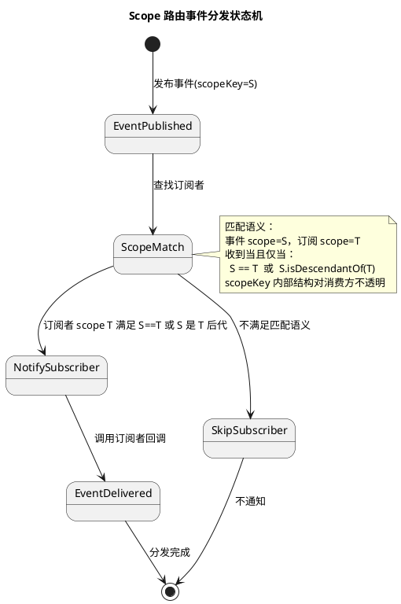
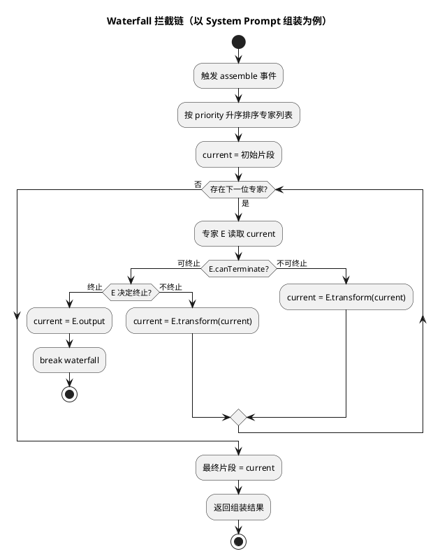
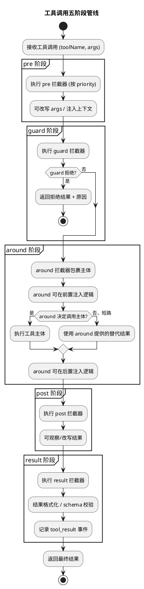
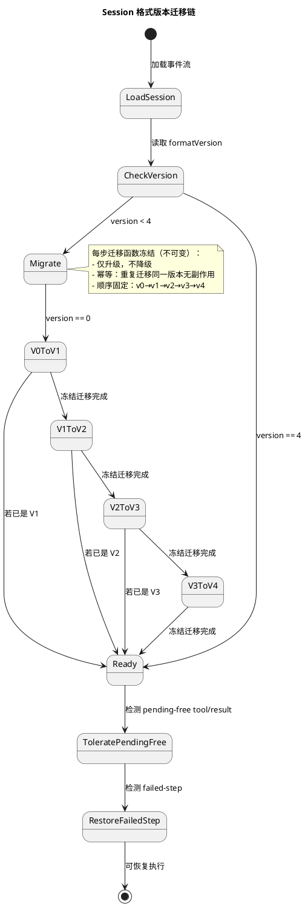
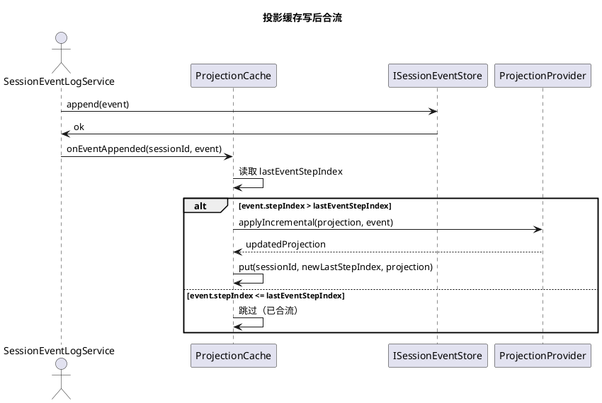
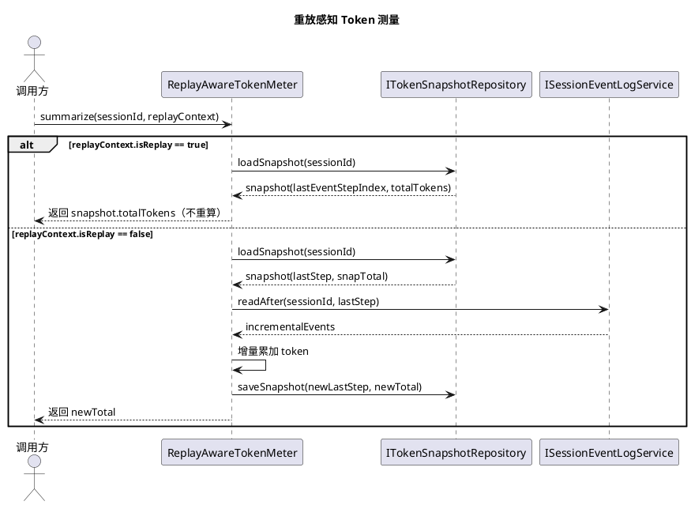
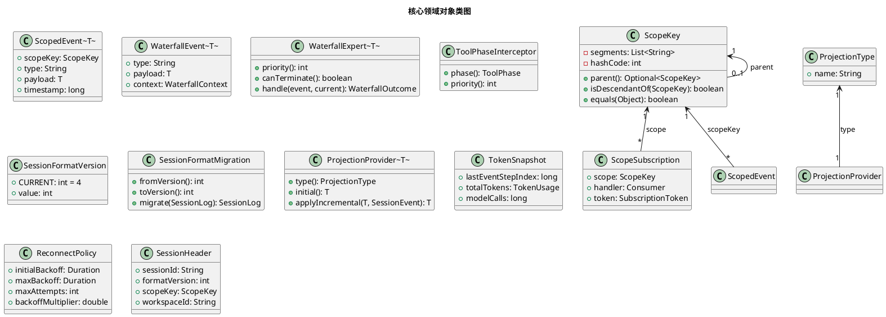
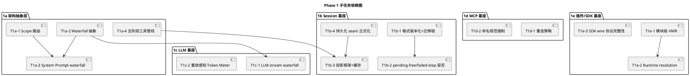

# dsh-java 核心底座对齐 — 实现方案设计文档

> 本文档基于 `dsh-java-core-base-alignment-spec.md`（104 条 EARS 需求 / 19 域 / P0-P1-P2 / Phase 1-2-3）生成，将需求规格（WHAT）转化为 dsh-java（Java 17 + Spring Boot 3.5.16 + DDD 六边形架构）的增量技术设计（HOW）。
>
> - **目标版本**：v0.1.8 → v0.2.0
> - **参考实现**：deepseek-harness（TS/Python monorepo，200+ 包）
> - **设计原则**：端口适配器优先、不破坏 v0.1.8 现有 API、类型安全（无 `any`/无 unchecked cast）、每项新能力落位到 DDD 模块（types/domain/api/case/infrastructure/trigger/app）

---

# 一、需求与存量功能关系分析

## 1.1 需求功能与存量功能对比

### 1.1.1 已实现功能（匹配度 ≥ 75%）

| 需求功能 | 存量功能 | 代码位置 | 匹配度 |
|---------|---------|---------|--------|
| B7 Session 持久化多后端抽象 seam | `ISessionEventStore` 抽象接口 + `JsonlSessionEventStore` / `JdbcSessionEventStore` 双实现 | `domain/session/event/adapter/repository/ISessionEventStore.java`；`infrastructure/adapter/eventstore/{Jsonl,Jdbc}SessionEventStore.java` | 75% |
| B7 切换后端不改上层调用 | `SessionEventLogService` 仅依赖 `ISessionEventStore` 端口，不感知后端 | `domain/session/event/service/SessionEventLogService.java:43` | 75% |
| A2 System Prompt 分段组装 | `ScopedSystemPromptAssembler` 已支持 section/context 注册、按 order 排序、变量插值、complete 短路 | `domain/agent/service/ScopedSystemPromptAssembler.java` | 50% |
| A3 工具 PRE/POST Hook | `ToolCallExecutor` 已实现 `PRE_TOOL_USE` 阻断与 `POST_TOOL_USE` 观察 | `domain/tool/service/ToolCallExecutor.java:167-185` | 50% |
| C3 Token 用量统计 | `SessionTokenMeterService` 已遍历事件流累加 `AssistantMessage.usage` | `domain/runtime/meter/service/SessionTokenMeterService.java` | 50% |
| D1 MCP 客户端连接 | `IMcpClient` + `StdioMcpClient` / `HttpMcpClient` 已实现 connect/callTool/listTools | `domain/tool/mcp/IMcpClient.java`；`infrastructure/adapter/mcp/{Stdio,Http}McpClient.java` | 75% |
| D1 MCP 工具命名前缀 | `McpServerConfig` 注释声明 `mcp__<name>__*` 前缀规范 | `domain/tool/mcp/McpServerConfig.java:8` | 75% |
| N3 插件热重载（JAR 级） | `PluginHotReloader` 基于 `WatchService` 监听 JAR 变更并回调重载 | `infrastructure/adapter/plugin/java/PluginHotReloader.java` | 50% |
| N4 Plugin Manager 注册表 | `PluginRegistryService` + `IHarnessPluginRepository` 已维护插件元数据 | `domain/plugin/registry/service/PluginRegistryService.java` | 50% |
| O1 SDK JSON-RPC stdio 传输 | `ISdkTransportPort` + `StdioSdkTransportPort` 已实现 stdio 传输 | `domain/sdk/adapter/port/ISdkTransportPort.java`；`infrastructure/adapter/sdk/StdioSdkTransportPort.java` | 50% |
| G4 沙箱策略解析 | `LocalSandboxEnforcer` + `SandboxedShellExecutor` 已实现基础策略解析 | `infrastructure/adapter/sandbox/{LocalSandboxEnforcer,SandboxedShellExecutor}.java` | 50% |
| H2 进程内子代理驱动 | `agent/service/subagent` 包已存在进程内子代理骨架 | `domain/agent/service/subagent/` | 50% |
| J4 重复工具防护 | `guard/reminder` 包已存在重复调用提醒骨架 | `domain/guard/reminder/` | 50% |
| J5 工具超时 | `ToolCallExecutor` 已支持 `toolTimeoutMs` + `awaitWithTimeout` | `domain/tool/service/ToolCallExecutor.java:244-271` | 75% |
| L3 FS 搜索工具 | `tool/fs` 包 + `IFsPort` 已存在 FS 抽象 | `domain/tool/fs/adapter/port/IFsPort.java` | 50% |
| M2 Schedule 服务 | `schedule` 域已存在 `IScheduleRepository` + 服务 | `domain/schedule/` | 50% |
| M4 Workspace 注册表 | `session/registry` 包已存在 `IHarnessSessionRepository` | `domain/session/registry/adapter/repository/IHarnessSessionRepository.java` | 50% |
| N2 ExecutionProfile | `runtime/profile` 包已存在执行配置骨架 | `domain/runtime/profile/` | 50% |
| P2 附件存储 | `storage` 域已存在 `IStorageBackendPort` | `domain/storage/adapter/port/IStorageBackendPort.java` | 25% |
| C5 LLM 适配器（DeepSeek/Anthropic/OpenAI） | `LlmAdapterFactory` + 三协议适配器已实现 | `infrastructure/adapter/llm/{deepseek,anthropic,openai}/` | 75% |

### 1.1.2 需要扩展的功能（部分匹配，需在现有基础上改造）

| 需求功能 | 存量功能 | 差异说明 | 扩展方向 |
|---------|---------|---------|---------|
| A2 System Prompt waterfall 拦截 | `ScopedSystemPromptAssembler` 仅按 order 静态排序拼接，无拦截链、无终止传播 | 缺：专家优先级链、可读取前序输出、可终止 waterfall、可改写片段 | 在 Assembler 中引入 `WaterfallChain<PromptFragment>`，将 section 解析改为 waterfall 事件链；保留现有 `registerSection` API 作为默认非拦截专家 |
| A3 工具五阶段管线 | `ToolCallExecutor` 仅 PRE/POST 两阶段，无 guard/around/result | 缺：guard 拒绝语义、around 包裹主体、result 阶段、五阶段固定顺序 | 扩展 `HookPoint` 枚举新增 `GUARD_TOOL_USE`/`AROUND_TOOL_USE`/`RESULT_TOOL_USE`；在 `runGroup` 中插入五阶段编排；保留 PRE/POST 为 pre/post 别名以兼容 |
| C1 LLM stream waterfall | `LlmGenerationService` 直接订阅流，无拦截器介入点 | 缺：retry/replay/routing 拦截器、waterfall 事件链、重定向保留上下文 | 在 `ILlmRuntimePort.stream` 外包裹 `LlmStreamWaterfall`，注入拦截器链；`LlmGenerationService` 改为 waterfall 终端消费者 |
| C3 重放感知 Token Meter | `SessionTokenMeterService` 每次全量重算，无快照、无重放感知 | 缺：token 用量快照持久化、`lastEventStepIndex`、重放时从快照恢复 | 新增 `ITokenSnapshotRepository`，`summarize` 先读快照再增量合流；重放上下文标记时跳过计入 |
| D1 MCP 重连策略 | `StdioMcpClient` 断连即失败，无退避重连 | 缺：`ReconnectPolicy`、指数退避、重连成功恢复工具可用 | 在 `StdioMcpClient` 外包裹 `ReconnectingMcpClient` 装饰器，注入 `ReconnectPolicy`；保留原 `StdioMcpClient` 作为底层传输 |
| N3 模块级 HMR | `PluginHotReloader` 仅 JAR 文件级监听 + stop/start，非模块级、无 runtime resolution 刷新 | 缺：模块级粒度、包清单刷新、入口标识更新、Office resolution | 扩展为 `ModuleLevelHmrService`，监听粒度细化到模块；刷新 `PluginManifest` 并触发 `RuntimeResolutionRefresh` |
| N4 Runtime resolution 刷新 | `PluginRegistryService` 静态注册，无运行时 resolution 映射维护 | 缺：resolution 映射、运行时新增/更新插件可发现 | 新增 `IRuntimeResolutionPort`，`PluginRegistryService` 增 `refreshResolution()` 方法 |
| O1 SDK wire 协议完整性 | `ISdkServerService` 仅 start/stop/emitNotification，`ISdkClientService` 仅 initialize/sessionPrompt/shutdown | 缺：DSH `sdk/protocol` 全部方法（listSessions/loadSession/cancel/stream/tools/cancelTool 等） | 扩展 `ISdkServerService` / `ISdkClientService` 接口方法集，对齐 DSH 方法清单；按 semver 新增方法不破坏旧客户端 |
| G4 沙箱策略注入模型上下文 | `LocalSandboxEnforcer` 仅执行隔离，未向模型上下文注入策略摘要 | 缺：策略摘要序列化、注入 AssembleContext | 在 `ScopedSystemPromptAssembler.registerContext` 中新增 `sandbox-policy` context；`ToolCallExecutor` 调用前解析策略并注入 |
| B7 抽象 seam 正式化 | `ISessionEventStore` 已是抽象接口但缺正式 seam 命名与契约文档 | 缺：正式 `SessionPersistenceSeam` 命名、契约测试基类 | 提取 `SessionPersistenceSeam` 超接口（继承 `ISessionEventStore`），新增 `SessionPersistenceContractTest` 契约测试 |
| C5 pi-ai 适配器 | 现有 DeepSeek/Anthropic/OpenAI 三适配器，缺 pi-ai | 缺：pi-ai 适配器、与 DeepSeek 共享核心协议 | 新增 `PiAiAdapter` 继承 `OpenAiCompatibleAdapter` 或与 `DeepSeekAdapter` 共享 `BaseChatAdapter` |
| N2 Bundle 装配体系 | `runtime/profile` 仅有 `ExecutionProfile` 单一概念，无 bundle 组合 | 缺：base/headless/sdk-app/sdk-minimal/acp-app/web-app bundle 定义、组合装配 | 新增 `BundleDefinition` + `BundleAssembler`，`ExecutionProfile` 降级为 bundle 的一个属性 |
| M4 Workspace 持久化校验 | `IHarnessSessionRepository` 存在但未持久化工作区、未校验 Session 附着 | 缺：Workspace 实体持久化、附着关系校验、孤立 Session 识别 | 新增 `WorkspaceEntity` + `IWorkspaceRepository`，`SessionHeader` 增 `workspaceId` 字段 |
| P2 内容寻址附件 | `IStorageBackendPort` 通用 KV 存储，无内容寻址 | 缺：SHA-256 内容哈希键、去重 | 新增 `ContentAddressableAttachmentStore` 装饰器，以 `SHA-256(content)` 为键包装 `IStorageBackendPort` |
| H2 进程内驱动对齐 | `agent/service/subagent` 骨架存在但行为未对齐 DSH | 缺：生命周期管理、行为契约对齐 | 对照 DSH `subagent-in-process-driver` 行为契约补齐 |
| J3 Hook CC/Codex 桥接 | `HookDialect` 枚举已有 `CLAUDE_CODE`，但缺 Codex 协议桥接 | 缺：Codex hook 协议、wire 桥接 | 新增 `CODEX` 枚举值 + `CodexHookBridge` |
| J5 per-tool deadline | `ToolCallExecutor` 仅全局 `toolTimeoutMs`，无 per-tool | 缺：per-tool deadline 配置、独立超时控制 | `ToolCallExecutor` 增 `Map<String, Duration> perToolDeadlines`，`awaitWithTimeout` 按工具名查表 |
| L3 glob/grep 工具 | `tool/fs` 包存在但缺 glob/grep 模型面向工具 | 缺：glob 模式匹配、正则内容检索工具定义 | 新增 `GlobTool` / `GrepTool` 工具定义，对齐 DSH `tool-fs-search` 行为 |
| M2 Schedule 模型面向 tool | `schedule` 域有服务但无模型面向 tool | 缺：`schedule_tool` 工具定义 | 新增 `ScheduleTool` 工具定义，模型可创建/修改/取消提醒 |

### 1.1.3 需要新增的功能或接口（存量代码无对应实现）

**A. 核心抽象层（全新）**
- **Scope 路由机制**（A1）：`ScopeKey` 不透明值对象、`ScopedContext` 父链嵌套、`ScopeEventDispatcher` scope-filtered 分发、`ScopeSubscription` 订阅者注册。输入：携带 scopeKey 的事件；输出：仅通知 scope 父链匹配的订阅者。依赖：事件总线。
- **Waterfall 事件链抽象**（A2/C1）：`WaterfallEvent<T>`、`WaterfallExpert<T>`、`WaterfallChain<T>`、终止传播语义、优先级排序。为 System Prompt 组装与 LLM stream 共用同一 waterfall 抽象。
- **Agent Tool Presentation**（A4）：`ToolPresentation` 值对象（PTC/native/selector）、工具注册时声明。
- **Agent Default Model**（A5）：`AgentDefaultModelProvider` 共享默认模型选择服务。

**B. Session 域（全新基座）**
- **Session 格式版本化**（B1）：`SessionFormatVersion` 常量（=4）、`SessionFormatMigration` 接口、`V0ToV1Migration`...`V3ToV4Migration` 冻结迁移链、`MigrationCatalog` 注册与路由、pending-free tool/result 容忍、failed-step 恢复。
- **投影框架**（B2）：`ProjectionType` 类型表、`ProjectionProvider` 契约、`ProjectionRegistry` 路由、`ProjectionCache` 写后合流缓存、`lastEventStepIndex` 增量合流。
- **检查点策略**（B3）：`CheckpointStrategy`、`CheckpointSnapshot`、`ICheckpointRepository`，模型请求前与工具副作用前写入。
- **Session 遥测 OTel**（B4）：`SessionTelemetryExporter`、字节有界 OTLP 缓冲区、`drop-oldest` 裁剪策略、`droppedCount` 监控。
- **Session 标题/统计/轮次大纲**（B5）：`SessionTitleGenerator`、`SessionStatistics` 投影、`TurnOutline` 投影。
- **Session 全文搜索**（B6）：`SessionFullTextIndex`、`SessionSearchProvider`、高亮定位。

**C. LLM 域（全新）**
- **LLM 重试策略**（C2）：`LlmRetryPolicy`、`RetryableErrorClassifier`、Provider 路由重试、重试上限。
- **LLM 请求扩展**（C4）：`LlmRequestExtensionRegistry`、插件注册额外请求字段。

**D. MCP 域（全新）**
- **MCP 资源**（D2）：`McpResourceDiscovery`、scoped 资源发现与读取、`IMcpResourcePort`。

**E. Context 域（全新）**
- **AGENTS.md 指令加载**（E1）：`AgentsMdLoader`、工作区层级合并、子级覆盖父级。
- **@file 引用展开**（E2）：`FileReferenceExpander`、消息预处理、内联展开。
- **跨 session 快照引用**（E3）：`SessionSnapshotReference`、只读快照注入。
- **时间上下文**（E4）：`TimeContextInjector`、当前时间 + elapsed。
- **tmux 上下文**（E5）：`TmuxContextInjector`、pane/window 标识。

**F. Compaction 域（全新）**
- **图像卸载**（F1）：`ImageOffloader`、占位符替换、可恢复引用。
- **工具结果剪枝**（F2）：`ToolResultPruner`、head/middle/tail 策略。
- **显式压缩命令**（F3）：`CompactCommand` slash 命令、立即触发。

**G. Sandbox 域（全新跨平台）**
- **Linux Landlock**（G1）：`LandlockSandbox`、bwrap fallback。
- **macOS Seatbelt**（G2）：`SeatbeltSandbox`、sandbox-exec 策略。
- **Windows ACL**（G3）：`AclSandbox`、受限 token、capability-SID 白名单、拒绝诊断。

**H. Subagent 域（全新）**
- **SDK 子代理**（H1）：`SdkSubagentDriver`、进程外 stdio JSON-RPC。
- **子代理控制工具**（H3）：`SendMessageTool`/`InterruptTool`/`ListAgentsTool`。

**I. Workflow/Plan/Todo/Goal 域（全新）**
- **PTC 运行时编排**（I1）：`PtcRuntimeOrchestrator`、沙箱 Node。
- **Ralph loop**（I2）：`RalphLoopTool`、fresh-agent。
- **Goal-round 驱动**（I3）：`GoalRoundDriver`、竞争隔离。
- **/goal slash 命令**（I4）：`GoalCommand`。

**J. Skill/Hooks/Guard 域（全新）**
- **Office skill**（J1）、**Badge skill**（J2）。
- **重复工具防护增强**（J4）、**超时策略增强**（J5，per-tool deadline）。

**K. Telemetry/Identity/Credentials 域（全新）**
- **OTel 服务**（K1）：`OtelService`、字节有界 OTLP。
- **匿名用户身份**（K2）：`AnonymousUserIdProvider`。
- **授权 seam**（K3）：`AuthorizationSeam`、对话式凭证获取。
- **PKCE 浏览器授权**（K4）：`PkceAuthorizer`。

**L. Storage/FS/Shell/Terminal/SSH/Subprocess 域（全新）**
- **Storage 域数据形式**（L1）：`StorageDomain`、schema 校验 + 事件发射。
- **SQLite 后端**（L2）：`SqliteSessionEventStore`。
- **str-replace-editor**（L4）：`StrReplaceEditorTool`、view/create/replace/insert。
- **FS 观察策略**（L5）：`FsObservationPolicy`。
- **PowerShell**（L6）：`PowerShellExecutor`。
- **持久 Shell**（L7）：`PersistentShellTool`。
- **受管环境变量**（L8）：`ManagedEnvRegistry`、`DSH_*` 前缀。
- **SSH**（L9）：`SshConnection`/`FsOverSsh`/`SandboxedSsh`/`SubprocessSsh`。
- **Win32 进程原语**（L10）：`JobObject`、进程组控制。

**M. Jobs/Schedule/Webhook/Workspace 域（全新）**
- **Job 控制工具**（M1）：`JobControlTool`。
- **Webhook**（M3）：`WebhookReceiver`、GitHub 签名校验。

**N. Preset/Boot/Host/Bundle 域（全新）**
- **YAML 声明式 Preset**（N1）：`YamlPresetLoader`、persona 定义。
- **Plugin Inventory Remote**（N5）：`RemotePluginInventory`。
- **Directory Picker**（N6）：`DirectoryPicker`。

**O. SDK/Feedback/Interaction/Spill 域（全新）**
- **消息反馈**（O2）：`MessageFeedbackService`、`/feedback` 命令。
- **命令注册表**（O3）：`SlashCommandRegistry`、统一分发。
- **权限预设**（O4）：`PermissionPreset`。
- **timed waits**（O5）：`TimedWaitAskUser`、late reply 接受。
- **Spill 溢出存储**（O6）：`SpillStore`、溢出策略。

**P. Document/Attachment/Deliverables 域（全新）**
- **Office-to-PDF**（P1）：`OfficeToPdfConverter`。
- **交付声明**（P3）：`DeliverableTool`、git 工作树快照。

**Q. PTC/Typert/LSP 域（全新）**
- **PTC 沙箱 Node**（Q1）：`PtcSandboxNodeProcess`。
- **Typert generator**（Q2）：`TypertGenerator`、TS 项目分析 → 类型协议。
- **LSP stdio provider**（Q3）：`LspStdioProvider`、`LspTool`。

**R. Computer-use/Browser-use/ACP/Web 域（全新）**
- **Computer-use**（R1）：`ComputerUseTool`。
- **Browser-use**（R2）：`BrowserUseTool`。
- **Web 搜索多 provider**（R3）：`ExaSearchProvider`/`PerplexitySearchProvider`。

**S. Native 系统原语 域（全新）**
- **Landlock + flock**（S1）：`NativeSystemPrimitive`、JNA 封装。

## 1.2 存量功能详细分析

### 1.2.1 `ISessionEventStore` 持久化抽象（B7）

- **接口契约**：`saveHeader` / `getHeader` / `append` / `appendBatch` / `readAll` / `readAfter` / `readRange` / `getLastSeq` / `count` / `listHeaders`。入参 sessionId + SessionEvent/SessionHeader；出参 SessionEvent 列表 / SessionHeader；异常由实现抛出；副作用为 append-only 写入。
- **业务规则**：append-only，seq 单调递增；`readAfter(fromSeq)` 用于增量读取；`listHeaders(limit)` 用于 list 接口。
- **扩展点**：接口本身是抽象 seam，可新增实现（SQLite/远程）而不改上层。
- **约束**：`SessionEventLogService` 通过 `SessionWriteLeaseService` 保证单 Session 串行写入（写租约）；并发 append 需经租约。
- **与新需求关系**：B7 需求要求正式化为 `SessionPersistenceSeam` 并补契约测试，B1 要求在 Header 中新增 `formatVersion` 字段，B2 要求在 Store 之上叠加投影缓存。

### 1.2.2 `ToolCallExecutor` 工具执行器（A3/J5）

- **接口契约**：`execute(...)` 返回 `boolean`（是否结束 turn）；`setHookService` / `setApprovalGate` / `setLifecycleListener` 注入运行期组件；`ToolLifecycleEvent` record 携带 phase/callId/toolName/args/result/status/durationMs。
- **业务规则**：`runGroup` 内顺序为：解析参数 → 记录 tool_call 事件 → 审批检查（`checkApproval`）→ PRE Hook（`shouldBlock`）→ 派发执行 → 等待完成（`awaitWithTimeout`）→ POST Hook（`afterTool`）→ 记录 tool_result 事件。并行模式用 `CompletableFuture` + `TOOL_WORKER` daemon 线程池；串行模式 `awaitWithTimeout` 阻塞。
- **扩展点**：`RuntimeApprovalGate` 可注入自定义审批逻辑；`IHookService` 可注入 PRE/POST Hook；`ToolLifecycleListener` 可观察生命周期。
- **约束**：`maxParallel` ≥ 1；`toolTimeoutMs` > 0 时启用超时，否则直接派发；结果按调用顺序回填保证回放稳定。
- **与新需求关系**：A3 要求扩展为 pre/guard/around/post/result 五阶段，需在 `runGroup` 中插入 guard 拒绝、around 包裹、result 阶段；J5 要求 per-tool deadline 替代全局 `toolTimeoutMs`。

### 1.2.3 `ScopedSystemPromptAssembler` 提示词装配器（A2）

- **接口契约**：`assemble(agentId, options, cwd, tools)` 返回 `CompletableFuture<PromptAssembly>`；`registerSection` / `registerContext` / `registerToolProvider` / `registerVariable` 注册各部件。
- **业务规则**：section 按 `order` 升序排序；`complete=true` 的 section 短路（仅用该 section）；context 在 runtime 未抑制时拼接为 "Current runtime context..." 前缀；变量用 `{{var}}` 插值；工具按 `toolOrder` 排序，`<unlisted-tools>` 占位余下。
- **扩展点**：section/context 的 `text` 可为 `String` 或 `Function<AssembleContext, String>`（动态）；`registerToolProvider` 可注入额外工具 schema。
- **约束**：变量名必须匹配 `^[a-z][a-z0-9_]*$`；`suppressRuntimeContext` 抑制 context 拼接。
- **与新需求关系**：A2 要求将 section 解析改为 waterfall 事件链，允许专家按优先级依次拦截改写、可终止传播。现有 `complete` 短路是 waterfall 终止的特例，需泛化。

### 1.2.4 `LlmGenerationService` LLM 生成服务（C1/C3）

- **接口契约**：`generate(options)` 返回 `CompletableFuture<Message>`；依赖 `ILlmRuntimePort.stream(options)` 返回 `Flow.Publisher<StreamChunk>`。
- **业务规则**：订阅流 → `BlockAssembler.push` 累积 chunk → `onComplete` 组装为 `Message`；`onError` 透传异常。
- **扩展点**：`ILlmRuntimePort` 可替换 Provider 适配器。
- **约束**：同步等待（`CountDownLatch.await`）；无重试、无路由、无重放感知。
- **与新需求关系**：C1 要求在 stream 外包裹 waterfall 拦截链（retry/replay/routing）；C3 要求 token 用量从快照恢复而非重算。

### 1.2.5 `IMcpClient` / `StdioMcpClient` MCP 客户端（D1）

- **接口契约**：`connect` / `disconnect` / `isConnected` / `listTools` / `callTool`。`McpToolDescriptor` record（name/description/inputSchema）；`McpToolResult` record（content/isError）。
- **业务规则**：stdio 传输启动子进程，JSON-RPC over stdin/stdout；`pending` map 维护请求-响应映射；断连时 `pending.values().completeExceptionally`。
- **扩展点**：`McpServerConfig` 支持 stdio/streamable-http/sse 三传输。
- **约束**：`stdio` 传输要求 `command` 非空；非 stdio 要求 `url` 非空。
- **与新需求关系**：D1 要求断连时按 `ReconnectPolicy` 自动重连，需在 `StdioMcpClient` 外包裹装饰器；D1 要求工具名 `mcp__{server}__{raw}` 规范（已有注释，需在 `McpToolAdapter` 中强制）。

### 1.2.6 `PluginHotReloader` 插件热重载（N3）

- **接口契约**：`start(listener)` / `watch(pluginId, jarPath)` / `unwatch(pluginId)`。`HotReloadListener.onPluginChanged(pluginId, jarPath)` 回调。
- **业务规则**：`WatchService` 监听 `installRoot` 目录；CREATE/MODIFY 事件匹配已登记 JAR → 回调；daemon 线程；`@PreDestroy` 停止。
- **扩展点**：`HotReloadListener` 由 `JavaPluginRuntimeManager` 实现，执行 stop → 重新加载 → start。
- **约束**：CAS 保证单次启动；`installRoot` 来自 `HarnessExtensionsProperties`。
- **与新需求关系**：N3 要求模块级 HMR（非 JAR 级）、刷新包清单与入口标识、Office resolution 重新解析。需扩展监听粒度并联动 `RuntimeResolutionRefresh`。

### 1.2.7 `ISdkServerService` / `ISdkClientService` SDK 协议（O1）

- **接口契约**：Server 仅 `start` / `stop` / `emitNotification(method, params)`；Client 仅 `initialize` / `sessionPrompt` / `shutdown` / `onSessionStatus` / `onSessionEvent`。
- **业务规则**：JSON-RPC over stdio（`StdioSdkTransportPort`）；`InitializeParams`/`InitializeResult`/`SessionPromptParams`/`SessionPromptResult` 值对象。
- **扩展点**：`ISdkTransportPort` 可替换传输。
- **约束**：当前方法集远小于 DSH `sdk/protocol`。
- **与新需求关系**：O1 要求对齐 DSH 全部方法（listSessions/loadSession/cancel/stream/tools/cancelTool/resources 等），按 semver 新增不破坏旧客户端。

### 1.2.8 `SessionTokenMeterService` Token 测量（C3）

- **接口契约**：`summarize(sessionId)` 返回 `TokenUsageSummaryVO`；依赖 `ISessionEventLogService.readAll`。
- **业务规则**：遍历全部事件，对 `AssistantMessage` 且 `usage != null` 累加 `TokenUsage`，统计 `modelCalls`。
- **扩展点**：无（每次全量重算）。
- **约束**：无快照、无重放感知；重放时 token 翻倍。
- **与新需求关系**：C3 要求重放感知（从快照恢复）+ 增量合流（`lastEventStepIndex` 之后）。

### 1.2.9 `HookPoint` / `IHookService` Hook 机制（A3/J3）

- **接口契约**：`HookPoint` 枚举 = {PRE_TOOL_USE, POST_TOOL_USE, USER_PROMPT_SUBMIT, SESSION_START, STOP, NOTIFICATION}；`IHookService.runHooks(dialect, point, toolName, payloadJson, environment)` 返回 `MergedHookOutcome`。
- **业务规则**：`HookMatcher` 匹配配置的 hook；`HookOutputMerger` 合并多 hook 输出；`HookDialect` 区分 CLAUDE_CODE 等协议。
- **扩展点**：`IHookRunnerPort` 可替换执行器（`LocalShellHookRunner`）。
- **约束**：PRE Hook 可阻断（BLOCK/DENY），POST Hook 仅观察。
- **与新需求关系**：A3 要求新增 GUARD/AROUND/RESULT 三阶段；J3 要求新增 Codex 协议桥接。

### 1.2.10 现有 DDD 分层与端口适配器约束

- **types 模块**：仅放 `PluginHook` / `PluginHookResult` SPI 与跨模块共享的 entity/valobj。**约束**：不依赖任何业务模块。
- **domain 模块**：约 30+ 限界上下文，每个上下文含 `adapter/port`（端口）/ `adapter/repository`（仓储端口）/ `model/{entity,valobj}` / `service`。**约束**：不依赖 infrastructure，端口用 Java 接口表达。
- **api 模块**：`dto` / `response` / `stream` / `port` / `gateway`。**约束**：对外契约层，不含业务逻辑。
- **case 模块**：`cases/*` 编排用例，组合 domain 服务。**约束**：事务边界与用例编排在此。
- **infrastructure 模块**：`adapter/*` 实现端口，`dao/po` 持久化对象，`gateway` 外部网关。**约束**：依赖 domain 端口，不反向。
- **trigger 模块**：`http` / `service` / `filter` 入口适配器。**约束**：将外部协议转内部调用。
- **app 模块**：Spring Boot 启动 + `SchemaMigrationRunner`。**约束**：组装所有模块。

**DSH 架构差异适配**：DSH 用 Cordis 声明合并（`@service`/`@hook` 装饰器自动合并），dsh-java 用 Spring DI + 端口适配器。映射策略：DSH 的 `@service` → Spring `@Service` + 接口；DSH 的 `@hook` → `IHookService` 实现 + `HookPoint` 枚举；DSH 的 Cordis 合并 → Spring `@Autowired List<T>` 注入多个实现 + `@Order` 排序；DSH 的 feature flag → Spring `@ConditionalOnProperty`。

---

# 二、增量设计方案

## 2.1 实现模型

### 2.1.1 上下文视图

```plantuml
@startuml
!include https://raw.githubusercontent.com/plantuml/stdlib/main/cloudinsight/archimate.puml

actor "SDK 客户端" as SdkClient
actor "Web/CLI 用户" as User
actor "插件开发者" as Dev

rectangle "dsh-java 核心底座 (v0.2.0)" as DSH {
  port "SDK JSON-RPC stdio" as SdkPort
  port "HTTP/Stream 入口" as HttpPort
  port "插件注册口" as PluginPort

  rectangle "Scope 路由层" as Scope
  rectangle "Waterfall 事件链" as Waterfall
  rectangle "五阶段工具管线" as Pipeline
  rectangle "Session 基座\n(版本化/投影/检查点)" as SessionBase
  rectangle "LLM 基座\n(waterfall/重放感知)" as LlmBase
  rectangle "MCP 基座\n(重连/命名)" as McpBase
  rectangle "插件基座\n(模块级HMR/resolution)" as PluginBase
}

cloud "LLM Provider" as LLM
cloud "MCP 服务端" as MCP
cloud "存储后端\n(JSONL/JDBC/SQLite)" as Storage
cloud "OTel Collector" as Otel
cloud "子代理 SDK" as Subagent
cloud "OS 沙箱原语" as Sandbox

SdkClient --> SdkPort : JSON-RPC stdio
User --> HttpPort : 消息/命令
Dev --> PluginPort : 工具/hook/专家

SdkPort --> Scope
HttpPort --> Scope
Scope --> Waterfall : scope-filtered 分发
Waterfall --> Pipeline : 工具调用事件
Pipeline --> SessionBase : 事件追加
Pipeline --> LlmBase : 模型请求
Pipeline --> McpBase : MCP 工具调用
PluginPort --> PluginBase

LlmBase --> LLM : 流式生成
McpBase --> MCP : 工具/资源
SessionBase --> Storage : 事件流/投影
SessionBase --> Otel : OTLP 上报
Pipeline --> Subagent : 子代理调用
Pipeline --> Sandbox : 隔离执行
@enduml
```

**通信协议与调用频率**：
- SDK ↔ 主进程：JSON-RPC stdio，高频（每轮多次）
- 主进程 → LLM Provider：HTTPS SSE 流式，中频（每轮 1-N 次）
- 主进程 → MCP 服务端：JSON-RPC stdio/HTTP，中频（每轮 0-N 次）
- 主进程 → 存储后端：JDBC/文件 IO，高频（每事件一次 append）
- 主进程 → OTel Collector：OTLP HTTP/gRPC，低频（缓冲批量）
- 主进程 → 子代理：JSON-RPC stdio，低频（按需）
- 主进程 → OS 沙箱：JNA/进程调用，中频（每次工具调用）

### 2.1.2 服务/组件总体架构

```plantuml
@startuml
!include https://raw.githubusercontent.com/plantuml/stdlib/main/cloudinsight/archimate.puml

rectangle "dsh-java 内部架构" {

  rectangle "trigger 层" as Trigger {
    port "HttpTrigger"
    port "SdkTrigger"
    port "ScheduleTrigger"
  }

  rectangle "case 层" as Case {
    port "AgentRunCase"
    port "SessionQueryCase"
    port "PluginManageCase"
    port "WorkflowCase"
  }

  rectangle "domain 层" as Domain {
    rectangle "core 抽象" as Core {
      port "ScopeEventDispatcher"
      port "WaterfallChain<T>"
      port "ToolPipeline(5阶段)"
    }
    rectangle "session 域" as Session {
      port "FormatVersion/Migration"
      port "ProjectionFramework"
      port "CheckpointStrategy"
    }
    rectangle "llm 域" as Llm {
      port "LlmStreamWaterfall"
      port "ReplayAwareTokenMeter"
    }
    rectangle "tool 域" as Tool {
      port "ToolRegistry"
      port "ToolCallExecutor"
    }
    rectangle "mcp 域" as Mcp {
      port "ReconnectingMcpClient"
    }
    rectangle "plugin 域" as Plugin {
      port "ModuleLevelHmr"
      port "RuntimeResolution"
    }
    rectangle "sdk 域" as Sdk {
      port "SdkServerService"
    }
  }

  rectangle "infrastructure 层" as Infra {
    port "Jsonl/Jdbc/Sqlite Store"
    port "DeepSeek/Anthropic/OpenAI/pi-ai Adapter"
    port "Stdio/Http McpClient"
    port "OtelExporter"
    port "SandboxEnforcer"
    port "JavaPluginLoader"
  }

  rectangle "types 层" as Types {
    port "PluginHook SPI"
    port "共享 Entity/ValObj"
  }
}

Trigger --> Case
Case --> Domain
Domain ..> Types
Infra ..|> Domain : 实现端口
@enduml
```

**模块职责与依赖关系**：
- **types**：跨模块共享 SPI 与值对象，零业务依赖。
- **domain**：核心业务规则，通过 `adapter/port` 声明端口，不依赖 infrastructure。新增 `core` 子包容纳 Scope/Waterfall/Pipeline 抽象。
- **case**：用例编排，组合 domain 服务，定义事务边界。新增 `cases/core` 编排 waterfall 与 pipeline。
- **infrastructure**：实现 domain 端口，依赖 Spring DI。新增 `adapter/scope`/`adapter/waterfall`/`adapter/projection`/`adapter/migration`/`adapter/otel` 等适配器。
- **trigger**：HTTP/SDK/Schedule 入口，转内部调用。
- **api**：对外 DTO 与 gateway 契约。
- **app**：Spring Boot 启动 + 装配 + DB schema 迁移。

**配置项及取值策略**：
- `dsh.session.format-version=4`（常量，Phase 1 后冻结）
- `dsh.scope.enabled=true`（Scope 路由开关）
- `dsh.waterfall.prompt.max-experts=32`（System Prompt waterfall 专家上限）
- `dsh.tool.pipeline.phases=pre,guard,around,post,result`（五阶段固定顺序）
- `dsh.mcp.reconnect.initial-backoff-ms=100`/`max-backoff-ms=10000`/`max-attempts=10`
- `dsh.hmr.module-level.enabled=true`/`debounce-ms=300`
- `dsh.otel.byte-limit=4194304`（4MB）/`drop-policy=drop-oldest`
- `dsh.projection.cache.enabled=true`/`write-behind-flush-ms=100`

### 2.1.3 实现设计文档

#### 2.1.3.1 Scope 路由状态机



**触发条件与处理策略**：事件携带 scopeKey 时进入 `EventPublished`；按订阅者注册表逐一匹配；匹配则 `NotifySubscriber`，不匹配则 `SkipSubscriber`。scopeKey 不透明性通过 `ScopeKey` 值对象封装（仅暴露 `equals`/`isDescendantOf`/`parent` 方法，内部字段 private final）。

#### 2.1.3.2 Waterfall 事件链流程



**分支触发条件与处理策略**：
- 专家按 `priority` 升序依次执行；每位可读取前序输出（`current`）。
- `canTerminate=true` 的专家（如 guard）可选择终止：以该专家输出为最终片段，不再调用后续专家。
- `canTerminate=false` 的专家（如 observer）仅 transform，不可终止。
- System Prompt waterfall 中 `complete=true` 的 section 等价于可终止专家的终止分支（泛化现有短路语义）。
- LLM stream waterfall 中 retry/replay/routing 拦截器：retry 可重试（不终止，重发请求）、replay 可重放（不终止，注入历史 chunk）、routing 可重定向（终止当前 Provider 请求，以新 Provider 重启 waterfall）。

#### 2.1.3.3 五阶段工具管线活动图



**分支触发条件与处理策略**：
- **pre**：可改写 args、注入上下文，不可终止（兼容现有 `PRE_TOOL_USE` Hook）。
- **guard**：可拒绝（返回 `GuardDecision.DENY(reason)`），拒绝则立即返回，不执行主体（满足 REQ-A3-P0-2）。
- **around**：包裹主体调用，可控制是否调用主体、可在前后注入逻辑（满足 REQ-A3-P0-3）。多个 around 按优先级嵌套（洋葱模型）。
- **post**：可观察/改写结果（兼容现有 `POST_TOOL_USE` Hook）。
- **result**：结果格式化、schema 校验、事件记录。
- 固定顺序 pre→guard→around→post→result（满足 REQ-A3-P0-1）。

#### 2.1.3.4 Session 格式迁移链状态机



#### 2.1.3.5 投影写后合流时序



**事务设计**：投影合流为最终一致性，不与事件追加同事务。事件追加成功后异步触发合流（写后合流）；合流失败时重试，不阻塞主流程。`lastEventStepIndex` 保证幂等（重复合流同一事件无副作用）。

#### 2.1.3.6 重放感知 Token Meter 时序



**重放正确性约束**：重放时（`replayContext.isReplay=true`）直接返回快照值，不触发重新估算、不重复计入（满足 REQ-C3-P0-1/P0-2）。非重放时从快照 `lastEventStepIndex` 之后增量合流，避免全量重算。

## 2.2 接口设计

### 2.2.1 总体设计

**接口分类依据**：按域 + 按角色（端口/适配器/服务）。所有新增接口遵循端口适配器模式：domain 层声明端口（`I*Port`/`I*Repository`），infrastructure 层实现适配器。

**接口继承体系**：
- `SessionPersistenceSeam` extends `ISessionEventStore`（B7 正式化）
- `ReconnectingMcpClient` implements `IMcpClient`（D1 装饰器）
- `ContentAddressableAttachmentStore` implements `IStorageBackendPort`（P2 装饰器）
- `PiAiAdapter` extends `OpenAiCompatibleAdapter`（C5 共享协议）
- `SqliteSessionEventStore` implements `SessionPersistenceSeam`（L2 新后端）

**接口变更策略**：
- 现有接口仅加方法不减方法（兼容 v0.1.8）
- 新增方法提供默认实现（Java 8 default method）或重载，旧客户端无需改动
- 破坏性变更走 semver major 版本（v0.2.0 内不破坏）

| 接口分类 | 接口名 | 所在模块 | 稳定性 | 对应需求 |
|---------|--------|---------|--------|---------|
| 核心抽象 | `ScopeKey` / `ScopedContext` / `ScopeEventDispatcher` / `ScopeSubscription` | domain/core | 稳定 | A1 |
| 核心抽象 | `WaterfallEvent<T>` / `WaterfallExpert<T>` / `WaterfallChain<T>` | domain/core | 稳定 | A2/C1 |
| 核心抽象 | `ToolPipeline` / `ToolPhaseInterceptor` / `GuardDecision` / `AroundWrapper` | domain/tool | 稳定 | A3 |
| 核心抽象 | `ToolPresentation` / `AgentDefaultModelProvider` | domain/tool / domain/agent | 实验 | A4/A5 |
| Session | `SessionFormatVersion` / `SessionFormatMigration` / `MigrationCatalog` | domain/session | 稳定 | B1 |
| Session | `ProjectionType` / `ProjectionProvider` / `ProjectionRegistry` / `ProjectionCache` | domain/session | 稳定 | B2 |
| Session | `CheckpointStrategy` / `ICheckpointRepository` | domain/session | 稳定 | B3 |
| Session | `SessionTelemetryExporter` / `OtlpBuffer` | domain/session | 实验 | B4 |
| Session | `SessionTitleGenerator` / `SessionStatistics` / `TurnOutline` | domain/session | 稳定 | B5 |
| Session | `SessionFullTextIndex` / `SessionSearchProvider` | domain/session | 实验 | B6 |
| Session | `SessionPersistenceSeam` | domain/session | 稳定 | B7 |
| LLM | `LlmStreamWaterfall` / `LlmRetryInterceptor` / `LlmReplayInterceptor` / `LlmRoutingInterceptor` | domain/llm | 稳定 | C1 |
| LLM | `LlmRetryPolicy` / `RetryableErrorClassifier` | domain/llm | 稳定 | C2 |
| LLM | `ReplayAwareTokenMeter` / `ITokenSnapshotRepository` | domain/runtime/meter | 稳定 | C3 |
| LLM | `LlmRequestExtensionRegistry` | domain/llm | 实验 | C4 |
| LLM | `PiAiAdapter` | infrastructure/adapter/llm/piai | 实验 | C5 |
| MCP | `ReconnectPolicy` / `ReconnectingMcpClient` | domain/tool/mcp | 稳定 | D1 |
| MCP | `IMcpResourcePort` / `McpResourceDiscovery` | domain/tool/mcp | 实验 | D2 |
| Context | `AgentsMdLoader` / `FileReferenceExpander` / `SessionSnapshotReference` / `TimeContextInjector` / `TmuxContextInjector` | domain/agent/context | 稳定 | E1-E5 |
| Compaction | `ImageOffloader` / `ToolResultPruner` / `CompactCommand` | domain/agent/service/compaction | 稳定 | F1-F3 |
| Sandbox | `LandlockSandbox` / `SeatbeltSandbox` / `AclSandbox` | infrastructure/adapter/sandbox | 实验 | G1-G3 |
| Subagent | `SdkSubagentDriver` / `SendMessageTool` / `InterruptTool` / `ListAgentsTool` | domain/agent/service/subagent | 实验 | H1/H3 |
| Workflow | `PtcRuntimeOrchestrator` / `RalphLoopTool` / `GoalRoundDriver` / `GoalCommand` | domain/workflow / domain/goal | 实验 | I1-I4 |
| Skill/Hook | `OfficeSkill` / `BadgeSkill` / `CodexHookBridge` | domain/skill / domain/hooks | 实验 | J1-J3 |
| Telemetry | `OtelService` / `AnonymousUserIdProvider` / `AuthorizationSeam` / `PkceAuthorizer` | domain/*/telemetry | 实验 | K1-K4 |
| Storage | `StorageDomain` / `SqliteSessionEventStore` / `StrReplaceEditorTool` / `PersistentShellTool` / `ManagedEnvRegistry` / `SshConnection` / `JobObject` | domain/storage / infrastructure | 实验 | L1-L10 |
| Jobs | `JobControlTool` / `WebhookReceiver` / `WorkspaceEntity` / `IWorkspaceRepository` | domain/jobs / domain/session | 稳定 | M1/M3/M4 |
| Preset | `YamlPresetLoader` / `BundleDefinition` / `BundleAssembler` / `RemotePluginInventory` / `DirectoryPicker` | domain/runtime/profile | 实验 | N1/N2/N5/N6 |
| SDK | `ISdkServerService`（扩展）/ `ISdkClientService`（扩展）/ `SlashCommandRegistry` / `TimedWaitAskUser` / `SpillStore` / `MessageFeedbackService` / `PermissionPreset` | domain/sdk | 稳定 | O1-O6 |
| Document | `OfficeToPdfConverter` / `ContentAddressableAttachmentStore` / `DeliverableTool` | domain/storage / infrastructure | 实验 | P1-P3 |
| PTC/LSP | `PtcSandboxNodeProcess` / `TypertGenerator` / `LspStdioProvider` / `LspTool` | domain/typert / domain/lsp | 实验 | Q1-Q3 |
| Web | `ComputerUseTool` / `BrowserUseTool` / `ExaSearchProvider` / `PerplexitySearchProvider` | domain/tool/web | 实验 | R1-R3 |
| Native | `NativeSystemPrimitive` / `LandlockPrimitive` / `FlockPrimitive` | infrastructure/adapter/sandbox | 实验 | S1 |

### 2.2.2 接口清单

以下按核心域分组列出关键接口签名。受篇幅限制，仅展示 P0 核心接口的完整签名，P1/P2 接口给出签名概要。

#### 2.2.2.1 Scope 路由（A1）

```java
// domain/core/scope/model/valobj/ScopeKey.java
public final class ScopeKey {
    // 不透明值对象，内部字段 private final，对外仅暴露比较语义
    public boolean equals(Object o);          // 相等比较
    public int hashCode();
    public Optional<ScopeKey> parent();        // 父链
    public boolean isDescendantOf(ScopeKey ancestor);  // 后代判断
    public static ScopeKey root(String name);  // 创建根 scope
    public static ScopeKey child(ScopeKey parent, String name);  // 创建子 scope
    // 不暴露内部结构：无 getter 暴露内部字段
}

// domain/core/scope/model/valobj/ScopedEvent.java
public record ScopedEvent<T>(ScopeKey scopeKey, String type, T payload, long timestamp) {}

// domain/core/scope/adapter/port/IScopeSubscriptionPort.java
public interface IScopeSubscriptionPort {
    SubscriptionToken subscribe(ScopeKey scope, Consumer<ScopedEvent<?>> handler);
    void unsubscribe(SubscriptionToken token);
}

// domain/core/scope/service/ScopeEventDispatcher.java
public class ScopeEventDispatcher {
    public void dispatch(ScopedEvent<?> event);  // scope-filtered 分发
    public SubscriptionToken subscribe(ScopeKey scope, Consumer<ScopedEvent<?>> handler);
}
```

**业务说明**：`ScopeEventDispatcher.dispatch` 将事件分发给所有 scope 父链匹配的订阅者。**前置条件**：事件携带非 null scopeKey。**后置条件**：仅匹配订阅者收到事件，不匹配者不收到。**异常映射**：scopeKey 非法 → `IllegalArgumentException`。**调用示例**：
```java
ScopeKey sessionScope = ScopeKey.root("session:" + sessionId);
ScopeKey toolScope = ScopeKey.child(sessionScope, "tool:" + toolName);
dispatcher.subscribe(sessionScope, event -> handleSessionEvent(event));
dispatcher.dispatch(new ScopedEvent<>(toolScope, "tool.called", payload, now()));
// sessionScope 订阅者收到事件（toolScope 是 sessionScope 后代）
```

#### 2.2.2.2 Waterfall 事件链（A2/C1）

```java
// domain/core/waterfall/model/valobj/WaterfallEvent.java
public record WaterfallEvent<T>(String type, T payload, WaterfallContext context) {}

// domain/core/waterfall/model/valobj/WaterfallContext.java
public record WaterfallContext(
    int currentExpertIndex,
    List<String> executedExperts,
    Map<String, Object> metadata
) {}

// domain/core/waterfall/WaterfallExpert.java
public interface WaterfallExpert<T> {
    int priority();                          // 升序执行
    boolean canTerminate();                  // 是否可终止传播
    WaterfallOutcome<T> handle(WaterfallEvent<T> event, T current);  // 读取前序输出 current
}

// domain/core/waterfall/model/valobj/WaterfallOutcome.java
public sealed interface WaterfallOutcome<T> {
    record Continue<T>(T output) implements WaterfallOutcome<T> {}      // 继续传播
    record Terminate<T>(T output) implements WaterfallOutcome<T> {}     // 终止传播
}

// domain/core/waterfall/service/WaterfallChain.java
public class WaterfallChain<T> {
    public WaterfallChain(List<WaterfallExpert<T>> experts);  // 按 priority 排序
    public T execute(WaterfallEvent<T> event, T initial);     // 返回最终输出
    public void registerExpert(WaterfallExpert<T> expert);    // 运行时注册
}
```

**业务说明**：`WaterfallChain.execute` 按 priority 升序执行专家，每位可读取 `current`（前序输出）并 transform 或终止。**前置条件**：专家列表已按 priority 排序。**后置条件**：若某可终止专家返回 `Terminate`，后续专家不调用，最终输出为该专家输出。**调用示例**：
```java
WaterfallChain<String> promptChain = new WaterfallChain<>(List.of(
    new PersonaExpert(),      // priority=0, canTerminate=false
    new ToolSectionExpert(),  // priority=10, canTerminate=false
    new CompleteExpert()      // priority=100, canTerminate=true
));
String systemPrompt = promptChain.execute(
    new WaterfallEvent<>("prompt.assemble", options, ctx), "");
```

#### 2.2.2.3 五阶段工具管线（A3）

```java
// domain/tool/model/valobj/ToolPhase.java
public enum ToolPhase {
    PRE, GUARD, AROUND, POST, RESULT;
    // 固定顺序 pre→guard→around→post→result
}

// domain/tool/service/ToolPhaseInterceptor.java
public interface ToolPhaseInterceptor {
    ToolPhase phase();
    int priority();
    // pre/post/result: 不可终止
    default ToolPhaseOutcome preIntercept(ToolCallContext ctx) { return ToolPhaseOutcome.continue_(ctx); }
    default ToolPhaseOutcome postIntercept(ToolCallContext ctx, ToolExecutionResult result) { return ToolPhaseOutcome.continue_(result); }
    default ToolPhaseOutcome resultIntercept(ToolCallContext ctx, ToolExecutionResult result) { return ToolPhaseOutcome.continue_(result); }
    // guard: 可拒绝
    default GuardDecision guardIntercept(ToolCallContext ctx) { return GuardDecision.allow(); }
    // around: 包裹主体
    default AroundWrapper aroundIntercept(ToolCallContext ctx) { return AroundWrapper.passThrough(); }
}

// domain/tool/model/valobj/GuardDecision.java
public sealed interface GuardDecision {
    record Allow() implements GuardDecision {}
    record Deny(String reason, String errorCode) implements GuardDecision {}
    static GuardDecision allow() { return new Allow(); }
    static GuardDecision deny(String reason) { return new Deny(reason, "GUARD_DENIED"); }
}

// domain/tool/model/valobj/AroundWrapper.java
public interface AroundWrapper {
    ToolExecutionResult wrap(java.util.function.Supplier<ToolExecutionResult> proceed);
    static AroundWrapper passThrough() { return proceed -> proceed.get(); }
}

// domain/tool/service/ToolPipeline.java
public class ToolPipeline {
    public ToolPipeline(List<ToolPhaseInterceptor> interceptors);  // 按 phase+priority 排序
    public ToolExecutionResult execute(ToolCallContext ctx, java.util.function.Supplier<ToolExecutionResult> toolBody);
}
```

**业务说明**：`ToolPipeline.execute` 按 pre→guard→around→post→result 顺序执行拦截器。guard 拒绝则立即返回拒绝结果，不执行 `toolBody`。around 拦截器包裹 `toolBody`，可控制是否调用。**前置条件**：拦截器已按 phase+priority 排序。**后置条件**：guard 拒绝时 `toolBody` 不执行；around 短路时 `toolBody` 不执行。**调用示例**：
```java
ToolPipeline pipeline = new ToolPipeline(List.of(
    new PreLogInterceptor(),      // PRE, priority=0
    new SandboxGuard(),           // GUARD, priority=0
    new TracingAround(),          // AROUND, priority=0
    new PostMetricInterceptor(),  // POST, priority=0
    new ResultValidator()         // RESULT, priority=0
));
ToolExecutionResult result = pipeline.execute(ctx, () -> tool.execute(args, runCtx));
```

#### 2.2.2.4 Session 格式版本化与迁移（B1）

```java
// domain/session/event/model/valobj/SessionFormatVersion.java
public final class SessionFormatVersion {
    public static final int CURRENT = 4;   // 目标版本，Phase 1 后冻结
    public static SessionFormatVersion of(int version);
    public int value();
    public boolean needsMigration();
}

// domain/session/event/service/migration/SessionFormatMigration.java
public interface SessionFormatMigration {
    int fromVersion();
    int toVersion();
    SessionLog migrate(SessionLog input);  // 冻结：纯函数，不可变
}

// domain/session/event/service/migration/MigrationCatalog.java
public class MigrationCatalog {
    public static MigrationCatalog defaultChain();  // 注册 v0→v1→v2→v3→v4
    public SessionLog migrateToCurrent(SessionLog input);  // 依次执行迁移链
    public void register(SessionFormatMigration migration);
}
```

**业务说明**：`MigrationCatalog.migrateToCurrent` 依次执行从输入版本到 CURRENT 的迁移链，每步迁移为冻结纯函数。**前置条件**：输入 version ≤ CURRENT。**后置条件**：输出 version == CURRENT；幂等（重复迁移无副作用）。**异常映射**：version > CURRENT → `UnsupportedFormatException`；pending-free tool/result → 容忍（不抛错）；failed-step → 标记可恢复。

#### 2.2.2.5 投影框架（B2）

```java
// domain/session/projection/model/valobj/ProjectionType.java
public record ProjectionType(String name) {
    public static final ProjectionType SURFACE = new ProjectionType("surface");
    public static final ProjectionType STATISTICS = new ProjectionType("statistics");
    public static final ProjectionType TURN_OUTLINE = new ProjectionType("turn-outline");
    // 类型表注册
}

// domain/session/projection/adapter/port/ProjectionProvider.java
public interface ProjectionProvider<T> {
    ProjectionType type();
    Class<T> projectionClass();
    T initial();                              // 初始空投影
    T applyIncremental(T current, SessionEvent event);  // 增量合流
}

// domain/session/projection/service/ProjectionRegistry.java
public class ProjectionRegistry {
    public <T> void register(ProjectionProvider<T> provider);
    public <T> Optional<ProjectionProvider<T>> resolve(ProjectionType type);
}

// domain/session/projection/service/ProjectionCache.java
public class ProjectionCache {
    <T> Optional<T> get(String sessionId, ProjectionType type);
    <T> void put(String sessionId, ProjectionType type, T projection, long lastEventStepIndex);
    <T> T computeIfAbsent(String sessionId, ProjectionType type, Supplier<T> loader);
    void onEventAppended(String sessionId, SessionEvent event);  // 写后合流触发
}
```

**业务说明**：`ProjectionCache.onEventAppended` 触发写后合流：读取 `lastEventStepIndex`，若 event.stepIndex > lastEventStepIndex 则调用 `ProjectionProvider.applyIncremental` 增量合并。**前置条件**：provider 已在 `ProjectionRegistry` 注册。**后置条件**：投影缓存增量合并，不重算全量；`lastEventStepIndex` 前进。**异常映射**：provider 未注册 → `ProjectionNotFoundException`。

#### 2.2.2.6 重放感知 Token Meter（C3）

```java
// domain/runtime/meter/service/ReplayAwareTokenMeter.java
public class ReplayAwareTokenMeter implements ITokenMeterService {
    public ReplayAwareTokenMeter(ITokenSnapshotRepository snapshotRepo, ISessionEventLogService eventLog);
    @Override
    public TokenUsageSummaryVO summarize(String sessionId);
    public TokenUsageSummaryVO summarize(String sessionId, ReplayContext replayContext);
}

// domain/runtime/meter/model/valobj/ReplayContext.java
public record ReplayContext(boolean isReplay, long upToStepIndex) {
    public static ReplayContext live() { return new ReplayContext(false, Long.MAX_VALUE); }
    public static ReplayContext replay(long upToStep) { return new ReplayContext(true, upToStep); }
}

// domain/runtime/meter/adapter/repository/ITokenSnapshotRepository.java
public interface ITokenSnapshotRepository {
    Optional<TokenSnapshot> load(String sessionId);
    void save(String sessionId, TokenSnapshot snapshot);
}
// domain/runtime/meter/model/valobj/TokenSnapshot.java
public record TokenSnapshot(long lastEventStepIndex, TokenUsage totalTokens, long modelCalls) {}
```

**业务说明**：`summarize(sessionId, replayContext)` 在 `isReplay=true` 时直接返回快照 `totalTokens`，不重算；在 `isReplay=false` 时从快照 `lastEventStepIndex` 之后增量合流并保存新快照。**前置条件**：sessionId 存在。**后置条件**：重放时 token 总量等于快照值，不翻倍；非重放时快照前进。**异常映射**：快照不存在 → 从 0 开始全量计算并保存。

#### 2.2.2.7 MCP 重连策略（D1）

```java
// domain/tool/mcp/model/valobj/ReconnectPolicy.java
public record ReconnectPolicy(
    Duration initialBackoff,
    Duration maxBackoff,
    int maxAttempts,
    double backoffMultiplier  // 指数退避倍数
) {
    public static ReconnectPolicy default_() { return new ReconnectPolicy(Duration.ofMillis(100), Duration.ofSeconds(10), 10, 2.0); }
    public Duration nextBackoff(int attempt);  // 计算第 n 次重连退避
}

// domain/tool/mcp/ReconnectingMcpClient.java
public class ReconnectingMcpClient implements IMcpClient {
    public ReconnectingMcpClient(IMcpClient delegate, ReconnectPolicy policy, ScheduledExecutorService scheduler);
    @Override public CompletableFuture<Void> connect();
    @Override public CompletableFuture<Void> disconnect();
    @Override public boolean isConnected();
    @Override public CompletableFuture<List<McpToolDescriptor>> listTools();
    @Override public CompletableFuture<McpToolResult> callTool(String toolName, Map<String, Object> args);
    // 断连检测 → 按策略自动重连 → 重连成功恢复工具可用
}
```

**业务说明**：`ReconnectingMcpClient` 装饰底层 `IMcpClient`，断连时按 `ReconnectPolicy` 指数退避自动重连。**前置条件**：delegate 非 null。**后置条件**：重连成功后 `isConnected()=true`，工具调用恢复；超过 `maxAttempts` 则失败。**异常映射**：重连耗尽 → `McpReconnectExhaustedException`。

#### 2.2.2.8 模块级 HMR（N3）

```java
// domain/plugin/runtime/service/ModuleLevelHmrService.java
public class ModuleLevelHmrService {
    public void start(HotReloadListener listener);
    public void watchModule(String moduleId, Path moduleRoot);
    public void unwatchModule(String moduleId);
    public void refreshManifest(String moduleId);        // 刷新包清单
    public void refreshResolution(String moduleId);       // 触发 runtime resolution 刷新
    public interface HotReloadListener {
        void onModuleChanged(String moduleId, Path changedPath);
        void onManifestRefreshed(String moduleId);
    }
}

// domain/plugin/runtime/adapter/port/IRuntimeResolutionPort.java
public interface IRuntimeResolutionPort {
    Map<String, ResolvedPackage> resolutionMap();          // 当前 resolution 映射
    void refresh(String moduleId);                          // 刷新指定模块 resolution
    Optional<ResolvedPackage> resolve(String moduleId);     // 解析模块
}
```

**业务说明**：`ModuleLevelHmrService` 监听模块源码变更（粒度到模块，非 JAR），触发 `refreshManifest` + `refreshResolution`，不重启进程。**前置条件**：模块已 `watchModule`。**后置条件**：包清单和入口标识更新，runtime resolution 映射刷新，新模块可被发现加载。**异常映射**：模块加载失败 → `ModuleReloadException`，保留旧版本。

#### 2.2.2.9 SDK wire 协议扩展（O1）

```java
// domain/sdk/ISdkServerService.java（扩展，新增方法不破坏旧客户端）
public interface ISdkServerService {
    // 现有（保留）
    void start();
    void stop();
    void emitNotification(String method, Object params);
    // 新增（对齐 DSH sdk/protocol）
    default List<SessionHeader> listSessions(int limit) { return List.of(); }
    default Optional<SessionLog> loadSession(String sessionId) { return Optional.empty(); }
    default void cancelSession(String sessionId) {}
    default void streamSession(String sessionId, Consumer<SessionEvent> sink) {}
    default List<ToolSchema> listTools(String sessionId) { return List.of(); }
    default void cancelTool(String sessionId, String callId) {}
    default List<McpToolDescriptor> listMcpTools() { return List.of(); }
    default List<Object> listResources(String scope) { return List.of(); }
    // ... 其他 DSH 方法
}
```

**业务说明**：`ISdkServerService` 新增方法以 default 实现提供空默认，旧实现无需改动，新实现按 DSH `sdk/protocol` 对齐。**前置条件**：server 已 start。**后置条件**：方法可经 JSON-RPC stdio 调用，签名对齐 DSH。**异常映射**：方法未实现 → 默认空结果；协议错误 → JSON-RPC error response。

#### 2.2.2.10 P1/P2 接口签名概要

| 接口 | 签名概要 | 需求 |
|------|---------|------|
| `CheckpointStrategy` | `CheckpointSnapshot beforeModelRequest(SessionLog)` / `beforeToolSideEffect(SessionLog, ToolCall)` | B3 |
| `SessionTelemetryExporter` | `void export(SessionEvent)` / `OtlpBuffer buffer()` | B4 |
| `SessionTitleGenerator` | `String generate(SessionLog)` / `String update(String old, SessionLog)` | B5 |
| `SessionFullTextIndex` | `void index(SessionEvent)` / `List<SearchHit> search(String query, int limit)` | B6 |
| `LlmRetryPolicy` | `boolean shouldRetry(Throwable, int attempt)` / `Optional<String> fallbackProvider(Throwable)` | C2 |
| `LlmRequestExtensionRegistry` | `void register(String field, Function<Request, Object> provider)` / `Map<String,Object> resolve(Request)` | C4 |
| `PiAiAdapter` | extends `OpenAiCompatibleAdapter`，共享 `BaseChatAdapter` | C5 |
| `IMcpResourcePort` | `List<Resource> listResources(ScopeKey)` / `Resource readResource(String uri)` | D2 |
| `AgentsMdLoader` | `Instructions load(Path workspaceRoot)` / `Instructions merge(List<Instructions> layered)` | E1 |
| `FileReferenceExpander` | `Message expand(Message)` / `String expandAtFile(String text, Path cwd)` | E2 |
| `SessionSnapshotReference` | `SessionSnapshot loadReadOnly(String sessionId)` | E3 |
| `TimeContextInjector` | `void inject(AssembleContext)` | E4 |
| `TmuxContextInjector` | `void inject(AssembleContext)` | E5 |
| `ImageOffloader` | `OffloadResult offload(List<ContentBlock>)` / `List<ContentBlock> restore(OffloadResult)` | F1 |
| `ToolResultPruner` | `String prune(String result, int threshold)` / `PrunedResult headMiddleTail(String, int)` | F2 |
| `CompactCommand` | `void execute(SessionLog)` | F3 |
| `LandlockSandbox` / `SeatbeltSandbox` / `AclSandbox` | `SandboxHandle apply(SandboxPolicy)` / `void revoke(SandboxHandle)` | G1-G3 |
| `SdkSubagentDriver` | `SubagentHandle spawn(SubagentConfig)` / `void send(SubagentHandle, Message)` / `void interrupt(SubagentHandle)` | H1 |
| `SendMessageTool` / `InterruptTool` / `ListAgentsTool` | 工具定义，实现 `ToolDefinition` | H3 |
| `PtcRuntimeOrchestrator` / `RalphLoopTool` / `GoalRoundDriver` / `GoalCommand` | 工作流编排 / fresh-agent / 竞争隔离 / slash 命令 | I1-I4 |
| `OfficeSkill` / `BadgeSkill` | 技能定义，实现 `SkillProvider` | J1-J2 |
| `CodexHookBridge` | `MergedHookOutcome bridge(CodexHookInput)` | J3 |
| `OtelService` | `void start()` / `Span startSpan(String)` / `void exportOtlp(List<Signal>)` | K1 |
| `AnonymousUserIdProvider` | `String stableId(HttpServletRequest)` | K2 |
| `AuthorizationSeam` | `Credential acquire(DialogFlow)` / `boolean confirm(Credential)` | K3 |
| `PkceAuthorizer` | `Token authorizeViaBrowser()` | K4 |
| `StorageDomain` / `SqliteSessionEventStore` | KV schema 校验 + 事件发射 / SQLite 实现 `SessionPersistenceSeam` | L1-L2 |
| `StrReplaceEditorTool` / `PersistentShellTool` / `ManagedEnvRegistry` / `SshConnection` / `JobObject` | view/create/replace/insert / 跨调用 Shell / `DSH_*` 注册表 / SSH / Win32 Job | L4-L10 |
| `JobControlTool` / `WebhookReceiver` / `WorkspaceEntity` / `IWorkspaceRepository` | Job CRUD / Webhook 接收 + GitHub 签名校验 / Workspace 持久化 | M1/M3/M4 |
| `YamlPresetLoader` / `BundleDefinition` / `BundleAssembler` / `RemotePluginInventory` / `DirectoryPicker` | YAML Preset / bundle 组合 / 远程清单 / 目录选择 | N1/N2/N5/N6 |
| `SlashCommandRegistry` / `TimedWaitAskUser` / `SpillStore` / `MessageFeedbackService` / `PermissionPreset` | 命令注册表 / timed waits + late reply / 溢出存储 / 反馈 / 权限预设 | O2-O6 |
| `OfficeToPdfConverter` / `ContentAddressableAttachmentStore` / `DeliverableTool` | Office→PDF / SHA-256 内容寻址 / 交付声明 + git 工作树 | P1-P3 |
| `PtcSandboxNodeProcess` / `TypertGenerator` / `LspStdioProvider` / `LspTool` | 沙箱 Node / TS→类型协议 / LSP stdio / 模型 LSP 工具 | Q1-Q3 |
| `ComputerUseTool` / `BrowserUseTool` / `ExaSearchProvider` / `PerplexitySearchProvider` | 截图/鼠标/键盘 / 导航/点击/输入 / Exa / Perplexity | R1-R3 |
| `NativeSystemPrimitive` / `LandlockPrimitive` / `FlockPrimitive` | JNA 封装 Landlock/flock | S1 |

## 2.3 数据模型

### 2.3.1 设计目标

1. **支持的业务场景**：Session 事件流 append-only 持久化与重放；投影增量合流；token 用量快照；scope 路由订阅；waterfall 专家注册；五阶段拦截器配置；插件模块 HMR 监听；MCP 重连状态机；格式版本迁移。
2. **性能/容量/扩展性目标**：单实例 10 万 Session list P99 ≤ 500ms（投影缓存 + 索引）；事件流 append 吞吐 ≥ 10k events/s（批量写）；token 快照查询 O(1)；scope 分发 O(订阅者数)。
3. **与存量数据兼容策略**：v0.1.8 Session 事件流无 formatVersion 字段，加载时视为 V0，经迁移链升级至 V4；现有 `harness_session` 表新增 `format_version` 列默认 0；投影缓存为新表，不影响存量；token 快照为新表。

### 2.3.2 模型实现



**对象关系与生命周期**：
- `ScopeKey`：值对象，不可变，通过 `root`/`child` 工厂创建，无生命周期管理（GC 回收）。
- `ScopedEvent<T>`：record，不可变，发布后即不可改。
- `ScopeSubscription`：注册时创建，`unsubscribe` 后失效。
- `WaterfallExpert<T>`：无状态服务，Spring 单例，生命周期由容器管理。
- `ToolPhaseInterceptor`：无状态服务，Spring 单例。
- `SessionFormatMigration`：冻结纯函数，无状态。
- `ProjectionProvider<T>`：无状态服务，Spring 单例。
- `TokenSnapshot`：值对象，持久化到 `token_snapshot` 表，每次合流后更新。
- `ReconnectPolicy`：值对象，配置驱动。
- `SessionHeader`：聚合根，新增 `formatVersion`/`scopeKey`/`workspaceId` 字段。

**持久化策略（不包含表结构细节）**：
- `SessionHeader`：现有 `harness_session` 表新增列 `format_version INT DEFAULT 0`、`scope_key VARCHAR`、`workspace_id VARCHAR`。
- `TokenSnapshot`：新增 `token_snapshot(session_id PK, last_event_step_index, total_tokens, model_calls)` 表。
- `ProjectionCache`：新增 `projection_cache(session_id, projection_type, last_event_step_index, payload_json)` 表（或 in-memory，按配置）。
- `CheckpointSnapshot`：新增 `checkpoint(session_id, step_index, reason, context_snapshot_json)` 表。
- `WorkspaceEntity`：新增 `workspace(workspace_id PK, root_path, created_at)` 表 + `session_workspace(session_id, workspace_id)` 关联表。
- `MigrationCatalog`：无持久化，纯内存注册链。
- `ScopeSubscription`：内存 `ConcurrentHashMap`，不持久化。
- `WaterfallExpert`/`ToolPhaseInterceptor`：内存 Spring Bean 注册，不持久化。

**对象创建与销毁策略**：
- `ScopeKey`/`ScopedEvent`/`TokenSnapshot`/`ReconnectPolicy`：工厂方法或 record 构造，不可变。
- `ScopeEventDispatcher`/`WaterfallChain`/`ToolPipeline`/`ProjectionCache`/`ProjectionRegistry`/`MigrationCatalog`：Spring `@Service` 单例，容器管理生命周期。
- `ReconnectingMcpClient`：按 MCP server 配置创建，连接时活跃，断连后按策略重连，`disconnect` 后销毁。
- `ModuleLevelHmrService`：Spring `@Component` 单例，`@PreDestroy` 停止 WatchService。

---

# 三、域级详细设计（19 域）

> 每域给出：新增/修改的关键类与接口、端口定义、适配器实现、与现有代码集成点、数据模型变更。包路径以 `net.linlan.dsh.domain.*` 为 domain，`net.linlan.dsh.infrastructure.adapter.*` 为 infrastructure。

## 3.A 核心抽象层（core）

**新增包**：`domain/core/scope`、`domain/core/waterfall`

| 关键类/接口 | 包路径 | 职责 |
|------------|--------|------|
| `ScopeKey` | `domain/core/scope/model/valobj` | 不透明 scope key 值对象，仅暴露相等与父子关系 |
| `ScopedEvent<T>` | `domain/core/scope/model/valobj` | 携带 scopeKey 的事件 record |
| `ScopeEventDispatcher` | `domain/core/scope/service` | scope-filtered 事件分发 |
| `IScopeSubscriptionPort` | `domain/core/scope/adapter/port` | 订阅者注册端口 |
| `WaterfallEvent<T>` / `WaterfallExpert<T>` / `WaterfallChain<T>` | `domain/core/waterfall` | waterfall 事件链抽象 |
| `WaterfallOutcome<T>` | `domain/core/waterfall/model/valobj` | Continue/Terminate 密封接口 |

- **端口**：`IScopeSubscriptionPort`（订阅持久化，可选）
- **适配器**：`InMemoryScopeSubscriptionPort`（infrastructure，ConcurrentHashMap 实现）
- **集成点**：`ReactLoopAgent` 的事件发布改为经 `ScopeEventDispatcher.dispatch`；`ScopedSystemPromptAssembler.assemble` 内部改用 `WaterfallChain<String>`；`LlmGenerationService.generate` 改用 `LlmStreamWaterfall`（见 C 域）
- **数据模型变更**：`SessionHeader` 新增 `scopeKey` 字段；无新表

## 3.B Session 域

**新增包**：`domain/session/event/service/migration`、`domain/session/projection`、`domain/session/checkpoint`、`domain/session/telemetry`、`domain/session/search`

| 关键类/接口 | 包路径 | 职责 | 需求 |
|------------|--------|------|------|
| `SessionFormatVersion` | `domain/session/event/model/valobj` | 格式版本常量（=4） | B1 |
| `SessionFormatMigration` / `MigrationCatalog` | `domain/session/event/service/migration` | 冻结迁移链 v0→v4 | B1 |
| `V0ToV1Migration`...`V3ToV4Migration` | `domain/session/event/service/migration` | 各步迁移实现 | B1 |
| `LegacyEventAdapter`（已存在，增强） | `domain/session/event/service` | pending-free 容忍 + failed-step 恢复 | B1 |
| `SessionPersistenceSeam` | `domain/session/event/adapter/repository` | 正式化抽象 seam（extends ISessionEventStore） | B7 |
| `ProjectionType` / `ProjectionProvider<T>` / `ProjectionRegistry` / `ProjectionCache` | `domain/session/projection` | 投影框架 + 写后合流缓存 | B2 |
| `SurfaceProjector`（已存在，改造为 provider） | `domain/session/event/service` | 实现 `ProjectionProvider<SurfaceProjection>` | B2 |
| `CheckpointStrategy` / `ICheckpointRepository` | `domain/session/checkpoint` | 模型请求前/工具副作用前检查点 | B3 |
| `SessionTelemetryExporter` / `OtlpBuffer` | `domain/session/telemetry` | 字节有界 OTLP 上报 + drop-oldest | B4 |
| `SessionTitleGenerator` / `SessionStatistics` / `TurnOutline` | `domain/session/projection` | 标题/统计/轮次大纲投影 | B5 |
| `SessionFullTextIndex` / `SessionSearchProvider` | `domain/session/search` | 全文搜索（Lucene） | B6 |

- **端口**：`ICheckpointRepository`、`ITokenSnapshotRepository`（见 C 域）、`ISessionSearchIndexPort`
- **适配器**：`JdbcCheckpointRepository`、`JdbcTokenSnapshotRepository`、`LuceneSessionSearchIndex`、`InMemoryProjectionCache`（已存在，增强为写后合流）、`JdbcProjectionCache`
- **集成点**：`SessionEventLogService.append` 后触发 `ProjectionCache.onEventAppended`；`SessionRebuilderService`（已存在）调用 `MigrationCatalog.migrateToCurrent`；`ReactLoopAgent` 模型请求前调 `CheckpointStrategy.beforeModelRequest`，工具副作用前调 `beforeToolSideEffect`；`SessionEventLogService` 依赖从 `ISessionEventStore` 改为 `SessionPersistenceSeam`
- **数据模型变更**：`SessionHeader` 新增 `formatVersion`（int，默认 0）；新增表 `token_snapshot`、`projection_cache`、`checkpoint`；`harness_session` 表新增 `format_version`/`scope_key`/`workspace_id` 列

## 3.C LLM 域

**新增包**：`domain/llm/waterfall`、`domain/llm/retry`、`domain/llm/extension`

| 关键类/接口 | 包路径 | 职责 | 需求 |
|------------|--------|------|------|
| `LlmStreamWaterfall` | `domain/llm/waterfall` | LLM stream waterfall 拦截链 | C1 |
| `LlmRetryInterceptor` / `LlmReplayInterceptor` / `LlmRoutingInterceptor` | `domain/llm/waterfall` | retry/replay/routing 拦截器 | C1 |
| `LlmRetryPolicy` / `RetryableErrorClassifier` | `domain/llm/retry` | 重试策略 + 可重试错误分类 | C2 |
| `ReplayAwareTokenMeter` | `domain/runtime/meter/service` | 重放感知 token 测量 | C3 |
| `ITokenSnapshotRepository` | `domain/runtime/meter/adapter/repository` | token 快照仓储端口 | C3 |
| `LlmRequestExtensionRegistry` | `domain/llm/extension` | 加法请求字段注册表 | C4 |
| `PiAiAdapter` | `infrastructure/adapter/llm/piai` | pi-ai 适配器，共享 DeepSeek 核心协议 | C5 |

- **端口**：`ITokenSnapshotRepository`、`ILlmRuntimePort`（已存在，不变）
- **适配器**：`JdbcTokenSnapshotRepository`、`PiAiAdapter`（继承 `OpenAiCompatibleAdapter` 或共享 `BaseChatAdapter`）
- **集成点**：`LlmGenerationService.generate` 改为经 `LlmStreamWaterfall.execute` 包装 `ILlmRuntimePort.stream`；`ReactLoopAgent` 中 token 统计改用 `ReplayAwareTokenMeter.summarize(sessionId, replayContext)`；`LlmAdapterFactory`（已存在）新增 pi-ai 分支
- **数据模型变更**：新增 `token_snapshot` 表；`AssistantMessage` 事件 payload 不变（已含 usage）

## 3.D MCP 域

**新增包**：`domain/tool/mcp/reconnect`、`domain/tool/mcp/resource`

| 关键类/接口 | 包路径 | 职责 | 需求 |
|------------|--------|------|------|
| `ReconnectPolicy` | `domain/tool/mcp/model/valobj` | 重连策略参数 | D1 |
| `ReconnectingMcpClient` | `domain/tool/mcp` | 装饰器，断连自动重连 | D1 |
| `McpToolAdapter`（已存在，增强命名） | `domain/tool/mcp` | 强制 `mcp__{server}__{raw}` 命名 | D1 |
| `IMcpResourcePort` / `McpResourceDiscovery` | `domain/tool/mcp/resource` | scoped 资源发现与读取 | D2 |

- **端口**：`IMcpResourcePort`
- **适配器**：`ReconnectingMcpClient` 装饰 `StdioMcpClient`/`HttpMcpClient`；`StdioMcpResourcePort`/`HttpMcpResourcePort`
- **集成点**：`McpBootstrap`（已存在）创建 client 时包裹 `ReconnectingMcpClient`；`McpToolAdapter` 注册工具名时强制前缀
- **数据模型变更**：无（重连状态内存维护）

## 3.E Context 域

**新增包**：`domain/agent/context`

| 关键类/接口 | 包路径 | 职责 | 需求 |
|------------|--------|------|------|
| `AgentsMdLoader` | `domain/agent/context` | AGENTS.md 层级加载与合并 | E1 |
| `FileReferenceExpander` | `domain/agent/context` | @file 引用内联展开 | E2 |
| `SessionSnapshotReference` | `domain/agent/context` | 跨 session 只读快照引用 | E3 |
| `TimeContextInjector` | `domain/agent/context` | 当前时间 + elapsed 注入 | E4 |
| `TmuxContextInjector` | `domain/agent/context` | tmux pane/window 注入 | E5 |

- **端口**：复用 `IFsPort`（已存在）读文件
- **适配器**：`LocalAgentsMdLoader`、`LocalFileReferenceExpander`
- **集成点**：`ReactLoopAgent` 消息预处理阶段调用 `FileReferenceExpander.expand`；`ScopedSystemPromptAssembler.registerContext` 注册 `agents-md`/`time`/`tmux` context；Session 初始化时调 `AgentsMdLoader.load(cwd)`
- **数据模型变更**：无（上下文为运行时构造）

## 3.F Compaction 域

**新增包**：`domain/agent/service/compaction`（已存在骨架，增强）

| 关键类/接口 | 包路径 | 职责 | 需求 |
|------------|--------|------|------|
| `ImageOffloader` | `domain/agent/service/compaction` | 图像卸载为占位符 + 可恢复引用 | F1 |
| `ToolResultPruner` | `domain/agent/service/compaction` | head/middle/tail 剪枝 | F2 |
| `CompactCommand` | `domain/agent/service/compaction` | /compact slash 命令 | F3 |

- **端口**：复用 `IStorageBackendPort`（存溢出图像）
- **适配器**：`LocalImageOffloader`
- **集成点**：`CompactionEngine`（已存在，ReactLoopAgent 依赖）集成 `ImageOffloader`/`ToolResultPruner`；`SlashCommandRegistry` 注册 `/compact`
- **数据模型变更**：无

## 3.G Sandbox 域

**新增包**：`domain/sandbox/platform`（已存在 `domain/sandbox`，新增平台子包）

| 关键类/接口 | 包路径 | 职责 | 需求 |
|------------|--------|------|------|
| `LandlockSandbox` | `infrastructure/adapter/sandbox/linux` | Linux Landlock/bwrap 隔离 | G1 |
| `SeatbeltSandbox` | `infrastructure/adapter/sandbox/macos` | macOS sandbox-exec 隔离 | G2 |
| `AclSandbox` / `AclDiagnostic` | `infrastructure/adapter/sandbox/windows` | Windows 受限 token + ACL + 诊断 | G3 |
| `SandboxPolicyInjector` | `domain/sandbox/service` | 策略摘要注入模型上下文 | G4 |

- **端口**：`ISandboxEnforcerPort`（抽象，已有 `LocalSandboxEnforcer`）
- **适配器**：`LandlockSandbox`/`SeatbeltSandbox`/`AclSandbox` 实现 `ISandboxEnforcerPort`，`@ConditionalOnProperty`/`@ConditionalOnOs` 按平台激活
- **集成点**：`ToolCallExecutor` guard 阶段调用 `ISandboxEnforcerPort.apply`；`ScopedSystemPromptAssembler` 注册 `sandbox-policy` context
- **数据模型变更**：无

## 3.H Subagent 域

**新增包**：`domain/agent/service/subagent`（已存在骨架，增强）

| 关键类/接口 | 包路径 | 职责 | 需求 |
|------------|--------|------|------|
| `SdkSubagentDriver` | `domain/agent/service/subagent` | 进程外 SDK 子代理 stdio JSON-RPC | H1 |
| `InProcessSubagentDriver`（已存在，对齐） | `domain/agent/service/subagent` | 进程内驱动对齐 DSH | H2 |
| `SendMessageTool` / `InterruptTool` / `ListAgentsTool` | `domain/tool/subagent` | 子代理控制工具 | H3 |

- **端口**：`ISubagentDriverPort`
- **适配器**：`StdioSdkSubagentDriver`（进程外）、`InProcessSubagentDriver`（进程内）
- **集成点**：`ReactLoopAgent` 子代理派发经 `ISubagentDriverPort`；工具注册表注册控制工具
- **数据模型变更**：无

## 3.I Workflow/Plan/Todo/Goal 域

**新增包**：`domain/workflow/ptc`、`domain/goal/round`

| 关键类/接口 | 包路径 | 职责 | 需求 |
|------------|--------|------|------|
| `PtcRuntimeOrchestrator` | `domain/workflow/ptc` | 沙箱 Node PTC 编排 | I1 |
| `RalphLoopTool` | `domain/tool/goal` | fresh-agent Ralph loop | I2 |
| `GoalRoundDriver` | `domain/goal/round` | 竞争隔离 goal-round 驱动 | I3 |
| `GoalCommand` | `domain/goal` | /goal slash 命令 | I4 |

- **端口**：`IPtcRuntimePort`、`IGoalRoundPort`
- **适配器**：`SandboxedNodePtcRuntime`、`InProcessGoalRound`
- **集成点**：`SlashCommandRegistry` 注册 `/goal`；`ReactLoopAgent` 可切换为 `GoalRoundDriver` 驱动
- **数据模型变更**：`goal` 域新增 `round_state` 字段

## 3.J Skill/Hooks/Guard 域

**新增包**：`domain/skill/office`、`domain/skill/badge`、`domain/hooks/codex`

| 关键类/接口 | 包路径 | 职责 | 需求 |
|------------|--------|------|------|
| `OfficeSkill` / `BadgeSkill` | `domain/skill/office` / `domain/skill/badge` | Office/Badge 技能 | J1/J2 |
| `CodexHookBridge` | `domain/hooks/codex` | Codex hook 协议桥接 | J3 |
| `HookPoint`（已存在，扩展枚举） | `domain/hooks/model/valobj` | 新增 GUARD/AROUND/RESULT | A3/J3 |
| `DuplicateToolGuard`（已存在，增强） | `domain/guard/reminder` | 重复工具提醒 | J4 |
| `PerToolDeadlinePolicy` | `domain/guard/timeout` | per-tool deadline | J5 |

- **端口**：`ISkillProviderPort`（已存在）、`IHookRunnerPort`（已存在）
- **适配器**：`LocalOfficeSkill`、`LocalBadgeSkill`、`CodexShellHookRunner`
- **集成点**：`HookPoint` 枚举新增值；`ToolCallExecutor` 改用 `PerToolDeadlinePolicy` 查表超时
- **数据模型变更**：无

## 3.K Telemetry/Identity/Credentials 域

**新增包**：`domain/telemetry`、`domain/credentials/anonymous`、`domain/credentials/authorization`、`domain/credentials/pkce`

| 关键类/接口 | 包路径 | 职责 | 需求 |
|------------|--------|------|------|
| `OtelService` | `domain/telemetry` | OTel 服务 + 字节有界 OTLP | K1 |
| `AnonymousUserIdProvider` | `domain/credentials/anonymous` | 稳定匿名 ID | K2 |
| `AuthorizationSeam` | `domain/credentials/authorization` | 对话式凭证获取 | K3 |
| `PkceAuthorizer` | `domain/credentials/pkce` | PKCE 浏览器授权 | K4 |

- **端口**：`IOtelExporterPort`、`IAnonymousIdStorePort`、`ICredentialDialogPort`
- **适配器**：`OtlpHttpExporter`、`JdbcAnonymousIdStore`、`HttpCredentialDialog`、`BrowserPkceFlow`
- **集成点**：`app` 启动时按 `@ConditionalOnProperty(name="dsh.otel.enabled")` 装配 `OtelService`；`ReactLoopAgent` 跨进程调用注入 trace 上下文
- **数据模型变更**：新增 `anonymous_user_id` 表

## 3.L Storage/FS/Shell/Terminal/SSH/Subprocess 域

**新增包**：`domain/storage/domain`、`domain/tool/shell/persistent`、`domain/tool/shell/pwsh`、`domain/tool/ssh`、`infrastructure/adapter/sandbox/win32`

| 关键类/接口 | 包路径 | 职责 | 需求 |
|------------|--------|------|------|
| `StorageDomain` | `domain/storage/domain` | KV schema 校验 + 事件发射 | L1 |
| `SqliteSessionEventStore` | `infrastructure/adapter/eventstore` | SQLite 后端实现 `SessionPersistenceSeam` | L2 |
| `GlobTool` / `GrepTool` | `domain/tool/fs` | glob/grep 搜索工具 | L3 |
| `StrReplaceEditorTool` | `domain/tool/fs` | view/create/replace/insert | L4 |
| `FsObservationPolicy` | `domain/tool/fs` | 文件观察策略 | L5 |
| `PowerShellExecutor` | `infrastructure/adapter/shell` | PowerShell 本地/沙箱 | L6 |
| `PersistentShellTool` | `domain/tool/shell/persistent` | 持久 Shell 跨调用保持状态 | L7 |
| `ManagedEnvRegistry` | `domain/runtime/setting` | `DSH_*` 受管环境变量 | L8 |
| `SshConnection` / `FsOverSsh` / `SandboxedSsh` / `SubprocessSsh` | `domain/tool/ssh` | SSH 全套 | L9 |
| `JobObject` | `infrastructure/adapter/sandbox/win32` | Win32 Job Object 进程组 | L10 |

- **端口**：`ISqlitePort`、`ISshPort`、`IWin32ProcessPort`
- **适配器**：`SqliteJdbcSessionEventStore`（sqlite-jdbc）、`ApacheSshdConnection`、`JnaJobObject`
- **集成点**：`LlmAdapterFactory` 无关；`ToolRegistry` 注册新工具；`ToolCallExecutor` 沙箱执行经 `ISshPort`/`IWin32ProcessPort`
- **数据模型变更**：SQLite 后端新建 `session_event`/`session_header`/`projection_cache` 表

## 3.M Jobs/Schedule/Webhook/Workspace 域

**新增包**：`domain/jobs/control`、`domain/webhook`、`domain/session/workspace`

| 关键类/接口 | 包路径 | 职责 | 需求 |
|------------|--------|------|------|
| `JobControlTool` | `domain/tool/jobs` | Job CRUD 工具 | M1 |
| `ScheduleTool` | `domain/tool/schedule` | 模型面向 schedule 工具 | M2 |
| `WebhookReceiver` / `GitHubWebhookHandler` | `domain/webhook` | Webhook 接收 + GitHub 签名校验 | M3 |
| `WorkspaceEntity` / `IWorkspaceRepository` | `domain/session/workspace` | Workspace 持久化 + Session 附着校验 | M4 |

- **端口**：`IWorkspaceRepository`、`IWebhookPort`
- **适配器**：`JdbcWorkspaceRepository`、`HttpWebhookReceiver`
- **集成点**：`SessionHeader` 新增 `workspaceId`；`SessionEventLogService.createSession` 校验 workspace 附着；`ToolRegistry` 注册 `ScheduleTool`/`JobControlTool`
- **数据模型变更**：新增 `workspace` 表 + `session_workspace` 关联

## 3.N Preset/Boot/Host/Bundle 域

**新增包**：`domain/runtime/profile/bundle`、`domain/runtime/profile/preset`

| 关键类/接口 | 包路径 | 职责 | 需求 |
|------------|--------|------|------|
| `YamlPresetLoader` / `PersonaDefinition` | `domain/runtime/profile/preset` | YAML 声明式 Preset + persona | N1 |
| `BundleDefinition` / `BundleAssembler` | `domain/runtime/profile/bundle` | bundle 装配体系 | N2 |
| `ModuleLevelHmrService` | `domain/plugin/runtime/service` | 模块级 HMR | N3 |
| `IRuntimeResolutionPort` / `RuntimeResolutionRefresh` | `domain/plugin/runtime/adapter/port` | runtime resolution 刷新 | N4 |
| `RemotePluginInventory` | `domain/plugin/registry` | 远程插件清单 | N5 |
| `DirectoryPicker` | `domain/tool` | 目录选择器 | N6 |

- **端口**：`IRuntimeResolutionPort`、`IRemoteInventoryPort`、`IDirectoryPickerPort`
- **适配器**：`InProcessRuntimeResolution`、`HttpRemoteInventory`、`NativeDirectoryPicker`
- **集成点**：`PluginHotReloader`（已存在）升级为 `ModuleLevelHmrService`；`PluginRegistryService` 增 `refreshResolution()`；`ExecutionProfile`（已存在）降级为 `BundleDefinition` 的属性
- **数据模型变更**：`harness_plugin` 表新增 `module_id`/`entry_point` 列

## 3.O SDK/Feedback/Interaction/Spill 域

**新增包**：`domain/sdk/command`、`domain/sdk/feedback`、`domain/sdk/spill`、`domain/agent/service/ask/timed`

| 关键类/接口 | 包路径 | 职责 | 需求 |
|------------|--------|------|------|
| `ISdkServerService`（扩展）/ `ISdkClientService`（扩展） | `domain/sdk` | 对齐 DSH 全部方法 | O1 |
| `MessageFeedbackService` / `FeedbackCommand` | `domain/sdk/feedback` | 消息评分/笔记 + /feedback | O2 |
| `SlashCommandRegistry` | `domain/sdk/command` | slash 命令统一注册分发 | O3 |
| `PermissionPreset` | `domain/task/permission` | 权限预设 | O4 |
| `TimedWaitAskUser` | `domain/agent/service/ask/timed` | timed waits + late reply | O5 |
| `SpillStore` / `SpillPolicy` | `domain/sdk/spill` | 溢出存储 + 策略 | O6 |

- **端口**：`ISlashCommandPort`、`ISpillStorePort`
- **适配器**：`InMemorySlashCommandRegistry`、`JdbcSpillStore`
- **集成点**：`SdkServerService`（已存在）实现新增 default 方法；`AskUserTool`（已存在）改造为 `TimedWaitAskUser`；`ReactLoopAgent` 消息预处理经 `SlashCommandRegistry` 分发
- **数据模型变更**：新增 `slash_command`/`message_feedback`/`spill_ref` 表

## 3.P Document/Attachment/Deliverables 域

**新增包**：`domain/storage/attachment`、`domain/storage/deliverable`

| 关键类/接口 | 包路径 | 职责 | 需求 |
|------------|--------|------|------|
| `OfficeToPdfConverter` | `domain/storage` | Office→PDF | P1 |
| `ContentAddressableAttachmentStore` | `domain/storage/attachment` | SHA-256 内容寻址 | P2 |
| `DeliverableTool` / `GitWorktreeSnapshot` | `domain/storage/deliverable` | 交付声明 + git 工作树快照 | P3 |

- **端口**：`IAttachmentStorePort`（增强）、`IOfficeConverterPort`、`IGitPort`
- **适配器**：`Sha256ContentAddressableStore` 装饰 `IStorageBackendPort`、`LibreOfficeConverter`、`JGitWorktree`
- **集成点**：`IStorageBackendPort`（已存在）被 `ContentAddressableAttachmentStore` 装饰
- **数据模型变更**：`attachment` 表以 `content_hash` 为键

## 3.Q PTC/Typert/LSP 域

**新增包**：`domain/typert/generator`、`domain/lsp/stdio`

| 关键类/接口 | 包路径 | 职责 | 需求 |
|------------|--------|------|------|
| `PtcSandboxNodeProcess` | `domain/typert` | 沙箱 Node PTC 运行时 | Q1 |
| `TypertGenerator` | `domain/typert/generator` | TS 项目分析 → 类型协议 | Q2 |
| `LspStdioProvider` / `LspTool` | `domain/lsp/stdio` | LSP stdio + 模型工具 | Q3 |

- **端口**：`IPtcRuntimePort`、`ITypertGeneratorPort`、`ILspProviderPort`（已存在）
- **适配器**：`SandboxedNodePtcProcess`、`TsMorphTypertGenerator`、`StdioLspProvider`
- **集成点**：`ToolRegistry` 注册 `LspTool`；`TypertProtocolLoader`（已存在）加载 generator 输出
- **数据模型变更**：无

## 3.R Computer-use/Browser-use/ACP/Web 域

**新增包**：`domain/tool/web/computer`、`domain/tool/web/browser`、`domain/tool/web/search`

| 关键类/接口 | 包路径 | 职责 | 需求 |
|------------|--------|------|------|
| `ComputerUseTool` | `domain/tool/web/computer` | 截图/鼠标/键盘 | R1 |
| `BrowserUseTool` | `domain/tool/web/browser` | 导航/点击/输入/截图 | R2 |
| `ExaSearchProvider` / `PerplexitySearchProvider` | `domain/tool/web/search` | Exa/Perplexity 搜索 | R3 |

- **端口**：`IComputerUsePort`、`IBrowserUsePort`、`IWebSearchPort`（已存在，增强）
- **适配器**：`RobotComputerUse`、`PlaywrightBrowserUse`、`ExaHttpSearch`、`PerplexityHttpSearch`
- **集成点**：`web_search` 工具（已存在）路由多 provider；`ToolRegistry` 注册 `ComputerUseTool`/`BrowserUseTool`
- **数据模型变更**：无

## 3.S Native 系统原语 域

**新增包**：`infrastructure/adapter/sandbox/native`

| 关键类/接口 | 包路径 | 职责 | 需求 |
|------------|--------|------|------|
| `NativeSystemPrimitive` | `infrastructure/adapter/sandbox/native` | JNA 封装入口 | S1 |
| `LandlockPrimitive` / `FlockPrimitive` | `infrastructure/adapter/sandbox/native` | Landlock/flock 原语 | S1 |

- **端口**：`INativePrimitivePort`
- **适配器**：`JnaLandlock`、`JnaFlock`（JNA 绑定）
- **集成点**：`LandlockSandbox`（G1）调用 `LandlockPrimitive`
- **数据模型变更**：无

---

# 四、分阶段实施方案

## 4.1 Phase 1 — P0 核心底座补齐（25 需求，目标 v0.2.0-alpha）

### 4.1.1 子任务拆分与依赖关系



### 4.1.2 子任务清单

| 子任务 | 对应需求 | 技术方案要点 | 验收标准 |
|--------|---------|------------|---------|
| **T1a-1 Scope 路由** | A1-P0-1/2 | 新建 `domain/core/scope` 包；`ScopeKey` 用 `List<String>` segments 封装为不透明值对象（字段 private final，仅暴露 equals/isDescendantOf/parent）；`ScopeEventDispatcher` 用 `ConcurrentHashMap<ScopeKey, List<Subscription>>` 维护订阅；dispatch 时遍历订阅者按 `event.scope.isDescendantOf(sub.scope) \|\| event.scope.equals(sub.scope)` 过滤 | 发布带 scope key 的事件，仅父链匹配订阅者收到；消费方无法解析 scope key 内部字段 |
| **T1a-2 Waterfall 抽象** | A2-P0-1/2 | 新建 `domain/core/waterfall` 包；`WaterfallChain<T>` 按 priority 升序执行 `WaterfallExpert`；`WaterfallOutcome` 密封接口（Continue/Terminate）；Terminate 时 break 链 | 多专家按优先级依次执行；可终止专家终止后后续不调用 |
| **T1a-3 System Prompt waterfall** | A2-P0-1/2 | `ScopedSystemPromptAssembler.assemble` 内部构造 `WaterfallChain<PromptFragment>`，每个 section 包装为 `WaterfallExpert`（priority=order，canTerminate=complete）；现有 `registerSection` API 保留为默认非拦截专家 | 触发组装时专家按优先级依次执行，可读取前序输出并改写；complete section 终止传播 |
| **T1a-4 五阶段工具管线** | A3-P0-1/2/3 | `HookPoint` 枚举新增 GUARD/AROUND/RESULT；`ToolCallExecutor.runGroup` 改为构造 `ToolPipeline`，按 pre→guard→around→post→result 执行；guard 拒绝返回 `GuardDecision.Deny`；around 用洋葱模型嵌套包裹主体；现有 PRE/POST Hook 映射为 pre/post 拦截器 | 调用任意工具，五阶段按序执行；guard 拒绝不执行主体；around 可包裹并控制是否调用主体 |
| **T1b-1 格式版本化+迁移链** | B1-P0-1/2 | `SessionFormatVersion.CURRENT=4`；`MigrationCatalog.defaultChain()` 注册 `V0ToV1`...`V3ToV4` 各步冻结迁移（纯函数）；`SessionRebuilderService` 加载时调 `migrateToCurrent`；`SessionHeader` 新增 `formatVersion` 字段 | 系统常量存在 SESSION_FORMAT_VERSION=4；加载 V2 流依次执行 v2→v3→v4 迁移，每步冻结幂等 |
| **T1b-2 pending-free/failed-step 容忍** | B1-P0-3/4 | `LegacyEventAdapter`（已存在）增强：检测无 pending 标记的孤立 tool/result 时容忍恢复；检测 failed-step 时标记可恢复，`ReactLoopAgent` 从 failed-step 之后继续 | 含 pending-free tool/result 的流正常加载不报错；含 failed-step 的 Session 可恢复继续执行 |
| **T1b-3 投影框架+缓存** | B2-P0-1/2 | 新建 `domain/session/projection` 包；`ProjectionProvider<T>` 契约；`ProjectionRegistry` 路由；`ProjectionCache.onEventAppended` 写后合流（读 lastEventStepIndex，增量 applyIncremental）；`SurfaceProjector`（已存在）改造为 `ProjectionProvider` | 注册投影 provider 后按类型路由；写入新事件后缓存增量合流，不重算全量 |
| **T1b-4 持久化 seam 正式化** | B7-P0-1/2 | `SessionPersistenceSeam` extends `ISessionEventStore`（标记接口 + 契约文档）；`JsonlSessionEventStore`/`JdbcSessionEventStore` 实现该 seam；新增 `SessionPersistenceContractTest` 契约测试基类 | 两种 Store 实现同一 seam，无后端特有方法泄漏；切换后端仅改配置 |
| **T1c-1 LLM stream waterfall** | C1-P0-1/2 | 新建 `domain/llm/waterfall`；`LlmStreamWaterfall` 用 `WaterfallChain<StreamChunk>` 包装 `ILlmRuntimePort.stream`；注册 `LlmRetryInterceptor`/`LlmReplayInterceptor`/`LlmRoutingInterceptor`；routing 重定向时保留原始请求上下文以新 Provider 重启 | 流式 LLM 请求时 retry/replay/routing 拦截器依次介入；routing 重定向后由新 Provider 执行，原上下文保留 |
| **T1c-2 重放感知 Token Meter** | C3-P0-1/2 | `ReplayAwareTokenMeter` 替换 `SessionTokenMeterService`；`ITokenSnapshotRepository` 持久化快照；重放时（`ReplayContext.isReplay=true`）直接返回快照；非重放时从 `lastEventStepIndex` 增量合流并保存 | 重放已含 token 的事件流，总量等于快照值不翻倍；重放时从快照恢复不重新估算 |
| **T1d-1 MCP 重连策略** | D1-P0-1 | `ReconnectPolicy` 值对象（指数退避）；`ReconnectingMcpClient` 装饰 `StdioMcpClient`/`HttpMcpClient`，断连检测后按策略重连；`McpBootstrap` 创建 client 时包裹装饰器 | MCP 服务端断连后按退避策略自动重连，成功后恢复工具可用 |
| **T1d-2 命名规范强制** | D1-P0-2 | `McpToolAdapter` 注册工具名时强制 `mcp__{server}__{raw}` 前缀；冲突检测 | 两个 MCP server 暴露同名工具，工具名带 server 前缀无冲突 |
| **T1e-1 模块级 HMR** | N3-P0-1/2 | `PluginHotReloader`（已存在）升级为 `ModuleLevelHmrService`；监听粒度从 JAR 细化到模块源码；变更后 `refreshManifest` + `refreshResolution`；CommonJS request 失效时刷新 manifest 并以 Office resolution 重新解析 | 插件模块文件变更后 HMR 刷新该模块，包清单和入口标识更新，不重启进程 |
| **T1e-2 Runtime resolution** | N4-P0-1 | `IRuntimeResolutionPort` 维护 `Map<String, ResolvedPackage>`；`PluginRegistryService` 增 `refreshResolution(moduleId)`；运行时新增/更新插件触发刷新 | 运行时新增/更新插件后 resolution 映射更新，新插件可被发现加载 |
| **T1e-3 SDK wire 协议完整性** | O1-P0-1 | 对照 DSH `sdk/protocol` 方法清单，`ISdkServerService`/`ISdkClientService` 新增 default 方法（listSessions/loadSession/cancel/stream/tools/cancelTool/resources 等）；`SdkServerService` 实现新方法；`StdioSdkTransportPort` 路由新方法 | 对照 DSH 方法清单全部可经 JSON-RPC stdio 调用，签名对齐 |

### 4.1.3 Phase 1 验收

- 全部 25 条 P0 需求的验收条件通过
- `SESSION_FORMAT_VERSION=4` 冻结
- 现有 v0.1.8 API 不破坏（新方法均为 default 或新增接口）
- 发布 v0.2.0-alpha

## 4.2 Phase 2 — P1 核心能力增强（41 需求，目标 v0.2.0-beta）

### 4.2.1 子任务拆分

| 子任务 | 对应需求 | 技术方案要点 | 验收标准 |
|--------|---------|------------|---------|
| **T2a-1 检查点策略** | B3-P1-1/2 | `CheckpointStrategy.beforeModelRequest`/`beforeToolSideEffect`；`ICheckpointRepository` 持久化；`ReactLoopAgent` 在 LLM 请求前和工具副作用前调用 | LLM 请求前写入检查点含上下文快照；工具副作用前写入可回滚 |
| **T2a-2 Session 遥测 OTel** | B4-P1-1/2 | `SessionTelemetryExporter` + `OtlpBuffer`（字节有界，默认 4MB）；超界按 drop-oldest 裁剪；`droppedCount` 接入监控 | 启用 session-telemetry 后 OTLP 上报，缓冲区受字节上界约束；超界丢弃最旧不拒绝新事件 |
| **T2a-3 标题/统计/轮次大纲** | B5-P1-1/2/3 | `SessionTitleGenerator`（首轮对话完成触发）；`SessionStatistics` 投影（消息数/工具调用数/token）；`TurnOutline` 投影（goal/action/result） | 首轮对话完成标题生成；查询统计返回聚合指标；查询轮次大纲返回摘要列表 |
| **T2a-4 全文搜索** | B6-P1-1 | `LuceneSessionSearchIndex` 索引事件流内容；`SessionSearchProvider.search` 返回匹配片段 + 高亮定位 | 提交关键词返回匹配片段及定位，支持高亮 |
| **T2b-1 LLM 重试策略** | C2-P1-1/2 | `LlmRetryPolicy` + `RetryableErrorClassifier`（429/5xx 可重试）；`LlmRetryInterceptor`（Phase 1 已建 waterfall）注入；超上限返回最终错误 | Provider 返回可重试错误时按策略重试可路由备用；超上限停止返回错误摘要 |
| **T2b-2 LLM 请求扩展** | C4-P1-1 | `LlmRequestExtensionRegistry` 加法字段注册；插件注册额外字段不影响已有 | 插件注册扩展字段后请求包含该字段，不影响已有 |
| **T2b-3 pi-ai 适配器** | C5-P1-1 | `PiAiAdapter` 继承 `OpenAiCompatibleAdapter` 或与 `DeepSeekAdapter` 共享 `BaseChatAdapter`；`LlmAdapterFactory` 新增 pi-ai 分支 | 配置 pi-ai Provider 后请求经 pi-ai 适配器，核心协议与 DeepSeek 共享 |
| **T2c Context 域** | E1-E5 | `AgentsMdLoader` 层级合并；`FileReferenceExpander` @file 内联；`SessionSnapshotReference` 只读快照；`TimeContextInjector`/`TmuxContextInjector` 注入 | AGENTS.md 按层级合并子覆盖父；@file 内联展开；session 引用只读注入；每步含时间/tmux 上下文 |
| **T2d Compaction 域** | F1-F3 | `ImageOffloader` 占位符 + 可恢复；`ToolResultPruner` head/middle/tail；`CompactCommand` /compact | 压缩触发图像替换为占位符；超阈值结果剪枝；/compact 立即触发 |
| **T2e-1 沙箱策略注入** | G4-P1-1 | `SandboxPolicyInjector` 解析策略并注入 AssembleContext | 工具调用时策略被解析，模型上下文含策略摘要 |
| **T2e-2 进程内子代理对齐** | H2-P1-1 | `InProcessSubagentDriver` 对照 DSH `subagent-in-process-driver` 补齐生命周期管理 | 启动进程内子代理行为与 DSH 一致 |
| **T2e-3 Hook CC/Codex 桥接** | J3-P1-1 | `HookDialect` 新增 CODEX；`CodexHookBridge` 实现 Codex 协议收发 | 配置 CC/Codex hook 后按对应协议格式收发 |
| **T2e-4 重复工具防护** | J4-P1-1 | `DuplicateToolGuard`（已存在骨架）增强：连续同工具同参数触发提醒 | 连续两次同工具同参数调用触发提醒 |
| **T2e-5 per-tool deadline** | J5-P1-1/2 | `PerToolDeadlinePolicy` 替代全局 `toolTimeoutMs`；`ToolCallExecutor.awaitWithTimeout` 按工具名查表 | 配置工具 deadline 后按独立超时控制；超时中断返回超时错误 |
| **T2e-6 OTel 服务** | K1-P1-1 | `OtelService` + `OtlpHttpExporter`；span/log/metric 字节有界上报 | 启用 otel 后 OTLP 上报，字节有界 |
| **T2e-7 FS 搜索工具** | L3-P1-1 | `GlobTool`/`GrepTool` 对齐 DSH `tool-fs-search` | glob/grep 返回匹配文件/行，行为对齐 |
| **T2e-8 Schedule tool** | M2-P1-1 | `ScheduleTool` 模型面向工具，创建/修改/取消提醒 | 模型调用 schedule tool 可管理提醒 |
| **T2e-9 Workspace 注册表** | M4-P1-1 | `WorkspaceEntity` + `IWorkspaceRepository`；`SessionHeader` 增 `workspaceId`；附着校验 | 创建/查询 Workspace 持久化，Session 附着校验，孤立 Session 识别 |
| **T2e-10 Bundle 体系** | N2-P1-1 | `BundleDefinition` + `BundleAssembler`；`ExecutionProfile` 降级为 bundle 属性；支持 base/headless/sdk-app/sdk-minimal/acp-app/web-app | 选择 bundle 组合后按定义装配插件集与配置 |
| **T2e-11 timed waits** | O5-P1-1/2 | `TimedWaitAskUser` 超时以默认值/超时结果继续；接受 late reply | 提问带 timeout 超时后继续；超时后用户提交 late reply 被接受 |
| **T2e-12 内容寻址附件** | P2-P1-1 | `ContentAddressableAttachmentStore` 以 SHA-256 为键装饰 `IStorageBackendPort` | 上传相同内容附件存储键为内容哈希，去重 |
| **T2e-13 PTC 沙箱 Node** | Q1-P1-1 | `PtcSandboxNodeProcess` 独立 Node 进程隔离 | 启用后 PTC 在沙箱 Node 进程执行 |
| **T2e-14 Typert generator** | Q2-P1-1 | `TypertGenerator` 分析 TS 项目生成类型协议 | 对 TS 项目运行输出类型协议可被 loader 加载 |
| **T2e-15 LSP stdio provider** | Q3-P1-1 | `LspStdioProvider` + `LspTool` | 启用 LSP 后经 stdio 通信，模型可查询定义/引用/诊断 |
| **T2e-16 Web 多 provider** | R3-P1-1 | `ExaSearchProvider`/`PerplexitySearchProvider`；`web_search` 路由多 provider | 配置 Exa/Perplexity 后 web_search 可路由返回结果 |
| **T2e-17 MCP 资源** | D2-P1-1 | `IMcpResourcePort` + `McpResourceDiscovery` scoped 过滤 | 启用 mcp-resources 按 scope 查询仅返回匹配资源 |
| **T2e-18 Agent Tool Presentation** | A4-P1-1 | `ToolPresentation`（PTC/native/selector）工具注册声明 | 工具声明 presentation 后模型可见三种形式之一 |
| **T2e-19 Agent Default Model** | A5-P1-1 | `AgentDefaultModelProvider` 共享默认模型 | 入口未传 model 时使用默认模型 |

### 4.2.2 Phase 2 依赖与验收

- **依赖**：T2a-2（OTel）依赖 T1b-3（投影）；T2b-1（重试）依赖 T1c-1（waterfall）；T2e-4/J4 依赖 T1a-4（五阶段）；T2e-9/M4 依赖 T1b-1（格式版本化）
- **验收**：全部 41 条 P1 需求验收条件通过；发布 v0.2.0-beta

## 4.3 Phase 3 — P2 生态扩展（38 需求，目标 v0.2.0）

### 4.3.1 子任务拆分

| 子任务 | 对应需求 | 技术方案要点 | 验收标准 |
|--------|---------|------------|---------|
| **T3a 跨平台沙箱** | G1/G2/G3 | `LandlockSandbox`（Linux，bwrap fallback）/`SeatbeltSandbox`（macOS sandbox-exec）/`AclSandbox`（Windows 受限 token + capability-SID 白名单 + 拒绝诊断）；`@ConditionalOnOs` 激活 | Linux/macOS/Windows 启用 sandbox-local 后工具被隔离；ACL 拒绝返回诊断 |
| **T3b Shell/SSH/进程** | L4-L10 | `StrReplaceEditorTool`（view/create/replace/insert + 冲突检测）/`PowerShellExecutor`/`PersistentShellTool`/`ManagedEnvRegistry`（`DSH_*`）/`SshConnection`+`FsOverSsh`+`SandboxedSsh`+`SubprocessSsh`/`JobObject`（Win32 JNA） | 各工具按需求验收条件 |
| **T3c 工作流/子代理** | H1/H3/I1-I4 | `SdkSubagentDriver`（进程外 stdio JSON-RPC）/`SendMessageTool`+`InterruptTool`+`ListAgentsTool`/`PtcRuntimeOrchestrator`/`RalphLoopTool`/`GoalRoundDriver`/`GoalCommand` | 启用各特性后对应能力可用 |
| **T3d 存储/技能/凭证** | L1/L2/J1/J2/K2/K3/K4 | `StorageDomain`（KV schema + 事件发射）/`SqliteSessionEventStore`/`OfficeSkill`/`BadgeSkill`/`AnonymousUserIdProvider`/`AuthorizationSeam`/`PkceAuthorizer` | 各能力按需求验收条件 |
| **T3e 其他扩展** | S1/M1/M3/N1/N5/N6/O2/O3/O4/O6/P1/P3/R1/R2 | `NativeSystemPrimitive`（JNA Landlock/flock）/`JobControlTool`/`WebhookReceiver`+`GitHubWebhookHandler`/`YamlPresetLoader`/`RemotePluginInventory`/`DirectoryPicker`/`MessageFeedbackService`+`/feedback`/`SlashCommandRegistry`/`PermissionPreset`/`SpillStore`/`OfficeToPdfConverter`/`DeliverableTool`+`GitWorktreeSnapshot`/`ComputerUseTool`/`BrowserUseTool` | 各能力按需求验收条件 |

### 4.3.2 Phase 3 依赖与验收

- **依赖**：T3a 依赖 T2e-1（沙箱策略注入）；T3c 依赖 T1e-3（SDK 协议）；T3d 的 `SqliteSessionEventStore` 依赖 T1b-4（持久化 seam）
- **可并行**：T3e 中 Computer-use/Browser-use 与 Phase 2 无直接依赖，可并行开发
- **验收**：全部 38 条 P2 需求验收条件通过；发布 v0.2.0

## 4.4 子任务总数与分布

| 阶段 | 子任务数 | 子任务编号 |
|------|---------|-----------|
| Phase 1 | 15 | T1a-1~4, T1b-1~4, T1c-1~2, T1d-1~2, T1e-1~3 |
| Phase 2 | 19 | T2a-1~4, T2b-1~3, T2c, T2d, T2e-1~11 |
| Phase 3 | 5（粗粒度，可细化为 38） | T3a, T3b, T3c, T3d, T3e |
| **合计** | **39（粗粒度）/ 72（细粒度）** | — |

> 注：Phase 3 按 5 个子阶段粗粒度拆分，每个子阶段内可按需求细化为独立子任务（共 38 条需求对应 38 个细粒度子任务）。

---

# 五、技术选型与约束

## 5.1 Java 生态选型

| 能力 | 选型 | 理由 | 对应需求 |
|------|------|------|---------|
| OTel 上报 | `opentelemetry-java` + `opentelemetry-exporter-otlp` | 官方 SDK，支持 span/log/metric，OTLP HTTP/gRPC | K1/B4 |
| SQLite 后端 | `sqlite-jdbc`（Xerial） | 纯 JDBC，无需独立 server，单文件持久化 | L2 |
| 全文搜索 | Apache Lucene | 嵌入式索引，支持高亮/短语/布尔查询 | B6 |
| YAML Preset | SnakeYAML | Spring Boot 已传递依赖，轻量 | N1 |
| SSH | Apache MINA SSHD | 纯 Java SSH 客户端/服务端 | L9 |
| Win32 Job Object | JNA + `kernel32` | JNA 已用于其他原生调用，Job Object 经 kernel32 API | L10 |
| Landlock/flock | JNA + Linux syscall | JNA 封装 `landlock_create_ruleset` 等 | S1/G1 |
| PowerShell | `ProcessBuilder` + `pwsh` 命令 | JDK 原生进程，无需额外依赖 | L6 |
| 持久 Shell | `ProcessBuilder` + PTY（`pty4j`） | 跨调用保持 Shell 状态需 PTY | L7 |
| Computer-use | `java.awt.Robot` | JDK 内置，截图/鼠标/键盘 | R1 |
| Browser-use | Playwright Java | 官方 Java binding，支持 Chromium/Firefox/WebKit | R2 |
| Office→PDF | LibreOffice headless（`soffice --convert-to pdf`） | 开源，跨平台 | P1 |
| Typert generator | `ts-morph`（Node 子进程）或 Java TS parser | TS 项目分析 | Q2 |
| LSP stdio | `ProcessBuilder` + LSP JSON-RPC | LSP 协议经 stdio | Q3 |
| PKCE 浏览器授权 | `java.awt.Desktop.browse` + 本地回调 server | JDK 内置浏览器唤起 | K4 |
| Git 工作树 | JGit | 纯 Java git | P3 |
| Webhook 签名校验 | `javax.crypto.Mac` + HMAC-SHA256 | JDK 内置 | M3 |

## 5.2 与 DSH 架构差异的适配

| DSH 机制 | dsh-java 映射 | 适配策略 |
|---------|--------------|---------|
| Cordis `@service` 声明合并 | Spring `@Service` + 接口 + `@Autowired List<T>` | 多实现按 `@Order` 排序注入 |
| Cordis `@hook` 装饰器 | `IHookService` + `HookPoint` 枚举 + `WaterfallChain` | hook 注册为 waterfall 专家 |
| Cordis feature flag | Spring `@ConditionalOnProperty(name="dsh.feature.xxx")` | 按配置装配 Bean |
| Cordis scope 声明 | `ScopeKey` 值对象 + `ScopeEventDispatcher` | 显式创建 scope，非装饰器自动 |
| TS/Python 动态类型 | Java 强类型 + record + sealed interface | 用 sealed interface 表达 Continue/Terminate 等代数和类型 |
| TS `async/await` | `CompletableFuture` + `Flow.Publisher`（Reactive Streams） | LLM 流用 `Flow.Publisher<StreamChunk>` |
| Node.js HMR（webpack/turbopack） | JVM `WatchService` + `URLClassLoader` 重新加载 | 模块级 HMR 用 WatchService 监听 + 类加载器刷新 |
| pnpm monorepo | Maven 多模块 | 7 模块 + plugins 子目录 |
| TS `import` runtime resolution | `IRuntimeResolutionPort` + `Map<String, ResolvedPackage>` | 运行时维护 resolution 映射 |

## 5.3 兼容性约束

1. **不破坏 v0.1.8 现有 API**：`ISessionEventStore`/`IMcpClient`/`IHookService`/`ISdkServerService`/`ISdkClientService`/`ITokenMeterService` 等接口仅加方法不减方法；新增方法用 Java 8 default method 提供空默认。
2. **Session 格式兼容**：v0.1.8 事件流无 `formatVersion` 字段，加载时视为 V0，经迁移链升级至 V4；现有 `harness_session` 表新增列有默认值。
3. **配置兼容**：新增配置项均有默认值，不配置则保持 v0.1.8 行为（如 `dsh.scope.enabled=false` 时退化为无 scope 路由）。
4. **插件兼容**：插件 API 变更遵循 semver，`PluginHook` SPI（types 模块）不破坏；deprecation 至少保留一个大版本周期。
5. **SDK wire 协议兼容**：JSON-RPC 方法新增不破坏旧客户端（旧客户端不调用新方法）；方法签名变更走 semver major。

---

# 六、风险与缓解

| 风险项 | 风险等级 | 风险描述 | 缓解方案 |
|--------|---------|---------|---------|
| **JVM 模块级 HMR** | 高 | JVM 类加载器重新加载可能导致内存泄漏（旧 ClassLoader 无法 GC）、单例状态不一致、Spring 容器刷新风险 | ① 限定 HMR 范围为插件模块（非核心底座）；② 用独立 `URLClassLoader` per 插件模块，重载时 close 旧加载器；③ 插件模块设计为无状态或可重置；④ Spring 用 `RefreshScope` 或独立 child context；⑤ 提供回滚机制（重载失败保留旧版本） |
| **跨平台沙箱** | 高 | Landlock/Seatbelt/ACL 为内核级原语，JNA 绑定可能因内核版本/系统策略失败；Windows ACL 受限 token 权限复杂 | ① 每平台独立适配器，`@ConditionalOnOs` 激活；② 提供 fallback（Landlock 失败回退 bwrap，bwrap 失败回退无沙箱+警告）；③ 沙箱策略解析与执行分离，策略可静态校验；④ ACL 拒绝提供诊断信息（路径/原因/修复建议）；⑤ CI 按平台矩阵测试 |
| **Waterfall 终止语义复杂性** | 中 | 多专家链中终止传播的语义可能被误用（如不可终止专家返回 Terminate） | ① `WaterfallExpert.canTerminate()` 显式声明，框架忽略不可终止专家的 Terminate 返回（降级为 Continue）；② 单元测试覆盖终止/非终止/混合场景；③ 文档明确 canTerminate 契约 |
| **五阶段管线性能** | 中 | 五阶段拦截器可能引入额外延迟，特别是 around 洋葱嵌套 | ① 拦截器设计为无状态轻量；② around 嵌套深度上限可配置（默认 8）；③ 拦截器可按 `@ConditionalOnProperty` 按需启用；④ 性能基准测试对照 v0.1.8 |
| **Session 迁移链幂等性** | 中 | 迁移函数若非纯函数可能导致重复合流副作用 | ① 每步迁移设计为冻结纯函数（输入不可变，输出新对象）；② `MigrationCatalog` 单元测试验证幂等（迁移两次等于一次）；③ 迁移过程不写存储，仅内存转换 |
| **重放感知正确性** | 中 | 重放上下文识别错误可能导致 token 翻倍或漏算 | ① `ReplayContext` 显式传入，不依赖隐式推断；② 快照 `lastEventStepIndex` 严格校验；③ 单元测试覆盖重放/非重放/部分重放 |
| **MCP 重连风暴** | 中 | 多 MCP server 同时断连可能引发重连风暴 | ① 每个 server 独立退避时钟，错峰重连；② 全局重连并发上限可配置；③ 重连失败超 `maxAttempts` 后退化为不可用并告警，不无限重试 |
| **SDK 协议方法爆炸** | 低 | 对齐 DSH 全部方法可能导致接口膨胀 | ① 新方法用 default 实现提供空默认，旧实现无需改动；② 方法按域分组（session/tools/resources/mcp/...）；③ 考虑未来拆分为多个细粒度接口（`ISdkSessionService`/`ISdkToolService`/...） |
| **投影缓存一致性** | 中 | 写后合流异步，可能与读取竞态 | ① 投影缓存用 `ConcurrentHashMap` + `lastEventStepIndex` CAS；② 读取时若缓存落后于事件流，触发同步合流；③ 提供强一致读选项（`computeIfAbsent` 同步加载） |
| **SQLite 并发** | 中 | SQLite 单写入者限制可能成为瓶颈 | ① SQLite 启用 WAL 模式（多读单写）；② 写入经 `SessionWriteLeaseService`（已存在）串行化；③ 大规模场景推荐 JDBC 后端 |
| **OTel 字节有界丢弃** | 低 | drop-oldest 策略可能丢失关键 span | ① 关键 span（错误/慢请求）标记不可丢弃；② `droppedCount` 接入监控告警；③ byteLimit 可配置，默认 4MB 覆盖大多数场景 |

---

# 七、实施计划总览

| 阶段 | 优先级 | 需求数 | 子任务数 | 目标版本 | 总工作量 |
|------|--------|--------|---------|---------|----------|
| Phase 1 | P0 | 25 | 15 | v0.2.0-alpha | XL |
| Phase 2 | P1 | 41 | 19 | v0.2.0-beta | XL |
| Phase 3 | P2 | 38 | 5（粗）/38（细） | v0.2.0 | XL |
| **合计** | — | **104** | **39（粗）/72（细）** | **v0.2.0** | **3×XL** |

**依赖关系**：
- Phase 2 依赖 Phase 1（P1 能力增强依赖 P0 架构基座）
- Phase 3 依赖 Phase 1（P2 生态扩展依赖 P0 架构基座）
- Phase 3 部分可与 Phase 2 并行（无直接依赖的 P2 需求）

**验收策略**：
1. 每阶段交付可运行版本（alpha → beta → GA）
2. 每个子阶段完成后对照 DSH 对应包行为契约编写回归测试
3. Phase 1 完成后 `SESSION_FORMAT_VERSION` 冻结为 4，后续不再变更迁移链
4. 每阶段进行性能基准对照 v0.1.8，确保核心接口 P99 ≤ 3s 不退化

---

> 本实现方案设计文档覆盖 19 个域、104 条 EARS 需求、39 个粗粒度子任务（72 个细粒度），分 Phase 1/2/3 三阶段实施，目标版本 v0.2.0。文档遵循 DDD 六边形架构与端口适配器模式，所有新增能力落位到 types/domain/api/case/infrastructure/trigger/app 七模块，不破坏 v0.1.8 现有 API。


