# DeepSeek Harness Java v0.2.1 实现方案文档

> 版本：`v0.2.1` | 基线：v0.2.0 | 架构：DDD 六边形架构（Maven 多模块 / Spring Boot 3.5.16 / Java 17）
>
> 本文档将 `spec.md` 中 **28 个功能领域**的 EARS 需求转化为技术实现方案。其中 **§5.1–§5.12（12 个领域）已落地**（domain 56 新增类、infrastructure 12 新增类、45 新增测试，全量 617 测试通过），描述**已采用**的架构与接口设计；**§5.13–§5.28（16 个领域）为待实现扩展**（对齐原版 0.2.1-alpha.3，6 个核心扩展 + 10 个实验性扩展），描述**待落地**的增量设计方案。扩展领域部分复用已有基础实现（`GitHubWebhookHandler`/`OfficeSkill`/`BadgeSkill`/`ModuleLevelHmrService`/`RemotePluginInventory`/`ITypertRemoteRegistry` 等），在对应章节标注复用关系。

---

# 一、需求与存量功能关系分析

本章节以 v0.2.0 为基线，逐项对比 v0.2.1 的 28 个功能领域需求与存量代码的关系。§5.1–§5.12 明确已实现、需扩展与新增的边界；§5.13–§5.28 明确待实现扩展领域与存量基础的关系，为增量设计提供基础。

## 1.1 需求功能与存量功能对比

### 1.1.1 已实现功能

v0.2.1 全部 12 个功能领域均已在当前代码库落地。下表列出需求功能与存量实现的精确对应关系，匹配度按"接口契约 + 业务规则 + 测试覆盖"三维评估。

| 需求功能 | 存量功能 | 代码位置 | 匹配度 |
|---------|---------|---------|--------|
| LLM 重试策略值对象 | `LlmRetryPolicy`（maxAttempts/retryableCodes/fallbackProvider） | `dsh-java-domain/.../llm/retry/model/valobj/LlmRetryPolicy.java` | 100% |
| 可重试错误分类器 | `RetryableErrorClassifier`（HTTP 状态码 + 异常消息分类） | `dsh-java-domain/.../llm/retry/service/RetryableErrorClassifier.java` | 100% |
| 错误码常量 | `LlmErrorCodes`（RATE_LIMIT/SERVER/AUTH 等） | `dsh-java-domain/.../llm/model/valobj/LlmErrorCodes.java` | 100% |
| 重试拦截器（向后兼容） | `LlmRetryInterceptor`（保留 `(int)` 旧构造 + 新增策略构造） | `dsh-java-domain/.../llm/waterfall/LlmRetryInterceptor.java` | 100% |
| AGENTS.md 加载注入器 | `AgentsMdLoader` | `dsh-java-domain/.../agent/context/service/AgentsMdLoader.java` | 100% |
| 文件引用展开注入器 | `FileReferenceExpander` | `dsh-java-domain/.../agent/context/service/FileReferenceExpander.java` | 100% |
| 压缩命令 `/compact` | `CompactCommand` | `dsh-java-domain/.../agent/service/compaction/CompactCommand.java` | 100% |
| 工具结果裁剪 | `ToolResultPruner` | `dsh-java-domain/.../agent/service/compaction/ToolResultPruner.java` | 100% |
| 图片卸载 | `ImageOffloader` | `dsh-java-domain/.../agent/service/compaction/ImageOffloader.java` | 100% |
| Slash 命令注册表 | `SlashCommandRegistry` | `dsh-java-domain/.../agent/service/compaction/SlashCommandRegistry.java` | 100% |
| 重复工具护栏 | `DuplicateToolGuard`（提醒式） | `dsh-java-domain/.../guard/reminder/DuplicateToolGuard.java` | 100% |
| 按工具超时策略 | `PerToolDeadlinePolicy` | `dsh-java-domain/.../guard/timeout/PerToolDeadlinePolicy.java` | 100% |
| 沙箱策略注入器 | `SandboxPolicyInjector` | `dsh-java-domain/.../sandbox/service/SandboxPolicyInjector.java` | 100% |
| Codex Hook 桥接 | `CodexHookBridge`（JSON 解析 + HookOutput 转换） | `dsh-java-domain/.../hooks/codex/CodexHookBridge.java` | 100% |
| 带超时等待式提问 | `TimedWaitAskUser` | `dsh-java-domain/.../agent/service/ask/timed/TimedWaitAskUser.java` | 100% |
| 进程内子代理驱动 | `InProcessSubagentDriver` | `dsh-java-domain/.../agent/service/subagent/InProcessSubagentDriver.java` | 100% |
| 检查点策略 | `CheckpointStrategy`（两个时机常量） | `dsh-java-domain/.../session/checkpoint/service/CheckpointStrategy.java` | 100% |
| 检查点快照值对象 | `CheckpointSnapshot`（record，5 字段） | `dsh-java-domain/.../session/checkpoint/model/valobj/CheckpointSnapshot.java` | 100% |
| 检查点 JDBC 仓储 | `JdbcCheckpointRepository` | `dsh-java-infrastructure/.../adapter/repository/JdbcCheckpointRepository.java` | 100% |
| 会话搜索领域服务 | `SessionSearchProvider`（委托端口） | `dsh-java-domain/.../session/search/service/SessionSearchProvider.java` | 100% |
| 会话全文索引装配 | `SessionFullTextIndex` | `dsh-java-domain/.../session/search/service/SessionFullTextIndex.java` | 100% |
| Lucene 索引适配器 | `LuceneSessionSearchIndex`（Lucene 9.11.1） | `dsh-java-infrastructure/.../adapter/search/LuceneSessionSearchIndex.java` | 100% |
| OTel 服务（span 生命周期） | `OtelService` | `dsh-java-domain/.../telemetry/service/OtelService.java` | 100% |
| 会话遥测导出器 | `SessionTelemetryExporter` | `dsh-java-domain/.../session/telemetry/service/SessionTelemetryExporter.java` | 100% |
| OTLP 缓冲（容量约束） | `OtlpBuffer`（FIFO 淘汰） | `dsh-java-domain/.../session/telemetry/model/valobj/OtlpBuffer.java` | 100% |
| OTLP HTTP 导出（条件装配） | `OtlpHttpExporter`（`@ConditionalOnProperty`） | `dsh-java-infrastructure/.../adapter/otel/OtlpHttpExporter.java` | 100% |
| 用量统计投影 | `SessionStatistics` | `dsh-java-domain/.../session/projection/service/SessionStatistics.java` | 100% |
| 会话标题投影 | `SessionTitleGenerator` | `dsh-java-domain/.../session/projection/service/SessionTitleGenerator.java` | 100% |
| 轮次大纲投影 | `TurnOutline` | `dsh-java-domain/.../session/projection/service/TurnOutline.java` | 100% |
| MCP Resource 发现 | `McpResourceDiscovery` + `IMcpResourcePort` | `dsh-java-domain/.../tool/mcp/resource/service/McpResourceDiscovery.java` | 100% |
| 网页搜索 Provider | `ExaSearchProvider` / `PerplexitySearchProvider` | `dsh-java-domain/.../tool/web/search/` | 100% |
| 文件检索工具 | `GlobTool` / `GrepTool` | `dsh-java-domain/.../tool/fs/` | 100% |
| 定时任务工具 | `ScheduleTool` | `dsh-java-domain/.../tool/schedule/ScheduleTool.java` | 100% |
| LSP stdio Provider | `LspStdioProvider` | `dsh-java-domain/.../lsp/stdio/LspStdioProvider.java` | 100% |
| 默认模型解析 | `AgentDefaultModelProvider` | `dsh-java-domain/.../agent/service/AgentDefaultModelProvider.java` | 100% |
| Typert 服务 | `TypertService`（register/resolve/list） | `dsh-java-domain/.../typert/service/TypertService.java` | 100% |
| PTC 沙箱 Node 进程 | `PtcSandboxNodeProcess` | `dsh-java-domain/.../typert/ptc/PtcSandboxNodeProcess.java` | 100% |
| ts-morph 反射生成 | `TsMorphTypertGenerator` | `dsh-java-infrastructure/.../adapter/typert/TsMorphTypertGenerator.java` | 100% |
| Profile Bundle 定义/装配 | `BundleDefinition` / `BundleAssembler` | `dsh-java-domain/.../runtime/profile/bundle/` | 100% |
| 渠道协议枚举（含 PiAi） | `ChannelProtocol`（OPENAI/ANTHROP/OLLAMA/PI_AI） | `dsh-java-domain/.../channel/model/valobj/ChannelProtocol.java` | 100% |
| PiAi 协议适配器 | `PiAiAdapter` | `dsh-java-infrastructure/.../adapter/llm/piai/PiAiAdapter.java` | 100% |
| 适配器工厂（PiAi 分支） | `LlmAdapterFactory` | `dsh-java-infrastructure/.../adapter/llm/LlmAdapterFactory.java` | 100% |
| 内容寻址附件存储 | `ContentAddressableAttachmentStore`（SHA-256 去重） | `dsh-java-domain/.../storage/attachment/ContentAddressableAttachmentStore.java` | 100% |
| SHA-256 内容寻址实现 | `Sha256ContentAddressableStore` | `dsh-java-infrastructure/.../adapter/storage/Sha256ContentAddressableStore.java` | 100% |
| 工作区实体与 JDBC 仓储 | `WorkspaceEntity` / `JdbcWorkspaceRepository` | `dsh-java-domain/.../session/workspace/` + `dsh-java-infrastructure/.../adapter/repository/` | 100% |
| 检查点/工作区迁移 SQL | `V20261011__checkpoint.sql` / `V20261011__workspace.sql` | `dsh-java-app/src/main/resources/db/migration/` | 100% |
| exec 分类器 fat jar 治理 | `spring-boot-maven-plugin`（classifier=exec, attach=false） | `dsh-java-app/pom.xml:81-94` | 100% |
| Dockerfile/脚本指向 exec jar | `Dockerfile` COPY `*-exec.jar` | `Dockerfile:22` | 100% |

### 1.1.2 需要扩展的功能

以下功能在 v0.2.0 基线中已存在部分实现，v0.2.1 在其基础上做了增量扩展，行为保持向后兼容。

| 需求功能 | 存量功能 | 差异说明 | 扩展方向 |
|---------|---------|---------|---------|
| 重试拦截器策略化 | `LlmRetryInterceptor(int maxRetries)`（v0.1.9 次数判断） | 旧构造仅按次数重试，无错误码分类与兜底路由；新需求要求按错误码决定可重试性并支持兜底 Provider | 新增 `(LlmRetryPolicy, RetryableErrorClassifier)` 构造，内部 `RetryPublisher` 在 `onError` 时调用分类器与策略决定是否重试；旧构造保留并退化为次数判断 |
| 渠道协议枚举扩展 | `ChannelProtocol`（v0.2.0 含 OPENAI/ANTHROP/OLLAMA） | 需新增 PiAi 协议分支且不改变既有取值 | 新增 `PI_AI("pi-ai")` 枚举项；`fromCode` 未知编码仍回退 OPENAI，既有取值不变 |
| 适配器工厂按协议选取 | `LlmAdapterFactory`（v0.2.0 支持三种协议） | 需新增 PiAi 分支返回 `PiAiAdapter` | 工厂 switch 增加 PI_AI 分支；未知协议抛出明确异常 |
| 上游模型同步适配新协议 | `UpstreamModelSyncService`（v0.2.0 同步 OpenAI/Anthropic/Ollama） | 需适配 PiAi 端点进行模型列表同步 | 同步服务增加 PiAi 端点配置解析与模型列表拉取 |
| 会话投影复用契约 | `ProjectionProvider<T>` 端口 + `ProjectionRegistry`（v0.1.9 已存在） | 需新增三个投影实现但不得另立接口 | `SessionStatistics`/`SessionTitleGenerator`/`TurnOutline` 均实现 `ProjectionProvider<T>`，通过 `ProjectionRegistry` 统一注册 |
| OTLP 导出条件装配 | `OtlpHttpExporter`（初版无条件注册导致 `NoSuchMethodException`） | 初版仅有带参构造却被无条件注册为 Bean，Spring 回退查找默认构造失败 | 增加 `@ConditionalOnProperty(name="dsh.otel.enabled", havingValue="true")`，未开启时不创建 Bean；构造器注入端点 `@Value` |

### 1.1.3 需要新增的功能或接口

以下功能在 v0.2.0 基线中完全不存在，v0.2.1 作为新增包/新增类引入，不影响既有包的公开 API 签名。

**会话可靠性模块（新增包 `session/checkpoint`）**
- `CheckpointStrategy`：领域服务，输入 `SessionLog`，输出 `CheckpointSnapshot`，在两个时机（`before-model-request`、`before-tool-side-effect`）落检查点。
- `ICheckpointRepository`：出站端口，`save(CheckpointSnapshot)` / `findBySessionAndStep(sessionId, stepIndex)`。
- `JdbcCheckpointRepository`：JDBC 适配器，依赖 `checkpoint` 表。
- 依赖关系：领域层依赖端口，基础设施层实现端口；迁移 SQL 落在 app 模块。

**会话可检索性模块（新增包 `session/search`，新增依赖 Lucene 9.11.1）**
- `SessionSearchProvider`：领域服务，委托 `ISessionSearchIndexPort` 执行搜索，返回 `List<SearchHit>`。
- `SessionFullTextIndex`：索引写入与查询的领域装配。
- `ISessionSearchIndexPort`：出站端口，`index(sessionId, seq, content)` / `search(query, limit)` / `clear()`。
- `LuceneSessionSearchIndex`：Lucene 嵌入式索引适配器，索引落在本地文件系统。

**遥测模块（新增包 `session/telemetry` + `telemetry`）**
- `OtelService`：span 生命周期管理，维护 `activeSpans` 并驱动导出。
- `SessionTelemetryExporter`：将 `SessionEvent` 编码为 OTLP 载荷写入 `OtlpBuffer`。
- `OtlpBuffer`：带字节容量上限的 FIFO 队列缓冲，超出时丢弃最旧载荷。
- `IOtelExporterPort` / `OtlpHttpExporter`：OTLP/HTTP 导出端口与适配器，条件装配。

**上下文注入与压缩模块（新增包 `agent/context` + `agent/service/compaction`）**
- 5 个注入器：`AgentsMdLoader`、`FileReferenceExpander`、`SessionSnapshotReference`、`TimeContextInjector`、`TmuxContextInjector`。
- 4 个压缩/Slash 组件：`CompactCommand`、`ToolResultPruner`、`ImageOffloader`、`SlashCommand`/`SlashCommandRegistry`。

**护栏与 Hook 模块（新增包 `guard` + `hooks/codex` + `sandbox/service`）**
- `DuplicateToolGuard`：重复工具调用提醒（提醒式，非强制拦截）。
- `PerToolDeadlinePolicy`：按工具名差异化超时。
- `SandboxPolicyInjector`：沙箱策略注入执行上下文。
- `CodexHookBridge`：Codex hook JSON 解析与 `HookOutput` 转换。
- `TimedWaitAskUser`、`InProcessSubagentDriver`：超时提问与进程内子代理。

**扩展能力模块（新增包 `tool/mcp/resource` + `tool/web/search` + `tool/fs` + `tool/schedule` + `lsp/stdio` + `typert`）**
- MCP Resource 发现、网页搜索（Exa/Perplexity）、文件检索（Glob/Grep）、定时任务、LSP stdio、工具呈现值对象、默认模型解析。
- Typert 类型反射与 PTC 沙箱：`TypertService`、`TypertGenerator`、`TsMorphTypertGenerator`、`TypertProtocolLoader`、`InMemoryTypertRegistry`、`PtcSandboxNodeProcess`、`IPtcRuntimePort`。

**Profile Bundle 与存储模块（新增包 `runtime/profile/bundle` + `storage/attachment` + `session/workspace`）**
- `BundleDefinition`/`BundleAssembler`：Profile 资源包定义与装配。
- `ContentAddressableAttachmentStore`/`Sha256ContentAddressableStore`：内容寻址附件存储（SHA-256 去重）。
- `WorkspaceEntity`/`JdbcWorkspaceRepository`：工作区聚合实体与 JDBC 仓储，`workspace` + `session_workspace` 表持久化多对多关系。

**发布治理（工程配置变更，非新增类）**
- `spring-boot-maven-plugin` repackage 增加 `classifier=exec` + `attach=false`。
- Dockerfile 与打包脚本指向 `*-exec.jar`。
- 全量 pom 元数据对齐（`<name>`/`<description>`/`<url>`/`<licenses>`/`<scm>`/`<developers>`）。

### 1.1.4 待实现扩展功能（§5.13–§5.28，对齐 0.2.1-alpha.3）

以下 16 个功能领域在当前代码库中**未完成**，为 v0.2.1 后续迭代工作项。其中部分领域已有基础实现可复用（标注"存量基础"），需在其上扩展；其余为全新新增。匹配度按"已有基础代码 + 接口契约覆盖度"评估。

#### 1.1.4.1 核心扩展（§5.13–§5.18，产品级）

| 需求功能 | 存量基础 | 代码位置 | 匹配度 | 扩展方向 |
|---------|---------|---------|--------|---------|
| Remote API Gateway 分派与多路复用 | `ITypertRemoteRegistry` 端口 + trigger/http REST | `dsh-java-domain/.../typert/adapter/port/ITypertRemoteRegistry.java`、`dsh-java-trigger/.../http/` | 25% | 新增 `TypertGatewayService` 类型化分派、多路复用流、取消与重连；复用 Typert `InvocationDescriptor` |
| 9 个 Remote 控制器（session/workspace/files/terminal/job/settings/account） | trigger/http command/query + `ITerminalCommandService` | `dsh-java-trigger/.../http/command/`、`dsh-java-domain/.../terminal/ITerminalCommandService.java` | 25% | 新增控制器 namespace 层，将既有 REST 端点收敛为类型化控制器方法 |
| Remote 访问控制（非 owner Peer 策略） | 无 | — | 0% | 新增 `RemoteAccessService` + `RemoteAccessPolicy` 值对象，方法级判定与列表过滤 |
| app-boot 启动序列 | Spring Boot `ApplicationBootstrap` | `dsh-java-app/.../app/`（Spring Boot 启动） | 50% | Spring Boot 已提供启动序列；需补充 `.env` 加载、profile/patch 层显式报告 |
| cmdline 应用持有 flag | Spring Boot `ApplicationArguments` | `dsh-java-app/` | 25% | 新增 `DshCommandLine` 持有 `--help`/退出码，原样透传启动器 flag 之后参数 |
| HMR 热重载互斥 | `ModuleLevelHmrService` | `dsh-java-domain/.../plugin/runtime/service/ModuleLevelHmrService.java` | 50% | 已有模块级 HMR；需扩展配置重载协调与包修改互斥锁 |
| config-editor 持久化 | Spring `ConfigurableEnvironment` + Loader | `dsh-java-infrastructure/.../adapter/config/` | 25% | 新增 `ConfigEditor` 经 Loader 应用并持久化 profile 配置 |
| plugin-manager CLI | `PluginRegistryService` + `PluginBridgeService` | `dsh-java-domain/.../plugin/registry/service/` | 50% | 已有插件注册/桥接服务；需新增 CLI 操作层（安装/卸载/列出） |
| Office 转 PDF | `OfficeSkill`（技能壳） | `dsh-java-domain/.../skill/office/OfficeSkill.java` | 25% | `OfficeSkill` 仅为技能声明；需新增 `OfficeToPdfService` + LibreOffice kit 适配器 + 有界队列/缓存 |
| 匿名身份标识 | 无 | — | 0% | 新增 `AnonymousUserId` 值对象 + `$DSH_HOME/.anonymous-user-id` 文件存储 |
| 子进程管理服务 | `ITerminalCommandService` + `adapter/terminal/` + `adapter/shell/` | `dsh-java-domain/.../terminal/`、`dsh-java-infrastructure/.../adapter/terminal/`、`.../adapter/shell/` | 25% | 已有终端/Shell 适配；需新增统一 `SubprocessService`（环境清理、受管范围终止、有界输出） |
| directory-picker 三后端 | `adapter/picker/` | `dsh-java-infrastructure/.../adapter/picker/` | 25% | 已有 picker 适配目录；需新增 `DirectoryPickerSeam` 端口 + 原生/浏览/自适应三后端 |
| open-in-app 启动路由 | 无 | — | 0% | 新增 `OpenInAppService` 应用探测与启动路由 |
| plugin-inventory 只读投影 | `RemotePluginInventory` + `PluginInventoryService` | `dsh-java-domain/.../plugin/registry/RemotePluginInventory.java`、`.../PluginInventoryService.java` | 75% | 已有插件清单服务；需补充 Remote `pluginInventory/list` 暴露与只读投影封装 |
| product-telemetry-otel OTLP 上报 | `OtlpHttpExporter`（条件装配） | `dsh-java-infrastructure/.../adapter/otel/OtlpHttpExporter.java` | 50% | 复用既有 OTLP 导出；需新增产品使用事件编码与显式上报通道 |

#### 1.1.4.2 实验性扩展（§5.19–§5.28，默认关闭）

| 需求功能 | 存量基础 | 代码位置 | 匹配度 | 扩展方向 |
|---------|---------|---------|--------|---------|
| 多代理团队协作 | `InProcessSubagentDriver` | `dsh-java-domain/.../agent/service/subagent/InProcessSubagentDriver.java` | 25% | 已有进程内子代理；需新增 `AgentTeamService`（roster/inbox/共享任务板/冷恢复） |
| 自动审查 | `DuplicateToolGuard`（提醒式护栏） | `dsh-java-domain/.../guard/reminder/DuplicateToolGuard.java` | 25% | 已有护栏模式；需新增 `AutoReviewService`（工具调用前模型审查 + 放行/拒绝/审批） |
| 语音转文本 | 无 | — | 0% | 新增 `SpeechToTextService` + Provider 发现 + 有界临时转写 Remote |
| 思维链翻译 | 无 | — | 0% | 新增 `CotTranslationService` + Bing/Google 翻译适配器，原文不变 |
| 会话检查器 | `SessionSearchProvider`（检索） | `dsh-java-domain/.../session/search/service/SessionSearchProvider.java` | 25% | 已有会话检索；需新增 `SessionInspectorService`（原始日志检查 + group/node 虚拟表格 + 分页高亮） |
| Git 工作树工具 | `GlobTool`/`GrepTool`（文件工具） | `dsh-java-domain/.../tool/fs/` | 25% | 已有文件工具模式；需新增 `WorktreeTool`（一次调用创建并进入新工作树 + 改变 Session 目录） |
| GitHub Webhook 适配 | `GitHubWebhookHandler` + `WebhookReceiver` + `IWebhookPort` | `dsh-java-domain/.../webhook/GitHubWebhookHandler.java`、`.../WebhookReceiver.java` | 50% | 已有 GitHub webhook 处理器；需补充签名验证、投影交付、立即 202 与 webhook 运行时 dispatch |
| 技能徽章 | `BadgeSkill` | `dsh-java-domain/.../skill/badge/BadgeSkill.java` | 50% | 已有徽章技能壳；需补充 Markdown 片段 + 随包 PNG + 内置提供方加载 |
| PTC Runtime Python | `PtcSandboxNodeProcess`（Node 沙箱） | `dsh-java-domain/.../typert/ptc/PtcSandboxNodeProcess.java` | 25% | 已有 Node PTC 沙箱模式；需新增 `PtcSandboxPythonProcess`（CPython 3.10+ + 资源预算 + 进程组拆卸） |
| Hook 协议扩展（Claude Code/Codex） | `CodexHookBridge`（协议解析） | `dsh-java-domain/.../hooks/codex/CodexHookBridge.java` | 25% | 已有 Codex JSON 解析；需新增多 hook 点支持 + `ClaudeCodeHookBridge` + 阻塞/附加上下文/强制继续 |

**扩展领域共性约束**：
1. 实验性扩展（§5.19–§5.28）默认关闭，通过 `@ConditionalOnProperty` 或 profile 显式启用，不影响默认启动。
2. 全部新增领域遵循六边形架构：领域服务 + 出站端口落在 `dsh-java-domain`，适配器落在 `dsh-java-infrastructure`，HTTP/CLI 触发落在 `dsh-java-trigger`/`dsh-java-app`。
3. 不引入新的 Maven 模块，新增包落在既有模块内，依赖方向保持"基础设施 → 领域"。
4. 对齐原版 `refer_source/deepseek-harness/packages/` 对应目录的职责边界，但仅移植后端能力，前端 UI（`client/`）不纳入（依据 §1.4 职责边界）。

## 1.2 存量功能详细分析

本节对 1.1.1 中已实现功能的关键实现进行契约级分析，聚焦接口契约、业务规则、扩展点与约束，不展开逐行实现细节。

### 1.2.1 LlmRetryPolicy（重试策略值对象）

- **接口契约**：不可变值对象（`final class`），构造 `LlmRetryPolicy(int maxAttempts, List<String> retryableCodes, String fallbackProvider)`，无参构造默认 `maxAttempts=3` + `LlmErrorCodes.DEFAULT_RETRYABLE_CODES` + 无兜底。核心方法 `shouldRetry(errorCode, attempt)` 返回布尔，`fallbackProvider(errorCode)` 返回兜底 Provider 名或 null。
- **业务规则**：`attempt >= maxAttempts` 时直接返回 false（次数上限优先）；错误码不在 `retryableCodes` 集合内时不重试；兜底 Provider 仅对可重试错误码生效。
- **约束**：`maxAttempts` 非负（否则抛 `IllegalArgumentException`）；`retryableCodes` 通过 `List.copyOf` 防御性拷贝保证不可变。

### 1.2.2 RetryableErrorClassifier（可重试错误分类器）

- **接口契约**：`classify(Throwable) -> String`（错误码）、`isRetryable(String code) -> boolean`、`isRetryable(Throwable) -> boolean`、`isRetryableStatus(int status) -> boolean`。
- **业务规则**：按异常消息关键词分类（timeout/connection/429/auth/invalid/context window/5xx 等），递归 `getCause()` 链；不可重试集合为 `{AUTH, INVALID_REQUEST, CONTEXT_WINDOW_EXCEEDED, MALFORMED_RESPONSE}`，可重试 HTTP 状态码集合为 `{429, 500, 502, 503, 504}`。
- **扩展点**：分类规则基于关键词匹配，新增错误码只需扩展 `LlmErrorCodes` 常量与匹配分支。
- **约束**：无状态对象，线程安全；未知异常返回 `UNKNOWN` 错误码。

### 1.2.3 LlmRetryInterceptor（重试拦截器）

- **接口契约**：实现 `WaterfallExpert<LlmStreamHandoff>`，`priority()=10`，`canTerminate()=false`（不可终止链，后续拦截器仍可介入）。保留 `(int maxRetries)` 旧构造 + 新增 `(LlmRetryPolicy, RetryableErrorClassifier)` 策略构造。
- **业务规则**：包装流式供应者为 `RetryPublisher`，在 `onError` 时依据策略与分类器决定重试或向上抛出；重试时记录 `attempt=N code=XXX` 摘要到 `retrySummary`。
- **约束**：旧构造退化为次数判断（`retryPolicy=null` 且 `classifier=null` 时仅按 `attempts <= maxRetries` 重试），与 v0.1.9 行为一致；流式背压通过 `Flow.Subscription` 的 `demand` 累加维护。

### 1.2.4 CheckpointStrategy / CheckpointSnapshot（检查点）

- **接口契约**：`CheckpointSnapshot` 为 `record`（sessionId, stepIndex, reason, contextSnapshotJson, createdAt），紧凑构造器校验 `sessionId`/`reason`/`createdAt` 非空，工厂方法 `of(...)` 自动填充 `createdAt=Instant.now()`。`CheckpointStrategy` 暴露 `beforeModelRequest(SessionLog)` 与 `beforeToolSideEffect(SessionLog, ToolCall)` 两个时机方法，常量 `REASON_BEFORE_MODEL_REQUEST` / `REASON_BEFORE_TOOL_SIDE_EFFECT`。
- **业务规则**：两个时机分别生成快照并委托 `ICheckpointRepository.save`；上下文序列化为 JSON 摘要（eventCount + lastSeq）。
- **约束**：仅覆盖两个时机（已知限制，不支持任意事件位点）；写入失败由调用方降级处理（日志告警，不中断主执行链）。

### 1.2.5 SessionSearchProvider / ISessionSearchIndexPort（会话检索）

- **接口契约**：`SessionSearchProvider.search(query, limit) -> List<SearchHit>`，委托 `ISessionSearchIndexPort`。端口接口 `index(sessionId, seq, content)` / `search(query, limit)` / `clear()` / `close()`（继承 `AutoCloseable`）。
- **业务规则**：空查询或 `limit<=0` 直接返回空列表；领域层不直接依赖 Lucene，通过端口委托至 `LuceneSessionSearchIndex` 适配器。
- **约束**：索引落在本地文件系统，单机本地（多实例不共享，已知限制）；索引目录无写权限时降级返回空结果。

### 1.2.6 OtlpBuffer（OTLP 缓冲）

- **接口契约**：`offer(byte[]) -> boolean`、`size()`、`currentBytes()`、`droppedCount()`、`byteLimit()`。默认容量 4MB，可构造指定 `byteLimit`。
- **业务规则**：`offer` 时若单条载荷超过 `byteLimit` 直接丢弃并计数；否则循环淘汰队列头部最旧载荷直至能容纳新载荷，再追加到队尾。所有读写方法 `synchronized` 保证线程安全。
- **约束**：容量上限必填且为正（否则抛 `IllegalArgumentException`）；溢出策略为 FIFO 淘汰最旧载荷，避免内存无界增长。

### 1.2.7 CodexHookBridge（Codex Hook 桥接）

- **接口契约**：`bridge(String hookInput) -> HookOutput`（解析 Codex JSON）、`toCodexJson(HookOutput) -> String`（反向序列化）。
- **业务规则**：解析字段 `exit_code`/`stdout`/`stderr`/`continue`/`stopReason`/`decision`/`reason`/`additionalContext`/`systemMessage`；`decision` 解析为 `HookOutput.HookDecision` 枚举；空输入返回默认 `emptyOutput`。
- **扩展点**：字段提取基于轻量字符串扫描（非完整 JSON 库），新增字段只需扩展 `extractStringField` 调用。
- **约束**：格式非法时记录解析错误并返回默认 HookOutput，不中断执行链；JSON 字符串转义手动处理（`"`/`\`/`\n`/`\r`/`\t`）。

### 1.2.8 ContentAddressableAttachmentStore（内容寻址存储）

- **接口契约**：`store(byte[]) -> String`（返回内容哈希键）、`retrieve(String hash) -> byte[]`、`exists(String hash) -> boolean`。内部 `HashFunction` 接口，默认 `Sha256HashFunction` 实现。
- **业务规则**：`store` 先计算 SHA-256 哈希，若后端已存在该键则直接返回（去重），否则 Base64 编码后写入 `IStorageBackendPort`；`retrieve` 解码并返回原始字节。
- **约束**：`backend` 与 `hashFunction` 均不可为 null；哈希校验失败抛 `StorageException`；SHA-256 通过 `MessageDigest` 标准实现。

### 1.2.9 ChannelProtocol（渠道协议枚举）

- **接口契约**：枚举 `OPENAI("openai")` / `ANTHROPIC("anthropic")` / `OLLAMA("ollama")` / `PI_AI("pi-ai")`，方法 `code()` 返回稳定编码，`fromCode(String)` 按编码解析。
- **业务规则**：`fromCode` 空值或未知编码回退为 `OPENAI`（历史数据均走 OpenAI 兼容协议）；大小写不敏感匹配。
- **约束**：新增协议分支不改变既有取值（向后兼容）；PiAi 作为 OpenAI 兼容变体接入。

### 1.2.10 ProjectionProvider（投影契约端口）

- **接口契约**：泛型接口 `ProjectionProvider<T>`，方法 `type() -> ProjectionType`、`projectionClass() -> Class<T>`、`initial() -> T`、`applyIncremental(T current, SessionEvent event) -> T`。
- **业务规则**：`applyIncremental` 为纯函数，不修改 `current`，返回新状态；每个实现负责一种投影类型的增量计算。
- **约束**：v0.2.1 三个新投影（`SessionStatistics`/`SessionTitleGenerator`/`TurnOutline`）均复用此契约，通过 `ProjectionRegistry` 统一注册，不得另立接口。

### 1.2.11 OtlpHttpExporter（OTLP HTTP 导出，条件装配）

- **接口契约**：实现 `IOtelExporterPort`，`@Component` + `@ConditionalOnProperty(name="dsh.otel.enabled", havingValue="true")`。构造器 `@Autowired` + `@Value("${dsh.otel.exporter.otlp-endpoint:http://127.0.0.1:4318/v1/traces}")` 注入端点，保留 `(endpoint, httpClient)` 双参构造便于测试。
- **业务规则**：仅当 `dsh.otel.enabled=true` 时创建 Bean；未配置端点时使用默认 `http://127.0.0.1:4318/v1/traces`；HTTP 客户端连接超时 10 秒。
- **约束**：默认不装配（遥测默认关闭，不影响应用启动）；OTLP 导出未做采样、鉴权与批量重试（已知限制，生产启用前须由运维在网关层补充鉴权）。

## 1.3 扩展领域存量基础复用分析

本节分析 §5.13–§5.28 扩展领域中可复用的存量基础实现，明确其接口契约、复用边界与扩展约束，为第二章增量设计提供依据。

### 1.3.1 GitHubWebhookHandler（§5.25 复用基础）

- **接口契约**：`GitHubWebhookHandler` 处理 GitHub webhook 事件，`WebhookReceiver` 接收原始事件，`IWebhookPort` 为出站端口。
- **复用边界**：已有事件接收与处理骨架；**缺少**签名验证（HMAC-SHA256）、提供方无关投影交付、立即 202 返回与 `webhookRuntime.dispatch()` 路由。
- **扩展约束**：签名密钥须由配置注入，不得硬编码；投影交付须剥离 GitHub 专有字段为提供方无关结构。

### 1.3.2 OfficeSkill / BadgeSkill（§5.15 / §5.26 复用基础）

- **接口契约**：`OfficeSkill` 与 `BadgeSkill` 为技能声明壳（`skill/office/`、`skill/badge/`），注册到技能注册表。
- **复用边界**：仅为技能元数据声明；**缺少** Office 转 PDF 的 LibreOffice kit 执行链与有界队列/缓存；缺少徽章 Markdown 片段与随包 PNG 资源。
- **扩展约束**：LibreOffice kit 为外部依赖（依据 §1.4 不负责其安装）；PNG 资源随包分发，损坏时降级为纯 Markdown。

### 1.3.3 ModuleLevelHmrService（§5.14 复用基础）

- **接口契约**：`ModuleLevelHmrService` 提供模块级热重载，位于 `plugin/runtime/service/`。
- **复用边界**：已有模块重载能力；**缺少**配置重载协调、与包修改的互斥执行（须引入读写锁或重载锁）。
- **扩展约束**：热重载互斥须保证重载期间包修改等待，不产生半成品状态。

### 1.3.4 RemotePluginInventory / PluginInventoryService（§5.18 复用基础）

- **接口契约**：`PluginInventoryService` 管理插件清单，`RemotePluginInventory` 为 Remote 投影，`IPluginInventoryMetadataPort` 为元数据端口。
- **复用边界**：已有清单服务与元数据端口；**缺少** Remote `pluginInventory/list` 的类型化暴露与只读投影封装。
- **扩展约束**：投影须为只读快照，不暴露可变 Loader 状态。

### 1.3.5 ITypertRemoteRegistry（§5.13 复用基础）

- **接口契约**：`ITypertRemoteRegistry` 为 Typert Remote 注册表端口，`RemoteResult`/`RemoteFailure` 为结果值对象。
- **复用边界**：已有 Remote 注册表契约；**缺少** `TypertGatewayService` 的类型化分派、多路复用流、取消与重连协调。
- **扩展约束**：Gateway 分派须依据生成的 `InvocationDescriptor` 约定，不得动态反射绕过类型校验。

### 1.3.6 ITerminalCommandService / adapter/terminal / adapter/shell（§5.13 / §5.17 复用基础）

- **接口契约**：`ITerminalCommandService` 提供终端命令服务，`adapter/terminal/` 与 `adapter/shell/` 提供终端与 Shell 适配。
- **复用边界**：已有终端/Shell 执行能力；**缺少**统一 `SubprocessService` 的环境清理（移除凭据与 `DSH_*`）、受管进程范围终止（无孤儿）、有界输出 spill 恢复。
- **扩展约束**：子进程环境清理须在应用显式覆盖前移除凭据，顺序不可颠倒；终止须关闭完整进程范围。

### 1.3.7 OtlpHttpExporter（§5.18 product-telemetry 复用基础）

- **接口契约**：见 1.2.11，条件装配的 OTLP HTTP 导出。
- **复用边界**：已有 OTLP 导出链；product-telemetry 须复用此导出器，**新增**产品使用事件编码为 OTLP 载荷的编码器。
- **扩展约束**：产品遥测与既有会话遥测共享导出器但事件命名空间隔离，避免指标混淆。

### 1.3.8 InProcessSubagentDriver（§5.19 复用基础）

- **接口契约**：`InProcessSubagentDriver` 在进程内驱动子代理执行。
- **复用边界**：已有子代理驱动；**缺少**多代理团队的 roster 管理、inbox 消息投递、持久共享任务板与冷恢复。
- **扩展约束**：团队消息持久化须遵循目标 Agent 常规策略，不另立持久化路径。

### 1.3.9 CodexHookBridge（§5.28 复用基础）

- **接口契约**：见 1.2.7，Codex hook JSON 解析与 HookOutput 转换。
- **复用边界**：已有协议解析；**缺少**多 hook 点调度（会话开始/提示词提交/工具执行前后/停止）、`ClaudeCodeHookBridge`、阻塞/附加上下文/强制继续的执行链集成。
- **扩展约束**：钩子执行失败不中断主链（降级为日志告警）；超出受支持子集的行为引导原生插件，不静默忽略。

### 1.3.10 PtcSandboxNodeProcess（§5.27 复用基础）

- **接口契约**：`PtcSandboxNodeProcess` 在受限 Node 进程执行 PTC 脚本，`IPtcRuntimePort` 为运行时端口。
- **复用边界**：已有 Node 沙箱模式；**缺少** CPython 3.10+ 进程执行、资源预算约束、进程组拆卸。
- **扩展约束**：Python PTC 仅在 macOS/Linux 启用（Windows 不支持）；运行间无状态保留，每次全新进程。

---

# 二、增量设计方案

本章节将 28 个功能领域需求转化为技术方案。§2.1–§2.3 描述 §5.1–§5.12 已落地的实现方案；§2.4–§2.6 描述 §5.13–§5.28 待落地的扩展领域增量设计。整体遵循 DDD 六边形架构：领域层定义端口与领域服务，基础设施层提供适配器实现，依赖方向始终保持"基础设施 → 领域"，不反向。v0.2.1 不引入新的 Maven 模块，新增包全部落在 Domain 与其端口，适配器落在 Infrastructure，HTTP/CLI 触发落在 Trigger/App。

## 2.1 实现模型

### 2.1.1 上下文视图

本视图展示 dsh-java v0.2.1 与外部系统的交互关系，标注通信协议与调用频率。

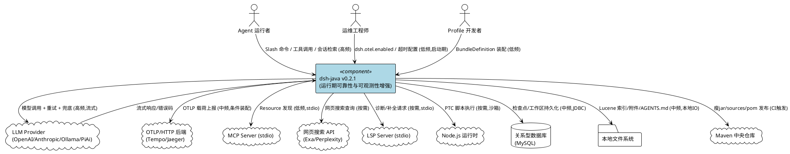

**关键交互说明**：
- **LLM 调用链**：Agent 执行链 → `LlmRetryInterceptor`（策略化重试）→ `LlmAdapterFactory`（按协议选取适配器）→ 具体 Provider。高频流式调用，重试与兜底在拦截器层完成。
- **遥测链**：`SessionEvent` → `SessionTelemetryExporter` → `OtlpBuffer` → `OtlpHttpExporter`（条件装配）→ OTLP 后端。仅在 `dsh.otel.enabled=true` 时激活。
- **检查点链**：Agent 执行链在两个时机调用 `CheckpointStrategy` → `ICheckpointRepository` → JDBC → DB。写入失败降级为日志告警。

### 2.1.2 服务/组件总体架构

本视图展示 v0.2.1 新增模块内部的组成结构、职责划分与依赖关系。整体按功能领域划分为 12 个组件群，全部遵循六边形架构的端口-适配器模式。

```plantuml
@startuml
!theme plain
skinparam component {
    BackgroundColor #White
}
skinparam package {
    BackgroundColor #F8F8F8
}

package "Domain 层 (net.linlan.dsh.domain)" as Domain {
    package "llm/retry" as LlmRetry {
        [LlmRetryPolicy] as Policy
        [RetryableErrorClassifier] as Classifier
        [LlmErrorCodes] as Codes
    }
    package "agent/context" as Context {
        [AgentsMdLoader] as AgentsMd
        [FileReferenceExpander] as FileRef
        [TimeContextInjector] as TimeInj
        [TmuxContextInjector] as TmuxInj
    }
    package "agent/service/compaction" as Compaction {
        [CompactCommand] as Compact
        [ToolResultPruner] as Pruner
        [ImageOffloader] as Offloader
        [SlashCommandRegistry] as SlashReg
    }
    package "guard" as Guard {
        [DuplicateToolGuard] as DupGuard
        [PerToolDeadlinePolicy] as Deadline
    }
    package "hooks/codex" as Hooks {
        [CodexHookBridge] as CodexBridge
    }
    package "session/checkpoint" as Checkpoint {
        [CheckpointStrategy] as CkStrategy
        [ICheckpointRepository] as CkPort
    }
    package "session/search" as Search {
        [SessionSearchProvider] as SearchSvc
        [ISessionSearchIndexPort] as SearchPort
    }
    package "session/telemetry" as Telemetry {
        [SessionTelemetryExporter] as TelExporter
        [OtlpBuffer] as Buffer
    }
    package "session/projection" as Projection {
        [SessionStatistics] as Stat
        [SessionTitleGenerator] as Title
        [TurnOutline] as Outline
    }
    package "tool/*" as Tools {
        [McpResourceDiscovery] as McpDisc
        [ExaSearchProvider] as Exa
        [GlobTool] as Glob
        [ScheduleTool] as Sched
        [LspStdioProvider] as LspSvc
    }
    package "typert" as Typert {
        [TypertService] as TypertSvc
        [PtcSandboxNodeProcess] as Ptc
    }
    package "runtime/profile/bundle" as Bundle {
        [BundleDefinition] as BundleDef
        [BundleAssembler] as BundleAsm
    }
    package "storage/attachment" as Storage {
        [ContentAddressableAttachmentStore] as CasStore
    }
    package "session/workspace" as Workspace {
        [WorkspaceEntity] as WsEntity
    }
}

package "Infrastructure 层" as Infra {
    [JdbcCheckpointRepository] as JdbcCk
    [LuceneSessionSearchIndex] as Lucene
    [OtlpHttpExporter] as OtlpHttp
    [PiAiAdapter] as PiAi
    [Sha256ContentAddressableStore] as Sha256
    [TsMorphTypertGenerator] as TsMorph
    [InMemoryTypertRegistry] as InMemReg
    [JdbcWorkspaceRepository] as JdbcWs
}

CkPort <|.. JdbcCk
SearchPort <|.. Lucene
CasStore ..> Sha256 : 委托
TypertSvc ..> InMemReg : 委托
TypertSvc ..> TsMorph : 委托
WsEntity ..> JdbcWs : 持久化

note right of LlmRetry
  重试策略化：
  错误码决定可重试性
  次数决定上限
  可选兜底 Provider
end note

note right of Checkpoint
  两个时机落点：
  before-model-request
  before-tool-side-effect
  写入失败降级
end note

note right of Telemetry
  条件装配：
  dsh.otel.enabled=true
  缓冲 FIFO 淘汰
  默认关闭
end note
@enduml
```

**模块职责与依赖关系**：

| 组件群 | 职责 | 关键依赖 | 配置项 |
|---------|------|---------|--------|
| llm/retry | 策略化重试与错误分类 | `LlmErrorCodes` 常量 | `LlmRetryPolicy`（maxAttempts/retryableCodes/fallbackProvider） |
| agent/context | 上下文注入链（5 个注入器） | 本地文件系统（AGENTS.md） | 无（自动检测） |
| agent/service/compaction | 上下文压缩与 Slash 命令 | 历史工具结果、图片载荷 | 保留阈值（近期/关键结果数） |
| guard | 执行护栏（重复工具提醒、按工具超时） | 工具调用记录 | 按工具名超时映射 |
| hooks/codex | Codex hook 协议桥接 | Codex JSON 输入 | 无 |
| session/checkpoint | 会话检查点（两个时机） | `ICheckpointRepository` 端口 | 检查点表（迁移 SQL） |
| session/search | 会话全文检索 | `ISessionSearchIndexPort` 端口 | Lucene 索引目录、`lucene.version=9.11.1` |
| session/telemetry | OTLP 遥测导出与缓冲 | `IOtelExporterPort` 端口 | `dsh.otel.enabled`、`dsh.otel.exporter.otlp-endpoint` |
| session/projection | 会话投影（统计/标题/大纲） | `ProjectionProvider<T>` 契约 | 无（复用既有契约） |
| tool/* | 工具增强（MCP/搜索/文件/定时/LSP） | 各自端口 | MCP stdio、搜索 API 端点、LSP stdio |
| typert | 类型反射与 PTC 沙箱 | `ITypertRegistryContract`、`IPtcRuntimePort` | Node.js 运行时、沙箱白名单 |
| runtime/profile/bundle | Profile Bundle 定义与装配 | Profile 配置 | BundleDefinition |
| storage/attachment | 内容寻址附件存储 | `IStorageBackendPort` | SHA-256 哈希 |
| session/workspace | 工作区实体与持久化 | `workspace` + `session_workspace` 表 | 迁移 SQL |

### 2.1.3 实现设计文档

本节描述核心逻辑的状态流转、流程分支与事务设计。

#### 2.1.3.1 LLM 重试状态流转

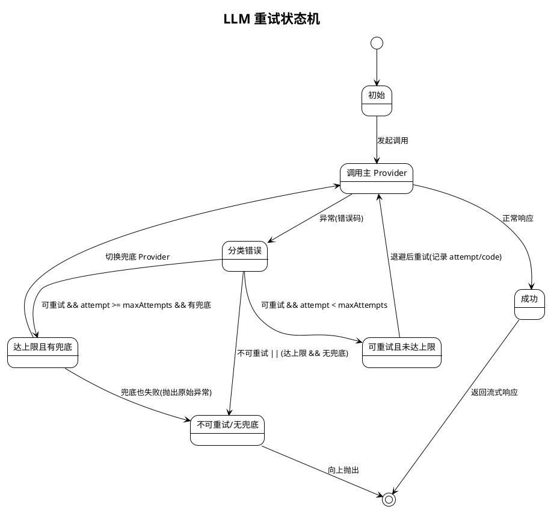

**分支触发条件与处理策略**：
- **可重试且未达上限**：错误码 ∈ retryableCodes 且 attempt < maxAttempts → 退避后重试，记录 `attempt=N code=XXX` 摘要。
- **达上限且有兜底**：attempt >= maxAttempts 且 fallbackProvider != null → 切换到兜底 Provider 发起请求。
- **不可重试/无兜底**：错误码 ∈ {AUTH, INVALID_REQUEST, CONTEXT_WINDOW_EXCEEDED, MALFORMED_RESPONSE} 或达上限且无兜底 → 向上抛出原始异常。
- **兜底也失败**：兜底 Provider 返回不可重试错误 → 向上抛出兜底 Provider 的原始异常。
- **向后兼容**：旧构造 `(int maxRetries)` 时 retryPolicy=null，退化为仅按 `attempts <= maxRetries` 重试，不进行错误码分类。

#### 2.1.3.2 检查点落点流程

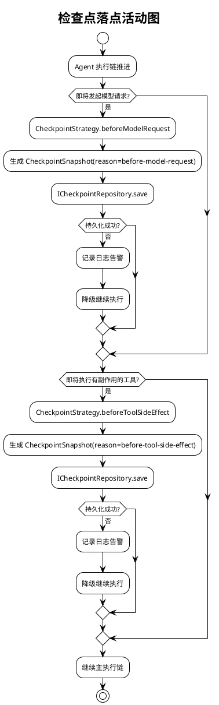

**事务设计**：检查点写入与主执行链解耦，写入失败不中断主链（降级为日志告警）。检查点表按 `session_id + step_index` 建索引，支持快速定位回放。迁移 SQL 使用 `CREATE TABLE IF NOT EXISTS` 保证幂等。

#### 2.1.3.3 OTLP 遥测导出流程

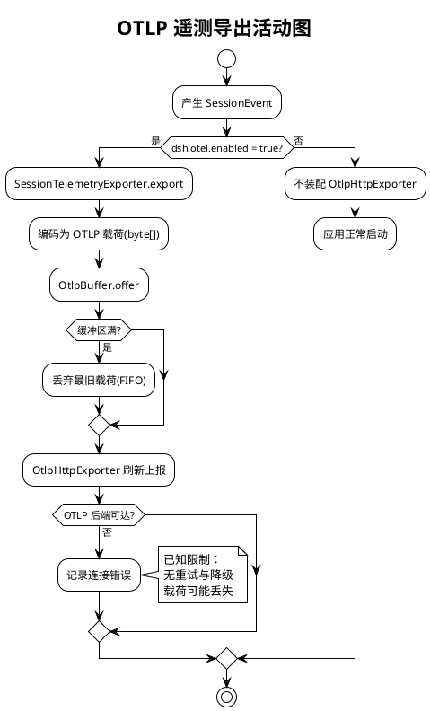

**条件装配设计**：`OtlpHttpExporter` 通过 `@ConditionalOnProperty(name="dsh.otel.enabled", havingValue="true")` 仅在显式开启时创建 Bean。未配置时 Spring 上下文不包含该 Bean，避免未配置 OTLP 端点时启动失败。

#### 2.1.3.4 上下文注入与压缩流程

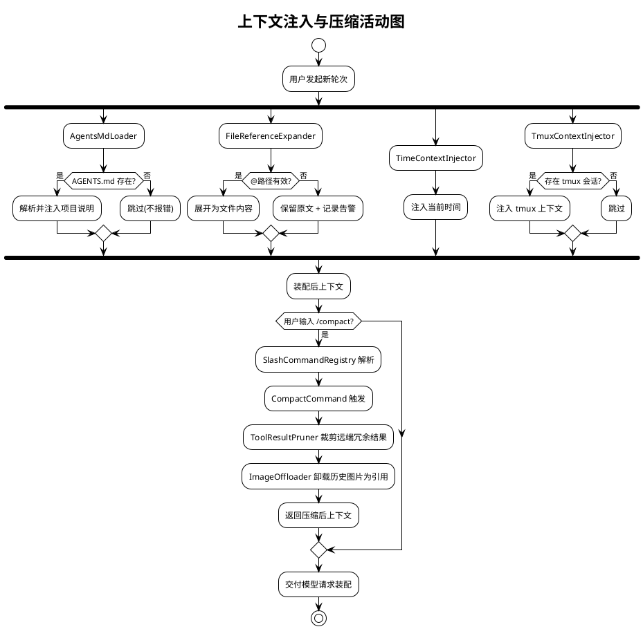

**扩展点设计**：`SlashCommandRegistry` 按名称解析并执行已注册的 Slash 命令，新增命令只需实现 `SlashCommand` 接口并注册。上下文注入器链可按需增减，各注入器独立失败不影响其他注入器。

## 2.2 接口设计

v0.2.1 接口设计遵循六边形架构端口-适配器模式：领域层定义出站端口接口，基础设施层提供适配器实现。所有接口参数类型安全，避免使用字符串 Map 传递业务数据。接口粒度按功能领域划分，每个端口职责单一。

### 2.2.1 总体设计

v0.2.1 新增接口按"领域服务 / 出站端口 / 适配器实现"三类组织。领域服务由 Domain 层提供，出站端口由 Domain 层定义，适配器由 Infrastructure 层实现。接口稳定性等级按"稳定 / 实验 / 废弃"标注。

| 接口分类 | 接口/类 | 层 | 稳定性 | 说明 |
|---------|---------|---|--------|------|
| 领域服务 | `LlmRetryPolicy` | Domain | 稳定 | 重试策略值对象 |
| 领域服务 | `RetryableErrorClassifier` | Domain | 稳定 | 错误分类器 |
| 领域服务 | `CheckpointStrategy` | Domain | 稳定 | 检查点策略（两时机） |
| 领域服务 | `SessionSearchProvider` | Domain | 稳定 | 会话搜索服务 |
| 领域服务 | `SessionTelemetryExporter` | Domain | 稳定 | 遥测导出器 |
| 领域服务 | `OtelService` | Domain | 稳定 | span 生命周期管理 |
| 领域服务 | `TypertService` | Domain | 实验 | 类型反射服务（初始版本） |
| 领域服务 | `CodexHookBridge` | Domain | 稳定 | Codex Hook 桥接 |
| 领域服务 | `ContentAddressableAttachmentStore` | Domain | 稳定 | 内容寻址存储 |
| 领域服务 | `BundleAssembler` | Domain | 稳定 | Profile Bundle 装配 |
| 出站端口 | `ICheckpointRepository` | Domain | 稳定 | 检查点持久化端口 |
| 出站端口 | `ISessionSearchIndexPort` | Domain | 稳定 | 全文索引端口 |
| 出站端口 | `IOtelExporterPort` | Domain | 稳定 | OTLP 导出端口 |
| 出站端口 | `ProjectionProvider<T>` | Domain | 稳定 | 投影契约端口（v0.1.9 既有） |
| 出站端口 | `IMcpResourcePort` | Domain | 稳定 | MCP Resource 发现端口 |
| 出站端口 | `IWebSearchPort` | Domain | 稳定 | 网页搜索端口 |
| 出站端口 | `IPtcRuntimePort` | Domain | 实验 | PTC 运行时端口 |
| 出站端口 | `ITypertRegistryContract` | Domain | 实验 | Typert 注册表契约 |
| 出站端口 | `IStorageBackendPort` | Domain | 稳定 | 存储后端端口 |
| 适配器 | `JdbcCheckpointRepository` | Infra | 稳定 | 检查点 JDBC 实现 |
| 适配器 | `LuceneSessionSearchIndex` | Infra | 稳定 | Lucene 9.11.1 索引实现 |
| 适配器 | `OtlpHttpExporter` | Infra | 稳定 | OTLP HTTP 导出（条件装配） |
| 适配器 | `PiAiAdapter` | Infra | 稳定 | PiAi 协议适配 |
| 适配器 | `Sha256ContentAddressableStore` | Infra | 稳定 | SHA-256 内容寻址实现 |
| 适配器 | `TsMorphTypertGenerator` | Infra | 实验 | ts-morph 反射生成 |
| 适配器 | `InMemoryTypertRegistry` | Infra | 实验 | 进程内 Typert 注册表 |
| 适配器 | `JdbcWorkspaceRepository` | Infra | 稳定 | 工作区 JDBC 仓储 |

**接口变更策略**：
- 向后兼容优先：`LlmRetryInterceptor` 保留 `(int)` 旧构造，`ChannelProtocol` 新增枚举项不改变既有取值。
- 新增功能全部落在新增包，不变更既有包的公开 API 签名。
- 实验性接口（Typert/PTC）标注为"实验"稳定性，后续版本可能调整。

### 2.2.2 接口清单

#### 2.2.2.1 LLM 重试策略接口群

**LlmRetryPolicy（重试策略值对象）**
- **接口签名**：
  - `LlmRetryPolicy()` — 默认构造，maxAttempts=3，默认可重试码，无兜底
  - `LlmRetryPolicy(int maxAttempts, List<String> retryableCodes, String fallbackProvider)`
  - `boolean shouldRetry(String errorCode, int attempt)`
  - `String fallbackProvider(String errorCode)`
  - `int maxAttempts()` / `List<String> retryableCodes()` / `String fallbackProvider()`
- **业务说明**：封装重试决策逻辑，错误码决定可重试性，次数决定上限，兜底 Provider 可选。
- **前置条件**：`maxAttempts` 非负；`retryableCodes` 可为 null（退化为空集合）。
- **后置条件**：返回不可变值对象，`retryableCodes` 经防御性拷贝。
- **异常映射**：`maxAttempts < 0` → `IllegalArgumentException`。

**RetryableErrorClassifier（错误分类器）**
- **接口签名**：
  - `String classify(Throwable throwable)` — 返回错误码
  - `boolean isRetryable(String code)` / `boolean isRetryable(Throwable)` / `boolean isRetryableStatus(int status)`
- **业务说明**：按异常消息关键词与 HTTP 状态码分类，递归 cause 链。
- **前置条件**：无（null 异常返回 `UNKNOWN`）。
- **后置条件**：返回标准错误码常量（定义于 `LlmErrorCodes`）。
- **异常映射**：无异常抛出，未知异常返回 `UNKNOWN`。

**LlmRetryInterceptor（重试拦截器）**
- **接口签名**：实现 `WaterfallExpert<LlmStreamHandoff>`
  - `LlmRetryInterceptor(int maxRetries)` — 旧构造，向后兼容
  - `LlmRetryInterceptor(LlmRetryPolicy retryPolicy, RetryableErrorClassifier classifier)` — 策略构造
  - `int priority()` → 10
  - `boolean canTerminate()` → false
  - `WaterfallOutcome<LlmStreamHandoff> handle(WaterfallEvent, LlmStreamHandoff)`
- **业务说明**：包装流式供应者为 `RetryPublisher`，在 `onError` 时依据策略重试或抛出。
- **前置条件**：策略构造要求 `retryPolicy` 与 `classifier` 非空；旧构造退化为次数判断。
- **后置条件**：重试时记录 `attempt/code` 摘要；流式背压通过 `Flow.Subscription` 维护。
- **调用示例**：
  ```java
  // 策略化重试
  LlmRetryPolicy policy = new LlmRetryPolicy(3, LlmErrorCodes.DEFAULT_RETRYABLE_CODES, "fallback-provider");
  LlmRetryInterceptor interceptor = new LlmRetryInterceptor(policy, new RetryableErrorClassifier());
  // 向后兼容（次数重试）
  LlmRetryInterceptor legacy = new LlmRetryInterceptor(3);
  ```

#### 2.2.2.2 检查点接口群

**CheckpointSnapshot（检查点快照值对象，record）**
- **接口签名**：
  - `CheckpointSnapshot(String sessionId, long stepIndex, String reason, String contextSnapshotJson, Instant createdAt)`
  - `static CheckpointSnapshot of(String sessionId, long stepIndex, String reason, String contextSnapshotJson)` — 自动填充 createdAt
- **业务说明**：不可变快照，含会话 ID、步次、原因、上下文 JSON、时间戳。
- **前置条件**：`sessionId`/`reason`/`createdAt` 非空（紧凑构造器校验）。
- **后置条件**：record 不可变。

**CheckpointStrategy（检查点策略）**
- **接口签名**：
  - `CheckpointStrategy(ICheckpointRepository repository)`
  - `CheckpointSnapshot beforeModelRequest(SessionLog session)`
  - `CheckpointSnapshot beforeToolSideEffect(SessionLog session, SessionEvent.ToolCall toolCall)`
  - 常量 `REASON_BEFORE_MODEL_REQUEST` / `REASON_BEFORE_TOOL_SIDE_EFFECT`
- **业务说明**：在两个时机生成快照并委托仓储持久化。
- **前置条件**：`repository` 非空。
- **后置条件**：快照写入端口；写入失败由调用方降级。
- **异常映射**：端口实现抛出异常时，调用方捕获并降级为日志告警。

**ICheckpointRepository（检查点出站端口）**
- **接口签名**：
  - `void save(CheckpointSnapshot snapshot)`
  - `Optional<CheckpointSnapshot> findBySessionAndStep(String sessionId, long stepIndex)`
  - `List<CheckpointSnapshot> findBySession(String sessionId)`
- **业务说明**：检查点持久化端口，由 `JdbcCheckpointRepository` 提供 JDBC 实现。
- **实现适配器**：`JdbcCheckpointRepository`（Infrastructure 层），操作 `checkpoint` 表。

#### 2.2.2.3 会话检索接口群

**SessionSearchProvider（会话搜索领域服务）**
- **接口签名**：
  - `SessionSearchProvider(ISessionSearchIndexPort port)`
  - `List<SearchHit> search(String query, int limit)`
- **业务说明**：委托端口执行搜索，返回匹配片段与高亮定位。
- **前置条件**：`port` 非空；`query` 非空非 blank；`limit > 0`。
- **后置条件**：空查询或 limit<=0 返回空列表。

**ISessionSearchIndexPort（全文索引出站端口，继承 AutoCloseable）**
- **接口签名**：
  - `void index(String sessionId, long seq, String content)`
  - `List<SearchHit> search(String query, int limit)`
  - `void clear()`
  - `default void close()`
- **业务说明**：全文索引写入与查询端口。
- **实现适配器**：`LuceneSessionSearchIndex`（Lucene 9.11.1 嵌入式索引，本地文件系统）。
- **约束**：索引单机本地，多实例不共享（已知限制）。

#### 2.2.2.4 遥测接口群

**OtlpBuffer（OTLP 缓冲值对象）**
- **接口签名**：
  - `OtlpBuffer()` — 默认 4MB 容量
  - `OtlpBuffer(long byteLimit)`
  - `synchronized boolean offer(byte[] event)`
  - `synchronized int size()` / `synchronized long currentBytes()` / `synchronized long droppedCount()` / `long byteLimit()`
- **业务说明**：带字节容量上限的 FIFO 队列缓冲，超出时丢弃最旧载荷。
- **前置条件**：`byteLimit > 0`。
- **后置条件**：线程安全（synchronized）；单条载荷超过容量直接丢弃并计数。
- **异常映射**：`byteLimit <= 0` → `IllegalArgumentException`。

**OtlpHttpExporter（OTLP HTTP 导出适配器，条件装配）**
- **接口签名**：实现 `IOtelExporterPort`
  - `@Component` + `@ConditionalOnProperty(name="dsh.otel.enabled", havingValue="true")`
  - `@Autowired OtlpHttpExporter(@Value("${dsh.otel.exporter.otlp-endpoint:http://127.0.0.1:4318/v1/traces}") String endpoint)`
  - 保留 `OtlpHttpExporter(String endpoint, HttpClient httpClient)` 双参构造（测试用）
- **业务说明**：OTLP/HTTP 导出，仅在 `dsh.otel.enabled=true` 时装配。
- **前置条件**：启用遥测时需配置端点（或使用默认端点）。
- **后置条件**：未启用时不创建 Bean，应用正常启动。
- **约束**：无采样、鉴权与批量重试（已知限制）。

#### 2.2.2.5 投影接口群

**ProjectionProvider<T>（投影契约端口，v0.1.9 既有）**
- **接口签名**：
  - `ProjectionType type()`
  - `Class<T> projectionClass()`
  - `T initial()`
  - `T applyIncremental(T current, SessionEvent event)`
- **业务说明**：增量计算投影状态，纯函数（不修改 current）。
- **v0.2.1 新增实现**：`SessionStatistics`（用量统计）、`SessionTitleGenerator`（会话标题）、`TurnOutline`（轮次大纲），均通过 `ProjectionRegistry` 统一注册。
- **约束**：新增投影必须复用此契约，不得另立接口。

#### 2.2.2.6 Codex Hook 桥接接口

**CodexHookBridge（Codex Hook 桥接）**
- **接口签名**：
  - `HookOutput bridge(String hookInput)` — 解析 Codex JSON 为 HookOutput
  - `String toCodexJson(HookOutput output)` — 反向序列化
- **业务说明**：解析字段 `exit_code`/`stdout`/`stderr`/`continue`/`stopReason`/`decision`/`reason`/`additionalContext`/`systemMessage`。
- **前置条件**：无（空输入返回默认 emptyOutput）。
- **后置条件**：格式非法时返回默认 HookOutput，不中断执行链。
- **异常映射**：无异常抛出，解析失败静默降级。

#### 2.2.2.7 内容寻址存储接口群

**ContentAddressableAttachmentStore（内容寻址附件存储）**
- **接口签名**：
  - `ContentAddressableAttachmentStore(IStorageBackendPort backend)` — 默认 SHA-256
  - `ContentAddressableAttachmentStore(IStorageBackendPort backend, HashFunction hashFunction)`
  - `String store(byte[] content)` — 返回内容哈希键
  - `byte[] retrieve(String contentHash)`
  - `boolean exists(String contentHash)`
  - 内部接口 `HashFunction`：`String hash(byte[] content)`
- **业务说明**：以内容哈希为键存储附件，相同内容去重。
- **前置条件**：`backend` 与 `hashFunction` 非空；`content` 非空。
- **后置条件**：相同内容返回相同哈希键；读取时哈希一致。
- **异常映射**：附件不存在 → `StorageException(UNIT_NOT_FOUND)`；SHA-256 不可用 → `StorageException(MALFORMED_MEDIUM)`。

#### 2.2.2.8 Typert 与 PTC 接口群

**ITypertService（Typert 服务端口）**
- **接口签名**：
  - `void registerContribution(TypertContribution contribution)`
  - `Optional<InvocationDescriptor> resolveInvocation(String endpoint)`
  - `List<InvocationDescriptor> listInvocations()`
  - `ITypertRegistryContract registry()`
- **业务说明**：类型反射与远程调用注册，由 `TypertService`（`@Service`）实现，委托 `ITypertRegistryContract`。
- **稳定性**：实验（初始版本，功能完整度与安全性待验证）。

**IPtcRuntimePort（PTC 运行时端口）**
- **接口签名**：定义 PTC 沙箱执行契约，由 `PtcSandboxNodeProcess` / `SandboxedNodePtcProcess` 实现。
- **约束**：沙箱 Node 进程限制可执行路径与脚本路径，不得执行白名单外命令。
- **稳定性**：实验。

#### 2.2.2.9 渠道协议与适配器工厂接口群

**ChannelProtocol（渠道协议枚举）**
- **接口签名**：
  - 枚举值 `OPENAI("openai")` / `ANTHROPIC("anthropic")` / `OLLAMA("ollama")` / `PI_AI("pi-ai")`
  - `String code()` — 稳定编码
  - `static ChannelProtocol fromCode(String code)` — 按编码解析，未知回退 OPENAI
- **业务说明**：描述模型渠道使用的上游协议，v0.2.1 新增 PiAi 分支。
- **约束**：新增分支不改变既有取值（向后兼容）。

**LlmAdapterFactory（适配器工厂）**
- **接口签名**：按 `ChannelProtocol` 选取适配器，新增 PI_AI 分支返回 `PiAiAdapter`。
- **异常映射**：未知协议 → 抛出明确异常。

#### 2.2.2.10 Profile Bundle 接口群

**BundleDefinition / BundleAssembler（Profile Bundle 定义与装配）**
- **接口签名**：
  - `BundleDefinition` 封装一组 Profile 配置定义
  - `BundleAssembler.assemble(BundleDefinition) -> Profile集合`
- **业务说明**：将 Bundle 定义装配为可分发的 Profile 集合，便于成组分发。

## 2.3 数据模型

v0.2.1 数据模型设计与领域概念对齐，先定义领域对象再考虑持久化。新增数据模型全部落在新增包，不影响既有表结构。持久化通过迁移脚本幂等建表（`CREATE TABLE IF NOT EXISTS`）。

### 2.3.1 设计目标

v0.2.1 数据模型需支持以下业务场景并满足对应约束：

| 业务场景 | 数据模型 | 性能/容量目标 | 兼容策略 |
|---------|---------|--------------|---------|
| 会话检查点回放 | `CheckpointSnapshot` + `checkpoint` 表 | 按 `session_id + step_index` 索引快速定位 | 迁移脚本幂等建表，不影响既有表 |
| 工作区与会话多对多关联 | `WorkspaceEntity` + `workspace` + `session_workspace` 表 | 关系表按 `(workspace_id, session_id)` 索引 | 迁移脚本幂等建表 |
| OTLP 遥测缓冲 | `OtlpBuffer`（内存队列） | 默认 4MB 字节上限，FIFO 淘汰 | 无持久化，进程内缓冲 |
| 内容寻址附件去重 | `ContentAddressableAttachmentStore`（SHA-256 键） | 相同内容仅存一份 | 复用既有 `IStorageBackendPort` |
| LLM 重试策略 | `LlmRetryPolicy`（值对象，无持久化） | 进程内决策 | 旧构造向后兼容 |
| Lucene 全文索引 | 本地文件系统索引 | 异步写入不阻塞主链 | 单机本地，多实例不共享 |
| 会话投影 | 复用 `ProjectionProvider<T>` 契约 | 增量计算纯函数 | 复用既有契约，不另立接口 |

**与存量数据兼容策略**：
- 新增表（`checkpoint`、`workspace`、`session_workspace`）由迁移脚本 `V20261011__*.sql` 幂等建表，使用 `CREATE TABLE IF NOT EXISTS`，可重复执行不报错。
- 不修改既有表结构，不影响既有数据。
- 新增领域对象全部落在新增包，不变更既有包的公开 API 签名。

### 2.3.2 模型实现

本节展示核心领域对象的类图与关系。类图只显示属性和方法签名，不显示访问修饰符；关系线标注多重性；不包含技术字段。

#### 2.3.2.1 检查点与工作区领域模型

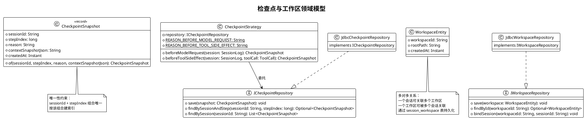

**对象创建与销毁策略**：
- `CheckpointSnapshot` 为 `record`，不可变，工厂方法 `of` 自动填充 `createdAt`。
- `CheckpointStrategy` / `JdbcCheckpointRepository` / `JdbcWorkspaceRepository` 为 Spring 管理单例。
- `WorkspaceEntity` 为聚合实体，通过仓储持久化。

**持久化策略**：
- `checkpoint` 表：`id` 自增主键，`session_id` + `step_index` 联合索引，`context_snapshot_json` 为 TEXT，`created_at` 为 TIMESTAMP。
- `workspace` 表：`workspace_id` 主键，`root_path` + `created_at`。
- `session_workspace` 表：`id` 自增主键，`workspace_id` + `session_id` 联合索引，持久化多对多关系。

#### 2.3.2.2 LLM 重试与遥测领域模型

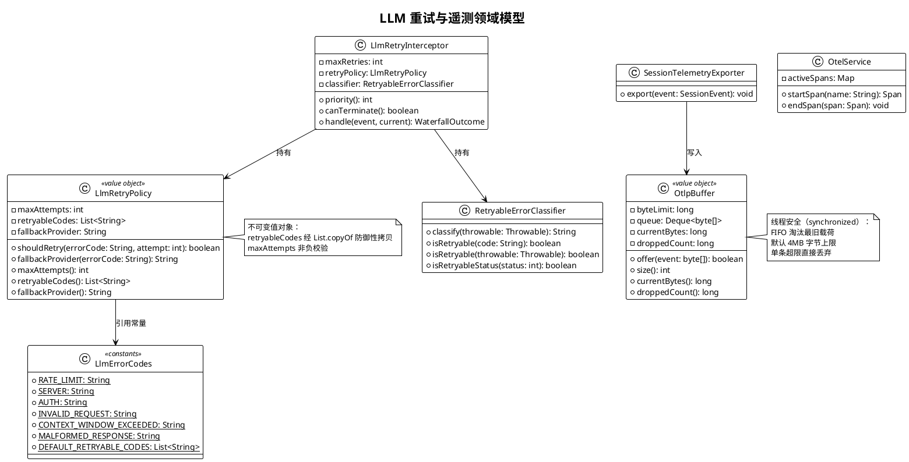

**对象生命周期**：
- `LlmRetryPolicy` / `LlmErrorCodes` / `RetryableErrorClassifier` 为无状态/不可变对象，线程安全。
- `LlmRetryInterceptor` 每次调用创建 `RetryPublisher`，内部维护 `attempts` 与 `retrySummary`。
- `OtlpBuffer` 为进程内单例，生命周期随 Spring 上下文。
- `OtelService` 维护 `activeSpans` 生命周期，span 泄漏可由日志发现。

#### 2.3.2.3 内容寻址存储与投影领域模型

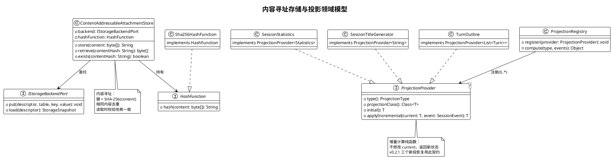

**持久化策略**：
- `ContentAddressableAttachmentStore` 复用既有 `IStorageBackendPort`，内容 Base64 编码后存储，键为 SHA-256 哈希。无独立表结构。
- 会话投影为内存计算，无独立持久化，状态由事件流增量计算得出。

#### 2.3.2.4 渠道协议与 Profile Bundle 领域模型

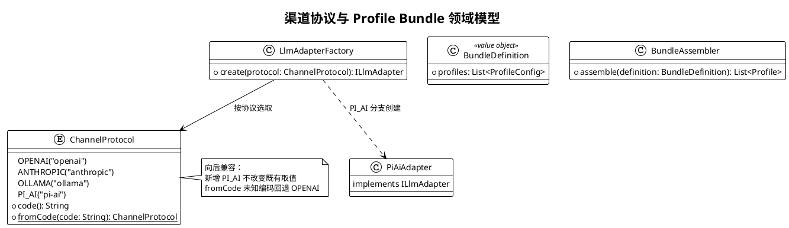

**对象创建策略**：
- `ChannelProtocol` 为枚举单例，`fromCode` 大小写不敏感匹配。
- `LlmAdapterFactory` 按协议 switch 选取适配器，PI_AI 分支返回 `PiAiAdapter` 实例。
- `BundleDefinition` 为不可变值对象，`BundleAssembler` 将定义装配为可分发 Profile 集合。

## 2.4 扩展领域增量设计（§5.13–§5.28）

本节将 16 个待实现扩展领域需求转化为可落地的技术方案。按"核心扩展（§5.13–§5.18）+ 实验性扩展（§5.19–§5.28）"组织，每个领域给出包路径、领域服务、出站端口与适配器设计。实验性扩展默认关闭，通过 `@ConditionalOnProperty` 或 profile 显式启用。

### 2.4.1 扩展领域上下文视图

本视图展示 v0.2.1 扩展领域与外部系统及既有模块的交互关系。

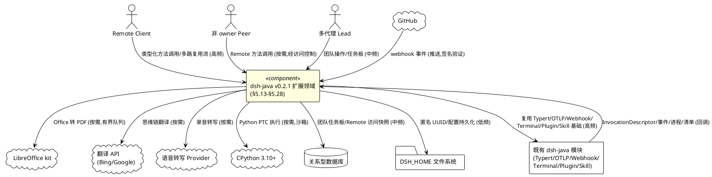

**关键交互说明**：
- **Remote API 链**：Client → `TypertGatewayService`（访问控制 + 分派）→ 控制器 namespace → 既有域服务。多路复用流在同一条逻辑流上承载双向流项。
- **Office 转换链**：消费方 → `OfficeToPdfService`（有界队列 + 缓存）→ LibreOffice kit 适配器 → PDF + 缺失字体列表。
- **子进程链**：消费方 → `SubprocessService`（环境清理）→ 本地/远程执行 → 受管进程范围终止。
- **团队协作链**：Lead → `AgentTeamService` → roster/inbox/共享任务板 → 持久存储 → teammate 冷恢复。
- **Webhook 链**：GitHub → `webhook-github` 适配器（签名验证）→ 投影交付 → `webhookRuntime.dispatch()` → 立即 202。

### 2.4.2 扩展领域服务/组件总体架构

本视图展示 16 个扩展领域的模块组成、职责与依赖关系。核心扩展与实验性扩展分区标注。

```plantuml
@startuml
!theme plain
skinparam package {
    BackgroundColor #FFF8E1
}
skinparam package <<exp>> {
    BackgroundColor #FCE4EC
}

package "Domain 层 - 核心扩展" as ExtDomain {
    package "api/gateway" as ApiGw {
        [TypertGatewayService] as Gateway
        [RemoteAccessService] as Access
        [RemoteAccessPolicy] as Policy
    }
    package "api/controller" as Ctrl {
        [SessionController] as SessCtrl
        [WorkspaceController] as WsCtrl
        [WorkspaceFilesController] as WsFile
        [TerminalController] as TermCtrl
        [JobController] as JobCtrl
        [SettingsController] as SetCtrl
        [AccountController] as AcctCtrl
    }
    package "boot" as Boot {
        [DshCommandLine] as Cmd
        [HmrCoordinator] as Hmr
        [ConfigEditor] as CfgEd
        [PluginManagerCli] as PlugCli
    }
    package "document/office" as Office {
        [OfficeToPdfService] as OfficeSvc
        [IOfficeConverterPort] as OfficePort
    }
    package "identity" as Identity {
        [AnonymousUserId] as AnonId
        [IAnonymousIdStoragePort] as AnonPort
    }
    package "subprocess" as Sub {
        [SubprocessService] as SubSvc
        [ISubprocessExecutorPort] as SubPort
    }
    package "host/picker" as Picker {
        [DirectoryPickerSeam] as DirPick
        [OpenInAppService] as OpenApp
        [PluginInventoryProjection] as InvProj
    }
}

package "Domain 层 - 实验性扩展" <<exp>> as ExpDomain {
    package "agent/team" as Team {
        [AgentTeamService] as TeamSvc
        [IAgentTeamRepository] as TeamRepo
    }
    package "guard/review" as Review {
        [AutoReviewService] as RevSvc
    }
    package "speech" as Speech {
        [SpeechToTextService] as SttSvc
        [ISpeechProviderPort] as SttPort
    }
    package "translation/cot" as Cot {
        [CotTranslationService] as CotSvc
        [ITranslatorPort] as TrPort
    }
    package "session/inspector" as Inspect {
        [SessionInspectorService] as InsSvc
    }
    package "tool/worktree" as Wt {
        [WorktreeTool] as WtTool
    }
    package "webhook/github" as GhWh {
        [GitHubWebhookAdapter] as GhAdapter
    }
    package "skill/badge" as Badge {
        [SkillBadgeProvider] as BadgeProv
    }
    package "ptc/python" as PyPtc {
        [PtcSandboxPythonProcess] as PyProc
    }
    package "hooks/claude-code" as CcHook {
        [ClaudeCodeHookBridge] as CcBridge
        [HookPointDispatcher] as HookDisp
    }
}

package "Infrastructure 层" as ExtInfra {
    [LibreOfficeConverterAdapter] as LibreAdapt
    [FileAnonymousIdStorage] as FileAnon
    [LocalSubprocessExecutor] as LocalSub
    [RemoteSubprocessExecutor] as RemoteSub
    [BingTranslatorAdapter] as BingAdapt
    [GoogleTranslatorAdapter] as GoogleAdapt
    [SenseVoiceSpeechAdapter] as SenseVoice
    [JdbcAgentTeamRepository] as JdbcTeam
    [CpythonPtcAdapter] as CpythonAdapt
}

OfficePort <|.. LibreAdapt
AnonPort <|.. FileAnon
SubPort <|.. LocalSub
SubPort <|.. RemoteSub
TrPort <|.. BingAdapt
TrPort <|.. GoogleAdapt
SttPort <|.. SenseVoice
TeamRepo <|.. JdbcTeam
PyProc ..> CpythonAdapt : 委托

note right of ApiGw
  核心扩展：
  Gateway 分派 + 访问控制
  9 个控制器 namespace
  多路复用流
end note

note right of ExpDomain
  实验性扩展：
  默认关闭
  @ConditionalOnProperty
  或 profile 显式启用
end note
@enduml
```

**扩展领域模块职责与配置项**：

| 组件群 | 包路径 | 职责 | 关键配置项 | 启用策略 |
|---------|---------|------|---------|---------|
| api/gateway | `domain/api/gateway` | 类型化 Gateway 分派与访问控制 | `dsh.remote.enabled` | 默认启用（核心） |
| api/controller | `domain/api/controller` | 9 个 Remote 控制器 namespace | 无（随 gateway） | 默认启用（核心） |
| boot | `domain/boot` | 命令行/HMR/配置编辑/插件 CLI | `dsh.boot.hmr.enabled` | 默认启用（核心） |
| document/office | `domain/document/office` | Office 转 PDF 服务 | `dsh.office.converter.path`、`dsh.office.queue-bound` | 按需（核心） |
| identity | `domain/identity` | 匿名用户标识 | `dsh.home`（`$DSH_HOME`） | 默认启用（核心） |
| subprocess | `domain/subprocess` | 统一子进程管理 | `dsh.subprocess.grace-ms` | 默认启用（核心） |
| host/picker | `domain/host/picker` | 目录选择/open-in-app/插件清单投影 | `dsh.picker.mode`（native/browse/auto） | 默认启用（核心） |
| agent/team | `domain/agent/team` | 多代理团队协作 | `dsh.experimental.agent-team.enabled` | 默认关闭（实验） |
| guard/review | `domain/guard/review` | 自动审查 | `dsh.experimental.auto-review.enabled` | 默认关闭（实验） |
| speech | `domain/speech` | 语音转文本 | `dsh.experimental.speech.enabled`、`dsh.speech.provider` | 默认关闭（实验） |
| translation/cot | `domain/translation/cot` | 思维链翻译 | `dsh.experimental.cot-translation.enabled`、`dsh.translation.service`（bing/google） | 默认关闭（实验） |
| session/inspector | `domain/session/inspector` | 会话检查器 | `dsh.experimental.session-inspector.enabled` | 默认关闭（实验） |
| tool/worktree | `domain/tool/worktree` | Git 工作树工具 | `dsh.experimental.worktree.enabled` | 默认关闭（实验） |
| webhook/github | `domain/webhook/github` | GitHub webhook 适配 | `dsh.experimental.webhook-github.enabled`、`dsh.webhook.github.secret` | 默认关闭（实验） |
| skill/badge | `domain/skill/badge` | 技能徽章 | `dsh.experimental.skill-badge.enabled` | 默认关闭（实验） |
| ptc/python | `domain/typert/ptc/python` | PTC Python 运行时 | `dsh.experimental.ptc-python.enabled`、`dsh.ptc.python.budget` | 默认关闭（实验） |
| hooks/claude-code | `domain/hooks/claude-code` | Claude Code/Codex hook 扩展 | `dsh.experimental.hooks-cc.enabled`、`dsh.hooks.codex.config-path` | 默认关闭（实验） |

### 2.4.3 扩展领域实现设计文档

本节描述扩展领域核心逻辑的状态流转、流程分支与事务设计。

#### 2.4.3.1 Remote API Gateway 分派与访问控制流程

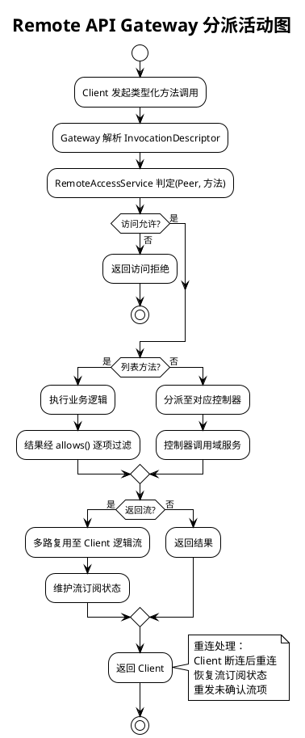

**事务设计**：访问控制在参数解析前执行（fail-fast），拒绝时不执行业务逻辑。多路复用流的订阅状态按 Client 连接 ID 维护，重连时按 ID 恢复。控制器 namespace 缺失时返回配置错误，不影响其他 namespace。

#### 2.4.3.2 Office 转 PDF 有界队列与缓存流程

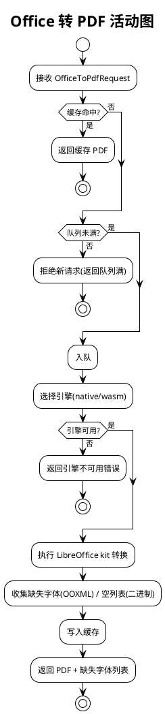

**分支触发条件**：native 引擎须目标声明且 kit 已安装；OOXML（DOCX/XLSX/PPTX）返回缺失字体列表，二进制 Office（DOC/XLS/PPT）返回空列表。有界队列满时拒绝新请求，不无限排队。

#### 2.4.3.3 子进程环境清理与受管终止流程

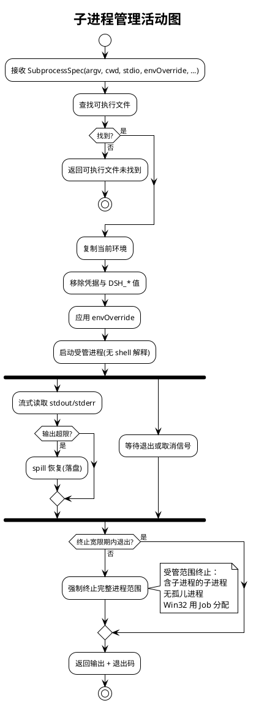

**事务设计**：环境清理顺序固定（先移除凭据/`DSH_*`，再应用覆盖），不可颠倒。受管进程范围终止通过进程组（Unix）或 Job 对象（Win32）实现，保证无孤儿进程。输出在进程退出后仍可读取（spill 落盘的输出持久化）。

#### 2.4.3.4 多代理团队协作状态流转

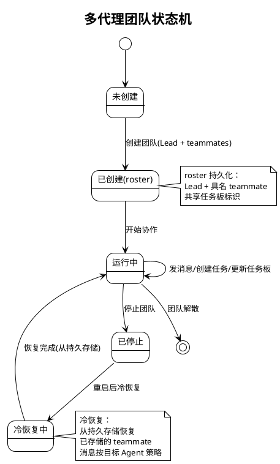

**持久化设计**：roster、共享任务板与消息均持久化到关系型存储，跨重启保留。冷恢复从持久存储重建 teammate 状态。消息持久化遵循目标 Agent 常规策略，不另立路径。

#### 2.4.3.5 自动审查决策流程

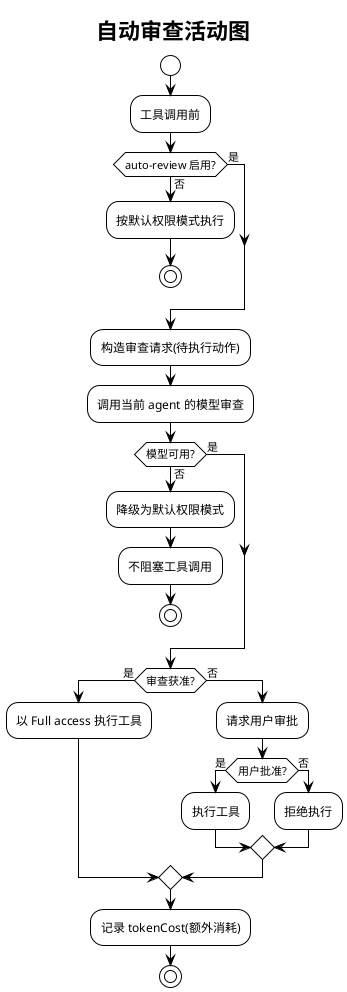

**约束设计**：自动审查消耗额外 token（模型评估），须记录 `tokenCost`。审查模型不可用时降级为默认权限模式，不阻塞工具调用。审查误判为已知限制，须人工复核。

#### 2.4.3.6 GitHub Webhook 签名验证与路由流程

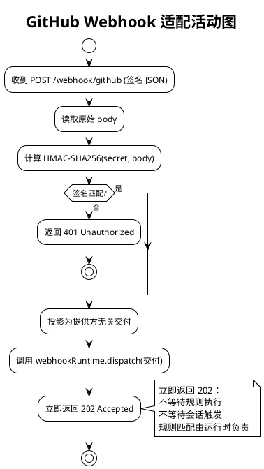

**事务设计**：签名验证在路由前执行（fail-fast），失败返回 401。验证通过后立即返回 202，不等待规则或会话执行（异步由 webhook 运行时负责）。投影交付剥离 GitHub 专有字段为提供方无关结构。

#### 2.4.3.7 PTC Python 沙箱执行流程

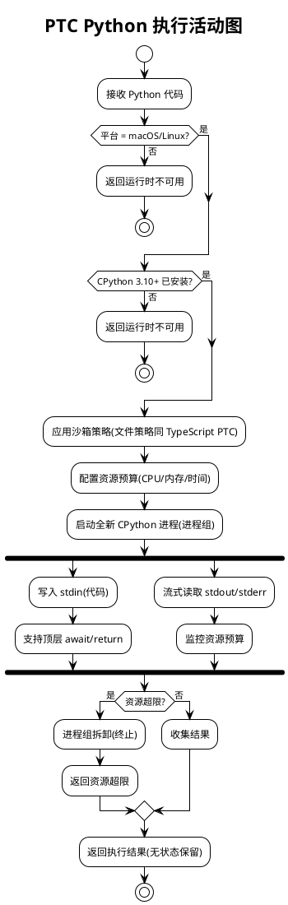

**约束设计**：Python PTC 仅在 macOS/Linux 启用。每次执行为全新进程，运行间无状态保留。资源预算超限时进程组拆卸终止。文件操作遵循与 TypeScript PTC 相同的沙箱策略。

#### 2.4.3.8 Hook 协议扩展调度流程

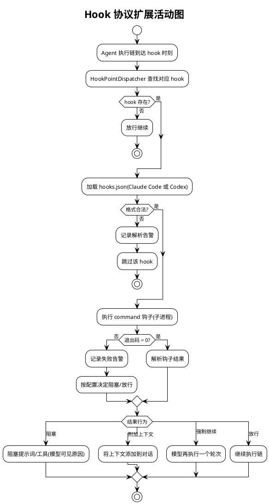

**扩展点设计**：`HookPointDispatcher` 按 hook 时刻（会话开始/提示词提交/工具执行前后/停止/subagent）调度。Claude Code 支持会话/提示词/工具/停止/subagent 点，Codex 支持 5 点。超出受支持子集的行为引导使用原生插件，不静默忽略。钩子执行失败不中断主链（降级为日志告警）。

## 2.5 扩展领域接口设计（§5.13–§5.28）

扩展领域接口设计遵循与既有领域一致的六边形架构端口-适配器模式。所有接口参数类型安全，避免字符串 Map。实验性接口标注"实验"稳定性。接口按"领域服务 / 出站端口 / 适配器"三类组织。

### 2.5.1 扩展领域接口总体设计

| 接口分类 | 接口/类 | 层 | 稳定性 | 对应领域 | 说明 |
|---------|---------|---|--------|---------|------|
| 领域服务 | `TypertGatewayService` | Domain | 稳定 | §5.13 | 类型化 Gateway 分派 |
| 领域服务 | `RemoteAccessService` | Domain | 稳定 | §5.13 | Remote 访问控制 |
| 领域服务 | `*Controller`（9 个） | Domain | 稳定 | §5.13 | Remote 控制器 namespace |
| 领域服务 | `DshCommandLine` | Domain | 稳定 | §5.14 | 应用命令行 flag |
| 领域服务 | `HmrCoordinator` | Domain | 稳定 | §5.14 | 热重载协调（复用 `ModuleLevelHmrService`） |
| 领域服务 | `ConfigEditor` | Domain | 稳定 | §5.14 | 配置编辑持久化 |
| 领域服务 | `PluginManagerCli` | Domain | 稳定 | §5.14 | 插件管理 CLI |
| 领域服务 | `OfficeToPdfService` | Domain | 稳定 | §5.15 | Office 转 PDF |
| 领域服务 | `AnonymousUserId` | Domain | 稳定 | §5.16 | 匿名身份值对象 |
| 领域服务 | `SubprocessService` | Domain | 稳定 | §5.17 | 子进程管理 |
| 领域服务 | `DirectoryPickerSeam` | Domain | 稳定 | §5.18 | 目录选择 seam |
| 领域服务 | `OpenInAppService` | Domain | 稳定 | §5.18 | open-in-app 路由 |
| 领域服务 | `PluginInventoryProjection` | Domain | 稳定 | §5.18 | 插件清单只读投影（复用 `PluginInventoryService`） |
| 领域服务 | `AgentTeamService` | Domain | 实验 | §5.19 | 多代理团队 |
| 领域服务 | `AutoReviewService` | Domain | 实验 | §5.20 | 自动审查 |
| 领域服务 | `SpeechToTextService` | Domain | 实验 | §5.21 | 语音转文本 |
| 领域服务 | `CotTranslationService` | Domain | 实验 | §5.22 | 思维链翻译 |
| 领域服务 | `SessionInspectorService` | Domain | 实验 | §5.23 | 会话检查器 |
| 领域服务 | `WorktreeTool` | Domain | 实验 | §5.24 | Git 工作树工具 |
| 领域服务 | `GitHubWebhookAdapter` | Domain | 实验 | §5.25 | GitHub webhook 适配（复用 `GitHubWebhookHandler`） |
| 领域服务 | `SkillBadgeProvider` | Domain | 实验 | §5.26 | 技能徽章提供方（复用 `BadgeSkill`） |
| 领域服务 | `PtcSandboxPythonProcess` | Domain | 实验 | §5.27 | PTC Python 沙箱（复用 `IPtcRuntimePort`） |
| 领域服务 | `ClaudeCodeHookBridge` | Domain | 实验 | §5.28 | Claude Code hook 桥接 |
| 领域服务 | `HookPointDispatcher` | Domain | 实验 | §5.28 | hook 点调度（复用 `CodexHookBridge`） |
| 出站端口 | `IOfficeConverterPort` | Domain | 稳定 | §5.15 | Office 转换器端口 |
| 出站端口 | `IAnonymousIdStoragePort` | Domain | 稳定 | §5.16 | 匿名 ID 存储端口 |
| 出站端口 | `ISubprocessExecutorPort` | Domain | 稳定 | §5.17 | 子进程执行器端口 |
| 出站端口 | `IDirectoryPickerBackendPort` | Domain | 稳定 | §5.18 | 目录选择后端端口 |
| 出站端口 | `IAgentTeamRepository` | Domain | 实验 | §5.19 | 团队持久化端口 |
| 出站端口 | `ISpeechProviderPort` | Domain | 实验 | §5.21 | 语音转写 Provider 端口 |
| 出站端口 | `ITranslatorPort` | Domain | 实验 | §5.22 | 翻译服务端口 |
| 出站端口 | `IWebhookRuntimePort` | Domain | 实验 | §5.25 | webhook 运行时端口 |
| 适配器 | `LibreOfficeConverterAdapter` | Infra | 稳定 | §5.15 | LibreOffice kit 适配 |
| 适配器 | `FileAnonymousIdStorage` | Infra | 稳定 | §5.16 | 文件存储适配 |
| 适配器 | `LocalSubprocessExecutor` | Infra | 稳定 | §5.17 | 本地子进程执行 |
| 适配器 | `RemoteSubprocessExecutor` | Infra | 稳定 | §5.17 | 远程子进程执行 |
| 适配器 | `BingTranslatorAdapter` | Infra | 实验 | §5.22 | Bing 翻译适配 |
| 适配器 | `GoogleTranslatorAdapter` | Infra | 实验 | §5.22 | Google 翻译适配 |
| 适配器 | `SenseVoiceSpeechAdapter` | Infra | 实验 | §5.21 | SenseVoice 语音适配 |
| 适配器 | `JdbcAgentTeamRepository` | Infra | 实验 | §5.19 | 团队 JDBC 仓储 |
| 适配器 | `CpythonPtcAdapter` | Infra | 实验 | §5.27 | CPython PTC 适配 |

**接口变更策略**：
- 扩展领域全部落在新增包，不变更既有包的公开 API 签名。
- 复用既有基础（如 `GitHubWebhookHandler`/`OfficeSkill`/`BadgeSkill`）时，新增领域服务包装既有实现，不修改既有类。
- 实验性接口标注"实验"稳定性，后续版本可能调整；默认关闭，启用须显式配置。

### 2.5.2 扩展领域接口清单

#### 2.5.2.1 Remote API Gateway 接口群（§5.13）

**TypertGatewayService（类型化 Gateway）**
- **接口签名**：
  - `TypertGatewayService(ITypertRemoteRegistry registry, RemoteAccessService access)`
  - `RemoteResult dispatch(InvocationDescriptor descriptor, Object[] args, PeerContext peer)`
  - `Stream<RemoteStreamItem> subscribeMultiplexed(PeerContext peer, List<String> streamIds)`
  - `void cancel(String invocationId)` / `Stream<RemoteStreamItem> reconnect(String peerId)`
- **业务说明**：依据 `InvocationDescriptor` 约定分派 Client 调用，校验参数，支持取消与重连，转发 Host 事件。
- **前置条件**：`descriptor` 非空且已注册；`peer` 经访问控制判定。
- **后置条件**：分派至对应控制器；多路复用流按 peer 维护订阅状态。
- **异常映射**：访问拒绝 → `RemoteAccessDeniedException`；descriptor 未注册 → `RemoteNotFoundException`。

**RemoteAccessService（Remote 访问控制）**
- **接口签名**：
  - `RemoteAccessService(RemoteAccessPolicy policy)`
  - `boolean allows(PeerContext peer, String method)`
  - `<T> List<T> filterList(PeerContext peer, String method, List<T> items)`
  - `AccessSnapshot snapshot(PeerContext peer)`
- **业务说明**：在 Gateway 解析参数前判定非 owner Peer 的方法级访问权限，列表方法经 `allows()` 逐项过滤。
- **前置条件**：`policy` 非空。
- **后置条件**：owner Peer 全部允许；非 owner Peer 按策略判定。
- **约束**：判定在参数解析前执行（fail-fast）。

**Remote 控制器（9 个 namespace）**
- **接口签名**（以 `SessionController` 为例，其余同模式）：
  - `SessionController`：`session lifecycle` / `history stream` / `control state` / `skill discovery` / `file reference` / `agent/session identity policy`
  - `WorkspaceController`：`create` / `rename` / `remove` / `reorder` / `archive session` / `full projection`
  - `WorkspaceFilesController`：`bounded read (paged UTF-8 / bounded raw)` / `fs watch` / `list dir`（不提供修改）
  - `TerminalController`：`open shell in cwd` / `screen restore` / `reconnect`（输出不入对话记录）
  - `JobController`：`mirror job roster` / `stream job output` / `human kill`（不触碰模型游标）
  - `SettingsController`：`redacted settings read` / `credentials metadata` / `settings write` / `native doc open`
  - `AccountController`：`login state snapshot stream`（不返回 token/PKCE 私密）
- **约束**：每个控制器为独立 namespace，缺失时返回配置错误，不影响其他 namespace。

#### 2.5.2.2 启动管理接口群（§5.14）

**DshCommandLine（应用命令行）**
- **接口签名**：
  - `DshCommandLine parse(String[] args)`
  - `boolean hasFlag(String flag)` / `String[] passthroughArgs()` / `void printHelp()`
- **业务说明**：持有应用自己的 flag、`--help` 与退出码，启动器 flag 之后的一切原样传入。
- **后置条件**：启动器 flag 之后参数透传至应用主逻辑。

**HmrCoordinator（热重载协调）**
- **接口签名**：
  - `HmrCoordinator(ModuleLevelHmrService moduleHmr)` — 复用既有模块级 HMR
  - `void reloadModules(Set<String> moduleIds)` / `void reloadConfig(String profile)`
  - `boolean isReloading()` / `void awaitReload()`
- **业务说明**：协调模块与配置重载，与包修改互斥执行（重载锁）。
- **约束**：重载期间包修改等待，不产生半成品状态。

**ConfigEditor（配置编辑持久化）**
- **接口签名**：
  - `ConfigEditor(Loader loader)`
  - `void applyAndPersist(String profile, ConfigPatch patch)` / `ConfigSnapshot current(String profile)`
- **业务说明**：经 Loader 应用并持久化当前 profile 配置，重启后生效。

**PluginManagerCli（插件管理 CLI）**
- **接口签名**：
  - `PluginManagerCli(PluginRegistryService registry, PluginBridgeService bridge)` — 复用既有服务
  - `void install(String pluginId)` / `void uninstall(String pluginId)` / `List<PluginInventoryItemVO> list()`
- **业务说明**：通过共享 CLI 操作管理当前 profile 插件与组合包。

#### 2.5.2.3 Office 转换接口群（§5.15）

**OfficeToPdfService（Office 转 PDF）**
- **接口签名**：
  - `OfficeToPdfService(IOfficeConverterPort converter, int queueBound, boolean cacheEnabled)`
  - `OfficeToPdfResult convert(OfficeToPdfRequest request)`
- **业务说明**：支持 DOC/DOCX/XLS/XLSX/PPT/PPTX 转完整 PDF，有界队列与缓存。
- **前置条件**：`request.sourceBytes` 非空；`request.format` ∈ 支持格式。
- **后置条件**：OOXML 返回 PDF + 缺失字体列表；二进制 Office 返回 PDF + 空列表。
- **异常映射**：队列满 → `OfficeQueueFullException`；引擎不可用 → `OfficeEngineUnavailableException`；格式不支持 → `OfficeFormatNotSupportedException`。
- **约束**：不校验源文件授权（由消费方负责）。

**IOfficeConverterPort（Office 转换器端口）**
- **接口签名**：`OfficeToPdfResult doConvert(byte[] source, OfficeFormat format, OfficeEngine engine)`
- **实现适配器**：`LibreOfficeConverterAdapter`（调用外部 LibreOffice kit）。

#### 2.5.2.4 匿名身份接口群（§5.16）

**AnonymousUserId（匿名用户标识值对象）**
- **接口签名**：
  - `AnonymousUserId(String value)` — 紧凑构造校验非空
  - `static AnonymousUserId generate()` — 生成随机 UUID
  - `String value()` / `boolean equals(Object)` / `int hashCode()`
- **业务说明**：随机 UUID，不含机器或账户数据。
- **约束**：`value` 为合法 UUID；不同 home 不同标识。

**IAnonymousIdStoragePort（匿名 ID 存储端口）**
- **接口签名**：
  - `Optional<AnonymousUserId> read()` / `void write(AnonymousUserId id)` / `boolean exists()`
- **实现适配器**：`FileAnonymousIdStorage`（`$DSH_HOME/.anonymous-user-id` 文件）。
- **约束**：home 目录不可写时降级（记录告警，不附加 UUID）。

#### 2.5.2.5 子进程管理接口群（§5.17）

**SubprocessService（子进程管理）**
- **接口签名**：
  - `SubprocessService(ISubprocessExecutorPort executor)`
  - `String resolveExecutable(String command)` — 可执行文件查找
  - `SubprocessResult spawn(SubprocessSpec spec)` — 显式 spawn
  - `void terminate(SubprocessHandle handle, long graceMs)` — 受管范围终止
- **业务说明**：解析可执行文件、启动受管子进程、流式/有界收集输出、终止完整进程范围。
- **前置条件**：`spec.argv` 非空；`spec.cwd` 非空；`spec.terminateGrace` 非负。
- **后置条件**：环境先移除凭据与 `DSH_*` 值再应用覆盖；终止无孤儿进程。
- **异常映射**：可执行文件未找到 → `ExecutableNotFoundException`；宽限期超时 → 强制终止完整范围。

**ISubprocessExecutorPort（子进程执行器端口）**
- **接口签名**：`SubprocessHandle execute(SubprocessSpec spec)` / `SubprocessResult collect(SubprocessHandle handle)`
- **实现适配器**：`LocalSubprocessExecutor`（本地）、`RemoteSubprocessExecutor`（远程）。
- **约束**：Win32 平台使用 Job 分配与句柄清理管理进程范围。

#### 2.5.2.6 宿主侧目录选择与插件清单接口群（§5.18）

**DirectoryPickerSeam（目录选择 seam）**
- **接口签名**：
  - `DirectoryPickerSeam(List<IDirectoryPickerBackendPort> backends)`
  - `Optional<String> pick(DirectoryPickerRequest request)` / `List<String> listBackends()`
- **业务说明**：工作区目录选择能力约定，支持多种后端注册（原生/浏览/自适应）。
- **异常映射**：无匹配后端 → `DirectoryPickerUnavailableException`。

**IDirectoryPickerBackendPort（目录选择后端端口）**
- **接口签名**：`boolean supports(PickerMode mode)` / `Optional<String> pick(DirectoryPickerRequest request)`
- **实现适配器**：原生 OS 选择器、应用内浏览选择器、自适应选择器。

**OpenInAppService（open-in-app 启动路由）**
- **接口签名**：
  - `OpenInAppService()`
  - `List<AppDescriptor> detectInstalled(String dirPath)` / `void launch(AppDescriptor app, String dirPath)`
- **业务说明**：探测已安装应用并提供启动路由。
- **异常映射**：未检测到应用 → `AppNotInstalledException`。

**PluginInventoryProjection（插件清单只读投影）**
- **接口签名**：
  - `PluginInventoryProjection(PluginInventoryService service)` — 复用既有服务
  - `List<PluginInventoryItemVO> readOnlySnapshot()` — 只读快照
- **业务说明**：当前 Loader 条目的只读投影，经 Remote `pluginInventory/list` 暴露。
- **约束**：投影为只读快照，不暴露可变 Loader 状态。

#### 2.5.2.7 多代理团队接口群（§5.19，实验性）

**AgentTeamService（多代理团队）**
- **接口签名**：
  - `AgentTeamService(IAgentTeamRepository repository)`
  - `AgentTeam createTeam(String sessionId, AgentTeamRoster roster)` / `void sendMessage(String toAgent, TeamMessage msg)` / `SharedTask createTask(String teamId, TaskSpec spec)` / `void updateTask(String teamId, String taskId, TaskUpdate update)` / `AgentTeam coldRecover(String teamId)`
- **业务说明**：roster 管理、inbox 消息投递、持久共享任务板、冷恢复。
- **前置条件**：持久存储可用；teammate 存在。
- **后置条件**：roster/任务板/消息持久化，跨重启保留。
- **异常映射**：存储不可用 → `TeamStorageUnavailableException`；teammate 不存在 → `TeammateNotFoundException`。
- **稳定性**：实验。

**IAgentTeamRepository（团队持久化端口）**
- **接口签名**：`save` / `findById` / `saveMessage` / `saveTask` / `findTasks`
- **实现适配器**：`JdbcAgentTeamRepository`。

#### 2.5.2.8 自动审查接口群（§5.20，实验性）

**AutoReviewService（自动审查）**
- **接口签名**：
  - `AutoReviewService()`
  - `AutoReviewDecision review(ToolCallAction action, AgentContext agent)` — 工具调用前审查
- **业务说明**：每次工具调用前由当前 agent 的模型审查待执行动作，获准以 Full access 执行，拒绝请求用户审批。
- **前置条件**：auto-review 启用；agent 的 provider 与模型可用。
- **后置条件**：返回 `AutoReviewDecision`（verdict + reason + tokenCost）；模型不可用时降级为默认权限。
- **约束**：消耗额外 token（记录 `tokenCost`）；默认关闭。
- **稳定性**：实验。

#### 2.5.2.9 语音转文本接口群（§5.21，实验性）

**SpeechToTextService（语音转文本）**
- **接口签名**：
  - `SpeechToTextService(ISpeechProviderPort provider)`
  - `List<SpeechProviderInfo> discoverProviders()` / `TranscriptionResult transcribe(byte[] audioBytes)` / `TranscriptionResult transcribeBounded(byte[] audioBytes, int limit)`
- **业务说明**：Provider 发现、完整录音转写、有界临时转写（经认证 Remote）。
- **异常映射**：Provider 不可用 → `SpeechProviderUnavailableException`。
- **稳定性**：实验。

**ISpeechProviderPort（语音转写 Provider 端口）**
- **实现适配器**：`SenseVoiceSpeechAdapter`（及其他 Provider）。

#### 2.5.2.10 思维链翻译接口群（§5.22，实验性）

**CotTranslationService（思维链翻译）**
- **接口签名**：
  - `CotTranslationService(ITranslatorPort translator)`
  - `String translate(String thoughtContent, String targetLang)` / `String original(String thoughtContent)` — 原文访问
- **业务说明**：将展开的思考内容翻译为目标语言，原文保持不变（仅用于展示）。
- **前置条件**：翻译服务可用。
- **后置条件**：Session 与模型输入原文不变；翻译结果仅用于展示。
- **异常映射**：翻译服务不可用 → 返回原文 + 记录告警。
- **稳定性**：实验。

**ITranslatorPort（翻译服务端口）**
- **接口签名**：`String translate(String text, String sourceLang, String targetLang)`
- **实现适配器**：`BingTranslatorAdapter`（默认）、`GoogleTranslatorAdapter`（可选）。

#### 2.5.2.11 会话检查器接口群（§5.23，实验性）

**SessionInspectorService（会话检查器）**
- **接口签名**：
  - `SessionInspectorService()`
  - `Page<SessionLogRow> inspectRaw(String sessionId, PageRequest page)` — 原始日志分页
  - `VirtualTable inspectGroupNode(String sessionId)` — Chat group/node 虚拟表格
  - `void locateToChat(String nodeId)` — 定位到 Chat
- **业务说明**：检查原始 Session 日志与 Chat group/node 虚拟表格，支持流式分片子行、分页与更新高亮。
- **异常映射**：Session 日志不存在 → `SessionLogNotFoundException`。
- **稳定性**：实验。

#### 2.5.2.12 Git 工作树工具接口群（§5.24，实验性）

**WorktreeTool（Git 工作树工具）**
- **接口签名**：
  - `WorktreeTool()`
  - `WorktreeResult create(String baseBranch, String worktreePath)` — 一次调用创建并进入
- **业务说明**：模型通过一次调用创建新的本地 Git 工作树并改变当前 Session 目录。
- **前置条件**：当前目录为 Git 仓库。
- **后置条件**：创建工作树 + Session 当前目录变更；沿用现有文件策略；原生与 PTC 调用返回相同带类型结果。
- **异常映射**：非 Git 仓库 → `NotGitRepositoryException`。
- **稳定性**：实验。

#### 2.5.2.13 GitHub Webhook 适配接口群（§5.25，实验性）

**GitHubWebhookAdapter（GitHub webhook 适配）**
- **接口签名**：
  - `GitHubWebhookAdapter(IWebhookRuntimePort runtime, String secret)` — 复用既有 `GitHubWebhookHandler` 骨架
  - `WebhookResponse handle(byte[] rawBody, String signatureHeader)` / `void registerRoute(WebServer server)`
- **业务说明**：注册精确 HTTP 路由、验证 GitHub 签名、投影提供方无关交付、路由至运行时、立即返回 202。
- **前置条件**：`secret` 非空（签名密钥）。
- **后置条件**：签名匹配 → dispatch + 202；签名不匹配 → 401。
- **异常映射**：签名验证失败 → 401；运行时未注入 → `WebhookRuntimeUnavailableException`。
- **稳定性**：实验。

#### 2.5.2.14 技能徽章接口群（§5.26，实验性）

**SkillBadgeProvider（技能徽章提供方）**
- **接口签名**：
  - `SkillBadgeProvider()` — 复用既有 `BadgeSkill`
  - `SkillDefinition loadBadgeSkill()` / `String markdownSnippet()` / `Optional<byte[]> pngResource()`
- **业务说明**：内置「powered by dsh」徽章 skill，提供 Markdown 片段与随包 PNG。
- **后置条件**：PNG 损坏时降级为仅 Markdown 片段。
- **约束**：无配置，部署方显式安装并插入插件行即生效。
- **稳定性**：实验。

#### 2.5.2.15 PTC Python 运行时接口群（§5.27，实验性）

**PtcSandboxPythonProcess（PTC Python 沙箱）**
- **接口签名**：实现 `IPtcRuntimePort`（复用既有端口）
  - `PtcSandboxPythonProcess(PythonRuntimeConfig config)`
  - `PtcResult execute(String pythonCode, SandboxPolicy policy, ResourceBudget budget)`
- **业务说明**：以全新 CPython 3.10+ 进程运行 Python，支持顶层 await/return、已配置 binding 调用、stdout/stderr 写入。
- **前置条件**：平台为 macOS/Linux；CPython 3.10+ 已安装。
- **后置条件**：受资源预算约束；超限进程组拆卸；运行间无状态保留。
- **异常映射**：CPython 不可用 → `PythonRuntimeUnavailableException`；资源超限 → `ResourceBudgetExceededException`。
- **稳定性**：实验。

#### 2.5.2.16 Hook 协议扩展接口群（§5.28，实验性）

**ClaudeCodeHookBridge（Claude Code hook 桥接）**
- **接口签名**：
  - `ClaudeCodeHookBridge(Path configPath)`
  - `HookOutput bridge(String hookInput)` / `List<HookPoint> supportedPoints()`
- **业务说明**：执行现有 Claude Code `hooks.json` 或 settings 文件中的 command 钩子，支持会话/提示词/工具/停止/subagent 点。
- **稳定性**：实验。

**HookPointDispatcher（hook 点调度）**
- **接口签名**：
  - `HookPointDispatcher(List<HookBridge> bridges)` — 复用 `CodexHookBridge` + `ClaudeCodeHookBridge`
  - `HookDispatchResult dispatch(HookPoint point, HookContext context)`
- **业务说明**：到达 hook 时刻时调度对应 command 钩子，支持阻塞/附加上下文/强制继续/放行。
- **前置条件**：hooks.json 格式合法。
- **后置条件**：钩子失败不中断主链（降级为日志告警）；超出受支持子集引导原生插件。
- **稳定性**：实验。

## 2.6 扩展领域数据模型（§5.13–§5.28）

扩展领域数据模型与领域概念对齐，先定义领域对象再考虑持久化。新增数据模型落在新增包，不影响既有表结构。实验性领域的持久化表仅在启用时由迁移脚本幂等建表。

### 2.6.1 扩展领域数据模型设计目标

| 业务场景 | 数据模型 | 性能/容量目标 | 兼容策略 |
|---------|---------|--------------|---------|
| Remote 访问控制 | `RemoteAccessPolicy` + `AccessSnapshot`（内存） | 每 Peer 快照 O(1) 查询 | 无持久化，进程内策略 |
| Office 转 PDF 缓存 | `OfficeToPdfResult`（内存缓存 + 有界队列） | 缓存按内容哈希；队列容量可配 | 无持久化，进程内缓存 |
| 匿名身份标识 | `AnonymousUserId`（值对象）+ 文件存储 | 单文件读写 | `$DSH_HOME/.anonymous-user-id`，跨重启保留 |
| 子进程管理 | `SubprocessSpec` + `SubprocessResult`（值对象） | 输出 spill 落盘 | 无持久化，进程内 |
| 多代理团队 | `AgentTeamRoster` + `SharedTaskBoard` + `TeamMessage` | 按团队 ID 索引 | 迁移脚本幂等建表 |
| 自动审查 | `AutoReviewDecision`（值对象） | 进程内决策 | 无持久化 |
| GitHub Webhook | 提供方无关交付（值对象） | 立即 202，异步处理 | 无持久化，转交运行时 |
| PTC Python | `ResourceBudget`（值对象） | 进程组拆卸 | 无持久化，每次全新进程 |
| Hook 协议扩展 | `HookBridgeConfig`（值对象） | 钩子配置内存加载 | 无持久化，读 hooks.json |

**与存量数据兼容策略**：
- 仅多代理团队（§5.19）需要新增持久化表（`agent_team` / `team_message` / `team_task`），由迁移脚本 `V20261012__*.sql` 幂等建表。
- 其余扩展领域为进程内值对象或文件存储，不新增表结构。
- 不修改既有表结构，不影响既有数据。

### 2.6.2 扩展领域模型实现

本节展示扩展领域核心对象的类图与关系。

#### 2.6.2.1 Remote API 与访问控制领域模型

```plantuml
@startuml
!theme plain
title Remote API 与访问控制领域模型

class TypertGatewayService {
    - registry: ITypertRemoteRegistry
    - access: RemoteAccessService
    + dispatch(descriptor, args, peer): RemoteResult
    + subscribeMultiplexed(peer, streamIds): Stream
    + cancel(invocationId): void
    + reconnect(peerId): Stream
}

class RemoteAccessService {
    - policy: RemoteAccessPolicy
    + allows(peer, method): boolean
    + filterList(peer, method, items): List
    + snapshot(peer): AccessSnapshot
}

class RemoteAccessPolicy <<value object>> {
    + principalKind: String
    + role: Role
    + resourceBinding: ResourceId
    + allows(action): boolean
}

class AccessSnapshot <<value object>> {
    + peerId: String
    + allowedMethods: Set<String>
    + createdAt: Instant
}

class PeerContext <<value object>> {
    + peerId: String
    + isOwner: boolean
    + principalKind: String
}

TypertGatewayService --> RemoteAccessService : 持有
RemoteAccessService --> RemoteAccessPolicy : 持有
RemoteAccessService ..> AccessSnapshot : 生成
TypertGatewayService ..> PeerContext : 接收

note right of RemoteAccessPolicy
  访问策略：
  owner Peer 全部允许
  非 owner 按角色判定
  列表方法逐项过滤
end note
@enduml
```

#### 2.6.2.2 Office 转换与匿名身份领域模型

```plantuml
@startuml
!theme plain
title Office 转换与匿名身份领域模型

class OfficeToPdfService {
    - converter: IOfficeConverterPort
    - queueBound: int
    - cacheEnabled: boolean
    + convert(request): OfficeToPdfResult
}

class OfficeToPdfRequest <<value object>> {
    + sourceBytes: byte[]
    + format: OfficeFormat
    + engine: OfficeEngine
    + queueBound: int
    + cacheEnabled: boolean
}

class OfficeToPdfResult <<value object>> {
    + pdfBytes: byte[]
    + missingFonts: List<String>
}

enum OfficeFormat {
    DOC / DOCX / XLS / XLSX / PPT / PPTX
}

interface IOfficeConverterPort {
    + doConvert(source, format, engine): OfficeToPdfResult
}

class AnonymousUserId <<value object>> {
    + value: String
    + {static} generate(): AnonymousUserId
}

interface IAnonymousIdStoragePort {
    + read(): Optional<AnonymousUserId>
    + write(id): void
    + exists(): boolean
}

class FileAnonymousIdStorage {
    implements IAnonymousIdStoragePort
}

OfficeToPdfService --> IOfficeConverterPort : 委托
OfficeToPdfService ..> OfficeToPdfRequest : 接收
OfficeToPdfService ..> OfficeToPdfResult : 返回

note bottom of AnonymousUserId
  随机 UUID：
  不含机器或账户数据
  不同 home 不同标识
  跨重启保留
end note
@enduml
```

#### 2.6.2.3 子进程管理与目录选择领域模型

```plantuml
@startuml
!theme plain
title 子进程管理与目录选择领域模型

class SubprocessService {
    - executor: ISubprocessExecutorPort
    + resolveExecutable(command): String
    + spawn(spec): SubprocessResult
    + terminate(handle, graceMs): void
}

class SubprocessSpec <<value object>> {
    + argv: String[]
    + cwd: String
    + stdio: StdioConfig
    + envOverride: Map
    + terminateGrace: long
    + cancelSignal: Optional
}

class SubprocessResult <<value object>> {
    + stdout: byte[]
    + stderr: byte[]
    + exitCode: int
    + spilled: boolean
}

interface ISubprocessExecutorPort {
    + execute(spec): SubprocessHandle
    + collect(handle): SubprocessResult
}

class DirectoryPickerSeam {
    - backends: List<IDirectoryPickerBackendPort>
    + pick(request): Optional<String>
    + listBackends(): List<String>
}

interface IDirectoryPickerBackendPort {
    + supports(mode): boolean
    + pick(request): Optional<String>
}

enum PickerMode {
    NATIVE / BROWSE / AUTO
}

SubprocessService --> ISubprocessExecutorPort : 委托
DirectoryPickerSeam --> IDirectoryPickerBackendPort : 注册(0..*)

note right of SubprocessSpec
  环境清理顺序：
  1. 移除凭据与 DSH_* 值
  2. 应用 envOverride
  顺序不可颠倒
end note
@enduml
```

#### 2.6.2.4 多代理团队与自动审查领域模型

```plantuml
@startuml
!theme plain
title 多代理团队与自动审查领域模型

class AgentTeamService {
    - repository: IAgentTeamRepository
    + createTeam(sessionId, roster): AgentTeam
    + sendMessage(toAgent, msg): void
    + createTask(teamId, spec): SharedTask
    + coldRecover(teamId): AgentTeam
}

class AgentTeamRoster <<value object>> {
    + lead: String
    + teammates: List<String>
    + sharedTaskBoard: String
    + messageStrategy: MessageStrategy
}

class SharedTask <<entity>> {
    + taskId: String
    + teamId: String
    + status: TaskStatus
    + assignee: String
}

class TeamMessage <<entity>> {
    + messageId: String
    + toAgent: String
    + content: String
    + createdAt: Instant
}

interface IAgentTeamRepository {
    + save(team): void
    + findById(teamId): Optional<AgentTeam>
    + saveMessage(msg): void
    + saveTask(task): void
}

class AutoReviewService {
    + review(action, agent): AutoReviewDecision
}

class AutoReviewDecision <<value object>> {
    + action: ToolCallAction
    + verdict: Verdict
    + reason: String
    + tokenCost: long
}

enum Verdict {
    ALLOW / DENY
}

AgentTeamService --> IAgentTeamRepository : 委托
AgentTeamService ..> AgentTeamRoster : 接收
AgentTeamService ..> SharedTask : 管理
AgentTeamService ..> TeamMessage : 投递

note bottom of AgentTeamRoster
  持久化：
  roster + 任务板 + 消息
  跨重启保留
  冷恢复从存储重建
end note

note right of AutoReviewDecision
  审查决策：
  allow → Full access 执行
  deny → 请求用户审批
  tokenCost 为额外消耗
end note
@enduml
```

#### 2.6.2.5 Hook 协议扩展与 PTC Python 领域模型

```plantuml
@startuml
!theme plain
title Hook 协议扩展与 PTC Python 领域模型

class HookPointDispatcher {
    - bridges: List<HookBridge>
    + dispatch(point, context): HookDispatchResult
}

interface HookBridge {
    + bridge(hookInput): HookOutput
    + supportedPoints(): List<HookPoint>
}

class ClaudeCodeHookBridge {
    implements HookBridge
}

class CodexHookBridge {
    implements HookBridge
}

class HookBridgeConfig <<value object>> {
    + source: HookSource
    + configPath: String
    + supportedPoints: List<HookPoint>
    + behavior: HookBehavior
}

enum HookPoint {
    SESSION_START / PROMPT_SUBMIT
    TOOL_BEFORE / TOOL_AFTER
    STOP / SUBAGENT
}

enum HookBehavior {
    BLOCK / APPEND_CONTEXT
    FORCE_CONTINUE / PASSTHROUGH
}

class PtcSandboxPythonProcess {
    - config: PythonRuntimeConfig
    + execute(code, policy, budget): PtcResult
}

class ResourceBudget <<value object>> {
    + cpuLimit: int
    + memoryLimitMb: int
    + timeLimitMs: long
}

class PythonRuntimeConfig <<value object>> {
    + cpythonPath: String
    + budget: ResourceBudget
}

HookPointDispatcher --> HookBridge : 注册(0..*)
ClaudeCodeHookBridge ..|> HookBridge
CodexHookBridge ..|> HookBridge
PtcSandboxPythonProcess --> ResourceBudget : 约束
PtcSandboxPythonProcess --> PythonRuntimeConfig : 持有

note right of HookPointDispatcher
  调度策略：
  到达 hook 时刻
  查找对应 hook
  执行 command 钩子
  失败不中断主链
end note

note bottom of PtcSandboxPythonProcess
  Python PTC 约束：
  仅 macOS/Linux
  全新 CPython 3.10+ 进程
  运行间无状态保留
  资源超限进程组拆卸
end note
@enduml
```

**对象生命周期与持久化策略**：
- 值对象（`RemoteAccessPolicy`/`OfficeToPdfRequest`/`AnonymousUserId`/`SubprocessSpec`/`AutoReviewDecision`/`HookBridgeConfig`/`ResourceBudget`）为不可变对象，线程安全。
- `AgentTeamRoster`/`SharedTask`/`TeamMessage` 为持久化实体，通过 `IAgentTeamRepository`（`JdbcAgentTeamRepository`）持久化到 `agent_team`/`team_task`/`team_message` 表，跨重启保留。
- `OfficeToPdfService` 缓存为进程内缓存（按内容哈希），生命周期随 Spring 上下文；有界队列满时拒绝新请求。
- `AnonymousUserId` 通过文件存储（`FileAnonymousIdStorage`），跨重启保留，仅在文件删除后重新生成。
- `PtcSandboxPythonProcess` 每次执行创建全新进程，运行间无状态保留，进程组拆卸保证无残留。

---

## 附：实现方案与需求映射核对

| spec.md 功能领域 | design.md 对应章节 | 实现状态 |
|---------|---------|---------|
| 5.1 LLM 重试策略与错误分类 | 1.2.1-1.2.3 / 2.1.3.1 / 2.2.2.1 / 2.3.2.2 | 已完成 |
| 5.2 上下文注入与压缩 | 1.1.3 / 2.1.3.4 / 2.2.1 | 已完成 |
| 5.3 护栏与 Hook | 1.1.3 / 1.2.7 / 2.2.2.6 | 已完成 |
| 5.4 会话检查点 | 1.2.4 / 2.1.3.2 / 2.2.2.2 / 2.3.2.1 | 已完成（两时机） |
| 5.5 会话全文检索 | 1.2.5 / 2.2.2.3 | 已完成（单机本地） |
| 5.6 OpenTelemetry 遥测 | 1.2.6 / 1.2.11 / 2.1.3.3 / 2.2.2.4 / 2.3.2.2 | 已完成（无采样/鉴权） |
| 5.7 会话投影增强 | 1.2.10 / 2.2.2.5 / 2.3.2.3 | 已完成 |
| 5.8 MCP Resource 与工具增强 | 1.1.3 / 2.2.1 | 已完成（MCP 仅 stdio） |
| 5.9 Typert 与 PTC 沙箱 | 1.1.3 / 2.2.2.8 | 已完成（初始版本） |
| 5.10 Profile Bundle、模型与渠道 | 1.1.2 / 1.2.9 / 2.2.2.9 / 2.2.2.10 / 2.3.2.4 | 已完成 |
| 5.11 存储与工作区 | 1.2.8 / 2.2.2.7 / 2.3.2.1 / 2.3.2.3 | 已完成 |
| 5.12 发布形态与工程治理 | 1.1.1 / 1.1.3 | 已完成 |
| 5.13 Remote API Gateway 与多控制器 | 1.1.4.1 / 1.3.5 / 1.3.6 / 2.4.2 / 2.4.3.1 / 2.5.2.1 / 2.6.2.1 | 待实现（复用 Typert/Terminal 基础） |
| 5.14 启动管理与热重载 | 1.1.4.1 / 1.3.3 / 2.4.2 / 2.5.2.2 | 待实现（复用 ModuleLevelHmrService/Plugin 基础） |
| 5.15 Office 文档转换 | 1.1.4.1 / 1.3.2 / 2.4.2 / 2.4.3.2 / 2.5.2.3 / 2.6.2.2 | 待实现（复用 OfficeSkill 基础） |
| 5.16 匿名身份标识 | 1.1.4.1 / 2.4.2 / 2.5.2.4 / 2.6.2.2 | 待实现（全新） |
| 5.17 子进程管理服务 | 1.1.4.1 / 1.3.6 / 2.4.2 / 2.4.3.3 / 2.5.2.5 / 2.6.2.3 | 待实现（复用 Terminal/Shell 基础） |
| 5.18 宿主侧目录选择与插件清单 | 1.1.4.1 / 1.3.4 / 1.3.7 / 2.4.2 / 2.5.2.6 / 2.6.2.3 | 待实现（复用 picker/PluginInventory/Otlp 基础） |
| 5.19 多代理团队协作 | 1.1.4.2 / 1.3.8 / 2.4.2 / 2.4.3.4 / 2.5.2.7 / 2.6.2.4 | 待实现·实验（复用 InProcessSubagentDriver 基础） |
| 5.20 自动审查 | 1.1.4.2 / 2.4.2 / 2.4.3.5 / 2.5.2.8 / 2.6.2.4 | 待实现·实验（复用 DuplicateToolGuard 模式） |
| 5.21 语音转文本与语音输入 | 1.1.4.2 / 2.4.2 / 2.5.2.9 | 待实现·实验（全新） |
| 5.22 思维链翻译 | 1.1.4.2 / 2.4.2 / 2.5.2.10 | 待实现·实验（全新） |
| 5.23 会话检查器 | 1.1.4.2 / 2.4.2 / 2.5.2.11 | 待实现·实验（复用 SessionSearchProvider 基础） |
| 5.24 Git 工作树工具 | 1.1.4.2 / 2.4.2 / 2.5.2.12 | 待实现·实验（复用文件工具模式） |
| 5.25 GitHub Webhook 适配 | 1.1.4.2 / 1.3.1 / 2.4.2 / 2.4.3.6 / 2.5.2.13 | 待实现·实验（复用 GitHubWebhookHandler 基础） |
| 5.26 技能徽章 | 1.1.4.2 / 1.3.2 / 2.4.2 / 2.5.2.14 | 待实现·实验（复用 BadgeSkill 基础） |
| 5.27 PTC Runtime Python | 1.1.4.2 / 1.3.10 / 2.4.2 / 2.4.3.7 / 2.5.2.15 / 2.6.2.5 | 待实现·实验（复用 PtcSandboxNodeProcess 模式） |
| 5.28 Hook 协议扩展 | 1.1.4.2 / 1.3.9 / 2.4.2 / 2.4.3.8 / 2.5.2.16 / 2.6.2.5 | 待实现·实验（复用 CodexHookBridge 基础） |

> **核验结论**：
> - **既有领域（§5.1–§5.12）**：全部 12 个功能领域均已落地，代码与测试齐备（domain 564 + infrastructure 53 = 617 测试通过，0 回归）。已知限制（检查点两时机、Lucene 单机本地、遥测无采样/鉴权、MCP 仅 stdio、Typert/PTC 初始版本、重复工具护栏提醒式）已在各章节标注，对应 spec.md 中的"部分完成"标注。
> - **扩展领域（§5.13–§5.28）**：16 个功能领域均为待实现，设计方案已在 §2.4–§2.6 给出。其中 10 个领域可复用既有基础实现（`GitHubWebhookHandler`/`OfficeSkill`/`BadgeSkill`/`ModuleLevelHmrService`/`RemotePluginInventory`/`ITypertRemoteRegistry`/`ITerminalCommandService`/`InProcessSubagentDriver`/`CodexHookBridge`/`PtcSandboxNodeProcess`），复用关系在 §1.3 与各接口清单标注；6 个领域为全新新增（`RemoteAccessService`/`AnonymousUserId`/`OpenInAppService`/`SpeechToTextService`/`CotTranslationService`/`ClaudeCodeHookBridge`）。
> - **实验性扩展（§5.19–§5.28）**：默认关闭，通过 `@ConditionalOnProperty` 或 profile 显式启用，不影响默认启动。仅多代理团队（§5.19）需新增持久化表，其余为进程内值对象或文件存储。
> - **架构约束**：全部扩展领域遵循六边形架构，不引入新 Maven 模块，新增包落在既有 Domain/Infrastructure/Trigger 模块内，依赖方向保持"基础设施 → 领域"。前端 UI（`client/`）不纳入（依据 §1.4 职责边界）。
