# DeepSeek Harness Java v0.2.1 需求规格

> 版本：`v0.2.1` | 主线：运行期可靠性与可观测性增强 + 对齐原版 0.2.1-alpha.3 能力版图 | 基线：v0.2.0
>
> 本规格覆盖 v0.2.1 开发说明中列出的全部功能领域，并依据当前代码库实际状态标注每项功能的完成情况：**已完成** / **部分完成** / **未完成**。经对照源码核验，v0.2.1 全部 12 个功能模块均已落地，代码与测试齐备；部分模块存在已知限制（见各模块异常场景与 DFX 约束），按"部分完成"标注其受限子能力。
>
> **本次扩展（对齐 0.2.1-alpha.3）**：对照原版 TypeScript 项目 `refer_source/deepseek-harness`（v0.2.1-alpha.3，50+ packages）与当前 Java 版已实现的 12 个功能领域，识别出原版具备但 Java 版尚未实现的 16 个功能领域，新增为 §5.13–§5.28。其中 §5.13–§5.20 为核心扩展（产品级），§5.21–§5.28 为实验性扩展（预稳定，默认关闭）。全部新增领域标注为 **未完成**，作为 v0.2.1 后续迭代的工作项。

---

# **1. Component Positioning**

## **1.1 Core Responsibility**

本组件负责为 AI Agent 运行期提供**可靠性策略、上下文治理、执行护栏、会话可观测性与可检索性、能力扩展与发布治理**，并对齐原版 0.2.1-alpha.3 补齐**Remote API 网关与多控制器、启动管理与热重载、Office 文档转换、匿名身份、子进程管理、宿主侧目录选择与插件清单、多代理团队协作、自动审查、语音转文本、思维链翻译、会话检查器、Git 工作树、GitHub Webhook、技能徽章、PTC Python 运行时、Hook 协议扩展**等能力，使 Agent 从"能跑通"升级为"跑得稳、看得见、可找回、可协作、可扩展"。

## **1.2 Core Inputs**

1. **上游 LLM 调用请求与响应**：来自 Agent 执行链的模型调用，含流式响应与异常返回。
2. **用户操作命令**：Slash 命令（`/compact` 等）、会话检索查询、网页搜索请求、工具调用请求。
3. **会话事件流**：模型请求事件、工具副作用事件、会话轮次事件，驱动检查点落盘与遥测导出。
4. **外部协议输入**：Codex Hook JSON、MCP Resource 发现请求、LSP stdio 消息、PTC 沙箱脚本。
5. **配置信号**：`dsh.otel.enabled`、`dsh.otel.exporter.otlp-endpoint`、工具超时配置、重试策略参数。
6. **Remote API 调用**：来自 Client 环境的类型化方法调用（会话、工作区、设置、终端、任务、账号控制器），经 Gateway 分派至 Host。（扩展）
7. **启动与配置编辑指令**：命令行 flag、profile/patch 层配置、热重载触发信号、插件管理操作。（扩展）
8. **Office 文档字节流**：已授权的 DOC/DOCX/XLS/XLSX/PPT/PPTX 文件字节，供宿主转换为 PDF。（扩展）
9. **子进程执行请求**：argv、工作目录、stdio、环境覆盖、终止宽限期与取消信号，不含 shell 解释。（扩展）
10. **GitHub Webhook 事件**：带签名的 GitHub 原始 JSON body，经验证后路由至 webhook 运行时。（扩展）
11. **语音录音流**：浏览器录音字节流，经 Remote 上传供语音转文本。（扩展）
12. **Claude Code / Codex hooks 配置**：现有 `hooks.json` 或 settings 钩子配置文件，复用其 command 钩子。（扩展）

## **1.3 Core Outputs**

1. **重试决策与兜底路由结果**：返回给 Agent 执行链的可重试判定与兜底 Provider 选择。
2. **压缩后上下文**：经裁剪、图片卸载、工具结果精简后的上下文，返回给模型请求装配。
3. **检查点快照**：持久化的会话状态快照，供回放与人工介入。
4. **检索结果与高亮定位**：会话全文检索返回的匹配片段与位置信息。
5. **OTLP 遥测载荷**：编码后的 span/trace 数据，经缓冲后上报至 OTLP/HTTP 端点。
6. **会话投影数据**：用量统计、会话标题、轮次大纲，返回给查询方。
7. **扩展能力响应**：MCP Resource 列表、网页搜索结果、Typert 调用描述符、LSP 诊断、定时任务调度结果。
8. **发布产物**：瘦 jar（可被外部依赖）、`exec` 分类器 fat jar（仅本地部署）、sources/javadoc/pom。
9. **Remote API 响应与事件流**：经 Gateway 返回 Client 的类型化方法结果、多路复用流项与转发的 Host 事件。（扩展）
10. **PDF 转换产物**：Office 文档转换后的完整 PDF 字节流与缺失字体名称列表。（扩展）
11. **子进程执行结果**：受管子进程的流式或有界输出、退出码与受管进程范围。（扩展）
12. **匿名身份标识**：每个 harness home 的匿名 UUID，附加到遥测、反馈与 DeepSeek 请求记录。（扩展）
13. **插件清单投影**：当前 Loader 条目的只读投影，返回给 Remote 查询方。（扩展）
14. **工作区目录选择结果**：原生/浏览/自适应选择器返回的工作区目录路径。（扩展）
15. **自动审查决策**：工具调用前模型审查的放行/拒绝判定与理由。（扩展）
16. **语音转文本结果**：完整录音转写的文本与 Provider 元数据。（扩展）
17. **思维链翻译结果**：展开思考内容翻译为目标语言的文本，原文保持不变。（扩展）

## **1.4 Responsibility Boundaries**

本组件**不负责**：

1. **LLM 模型训练与权重管理**：仅消费模型 API，不涉及训练侧。
2. **前端 UI 渲染**：投影数据与检索结果以结构化数据返回，展示由消费方决定；Client 浏览器侧外壳、UI 插件、本地化词典、键盘快捷键等前端能力不在本组件范围。
3. **分布式检索集群运维**：Lucene 索引为单机本地，不提供跨实例索引同步。
4. **OTLP 后端收集与存储**：仅负责编码与上报，后端（如 Tempo/Jaeger）由外部运维。
5. **Node.js 运行时安装与版本管理**：PTC 沙箱依赖外部 Node 进程，不负责其安装。
6. **中央仓库发布执行**：POM 元数据与产物形态已治理，实际 `mvn deploy` 由 CI/CD 流水线触发。
7. **既有 v0.2.0 及之前版本功能的重新实现**：本版本仅增强，不重构基线行为。
8. **LibreOffice kit 分发与安装**：Office 转 PDF 依赖外部独立发布的 LibreOffice kit，不负责其安装与版本管理。（扩展）
9. **用户身份识别**：匿名身份标识仅用于安装级关联，不识别用户个人身份，不包含机器或账户数据。（扩展）
10. **GitHub webhook 运行时规则执行**：仅负责验证签名与路由事件，规则匹配与会话触发由 webhook 运行时负责。（扩展）
11. **翻译服务后端运维**：思维链翻译默认使用 Bing，可选 Google，翻译服务后端由外部运维。（扩展）
12. **语音转文本模型训练**：仅消费 Provider API，不涉及语音模型训练。（扩展）

---

# **2. Domain Terminology**

**重试策略 (LlmRetryPolicy)**
: 一个值对象，封装最大重试次数、可重试错误码集合与兜底 Provider，决定 LLM 调用失败后是否重试及重试到哪个 Provider。

**可重试错误分类器 (RetryableErrorClassifier)**
: 一个服务对象，依据异常类型与 HTTP 状态码将错误分类为"可重试"或"不可重试"。

**上下文注入器 (Context Injector)**
: 在模型请求装配前，将外部信息（AGENTS.md、文件引用、会话快照、时间、tmux 状态）注入到上下文中的组件。

**压缩命令 (CompactCommand)**
: 由 `/compact` Slash 命令触发的上下文收缩操作，裁剪历史以降低 Token 占用。

**重复工具护栏 (DuplicateToolGuard)**
: 识别相同工具与相同参数的重复调用并发出提醒，而非重复执行的护栏组件。

**按工具超时策略 (PerToolDeadlinePolicy)**
: 按工具名配置差异化超时阈值的策略，补充全局超时在细粒度场景下的不足。

**Codex Hook 桥接 (CodexHookBridge)**
: 解析 Codex hook 协议 JSON 并转换为内部 HookOutput 的协议适配组件。

**检查点快照 (CheckpointSnapshot)**
: 在不可逆动作前保存的可回滚会话状态，含会话 ID、步次、原因、上下文快照与时间戳。

**会话全文索引 (SessionFullTextIndex)**
: 对会话内容建立本地全文索引并支持查询与高亮定位的领域装配。

**OTLP 缓冲 (OtlpBuffer)**
: 带容量约束的缓冲区，存放编码后的 OTLP 载荷，避免内存无界增长。

**会话投影 (Session Projection)**
: 从会话事件流派生的只读视图，包括用量统计、会话标题与轮次大纲。

**Typert**
: 类型反射与远程调用注册能力，由端点定义生成调用描述符并注册到进程内注册表。

**PTC 沙箱 (PtcSandboxNodeProcess)**
: 在受限 Node 进程中执行 Programmatic Tool Calling 的沙箱执行器，限制可执行与脚本路径。

**Profile Bundle**
: Agent Profile 的资源包定义与装配，便于成组分发一组 Profile 配置。

**内容寻址存储 (ContentAddressableAttachmentStore)**
: 以内容哈希为键的附件存储服务，实现去重与内容完整性校验。

**exec 分类器 fat jar**
: Spring Boot repackage 产出的可执行 fat jar，附加 `exec` classifier 且不上传中央仓库，仅用于本地/容器部署。

**Remote API Gateway (TypertGatewayService)**
: 承载 Client 到 Host 的类型化一元调用、多路复用流与转发 Host 事件的网关服务，使用生成的 InvocationDescriptor 约定分派、校验、取消与重连。

**Remote 控制器 (Remote Controller)**
: 拥有特定域 seam 之上 Remote 方法与事件流的 Host 服务，包括会话、工作区、设置、终端、任务、账号、工作区文件等控制器。

**Remote 访问控制 (RemoteAccessService)**
: 决定非 owner Peer 可以调用哪些 Remote 方法、可以收到哪些转发事件的服务，基于角色的 policy 判定、列表过滤与每个 Peer 的访问快照。

**启动粘合层 (app-boot)**
: 从配置文件启动应用、加载环境变量、应用 profile 与 patch 层并清晰报告启动失败的库。

**热重载 (HMR)**
: 协调模块与配置重载并与包修改互斥执行的机制。

**Office 转 PDF (office-to-pdf)**
: 在宿主计算机上将已授权 Office 文档（DOC/DOCX/XLS/XLSX/PPT/PPTX）转换为完整 PDF 的服务，提供有界队列和缓存。

**匿名用户标识 (anonymous-user-id)**
: 每个 harness home 拥有的匿名 UUID，存储于 `$DSH_HOME/.anonymous-user-id`，跨重启保留，用于关联遥测、反馈与 DeepSeek 请求记录而不识别用户身份。

**子进程服务 (ctx.subprocess)**
: 解析可执行文件、启动受管子进程或真实终端会话、流式读取或有界收集输出并终止完整进程范围的服务，环境先移除凭据与 `DSH_*` 值再应用显式覆盖。

**工作区目录选择 seam (directory-picker)**
: 工作区目录选择的能力约定与错误词汇，支持原生 OS、应用内浏览与自适应三种后端。

**插件清单投影 (plugin-inventory)**
: 当前 Loader 条目的只读投影，经 Remote `pluginInventory/list` 暴露。

**多代理团队 (agent-team)**
: 为一个会话提供 Lead、具名 teammate、直接 inbox 消息和持久共享任务板的实验性能力，保留 roster 与任务状态。

**自动审查 (auto-review)**
: 每次工具调用前由当前 agent 的模型审查待执行动作的实验性能力，获准调用以 Full access 执行，被拒绝调用请求用户审批。

**语音转文本 (speech-to-text)**
: 将浏览器录音连接至转写 Provider、提供 Provider 发现和完整录音转写调用的实验性能力。

**思维链翻译 (cot-translation)**
: 将展开的思考内容翻译为界面语言或其他指定语言的实验性能力，原文保持不变，默认使用 Bing 翻译。

**会话检查器 (session-inspector)**
: 检查原始 Session 日志与 Chat group/node 虚拟表格的实验性能力，支持流式分片子行、分页和更新高亮。

**Git 工作树工具 (tool-worktree)**
: 让模型通过一次调用创建并进入新的 Git 工作树的实验性工具，创建操作沿用现有文件策略。

**GitHub Webhook 适配器 (webhook-github)**
: 在 webserver 上注册精确 HTTP 路由、验证 GitHub 签名 JSON body 并路由至 webhook 运行时的适配器。

**技能徽章 (skill-badge)**
: 内置「powered by dsh」徽章 skill，给文档、PR 及其他用 DeepSeek Harness 生成的内容添加署名徽章。

**PTC Runtime Python (ptc-runtime-python)**
: 在共享文件系统沙箱下以全新 CPython 3.10+ 进程运行 Python 模型代码的实验性运行时，提供可配置资源预算与异步宿主绑定。

**Claude Code Hook 桥接 (hooks-claude-code)**
: 在 agent 运行期间执行现有 Claude Code `hooks.json` 或 settings 文件中 command 钩子的桥接，支持阻塞提示词/工具、附加上下文或强制继续。

**Codex Hook 桥接 (hooks-codex)**
: 在 agent 运行期间执行现有 Codex `hooks.json` 中 command 钩子的桥接，支持 5 个 hook 点：会话开始、提示词提交、工具执行前后以及停止。

---

# **3. Roles and Boundaries**

## **3.1 Core Roles**

1. **Agent 运行者**：通过 Slash 命令、工具调用、会话检索与 Agent 交互的终端用户。
2. **运维工程师**：配置遥测端点、工具超时、重试策略参数，并监控运行期指标。
3. **Profile 开发者**：定义与装配 Agent Profile Bundle，成组分发配置。
4. **Remote Client 消费方**：通过 Remote API Gateway 调用 Host 能力的 Client 环境（Web GUI、Desktop、CLI 远程）。（扩展）
5. **非 owner Peer**：经 Remote 访问控制策略授权后可调用部分 Remote 方法与接收部分事件的协作方。（扩展）
6. **多代理团队 Lead**：在 agent-team 中协调具名 teammate、分发任务并管理共享任务板的主代理。（扩展）

## **3.2 External Systems**

1. **上游 LLM Provider（含 PiAi 协议）**：接收模型调用请求，返回流式响应或错误码。
2. **OTLP/HTTP 后端**：接收遥测载荷的收集后端（如 Tempo、Jaeger）。
3. **MCP Server（stdio）**：提供 Resource 发现能力的 MCP 进程。
4. **网页搜索 API（Exa / Perplexity）**：接收搜索查询，返回网页检索结果。
5. **LSP Server（stdio）**：提供语言诊断与补全的语言服务器进程。
6. **Node.js 运行时**：承载 PTC 沙箱脚本执行的外部进程。
7. **关系型数据库**：持久化检查点、工作区与会话多对多关系。
8. **本地文件系统**：存放 Lucene 索引、内容寻址附件、AGENTS.md 等上下文来源。
9. **Maven 中央仓库**：消费瘦 jar、sources、javadoc、pom 等发布产物。
10. **Remote Client Connection**：承载 Client 到 Host 类型化调用、多路复用流与转发事件的通信通道。（扩展）
11. **LibreOffice kit**：独立发布的 Office 转 PDF 引擎，原生引擎或 Node WASM。（扩展）
12. **翻译服务 API（Bing / Google）**：思维链翻译的后端翻译服务。（扩展）
13. **语音转文本 Provider**：提供语音转写能力的外部 Provider API。（扩展）
14. **GitHub Webhook 入口**：接收带签名的 GitHub 事件 JSON 的 HTTP 入口。（扩展）
15. **CPython 3.10+ 运行时**：承载 PTC Runtime Python 执行的外部 Python 进程。（扩展）

## **3.3 Interaction Context**

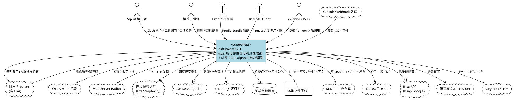

---

# **4. DFX Constraints**

## **4.1 Performance**

1. **LLM 重试延迟**：单次重试间退避由策略控制，最大重试次数默认 3 次，总重试耗时不得超过单次请求超时的 3 倍。
2. **OTLP 缓冲容量**：`OtlpBuffer` 必须有容量上限，超出时丢弃最旧载荷而非无限增长内存。
3. **Lucene 索引写入**：本地索引写入须在会话事件落盘后异步完成，不阻塞主执行链。
4. **工具超时粒度**：按工具名配置的超时须独立于全局超时，取两者较小值生效。
5. **上下文压缩触发**：`/compact` 须在单次命令内完成裁剪并返回，不得跨轮次挂起。
6. **Remote Gateway 流多路复用**：Gateway 须在同一条逻辑流上承载多路复用的 Remote 流，上行项沿 Client→Host、下行项沿 Host→Client，不得为每条流建立独立连接。（扩展）
7. **Office 转 PDF 队列有界**：转换服务须提供有界队列与缓存，队列满时拒绝新请求而非无限排队。（扩展）
8. **子进程输出有界捕获**：子进程输出须有界收集或流式读取，不得无界增长内存；spill 恢复须在输出超限时落盘。（扩展）
9. **工作区文件读取分页**：工作区文件服务须按页读取 UTF-8 文本与按有界窗口读取原始字节，不得一次性返回超大文件。（扩展）
10. **自动审查延迟**：自动审查须在工具执行前同步完成模型审查，审查耗时计入工具调用总时长，不得异步挂起。（扩展）

## **4.2 Reliability**

1. **重试行为兼容性**：使用旧构造（仅传重试次数）时，行为须与 v0.1.9 一致，不得引入新失败路径。
2. **检查点持久化**：检查点写入失败不得中断主执行链，须降级为日志告警并继续执行。
3. **遥测默认关闭**：未显式设置 `dsh.otel.enabled=true` 时，不得创建 OTLP 导出 Bean，不得影响应用启动。
4. **条件装配容错**：未配置 OTLP 端点时，应用上下文启动须成功，不得抛出 `NoSuchMethodException` 或类似装配异常。
5. **数据库迁移幂等**：`V20261011__checkpoint.sql` 与 `V20261011__workspace.sql` 须可重复执行不报错。
6. **Remote Gateway 重连**：Client 断连后重连须恢复流订阅状态，不得丢失已发送但未确认的流项。（扩展）
7. **子进程环境清理**：子进程环境须先移除凭据与 `DSH_*` 值再应用显式覆盖，不得泄露宿主环境变量。（扩展）
8. **子进程范围终止**：终止子进程须关闭完整的受管进程范围（含子进程的子进程），不得遗留孤儿进程。（扩展）
9. **匿名标识跨重启稳定**：匿名 UUID 须跨重启保留，仅在文件被删除后重新生成，不得每次启动变更。（扩展）
10. **HMR 互斥执行**：热重载须与包修改互斥执行，不得在重载过程中接受并发修改。（扩展）
11. **实验性能力默认关闭**：全部实验性扩展（§5.19–§5.28）须默认关闭，仅在显式安装或启用后生效，不得影响默认行为。（扩展）

## **4.3 Security**

1. **PTC 沙箱边界**：沙箱 Node 进程须限制可执行路径与脚本路径，不得执行白名单外命令。
2. **内容寻址完整性**：附件存储须以 SHA-256 校验内容完整性，写入与读取须校验哈希一致。
3. **遥测载荷安全**：OTLP 导出当前无鉴权与采样控制（已知限制），生产启用前须由运维在网关层补充鉴权。
4. **工具调用审计**：重复工具护栏须记录被提醒的重复调用，供事后审计。
5. **Remote 访问控制强制**：非 owner Peer 的每次 Remote 方法调用与事件接收须经 RemoteAccessService 策略判定，不得绕过。（扩展）
6. **设置脱敏读取**：settings-controller 须返回脱敏的 settings 与凭据元数据，不得返回机密值或 PKCE 私密数据。（扩展）
7. **GitHub Webhook 签名验证**：webhook-github 须验证 GitHub 签名后再处理 JSON body，不得接受未签名或签名错误的事件。（扩展）
8. **匿名标识不含敏感数据**：匿名 UUID 须为随机值，不得包含机器或账户数据，不得用于跨 home 关联。（扩展）
9. **子进程凭据隔离**：子进程环境须移除宿主凭据，不得将宿主 API Key 或 token 泄露给子进程。（扩展）
10. **PTC Python 沙箱约束**：PTC Runtime Python 须在共享文件系统沙箱下执行，直接文件操作须遵循所选沙箱策略，资源预算须约束执行。（扩展）

## **4.4 Maintainability**

1. **重试日志**：每次重试须记录 `attempt` 次数与错误 `code` 摘要。
2. **遥测可观测**：`OtelService` 须维护 activeSpans 生命周期，span 泄漏须可由日志发现。
3. **投影复用契约**：新增投影须复用既有 `ProjectionProvider` 契约，不得另立接口。
4. **POM 元数据完整**：全部模块 pom 须包含 `<name>` / `<description>` / `<url>` / `<licenses>` / `<scm>` / `<developers>`，scm 路径指向各自目录。
5. **Remote 控制器独立注册**：每个 Remote 控制器须独立注册其 namespace，不得在一个控制器中混入多个域的 Remote 方法。（扩展）
6. **子进程受管范围可观测**：子进程服务须记录受管进程范围的创建与终止，孤儿进程须可由日志发现。（扩展）
7. **实验性能力标注**：全部实验性扩展须在文档与日志中标注"实验性"，不得与产品级能力混淆。（扩展）
8. **Hook 桥接兼容性声明**：Claude Code / Codex hook 桥接须明确声明支持的 hook 点子集，超出子集的行为须引导使用原生插件。（扩展）

## **4.5 Compatibility**

1. **重试构造向后兼容**：`LlmRetryInterceptor(int)` 旧构造须保留且行为不变。
2. **渠道协议枚举兼容**：`ChannelProtocol` 新增协议分支不得改变既有协议取值。
3. **fat jar 部署兼容**：打包脚本与 Dockerfile 须优先选取 `*-exec.jar`，找不到时回退历史命名。
4. **新增表不影响既有数据**：检查点与工作区表由迁移脚本幂等建表，不得修改既有表结构。
5. **新增包不影响既有 API**：全部新增类落在新增包中，不得变更既有包的公开 API 签名。
6. **Remote API 契约稳定**：新增 Remote 控制器与 namespace 不得变更既有 Remote 方法的签名与语义。（扩展）
7. **Hook 桥接不重写既有配置**：Claude Code / Codex hook 桥接须直接复用既有 `hooks.json`，不得要求用户重写配置。（扩展）
8. **思维链翻译原文不变**：翻译须保持 Session 与模型输入中的原文不变，翻译结果仅用于展示。（扩展）
9. **实验性能力可移除**：实验性扩展须可独立卸载，卸载后不得影响产品级能力。（扩展）

---

# **5. Core Capabilities**

## **5.1 LLM 重试策略与错误分类**

> **完成状态：已完成**（`LlmRetryPolicy`、`RetryableErrorClassifier`、`LlmErrorCodes`、`LlmRetryInterceptor` 及测试均已落地）

### **5.1.1 Business Rules**

1. **错误码决定可重试性**：系统必须依据错误码分类决定是否重试，而非仅依据重试次数。
   a. Acceptance criteria: [LLM 返回 429/500/502/503/504] → [系统判定为可重试，在最大次数内重试]
2. **不可重试错误码不重试**：AUTH、INVALID_REQUEST、CONTEXT_WINDOW_EXCEEDED、MALFORMED_RESPONSE 必须不触发重试。
   a. Acceptance criteria: [LLM 返回 AUTH 或 INVALID_REQUEST 错误] → [系统立即向上抛出，不重试]
3. **兜底 Provider 路由**：当策略配置了兜底 Provider 且当前 Provider 重试耗尽时，系统必须切换到兜底 Provider 重试。
   a. Acceptance criteria: [主 Provider 重试达到 maxAttempts 且配置了兜底] → [系统切换到兜底 Provider 发起请求]
4. **默认策略**：未显式注入策略时，系统必须退化为次数判断，与 v0.1.9 行为一致。
   a. Acceptance criteria: [仅传入 `LlmRetryInterceptor(int maxRetries)`] → [系统按次数重试，不进行错误码分类]
5. **重试日志**：每次重试必须记录 attempt 序号与错误 code 摘要。
   a. Acceptance criteria: [触发一次重试] → [日志中出现 attempt 与 code 字段]

### **5.1.2 Interaction Flow**

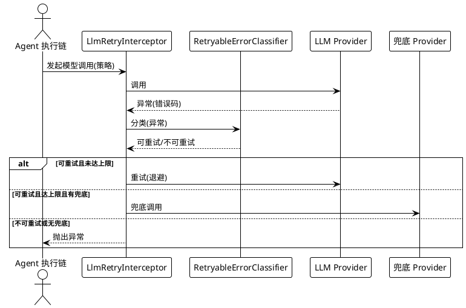

### **5.1.3 Exception Scenarios**

1. **兜底 Provider 也失败**
   a. Trigger condition: 兜底 Provider 返回不可重试错误
   b. System behavior: 向上抛出兜底 Provider 的原始异常
   c. User perception: Agent 执行链收到最终失败异常与错误码

---

## **5.2 上下文注入与压缩**

> **完成状态：已完成**（5 个注入器、4 个压缩/Slash 组件及测试均已落地）

### **5.2.1 Business Rules**

1. **AGENTS.md 加载**：系统必须能解析项目根目录下的 `AGENTS.md` 并将其内容注入为项目说明上下文。
   a. Acceptance criteria: [项目根目录存在 AGENTS.md] → [上下文装配时包含其解析内容]
2. **文件引用展开**：消息中的 `@文件路径` 引用必须被展开为文件可读内容。
   a. Acceptance criteria: [用户消息含 `@src/Main.java`] → [上下文中该引用被替换为文件内容]
3. **会话快照引用挂载**：会话快照必须以引用方式挂载，不得整段重复注入。
   a. Acceptance criteria: [引用历史会话快照] → [上下文中以引用标记挂载，不产生全文重复]
4. **时间上下文注入**：系统必须注入当前时间，支撑相对时间类指令。
   a. Acceptance criteria: [装配上下文] → [上下文包含当前时间信息]
5. **tmux 上下文注入**：当存在 tmux 会话时，系统必须注入 tmux 会话上下文。
   a. Acceptance criteria: [终端场景追问且存在 tmux 会话] → [上下文包含 tmux 会话状态]
6. **压缩命令触发**：`/compact` 必须触发上下文收缩，裁剪历史工具结果与图片载荷。
   a. Acceptance criteria: [用户输入 `/compact`] → [上下文被裁剪，Token 占用降低]
7. **工具结果裁剪**：`ToolResultPruner` 必须保留近期与关键工具结果，裁剪远端冗余结果。
   a. Acceptance criteria: [历史工具结果超过保留阈值] → [远端结果被裁剪，近期与关键结果保留]
8. **图片卸载**：`ImageOffloader` 必须将历史图片载荷卸载为引用，降低上下文占用。
   a. Acceptance criteria: [上下文含多张历史图片] → [历史图片被替换为引用标记]
9. **Slash 命令注册与解析**：`SlashCommandRegistry` 必须按名称解析并执行已注册的 Slash 命令。
   a. Acceptance criteria: [输入 `/compact` 且已注册] → [执行对应命令处理器]

### **5.2.2 Interaction Flow**

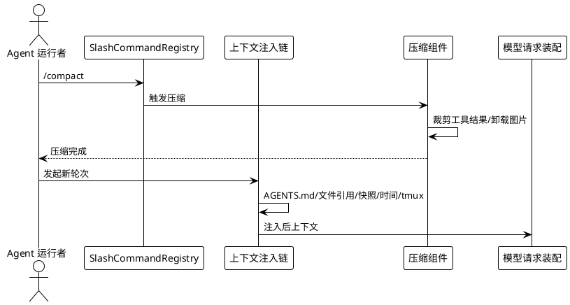

### **5.2.3 Exception Scenarios**

1. **AGENTS.md 不存在**
   a. Trigger condition: 项目根目录无 AGENTS.md
   b. System behavior: 跳过该注入器，不报错
   c. User perception: 上下文中不含项目说明，无错误提示
2. **文件引用路径无效**
   a. Trigger condition: `@路径` 指向不存在的文件
   b. System behavior: 保留原始引用文本并记录告警
   c. User perception: 引用未被展开，日志中有告警

---

## **5.3 护栏与 Hook**

> **完成状态：已完成**（`DuplicateToolGuard`、`PerToolDeadlinePolicy`、`SandboxPolicyInjector`、`CodexHookBridge`、`TimedWaitAskUser`、`InProcessSubagentDriver` 及测试均已落地）

### **5.3.1 Business Rules**

1. **重复工具提醒**：当相同工具以相同参数被重复调用时，系统必须发出提醒而非重复执行。
   a. Acceptance criteria: [连续两次以相同参数调用同一工具] → [第二次收到提醒，不重复执行]
2. **按工具差异化超时**：`PerToolDeadlinePolicy` 必须按工具名应用不同超时阈值。
   a. Acceptance criteria: [工具 A 配置 5s、工具 B 配置 30s] → [各自独立超时，互不影响]
3. **沙箱策略注入**：`SandboxPolicyInjector` 必须将沙箱策略注入执行上下文，统一 FS/Shell 边界判定。
   a. Acceptance criteria: [配置沙箱策略后执行工具] → [文件系统与 Shell 操作受策略约束]
4. **Codex Hook 协议解析**：`CodexHookBridge` 必须解析 Codex hook JSON（`exit_code`、`stdout`、`stderr`、`continue`、`stopReason`、`decision`、`reason`）并转换为内部 HookOutput。
   a. Acceptance criteria: [收到合法 Codex hook JSON] → [输出结构化 HookOutput]
5. **带超时等待式提问**：`TimedWaitAskUser` 必须在超时后返回，不得无限阻塞。
   a. Acceptance criteria: [用户未响应且超过超时阈值] → [提问以超时结果返回]
6. **进程内子代理**：`InProcessSubagentDriver` 必须在进程内驱动子代理，不启动外部进程。
   a. Acceptance criteria: [调用子代理] → [在当前进程内执行，无外部进程创建]

### **5.3.2 Interaction Flow**

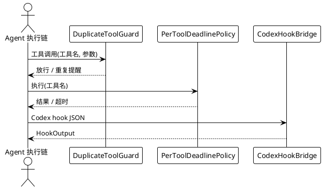

### **5.3.3 Exception Scenarios**

1. **Codex Hook JSON 格式非法**
   a. Trigger condition: 收到的 JSON 缺少必需字段或格式错误
   b. System behavior: 记录解析错误并返回默认 HookOutput
   c. User perception: 日志中有解析告警，执行链不中断
2. **重复工具护栏为提醒式（已知限制）**
   a. Trigger condition: 重复调用被识别
   b. System behavior: 仅发出提醒，不做强制拦截
   c. User perception: 用户可选择忽略提醒继续执行

---

## **5.4 会话检查点**

> **完成状态：已完成**（`CheckpointStrategy`、`CheckpointSnapshot`、`ICheckpointRepository`、`JdbcCheckpointRepository`、迁移 SQL 及测试均已落地）
>
> **部分完成**：检查点仅覆盖两个时机（模型请求前、工具副作用前），尚不支持任意事件位点回滚执行。

### **5.4.1 Business Rules**

1. **模型请求前落检查点**：在发起模型请求前，系统必须保存检查点快照。
   a. Acceptance criteria: [即将发起模型请求] → [持久化 `before-model-request` 检查点]
2. **工具副作用前落检查点**：在执行有副作用的工具操作前，系统必须保存检查点快照。
   a. Acceptance criteria: [即将执行写操作工具] → [持久化 `before-tool-side-effect` 检查点]
3. **快照结构完整**：检查点快照必须包含 sessionId、stepIndex、reason、contextSnapshotJson、createdAt。
   a. Acceptance criteria: [落检查点] → [快照含全部五项字段]
4. **按会话与步次索引**：检查点必须按 `session_id + step_index` 建索引以支持快速定位。
   a. Acceptance criteria: [按会话 ID 与步次查询] → [通过索引快速返回]
5. **写入失败降级**：检查点持久化失败不得中断主执行链。
   a. Acceptance criteria: [数据库不可用] → [主执行链继续，日志告警]

### **5.4.2 Interaction Flow**

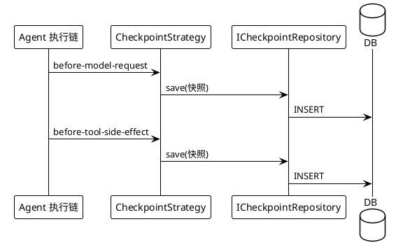

### **5.4.3 Exception Scenarios**

1. **检查点仅覆盖两个时机（已知限制）**
   a. Trigger condition: 需要在任意事件位点落检查点
   b. System behavior: 当前不支持，仅 `before-model-request` 与 `before-tool-side-effect` 两个时机
   c. User perception: 任意位点回滚不可用，须等待后续版本扩展

---

## **5.5 会话全文检索**

> **完成状态：已完成**（`SessionSearchProvider`、`SessionFullTextIndex`、`ISessionSearchIndexPort`、`LuceneSessionSearchIndex` 及测试均已落地，Lucene 9.11.1 依赖已引入）
>
> **部分完成**：索引为单机本地，多实例部署时索引不共享。

### **5.5.1 Business Rules**

1. **全文索引写入**：会话内容必须可被写入本地全文索引。
   a. Acceptance criteria: [会话产生新内容] → [索引中可检索到该内容]
2. **查询返回匹配片段**：检索必须返回匹配片段与高亮定位。
   a. Acceptance criteria: [按关键词查询] → [返回含高亮位置的匹配片段]
3. **领域契约委托**：`SessionSearchProvider` 必须委托 `ISessionSearchIndexPort` 执行搜索，不直接依赖具体索引实现。
   a. Acceptance criteria: [发起检索] → [经端口委托至适配器执行]
4. **本地索引不依赖外部服务**：索引必须落在本地文件系统，不依赖外部搜索服务。
   a. Acceptance criteria: [无外部搜索服务] → [本地索引正常写入与查询]

### **5.5.2 Interaction Flow**

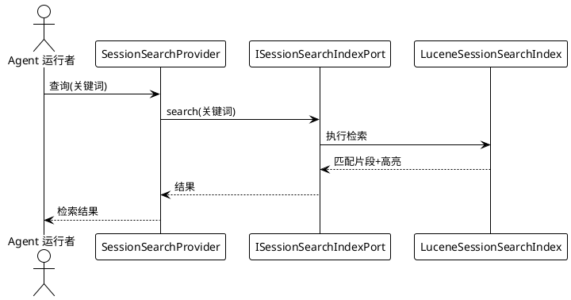

### **5.5.3 Exception Scenarios**

1. **索引目录无写权限**
   a. Trigger condition: 本地索引目录不可写
   b. System behavior: 记录错误并降级，检索返回空结果
   c. User perception: 检索无结果，日志中有权限告警
2. **多实例索引不共享（已知限制）**
   a. Trigger condition: 多实例部署
   b. System behavior: 各实例索引独立，不跨实例检索
   c. User perception: 仅可检索当前实例会话

---

## **5.6 OpenTelemetry 遥测**

> **完成状态：已完成**（`OtelService`、`SessionTelemetryExporter`、`OtlpBuffer`、`OtlpHttpExporter`（含条件装配）及测试均已落地）
>
> **部分完成**：遥测默认关闭且无鉴权与采样控制；OTLP 导出未做采样、批量重试与失败降级策略。

### **5.6.1 Business Rules**

1. **会话事件编码为 OTLP**：`SessionTelemetryExporter` 必须将 `SessionEvent` 编码为 OTLP 载荷并写入缓冲区。
   a. Acceptance criteria: [产生 SessionEvent] → [OtlpBuffer 中存在对应 OTLP 载荷]
2. **缓冲容量约束**：`OtlpBuffer` 必须有容量上限，超出时丢弃最旧载荷。
   a. Acceptance criteria: [缓冲区满] → [最旧载荷被丢弃，新载荷写入]
3. **条件装配**：`OtlpHttpExporter` 必须仅在 `dsh.otel.enabled=true` 时创建 Bean。
   a. Acceptance criteria: [未设置 dsh.otel.enabled] → [不创建 OtlpHttpExporter Bean，应用正常启动]
4. **默认端点**：OTLP/HTTP 上报端点默认为 `http://127.0.0.1:4318/v1/traces`。
   a. Acceptance criteria: [未配置端点但启用遥测] → [使用默认端点上报]
5. **span 生命周期管理**：`OtelService` 必须维护 activeSpans 并驱动导出。
   a. Acceptance criteria: [开启 span] → [activeSpans 中存在；关闭后移除并导出]

### **5.6.2 Interaction Flow**

```plantuml
@startuml
!theme plain
participant "会话事件源" as Event
participant "SessionTelemetryExporter" as Exporter
participant "OtlpBuffer" as Buffer
participant "OtlpHttpExporter" as Http
cloud "OTLP 后端" as Backend

Event -> Exporter : export(SessionEvent)
Exporter -> Buffer : 写入 OTLP 载荷
Buffer -> Http : 刷新上报
Http -> Backend : HTTP POST
@enduml
```

### **5.6.3 Exception Scenarios**

1. **OTLP 后端不可达**
   a. Trigger condition: 端点无法连接
   b. System behavior: 当前无重试与降级（已知限制），载荷可能丢失
   c. User perception: 遥测数据缺失，日志中有连接错误
2. **未配置遥测即启动**
   a. Trigger condition: `dsh.otel.enabled` 未设置或为 false
   b. System behavior: 不装配 OtlpHttpExporter，应用正常启动
   c. User perception: 无遥测上报，无启动异常

---

## **5.7 会话投影增强**

> **完成状态：已完成**（`SessionStatistics`、`SessionTitleGenerator`、`TurnOutline` 及测试均已落地，复用 `ProjectionProvider` 契约）

### **5.7.1 Business Rules**

1. **用量统计投影**：`SessionStatistics` 必须聚合模型调用次数与 Token 用量。
   a. Acceptance criteria: [会话产生多次模型调用] → [统计投影返回调用次数与 Token 用量]
2. **会话标题投影**：`SessionTitleGenerator` 必须依据可见用户文本生成会话标题。
   a. Acceptance criteria: [会话含用户文本] → [生成对应标题]
3. **轮次大纲投影**：`TurnOutline` 必须生成会话轮次提纲，便于长会话导航。
   a. Acceptance criteria: [长会话多轮次] → [返回轮次提纲列表]
4. **复用投影契约**：三个投影必须复用既有 `ProjectionProvider` 契约，不得另立接口。
   a. Acceptance criteria: [注册新投影] → [通过 ProjectionRegistry 统一注册]

### **5.7.2 Interaction Flow**

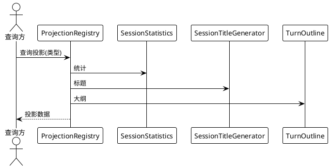

### **5.7.3 Exception Scenarios**

1. **会话无可见用户文本**
   a. Trigger condition: 会话仅含系统消息
   b. System behavior: 标题生成返回默认占位标题
   c. User perception: 显示默认标题

---

## **5.8 MCP Resource 与工具增强**

> **完成状态：已完成**（MCP Resource 发现、网页搜索、文件检索、定时任务、工具呈现、LSP stdio、默认模型解析及全部测试均已落地）
>
> **部分完成**：MCP Resource 仅 stdio 适配，HTTP/SSE MCP 的 Resource 发现尚未实现。

### **5.8.1 Business Rules**

1. **MCP Resource 发现**：`McpResourceDiscovery` 必须通过 `IMcpResourcePort` 发现 MCP Server 暴露的 Resource。
   a. Acceptance criteria: [连接 stdio MCP Server] → [返回其暴露的 Resource 列表]
2. **网页搜索**：`ExaSearchProvider` 与 `PerplexitySearchProvider` 必须通过各自端口执行网页搜索。
   a. Acceptance criteria: [发起网页搜索查询] → [返回网页检索结果]
3. **文件检索工具**：`GlobTool` 与 `GrepTool` 必须在沙箱 FS 端口约束下执行文件检索。
   a. Acceptance criteria: [调用 Glob/Grep 工具] → [返回匹配文件/内容，受沙箱边界约束]
4. **定时任务工具**：`ScheduleTool` 必须支持定时任务调度。
   a. Acceptance criteria: [配置定时任务] → [按计划触发执行]
5. **工具呈现值对象**：`ToolPresentation` 必须封装工具呈现信息。
   a. Acceptance criteria: [工具返回结果] → [附带 ToolPresentation 呈现信息]
6. **LSP stdio Provider**：`LspStdioProvider` 必须通过 stdio 与 LSP Server 交互。
   a. Acceptance criteria: [发起 LSP 请求] → [经 stdio 返回诊断/补全]
7. **默认模型解析**：`AgentDefaultModelProvider` 必须解析 Agent 的默认模型配置。
   a. Acceptance criteria: [Agent 未显式指定模型] → [解析默认模型并使用]

### **5.8.2 Interaction Flow**

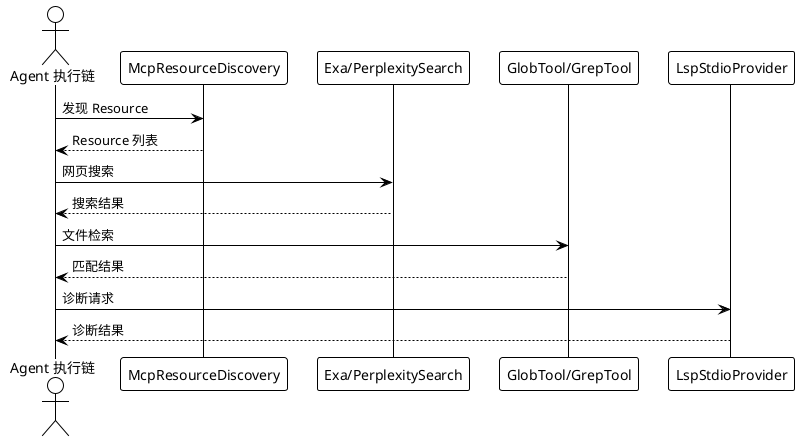

### **5.8.3 Exception Scenarios**

1. **MCP Resource 仅 stdio 适配（已知限制）**
   a. Trigger condition: MCP Server 使用 HTTP/SSE 传输
   b. System behavior: 当前不支持 HTTP/SSE Resource 发现
   c. User perception: 无法发现该 Server 的 Resource，须等待后续版本
2. **网页搜索 API 不可达**
   a. Trigger condition: Exa/Perplexity 端点无法连接
   b. System behavior: 返回错误并记录告警
   c. User perception: 搜索失败，收到错误提示

---

## **5.9 Typert 与 PTC 沙箱**

> **完成状态：已完成**（`ITypertService`、`TypertService`、`TypertGenerator`、`TsMorphTypertGenerator`、`TypertProtocolLoader`、`InMemoryTypertRegistry`、`PtcSandboxNodeProcess`、`SandboxedNodePtcProcess`、`IPtcRuntimePort` 及测试均已落地）
>
> **部分完成**：Typert/PTC 为初始版本，ts-morph 生成与 Node 沙箱进程的功能完整度与安全性待进一步验证。

### **5.9.1 Business Rules**

1. **类型反射注册**：`TypertService` 必须支持 `registerContribution`、`resolveInvocation`、`listInvocations` 操作。
   a. Acceptance criteria: [注册贡献点] → [可通过 resolveInvocation 解析并通过 listInvocations 列出]
2. **调用描述符生成**：`TypertGenerator` 必须由端点定义生成调用描述符。
   a. Acceptance criteria: [传入端点定义] → [输出调用描述符]
3. **ts-morph 反射生成**：`TsMorphTypertGenerator` 必须基于 ts-morph 生成 TypeScript 反射信息。
   a. Acceptance criteria: [传入 TypeScript 源码] → [输出反射生成结果]
4. **协议文件加载**：`TypertProtocolLoader` 必须加载协议文件。
   a. Acceptance criteria: [指定协议文件路径] → [加载并解析协议]
5. **进程内注册表**：`InMemoryTypertRegistry` 必须提供进程内注册表实现。
   a. Acceptance criteria: [注册贡献点] → [进程内可查询]
6. **PTC 沙箱执行**：`PtcSandboxNodeProcess` 必须在受限 Node 进程中执行 PTC，限制可执行与脚本路径。
   a. Acceptance criteria: [执行 PTC 脚本] → [在沙箱 Node 进程中执行，路径受限]
7. **PTC 运行时端口**：`IPtcRuntimePort` 必须定义 PTC 运行时端口契约。
   a. Acceptance criteria: [适配器实现端口] → [可注入领域层使用]

### **5.9.2 Interaction Flow**

```plantuml
@startuml
!theme plain
actor "Agent 执行链" as Chain
participant "TypertService" as Typert
participant "TypertGenerator" as Gen
participant "PtcSandboxNodeProcess" as Ptc
cloud "Node.js" as Node

Chain -> Gen : 端点定义
Gen --> Chain : 调用描述符
Chain -> Typert : registerContribution
Chain -> Ptc : 执行 PTC
Ptc -> Node : 沙箱执行
Node --> Ptc : 结果
Ptc --> Chain : PTC 结果
@enduml
```

### **5.9.3 Exception Scenarios**

1. **Node.js 运行时不可用**
   a. Trigger condition: 系统未安装 Node.js 或版本不兼容
   b. System behavior: PTC 执行失败并返回明确错误
   c. User perception: PTC 不可用，收到运行时缺失错误
2. **Typert/PTC 为初始版本（已知限制）**
   a. Trigger condition: 复杂 PTC 场景或安全敏感操作
   b. System behavior: 功能完整度与安全性未充分验证
   c. User perception: 须人工验证后再用于生产

---

## **5.10 Profile Bundle、模型与渠道**

> **完成状态：已完成**（`BundleDefinition`、`BundleAssembler`、`ChannelProtocol`、`LlmAdapterFactory`、`PiAiAdapter`、`UpstreamModelSyncService` 及测试均已落地）

### **5.10.1 Business Rules**

1. **Profile Bundle 定义**：`BundleDefinition` 必须封装 Profile 资源包定义。
   a. Acceptance criteria: [定义 Bundle] → [含一组 Profile 配置]
2. **Profile Bundle 装配**：`BundleAssembler` 必须将 Bundle 定义装配为可分发的 Profile 集合。
   a. Acceptance criteria: [传入 BundleDefinition] → [输出装配后的 Profile 集合]
3. **渠道协议枚举扩展**：`ChannelProtocol` 必须纳入 PiAi 等新协议，且不改变既有协议取值。
   a. Acceptance criteria: [查询协议枚举] → [含 PiAi 分支，既有取值不变]
4. **适配器工厂按协议选取**：`LlmAdapterFactory` 必须按协议选取适配器，新增 PiAi 分支。
   a. Acceptance criteria: [协议为 PiAi] → [返回 PiAiAdapter]
5. **PiAi 协议适配**：`PiAiAdapter` 必须实现 PiAi 协议的 LLM 调用适配。
   a. Acceptance criteria: [通过 PiAi 协议调用] → [经 PiAiAdapter 完成请求与响应转换]
6. **上游模型同步**：`UpstreamModelSyncService` 必须适配新协议端点进行模型同步。
   a. Acceptance criteria: [新协议端点配置] → [同步模型列表成功]

### **5.10.2 Interaction Flow**

```plantuml
@startuml
!theme plain
actor "Profile 开发者" as Prof
participant "BundleAssembler" as Assembler
participant "LlmAdapterFactory" as Factory
participant "PiAiAdapter" as PiAi
cloud "PiAi 端点" as Endpoint

Prof -> Assembler : BundleDefinition
Assembler --> Prof : 装配后 Profile 集合
Factory -> PiAi : 选取 PiAi 适配器
PiAi -> Endpoint : 模型调用
Endpoint --> PiAi : 响应
@enduml
```

### **5.10.3 Exception Scenarios**

1. **未知渠道协议**
   a. Trigger condition: 配置了未识别的协议
   b. System behavior: 工厂抛出明确异常
   c. User perception: 收到协议不支持错误

---

## **5.11 存储与工作区**

> **完成状态：已完成**（`ContentAddressableAttachmentStore`、`Sha256ContentAddressableStore`、`WorkspaceEntity`、`JdbcWorkspaceRepository`、`V20261011__workspace.sql` 及测试均已落地）

### **5.11.1 Business Rules**

1. **内容寻址存储**：`ContentAddressableAttachmentStore` 必须以内容哈希为键存储附件，实现去重。
   a. Acceptance criteria: [写入相同内容两次] → [仅存储一份，返回相同哈希键]
2. **SHA-256 实现完整性**：`Sha256ContentAddressableStore` 必须基于 SHA-256 校验内容完整性。
   a. Acceptance criteria: [写入后读取] → [哈希一致，内容完整]
3. **工作区实体**：`Workspace` 必须作为聚合实体管理工作区属性。
   a. Acceptance criteria: [创建工作区] → [实体含工作区属性并可持久化]
4. **工作区持久化**：`JdbcWorkspaceRepository` 必须通过 JDBC 持久化工作区。
   a. Acceptance criteria: [保存工作区] → [数据库中存在对应记录]
5. **会话与工作区多对多关系**：`workspace` 与 `session_workspace` 表必须持久化工作区与会话的多对多关系。
   a. Acceptance criteria: [会话关联多个工作区] → [关系表中有对应关联记录]
6. **迁移幂等**：`V20261011__workspace.sql` 必须可重复执行不报错。
   a. Acceptance criteria: [重复执行迁移] → [不报错，表结构不变]

### **5.11.2 Interaction Flow**

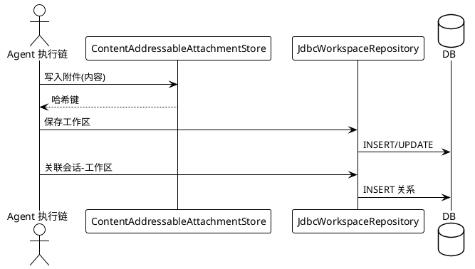

### **5.11.3 Exception Scenarios**

1. **附件内容损坏**
   a. Trigger condition: 读取时哈希校验失败
   b. System behavior: 返回完整性错误
   c. User perception: 收到附件损坏提示

---

## **5.12 发布形态与工程治理**

> **完成状态：已完成**（`classifier=exec` + `attach=false`、Dockerfile 与脚本同步、POM 元数据对齐、版本统一为 0.2.1 均已落地）

### **5.12.1 Business Rules**

1. **fat jar 附加 exec 分类器**：`spring-boot-maven-plugin` 的 repackage 必须附加 `classifier=exec` 且 `attach=false`。
   a. Acceptance criteria: [执行 mvn package] → [产出 `*-exec.jar`，不 install/deploy 该分类器]
2. **瘦 jar 可被外部依赖**：主 jar 必须保持瘦 jar，可被外部工程依赖。
   a. Acceptance criteria: [外部工程依赖 dsh-java-app] → [拉取到瘦 jar，体积约 159KB]
3. **sources/javadoc/pom 继续上传**：sources、javadoc、pom 必须继续上传中央仓库。
   a. Acceptance criteria: [执行 mvn deploy] → [上传瘦 jar、sources、javadoc、pom，不上传 fat jar]
4. **Dockerfile 指向 exec jar**：Dockerfile 必须复制 `dsh-java-app-*-exec.jar`。
   a. Acceptance criteria: [构建镜像] → [使用 exec jar 启动]
5. **打包脚本优先选取 exec jar**：打包脚本必须优先选取 `*-exec.jar`，找不到时回退历史命名。
   a. Acceptance criteria: [执行打包脚本] → [优先取 exec jar；不存在时回退历史命名]
6. **POM 元数据对齐**：全部模块 pom 必须包含 `<name>` / `<description>` / `<url>` / `<licenses>` / `<scm>` / `<developers>`，scm 路径指向各自目录。
   a. Acceptance criteria: [检查任意模块 pom] → [元数据完整且指向 GitHub 仓库对应目录]
7. **POM 版本统一**：全量 pom 版本必须统一为 `0.2.1`。
   a. Acceptance criteria: [检查根 pom 与各模块 pom] → [版本均为 0.2.1]
8. **CHANGELOG 按包记录**：`CHANGELOG.md` 必须按 app/trigger/api/case/domain/infrastructure/types 七个包记录版本更新。
   a. Acceptance criteria: [查看 CHANGELOG] → [按七个包分节记录]

### **5.12.2 Interaction Flow**

```plantuml
@startuml
!theme plain
actor "CI/CD" as CI
participant "Maven" as Mvn
cloud "Maven 中央仓库" as Central
participant "Dockerfile" as Docker
participant "打包脚本" as Script

CI -> Mvn : mvn package
Mvn --> CI : 瘦jar + *-exec.jar + sources + javadoc
CI -> Mvn : mvn deploy
Mvn -> Central : 上传瘦jar/sources/javadoc/pom
CI -> Docker : 构建镜像
Docker -> Docker : COPY *-exec.jar
CI -> Script : 打包
Script -> Script : 优先取 *-exec.jar
@enduml
```

### **5.12.3 Exception Scenarios**

1. **手工部署未更新取 jar 命名**
   a. Trigger condition: 部署脚本仍取 `dsh-java-app-*.jar` 而非 `*-exec.jar`
   b. System behavior: 可能取到瘦 jar 无法直接 `java -jar` 启动
   c. User perception: 启动失败，须改为取 `*-exec.jar`

---

## **5.13 Remote API Gateway 与多控制器**

> **完成状态：未完成**（对齐原版 `api/` 组：gateway、session-controller、workspace-controller、workspace-files、terminal-controller、job-controller、settings-controller、account-controller、remote-access）
>
> **说明**：原版以 Typert RPC 为基础构建 Client→Host 类型化通信架构。Java 版已有 REST API（trigger/api 模块），但缺少类型化 Gateway、多控制器 namespace、Remote 访问控制与工作区文件服务等能力。

### **5.13.1 Business Rules**

1. **Gateway 分派与校验**：`TypertGatewayService` 必须依据生成的 `InvocationDescriptor` 约定分派 Client 调用、校验参数、支持取消与重连，并转发 Host 事件。
   a. Acceptance criteria: [Client 发起类型化方法调用] → [Gateway 分派至对应控制器并返回结果或流]
2. **多路复用流**：Gateway 必须在同一条逻辑流上承载多路复用的 Remote 流，上行项沿 Client→Host、下行项沿 Host→Client。
   a. Acceptance criteria: [Client 订阅多条流] → [经同一逻辑流多路复用传输，不建立独立连接]
3. **会话控制器**：`session-controller` 必须提供会话生命周期、历史流、实时控制状态、技能发现、文件引用与 Agent/Session 身份策略。
   a. Acceptance criteria: [Client 请求会话操作] → [经 session namespace 返回会话状态与历史]
4. **工作区控制器**：`workspace-controller` 必须提供工作区创建、重命名、移除、重排、会话归档与完整工作区投影。
   a. Acceptance criteria: [Client 修改工作区] → [经 workspace namespace 执行并返回投影]
5. **工作区文件服务**：`workspace-files` 必须提供有界文件读取（分页 UTF-8、有界窗口原始字节）、文件系统变化监听与目录列举，不提供修改操作。
   a. Acceptance criteria: [Client 预览工作区文件] → [返回分页内容与元数据，不提供写入]
6. **终端控制器**：`terminal-controller` 必须在 Session 当前工作目录打开交互式 shell，支持屏幕恢复与重连，终端输出不进入 Agent 对话记录。
   a. Acceptance criteria: [Client 打开终端] → [返回交互式 shell 流，输出不入对话记录]
7. **任务控制器**：`job-controller` 必须镜像会话可见的 job 名册、流式发送 job 保留输出，并支持人类 kill 操作，不触碰模型消耗型游标。
   a. Acceptance criteria: [Client 跟随 job] → [返回名册与输出流；kill 不触碰模型游标]
8. **设置控制器**：`settings-controller` 必须提供脱敏的 settings 与凭据元数据读取、settings 与凭据写入（不返回机密值）、原生文档打开。
   a. Acceptance criteria: [Client 读取设置] → [返回脱敏数据，不含机密值]
9. **账号控制器**：`account-controller` 必须提供登录状态快照流，不返回 token 或 PKCE 私密数据。
   a. Acceptance criteria: [Client 查询账号] → [返回登录状态，不含 token 与 PKCE 私密]
10. **Remote 访问控制**：`RemoteAccessService` 必须在 Gateway 解析参数前判定非 owner Peer 的方法级访问权限，列表方法经 `allows()` 逐项过滤，每个 Peer 订阅自己的访问快照。
    a. Acceptance criteria: [非 owner Peer 调用 Remote 方法] → [经策略判定，拒绝的方法不可调用，列表结果被过滤]

### **5.13.2 Interaction Flow**

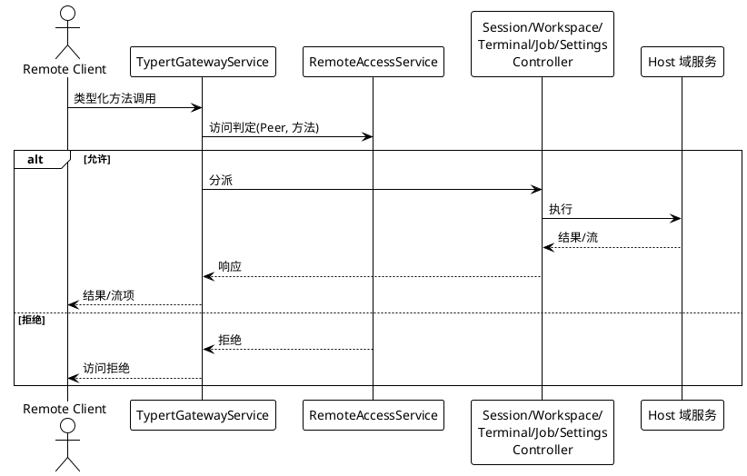

### **5.13.3 Exception Scenarios**

1. **Client 断连重连**
   a. Trigger condition: Client 连接中断后重连
   b. System behavior: 恢复流订阅状态，重发未确认流项
   c. User perception: 流恢复，无数据丢失
2. **非 owner Peer 调用未授权方法**
   a. Trigger condition: Peer 调用策略未授权的 Remote 方法
   b. System behavior: Gateway 在参数解析前拒绝，不执行业务逻辑
   c. User perception: 收到访问拒绝，方法不可调用
3. **控制器 namespace 缺失**
   a. Trigger condition: 对应域服务未装配
   b. System behavior: namespace 仍注册但返回可操作的配置错误
   c. User perception: 收到配置错误提示，其他 namespace 不受影响

---

## **5.14 启动管理与热重载**

> **完成状态：未完成**（对齐原版 `boot/` 组：app-boot、cmdline、hmr、config-editor、plugin-manager）
>
> **说明**：Java 版使用 Spring Boot 启动，但缺少应用持有的命令行 flag、HMR 热重载、配置编辑持久化与插件管理 CLI 等能力。

### **5.14.1 Business Rules**

1. **应用启动序列**：`app-boot` 必须从配置文件启动应用，加载 `.env`、应用 profile 与 patch 层，并在启动失败时清晰报告原因。
   a. Acceptance criteria: [启动应用] → [加载环境、profile、patch 层；失败时报告明确原因]
2. **应用持有命令行**：`cmdline` 必须让应用持有自己的 flag、`--help` 与退出码，启动器自身 flag 之后的一切原样传入。
   a. Acceptance criteria: [执行 `dsh --help`] → [显示应用持有的 flag 与帮助]
3. **热重载互斥**：`hmr` 必须协调模块与配置重载，并与包修改互斥执行。
   a. Acceptance criteria: [触发热重载时并发修改包] → [互斥执行，不产生冲突]
4. **配置编辑持久化**：`config-editor` 必须通过 Loader 应用并持久化当前 profile 配置。
   a. Acceptance criteria: [编辑配置] → [经 Loader 应用并持久化，重启后生效]
5. **插件管理 CLI**：`plugin-manager` 必须通过共享 CLI 操作管理当前 profile 插件与组合包。
   a. Acceptance criteria: [执行插件管理命令] → [安装/卸载/列出当前 profile 的插件与组合包]

### **5.14.2 Interaction Flow**

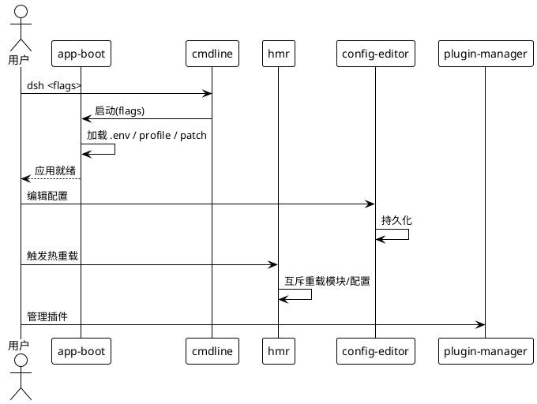

### **5.14.3 Exception Scenarios**

1. **启动失败**
   a. Trigger condition: 配置文件缺失或格式错误
   b. System behavior: 清晰报告失败原因与定位
   c. User perception: 收到明确启动失败提示
2. **热重载期间并发修改**
   a. Trigger condition: 热重载进行中触发包修改
   b. System behavior: 互斥等待，修改在重载完成后执行
   c. User perception: 修改延迟生效，无冲突

---

## **5.15 Office 文档转换**

> **完成状态：未完成**（对齐原版 `document/office-to-pdf`）
>
> **说明**：原版通过独立发布的 LibreOffice kit 将 Office 文档转换为 PDF。Java 版未实现此能力。

### **5.15.1 Business Rules**

1. **Office 格式支持**：转换服务必须支持 DOC、DOCX、XLS、XLSX、PPT、PPTX 格式转换为完整 PDF。
   a. Acceptance criteria: [传入支持的 Office 格式字节] → [输出完整 PDF]
2. **原生引擎与 WASM**：声明了原生 LibreOffice 引擎的目标使用原生引擎，其余目标使用 Node WASM。
   a. Acceptance criteria: [目标声明原生引擎] → [使用原生 LibreOffice 转换]
3. **缺失字体报告**：OOXML 转换必须返回缺失字体名称列表，二进制 Office 转换返回空列表。
   a. Acceptance criteria: [转换 OOXML 文档] → [返回 PDF 与缺失字体名称列表]
4. **有界队列与缓存**：转换服务必须提供有界队列与缓存，队列满时拒绝新请求。
   a. Acceptance criteria: [队列满时提交转换] → [拒绝新请求，不无限排队]
5. **源文件授权**：消费者负责源文件授权，转换服务不负责授权校验。
   a. Acceptance criteria: [传入未授权文件] → [转换服务不校验授权，由消费方负责]

### **5.15.2 Interaction Flow**

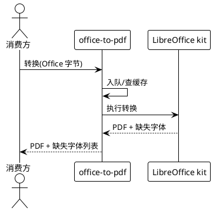

### **5.15.3 Exception Scenarios**

1. **LibreOffice kit 不可用**
   a. Trigger condition: 未安装或版本不兼容
   b. System behavior: 返回转换不可用错误
   c. User perception: 收到引擎缺失提示
2. **不支持的 Office 格式**
   a. Trigger condition: 传入非 DOC/DOCX/XLS/XLSX/PPT/PPTX 格式
   b. System behavior: 拒绝转换并返回格式不支持
   c. User perception: 收到格式不支持错误

---

## **5.16 匿名身份标识**

> **完成状态：未完成**（对齐原版 `identity/anonymous-user-id`）
>
> **说明**：原版为每个 harness home 提供匿名 UUID 用于安装级关联。Java 版未实现独立 identity 模块。

### **5.16.1 Business Rules**

1. **每 home 一个匿名 UUID**：系统必须为每个 harness home 拥有一个匿名 UUID，存储于 `$DSH_HOME/.anonymous-user-id`。
   a. Acceptance criteria: [首次运行] → [生成并存储匿名 UUID]
2. **跨重启保留**：匿名 UUID 必须跨重启保留，仅在文件被删除后重新生成。
   a. Acceptance criteria: [重启应用] → [UUID 不变；删除文件后重启则重新生成]
3. **不含敏感数据**：匿名 UUID 必须为随机值，不得包含机器或账户数据。
   a. Acceptance criteria: [检查 UUID] → [为随机 UUID，无机器或账户信息]
4. **安装级关联**：遥测、反馈与 DeepSeek 请求必须将匿名 UUID 附加到各自记录上，实现安装级关联而不识别用户。
   a. Acceptance criteria: [产生遥测/反馈/DeepSeek 请求] → [记录中携带匿名 UUID]
5. **不同 home 不同标识**：不同 harness home 必须使用不同的匿名标识符。
   a. Acceptance criteria: [两个不同 home] → [各自拥有不同的 UUID]
6. **自动创建**：内置功能首次运行时必须自动创建匿名 UUID，无需配置。
   a. Acceptance criteria: [首次运行任何内置功能] → [自动创建 UUID，无需手动配置]

### **5.16.2 Interaction Flow**

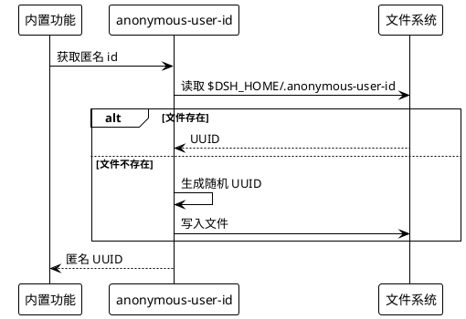

### **5.16.3 Exception Scenarios**

1. **home 目录不可写**
   a. Trigger condition: `$DSH_HOME` 目录无写权限
   b. System behavior: 记录告警，功能降级（不附加 UUID）
   c. User perception: 关联标识缺失，日志中有权限告警

---

## **5.17 子进程管理服务**

> **完成状态：未完成**（对齐原版 `subprocess/` 组：subprocess、subprocess-local、win32-process）
>
> **说明**：原版经由共享服务 `ctx.subprocess` 统一启动、观察与终止所有子进程与终端会话。Java 版有 terminal 能力但缺少统一的子进程管理服务。

### **5.17.1 Business Rules**

1. **可执行文件查找**：子进程服务必须提供可执行文件查找能力，解析命令为实际可执行路径。
   a. Acceptance criteria: [传入命令名] → [解析为实际可执行文件路径]
2. **显式 spawn**：每次请求必须指定 argv、工作目录、stdio、环境覆盖、终止宽限期与取消信号，不添加 shell 解释或隐藏执行默认值。
   a. Acceptance criteria: [传入完整 spawn 参数] → [按参数启动子进程，无 shell 解释]
3. **有界输出捕获**：子进程输出必须支持流式读取或有界收集，超限时 spill 恢复（落盘）。
   a. Acceptance criteria: [子进程输出超限] → [spill 恢复落盘，内存不无界增长]
4. **环境清理**：子进程环境必须先移除凭据与 `DSH_*` 值，再应用显式覆盖。
   a. Acceptance criteria: [启动子进程] → [环境中无凭据与 DSH_* 值，仅有显式覆盖]
5. **受管进程范围终止**：终止子进程必须关闭完整的受管进程范围（含子进程的子进程），不留孤儿进程。
   a. Acceptance criteria: [终止子进程] → [完整进程范围关闭，无孤儿进程]
6. **输出退出后可读**：收集的输出在进程退出后仍可读取。
   a. Acceptance criteria: [进程退出后读取输出] → [返回完整输出]
7. **本地与远程执行**：根据命令运行位置选择本地或远程执行，每个组合配置一个 subprocess 实现。
   a. Acceptance criteria: [配置远程执行] → [在远程宿主执行子进程]
8. **Win32 进程管理**：Windows 平台必须维护 sandbox 与普通进程创建、stdio、Job 分配、轮询、等待与句柄清理所用的共享 Win32 绑定。
   a. Acceptance criteria: [Windows 平台启动子进程] → [使用 Job 分配与句柄清理管理进程范围]

### **5.17.2 Interaction Flow**

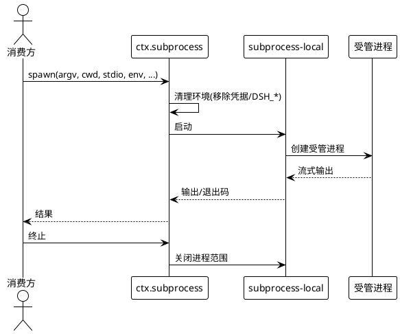

### **5.17.3 Exception Scenarios**

1. **可执行文件未找到**
   a. Trigger condition: 命令名无法解析为可执行文件
   b. System behavior: 返回可执行文件未找到错误
   c. User perception: 收到命令不存在提示
2. **终止宽限期超时**
   a. Trigger condition: 子进程在宽限期内未退出
   b. System behavior: 强制终止完整进程范围
   c. User perception: 进程被强制终止

---

## **5.18 宿主侧工作区目录选择与插件清单**

> **完成状态：未完成**（对齐原版 `host/` 组：directory-picker、open-in-app、plugin-inventory、product-telemetry-otel）
>
> **说明**：原版提供工作区目录选择 seam（原生/浏览/自适应）、open-in-app 启动路由、插件清单只读投影与产品遥测。Java 版有 webserver 但缺少这些宿主侧能力。

### **5.18.1 Business Rules**

1. **目录选择 seam**：`directory-picker` 必须定义工作区目录选择的能力约定与错误词汇，支持多种后端注册。
   a. Acceptance criteria: [请求选择工作区目录] → [经 seam 返回目录路径]
2. **原生 OS 选择器**：`directory-picker-native` 必须面向宿主屏幕前操作者提供原生 OS 选择器后端。
   a. Acceptance criteria: [宿主操作] → [弹出原生 OS 目录选择对话框]
3. **应用内浏览选择器**：`directory-picker-browse` 必须提供应用内目录浏览器后端，也服务于远程客户端。
   a. Acceptance criteria: [远程 Client 请求] → [返回应用内目录浏览结果]
4. **自适应选择器**：`directory-picker-auto` 必须在启动时挂载匹配后端的宿主自适应选择器。
   a. Acceptance criteria: [启动应用] → [自动挂载匹配的目录选择后端]
5. **open-in-app 启动路由**：`open-in-app` 必须提供在已安装应用中打开 workspace 目录的应用探测、图标与启动路由。
   a. Acceptance criteria: [请求在应用中打开目录] → [探测已安装应用并启动路由]
6. **插件清单只读投影**：`plugin-inventory` 必须提供当前 Loader 条目的只读投影，经 Remote `pluginInventory/list` 暴露。
   a. Acceptance criteria: [查询插件清单] → [返回当前 Loader 条目的只读投影]
7. **产品遥测 OTLP 上报**：`product-telemetry-otel` 必须通过 OTLP/HTTP 显式上报产品使用事件。
   a. Acceptance criteria: [产生产品使用事件] → [经 OTLP/HTTP 上报]

### **5.18.2 Interaction Flow**

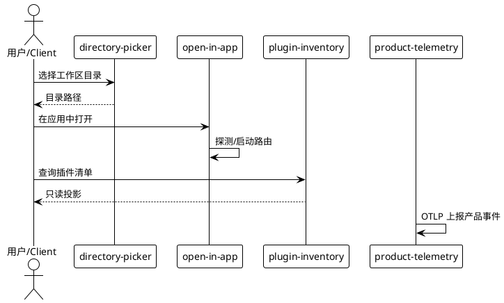

### **5.18.3 Exception Scenarios**

1. **无匹配目录选择后端**
   a. Trigger condition: 启动时无后端注册到 directory-picker seam
   b. System behavior: 选择不可用，返回明确错误
   c. User perception: 目录选择不可用提示
2. **open-in-app 未检测到已安装应用**
   a. Trigger condition: 系统未安装目标应用
   b. System behavior: 返回未检测到应用提示
   c. User perception: 收到应用未安装提示

---

## **5.19 多代理团队协作（实验性）**

> **完成状态：未完成**（对齐原版 `experimental/agent-team`、`experimental/agent-team-profile`、`experimental/tool-agent-team`）
>
> **说明**：原版为会话提供 Lead、具名 teammate、直接消息和持久共享任务板。Java 版未实现多代理团队协作。本能力为实验性，默认关闭。

### **5.19.1 Business Rules**

1. **团队 roster**：系统必须为一个会话提供 Lead 与具名 teammate 的 roster 管理。
   a. Acceptance criteria: [创建团队] → [含 Lead 与具名 teammate 的 roster]
2. **直接 inbox 消息**：消息发送必须使用目标 agent 的 inbox，支持直接消息。
   a. Acceptance criteria: [Lead 向 teammate 发消息] → [经目标 agent inbox 投递]
3. **持久共享任务板**：团队必须拥有持久共享任务板，保留任务状态。
   a. Acceptance criteria: [创建任务] → [任务持久化到共享任务板，跨重启保留]
4. **冷恢复 teammate**：系统必须支持冷恢复已存储的 teammate。
   a. Acceptance criteria: [重启后恢复团队] → [已存储 teammate 冷恢复]
5. **消息持久化**：消息持久化必须遵循目标 Agent 的常规策略。
   a. Acceptance criteria: [发送消息] → [按目标 Agent 策略持久化]
6. **团队工具挂载**：挂载 `tool-agent-team` 必须为模型提供团队操作工具。
   a. Acceptance criteria: [挂载团队工具] → [模型可调用团队操作工具]

### **5.19.2 Interaction Flow**

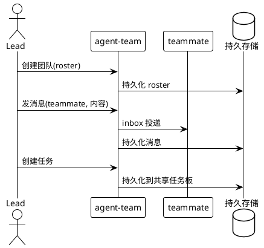

### **5.19.3 Exception Scenarios**

1. **持久会话存储不可用**
   a. Trigger condition: 团队依赖持久会话存储但存储不可用
   b. System behavior: 团队功能不可用，返回明确错误
   c. User perception: 收到存储不可用提示，团队无法创建
2. **teammate 不存在**
   a. Trigger condition: 向不存在的 teammate 发消息
   b. System behavior: 返回 teammate 不存在错误
   c. User perception: 收到 teammate 不存在提示

---

## **5.20 自动审查（实验性）**

> **完成状态：未完成**（对齐原版 `experimental/auto-review`）
>
> **说明**：原版在工具以 Full access 执行前使用当前 agent 的模型审查待执行动作。Java 版未实现自动审查。本能力为实验性，默认关闭。

### **5.20.1 Business Rules**

1. **工具调用前审查**：每次原生或 PTC inner 工具调用前，当前 agent 的 provider 与模型必须评估待执行动作。
   a. Acceptance criteria: [工具调用前] → [模型审查待执行动作]
2. **获准以 Full access 执行**：审查获准的调用必须以 Full access 执行。
   a. Acceptance criteria: [审查获准] → [以 Full access 执行工具]
3. **被拒绝请求审批**：审查被拒绝的调用必须请求用户审批。
   a. Acceptance criteria: [审查拒绝] → [请求用户审批]
4. **默认关闭**：dsh 安装随附此层但默认关闭，在 Web 侧栏插件页开启或显式安装之前，默认保持三种权限模式。
   a. Acceptance criteria: [未显式启用] → [自动审查不生效，保持默认权限模式]
5. **审查消耗额外 token**：自动审查必须消耗额外 token 用于模型评估。
   a. Acceptance criteria: [触发自动审查] → [产生额外 token 消耗]

### **5.20.2 Interaction Flow**

```plantuml
@startuml
!theme plain
actor "Agent 执行链" as Chain
participant "auto-review" as Review
participant "LLM Provider" as LLM
participant "工具" as Tool

Chain -> Review : 工具调用(动作)
Review -> LLM : 审查(动作)
alt 获准
    LLM --> Review : 放行
    Review -> Tool : Full access 执行
else 拒绝
    LLM --> Review : 拒绝(理由)
    Review -> Chain : 请求用户审批
end
@enduml
```

### **5.20.3 Exception Scenarios**

1. **审查模型不可用**
   a. Trigger condition: 当前 agent 的 provider 或模型不可用
   b. System behavior: 降级为默认权限模式，不阻塞工具调用
   c. User perception: 自动审查跳过，按默认权限执行
2. **审查误判（已知限制）**
   a. Trigger condition: 审查误放行不安全动作或误拒绝有用操作
   b. System behavior: 按审查结果执行
   c. User perception: 可能放行不安全动作或拒绝有用操作，须人工复核

---

## **5.21 语音转文本与语音输入（实验性）**

> **完成状态：未完成**（对齐原版 `experimental/api-speech-to-text`、`experimental/speech-to-text`、`experimental/speech-to-text-sensevoice`、`experimental/voice-input-bundle`、`experimental/client-ui-voice-input`）
>
> **说明**：原版通过带认证的 Web Remote 提供有界临时转写，将浏览器录音连接至 `ctx.speechToText`。Java 版未实现语音能力。本能力为实验性，默认关闭。

### **5.21.1 Business Rules**

1. **Provider 发现**：`speech` Remote 必须提供语音转文本 Provider 发现。
   a. Acceptance criteria: [查询 Provider] → [返回可用转写 Provider 列表]
2. **完整录音转写**：`speech` Remote 必须提供完整录音转写调用，将浏览器录音转为文本。
   a. Acceptance criteria: [提交录音] → [返回转写文本与元数据]
3. **有界临时转写**：转写必须通过带认证的 Web Remote 提供有界临时转写。
   a. Acceptance criteria: [临时转写] → [经认证 Remote 返回有界结果]
4. **语音输入 bundle**：`voice-input-bundle` 必须提供语音输入能力，可在插件页面启用。
   a. Acceptance criteria: [启用语音输入] → [浏览器可录音并转写为输入文本]
5. **默认关闭**：语音能力默认关闭，须显式安装或启用。
   a. Acceptance criteria: [未显式启用] → [语音能力不生效]

### **5.21.2 Interaction Flow**

```plantuml
@startuml
!theme plain
actor "用户" as User
participant "speech Remote" as Speech
participant "speechToText Provider" as Provider

User -> Speech : 发现 Provider
Speech --> User : Provider 列表
User -> Speech : 提交录音
Speech -> Provider : 转写
Provider --> Speech : 文本 + 元数据
Speech --> User : 转写结果
@enduml
```

### **5.21.3 Exception Scenarios**

1. **Provider 不可用**
   a. Trigger condition: 语音转文本 Provider 端点无法连接
   b. System behavior: 返回 Provider 不可用错误
   c. User perception: 语音转写失败提示

---

## **5.22 思维链翻译（实验性）**

> **完成状态：未完成**（对齐原版 `experimental/cot-translation-bundle`、`experimental/translator`、`experimental/client-ui-cot-translation`）
>
> **说明**：原版将展开的思考内容翻译为界面语言或其他指定语言。Java 版未实现思维链翻译。本能力为实验性，默认关闭。

### **5.22.1 Business Rules**

1. **思考内容翻译**：系统必须将展开的思考内容翻译为界面语言或其他指定语言。
   a. Acceptance criteria: [展开思考内容] → [翻译为目标语言文本]
2. **原文不变**：翻译必须保持 Session 与模型输入中的原文不变，翻译结果仅用于展示。
   a. Acceptance criteria: [翻译后检查 Session] → [原文不变，翻译仅用于展示]
3. **翻译服务选择**：默认翻译服务为 Bing，可在 Bundle 设置中选择 Google。
   a. Acceptance criteria: [选择 Google] → [使用 Google 翻译服务]
4. **原始内容可访问**：原始思考内容必须始终可访问。
   a. Acceptance criteria: [查看思考内容] → [可切换查看原文与翻译]
5. **默认禁用**：发布的 profile 默认禁用该功能，须在插件页面启用。
   a. Acceptance criteria: [未启用] → [不进行翻译]

### **5.22.2 Interaction Flow**

```plantuml
@startuml
!theme plain
actor "用户" as User
participant "cot-translation" as Cot
participant "翻译 API" as Api

User -> Cot : 展开思考内容(目标语言)
Cot -> Api : 翻译(原文, 目标语言)
Api --> Cot : 译文
Cot --> User : 译文(原文保留)
@enduml
```

### **5.22.3 Exception Scenarios**

1. **翻译服务不可用**
   a. Trigger condition: Bing/Google 翻译端点无法连接
   b. System behavior: 返回翻译失败，展示原文
   c. User perception: 看到原文，翻译缺失

---

## **5.23 会话检查器（实验性）**

> **完成状态：未完成**（对齐原版 `experimental/session-inspector`、`experimental/inspector`、`experimental/inspector-profile`、`experimental/session-inspector`）
>
> **说明**：原版提供原始 Session 日志与 Chat group/node 虚拟表格检查。Java 版未实现会话检查器。本能力为实验性，默认关闭。

### **5.23.1 Business Rules**

1. **原始 Session 日志检查**：系统必须支持检查原始 Session 日志，支持流式分片子行、分页与更新高亮。
   a. Acceptance criteria: [打开原始数据视图] → [显示 Session 日志，支持分页与高亮]
2. **Chat group/node 虚拟表格**：系统必须提供 Chat group/node 虚拟表格，支持沿对象引用查看 Node、Turn 和 Step。
   a. Acceptance criteria: [打开对话分组视图] → [显示 group/node 表格，可沿引用查看]
3. **定位到 Chat**：系统必须支持将选中 Node 定位到 Chat。
   a. Acceptance criteria: [选中 Node] → [定位到 Chat 对应位置]
4. **流式分片子行**：流式分片必须显示为子行。
   a. Acceptance criteria: [查看流式分片] → [显示为子行]
5. **更新高亮**：Chat 更新时对应行必须短暂高亮。
   a. Acceptance criteria: [Chat 更新] → [对应行短暂高亮]
6. **可调整高度**：详情区域必须支持可调整高度。
   a. Acceptance criteria: [拖动详情区域] → [高度可调整]

### **5.23.2 Interaction Flow**

```plantuml
@startuml
!theme plain
actor "开发者" as Dev
participant "session-inspector" as Ins
participant "Session 日志" as Log

Dev -> Ins : 打开原始数据
Ins -> Log : 读取日志
Log --> Ins : 分页数据
Ins --> Dev : 虚拟表格
Dev -> Ins : 选中 Node
Ins -> Ins : 定位到 Chat
@enduml
```

### **5.23.3 Exception Scenarios**

1. **Session 日志不存在**
   a. Trigger condition: 查询的 Session 日志已被清理
   b. System behavior: 返回日志不存在提示
   c. User perception: 收到日志不存在提示

---

## **5.24 Git 工作树工具（实验性）**

> **完成状态：未完成**（对齐原版 `experimental/tool-worktree`、`experimental/worktree`）
>
> **说明**：原版让模型通过一次调用创建并进入新的 Git 工作树。Java 版未实现 Git 工作树工具。本能力为实验性，默认关闭。

### **5.24.1 Business Rules**

1. **创建 Git 工作树**：模型必须能通过一次工具调用创建新的本地 Git 工作树。
   a. Acceptance criteria: [模型调用 worktree 工具] → [创建新的 Git 工作树]
2. **改变当前 Session 目录**：创建后必须改变当前 Session 目录到新工作树。
   a. Acceptance criteria: [创建工作树] → [Session 当前目录变更为新工作树]
3. **文件策略沿用**：创建操作必须沿用现有文件策略。
   a. Acceptance criteria: [创建工作树] → [遵循现有文件策略]
4. **类型化结果**：原生工具调用与 PTC 程序必须获得相同的带类型结果。
   a. Acceptance criteria: [原生调用与 PTC 调用] → [返回相同带类型结果]
5. **默认关闭**：此可选 bundle 随 Harness 安装，在选中之前保持关闭。
   a. Acceptance criteria: [未选中] → [工具不生效]

### **5.24.2 Interaction Flow**

```plantuml
@startuml
!theme plain
actor "模型" as Model
participant "tool-worktree" as Tool
participant "Git" as Git

Model -> Tool : 创建工作树
Tool -> Git : git worktree add
Git --> Tool : 工作树路径
Tool -> Tool : 改变 Session 目录
Tool --> Model : 带类型结果
@enduml
```

### **5.24.3 Exception Scenarios**

1. **非 Git 仓库**
   a. Trigger condition: 当前目录不是 Git 仓库
   b. System behavior: 返回非 Git 仓库错误
   c. User perception: 收到非 Git 仓库提示

---

## **5.25 GitHub Webhook 适配（实验性）**

> **完成状态：未完成**（对齐原版 `experimental/webhook-github`、`experimental/webhook`）
>
> **说明**：原版提供带签名的 GitHub webhook 适配器，将已认证 JSON 事件路由到 webhook 运行时。Java 版有 webhook 域但缺少 GitHub 专用适配器。本能力为实验性。

### **5.25.1 Business Rules**

1. **精确 HTTP 路由注册**：`webhook-github` 必须在注入的 `ctx.webServer` 上注册一条精确 HTTP 路由。
   a. Acceptance criteria: [注入 webServer] → [注册精确 GitHub webhook 路由]
2. **签名验证**：适配器必须限制并验证 GitHub 原始 JSON body 的签名。
   a. Acceptance criteria: [收到带签名 GitHub 事件] → [验证签名后处理]
3. **投影交付**：适配器必须投影提供方无关的交付。
   a. Acceptance criteria: [处理 GitHub 事件] → [投影为提供方无关的交付]
4. **路由至运行时**：适配器必须调用 `ctx.webhookRuntime.dispatch()` 路由事件。
   a. Acceptance criteria: [验证通过] → [调用 webhook 运行时 dispatch]
5. **立即返回 202**：适配器必须在不等待规则或会话的情况下返回 `202`。
   a. Acceptance criteria: [处理事件] → [立即返回 202，不等待规则执行]

### **5.25.2 Interaction Flow**

```plantuml
@startuml
!theme plain
cloud "GitHub" as Gh
participant "webhook-github" as Adapter
participant "webServer" as Server
participant "webhookRuntime" as Runtime

Gh -> Server : POST /webhook/github (签名 JSON)
Server -> Adapter : 路由
Adapter -> Adapter : 验证签名
Adapter -> Runtime : dispatch(投影交付)
Adapter --> Gh : 202 Accepted
@enduml
```

### **5.25.3 Exception Scenarios**

1. **签名验证失败**
   a. Trigger condition: GitHub 事件签名不匹配
   b. System behavior: 拒绝处理，返回 401
   c. User perception: 事件被拒绝
2. **webhook 运行时未注入**
   a. Trigger condition: `ctx.webhookRuntime` 未装配
   b. System behavior: 返回运行时不可用错误
   c. User perception: 收到运行时未配置提示

---

## **5.26 技能徽章（实验性）**

> **完成状态：未完成**（对齐原版 `experimental/skill-badge`、`experimental/badge-skill-bundle`）
>
> **说明**：原版提供内置「powered by dsh」徽章 skill，给文档、PR 及其他内容添加署名徽章。Java 版未实现技能徽章。本能力为实验性。

### **5.26.1 Business Rules**

1. **内置徽章 skill**：agent 必须能通过内置提供方加载官方「powered by dsh」徽章 skill。
   a. Acceptance criteria: [加载徽章 skill] → [获得「powered by dsh」徽章 skill]
2. **添加署名徽章**：skill 必须能给文档、PR 及其他用 DeepSeek Harness 生成的内容添加署名徽章。
   a. Acceptance criteria: [agent 遵循 skill 指令] → [内容中添加署名徽章]
3. **Markdown 片段与 PNG**：skill 必须提供 Markdown 片段和随包分发的 PNG，供无法可靠导入远程图片的系统使用。
   a. Acceptance criteria: [使用徽章] → [提供 Markdown 片段与 PNG]
4. **无配置**：该提供方没有配置，部署方须显式安装并插入插件行。
   a. Acceptance criteria: [安装徽章 skill] → [无需配置，插入插件行即生效]

### **5.26.2 Interaction Flow**

```plantuml
@startuml
!theme plain
actor "Agent" as Agent
participant "skill-badge" as Skill
participant "文档/PR" as Doc

Agent -> Skill : 加载徽章 skill
Skill --> Agent : skill 指令
Agent -> Doc : 生成内容
Agent -> Skill : 遵循指令添加徽章
Skill --> Doc : Markdown 片段 + PNG
@enduml
```

### **5.26.3 Exception Scenarios**

1. **PNG 不可用**
   a. Trigger condition: 随包 PNG 损坏或缺失
   b. System behavior: 降级为仅 Markdown 片段
   c. User perception: 徽章仅显示 Markdown，无图片

---

## **5.27 PTC Runtime Python（实验性）**

> **完成状态：未完成**（对齐原版 `experimental/ptc-runtime-python`）
>
> **说明**：原版在共享文件系统沙箱下以全新 CPython 3.10+ 进程运行 Python 模型代码。Java 版有 PTC Node 沙箱但缺少 Python 运行时。本能力为实验性，默认关闭。

### **5.27.1 Business Rules**

1. **CPython 3.10+ 进程执行**：系统必须以全新的 CPython 3.10+ 进程运行模型生成的 Python，仅在 macOS 或 Linux 上。
   a. Acceptance criteria: [执行 Python PTC] → [在全新 CPython 3.10+ 进程中执行]
2. **文件策略遵循**：直接文件操作必须遵循与 TypeScript PTC 相同的文件策略（所选沙箱策略）。
   a. Acceptance criteria: [Python 文件操作] → [遵循所选沙箱策略]
3. **顶层 await 与 return**：程序必须支持顶层 `await` 和 `return`。
   a. Acceptance criteria: [使用顶层 await/return] → [正常执行]
4. **已配置 binding 调用**：程序必须能调用已配置的 binding。
   a. Acceptance criteria: [调用 binding] → [经宿主绑定执行]
5. **stdout/stderr 写入**：程序必须正常写入 stdout/stderr。
   a. Acceptance criteria: [程序输出] → [stdout/stderr 正常写入]
6. **资源预算约束**：执行必须受可配置资源预算与进程组拆卸约束。
   a. Acceptance criteria: [执行 Python] → [受资源预算约束，超限终止]
7. **无状态保留**：运行之间不保留状态。
   a. Acceptance criteria: [两次执行] → [相互独立，无状态保留]
8. **默认不启用**：没有已发布 profile 启用这个实验性 runtime。
   a. Acceptance criteria: [默认 profile] → [Python PTC 不启用]

### **5.27.2 Interaction Flow**

```plantuml
@startuml
!theme plain
actor "Agent 执行链" as Chain
participant "ptc-runtime-python" as Py
cloud "CPython 3.10+" as CPython

Chain -> Py : 执行 Python 代码
Py -> Py : 沙箱策略/资源预算
Py -> CPython : 启动全新进程
CPython --> Py : stdout/stderr/结果
Py --> Chain : 执行结果
@enduml
```

### **5.27.3 Exception Scenarios**

1. **CPython 不可用**
   a. Trigger condition: 系统未安装 CPython 3.10+ 或平台不支持
   b. System behavior: 返回运行时不可用错误
   c. User perception: Python PTC 不可用提示
2. **资源预算超限**
   a. Trigger condition: 执行超出资源预算
   b. System behavior: 进程组拆卸，终止执行
   c. User perception: 执行被终止，收到资源超限提示

---

## **5.28 Hook 协议扩展（Claude Code / Codex）**

> **完成状态：未完成**（对齐原版 `experimental/hooks-claude-code`、`experimental/hooks-codex`、`experimental/hook-protocol`）
>
> **说明**：原版支持在 agent 运行期间复用现有 Claude Code / Codex hooks.json 配置。Java 版有 CodexHookBridge 但缺少完整的多 hook 点支持与 Claude Code 桥接。本能力为实验性。

### **5.28.1 Business Rules**

1. **Claude Code hooks 复用**：`hooks-claude-code` 必须在 agent 运行期间执行现有 Claude Code `hooks.json` 或 settings 文件中的 command 钩子，无需重写。
   a. Acceptance criteria: [存在 Claude Code hooks.json] → [运行期间执行对应 command 钩子]
2. **Claude Code hook 点**：受支持的钩子必须在会话、提示词、工具、停止或 subagent 到达对应时刻时运行。
   a. Acceptance criteria: [到达 hook 时刻] → [执行对应 command 钩子]
3. **Codex hooks 复用**：`hooks-codex` 必须在 agent 运行期间执行现有 Codex `hooks.json` 中的 command 钩子。
   a. Acceptance criteria: [存在 Codex hooks.json] → [运行期间执行对应 command 钩子]
4. **Codex 5 个 hook 点**：Codex 桥接必须支持 5 个 hook 点：会话开始、提示词提交、工具执行前后以及停止。
   a. Acceptance criteria: [到达 5 个 hook 点之一] → [执行对应 command 钩子]
5. **阻塞提示词或工具**：钩子必须能用模型可见的原因阻塞提示词或工具调用。
   a. Acceptance criteria: [钩子返回阻塞] → [提示词或工具调用被阻塞，模型可见原因]
6. **附加上下文**：钩子必须能添加对话上下文。
   a. Acceptance criteria: [钩子返回上下文] → [上下文添加到对话]
7. **强制继续**：钩子必须能强制模型再执行一个轮次（或一步）。
   a. Acceptance criteria: [钩子返回强制继续] → [模型再执行一个轮次]
8. **超出子集引导原生插件**：超出受支持子集的行为必须引导使用原生插件。
   a. Acceptance criteria: [使用超出子集的行为] → [引导使用原生插件]

### **5.28.2 Interaction Flow**

```plantuml
@startuml
!theme plain
actor "Agent 执行链" as Chain
participant "hooks-claude-code\n/ hooks-codex" as Hook
participant "command 钩子" as Cmd

Chain -> Hook : 到达 hook 时刻
Hook -> Cmd : 执行 command 钩子
Cmd --> Hook : 结果(阻塞/上下文/强制继续)
alt 阻塞
    Hook --> Chain : 阻塞(原因)
else 附加上下文
    Hook --> Chain : 上下文添加
else 强制继续
    Hook --> Chain : 再执行一轮
else 放行
    Hook --> Chain : 继续
end
@enduml
```

### **5.28.3 Exception Scenarios**

1. **hooks.json 格式非法**
   a. Trigger condition: hooks.json 缺少必需字段或格式错误
   b. System behavior: 记录解析错误，跳过该钩子
   c. User perception: 日志中有解析告警，执行链不中断
2. **command 钩子执行失败**
   a. Trigger condition: command 钩子进程退出码非零
   b. System behavior: 记录失败，按钩子配置决定是否阻塞
   c. User perception: 日志中有钩子失败告警

---

# **6. Data Constraints**

## **6.1 CheckpointSnapshot（检查点快照）**

1. **sessionId**：必填，标识所属会话，非空字符串。
2. **stepIndex**：必填，标识会话内步次，非负整数。
3. **reason**：必填，落检查点的原因，取值范围为 `before-model-request` 或 `before-tool-side-effect`。
4. **contextSnapshotJson**：必填，上下文快照的 JSON 序列化字符串，非空。
5. **createdAt**：必填，落检查点的时间戳，非空。
6. **唯一性**：`sessionId + stepIndex` 组合必须唯一，按该组合建索引。

## **6.2 Workspace（工作区）**

1. **工作区标识**：必填，唯一标识一个工作区。
2. **工作区属性**：工作区名称等属性须可持久化。
3. **会话关联**：一个会话可关联多个工作区，一个工作区可被多个会话关联，为多对多关系。

## **6.3 LlmRetryPolicy（重试策略）**

1. **maxAttempts**：必填，最大重试次数，正整数，默认 3。
2. **retryableErrorCodes**：可重试错误码集合，默认使用 `LlmErrorCodes.DEFAULT_RETRYABLE_CODES`。
3. **fallbackProvider**：可选，兜底 Provider 标识，未配置时不进行兜底路由。

## **6.4 LlmErrorCodes（错误码常量）**

1. **RATE_LIMIT**：对应 HTTP 429，可重试。
2. **SERVER**：对应 HTTP 500/502/503/504，可重试。
3. **AUTH**：认证失败，不可重试。
4. **INVALID_REQUEST**：请求参数非法，不可重试。
5. **CONTEXT_WINDOW_EXCEEDED**：上下文窗口超限，不可重试。
6. **MALFORMED_RESPONSE**：响应格式错误，不可重试。

## **6.5 OtlpBuffer（OTLP 缓冲）**

1. **容量上限**：必填，缓冲区最大容量，正整数。
2. **溢出策略**：超出容量时必须丢弃最旧载荷（FIFO 淘汰）。

## **6.6 Codex Hook JSON**

1. **exit_code**：进程退出码，整数。
2. **stdout**：标准输出，字符串。
3. **stderr**：标准错误，字符串。
4. **continue**：是否继续执行，布尔。
5. **stopReason**：停止原因，字符串。
6. **decision**：决策结果，字符串。
7. **reason**：决策理由，字符串。

## **6.7 发布产物形态**

1. **瘦 jar**：主构件，体积约 159KB，可被外部工程依赖，上传中央仓库。
2. **exec fat jar**：附加 `exec` classifier，体积约 30MB，`attach=false` 不上传，仅留 `target/` 供本地/容器部署。
3. **sources jar**：源码构件，上传中央仓库。
4. **javadoc jar**：文档构件，上传中央仓库。
5. **pom**：项目元数据，上传中央仓库，含完整 `<scm>` / `<developers>` / `<licenses>`。

## **6.8 RemoteAccessPolicy（Remote 访问策略）**（扩展）

1. **principalKind**：必填，非 owner Principal 的类型标识。
2. **role**：必填，限定一种资源种类的 action 集合。
3. **resourceBinding**：必填，role 绑定到的资源标识。
4. **allows()**：必填，列表方法逐项过滤的判定函数，返回布尔。

## **6.9 SubprocessSpec（子进程执行规格）**（扩展）

1. **argv**：必填，显式指定的参数数组，不含 shell 解释。
2. **cwd**：必填，工作目录。
3. **stdio**：必填，标准输入输出错误配置。
4. **envOverride**：可选，环境变量显式覆盖，应用前须先移除凭据与 `DSH_*` 值。
5. **terminateGrace**：必填，终止宽限期，非负整数。
6. **cancelSignal**：可选，取消信号标识。

## **6.10 AnonymousUserId（匿名用户标识）**（扩展）

1. **value**：必填，随机 UUID，不含机器或账户数据。
2. **storagePath**：必填，`$DSH_HOME/.anonymous-user-id`，跨重启保留。
3. **唯一性**：不同 harness home 必须拥有不同的 value。
4. **稳定性**：仅在文件被删除后重新生成，不得每次启动变更。

## **6.11 OfficeToPdfRequest（Office 转 PDF 请求）**（扩展）

1. **sourceBytes**：必填，已授权的 Office 文档字节流。
2. **format**：必填，取值范围为 DOC/DOCX/XLS/XLSX/PPT/PPTX。
3. **engine**：可选，`native` 或 `wasm`，未指定时按目标声明选择。
4. **queueBound**：必填，有界队列容量，正整数。
5. **cacheEnabled**：可选，是否启用缓存，默认 true。

## **6.12 AgentTeamRoster（多代理团队名册）**（扩展）

1. **lead**：必填，Lead agent 标识。
2. **teammates**：必填，具名 teammate 标识列表，至少一个。
3. **sharedTaskBoard**：必填，持久共享任务板标识。
4. **messageStrategy**：必填，消息持久化策略，遵循目标 Agent 常规策略。

## **6.13 AutoReviewDecision（自动审查决策）**（扩展）

1. **action**：必填，待审查的工具调用动作。
2. **verdict**：必填，`allow` 或 `deny`。
3. **reason**：必填，模型审查理由，模型可见。
4. **tokenCost**：必填，审查消耗的额外 token 数量，非负整数。

## **6.14 HookBridgeConfig（Hook 桥接配置）**（扩展）

1. **source**：必填，`claude-code` 或 `codex`。
2. **configPath**：必填，`hooks.json` 或 settings 文件路径。
3. **supportedPoints**：必填，受支持的 hook 点列表（Claude Code 为会话/提示词/工具/停止/subagent；Codex 为 5 点）。
4. **behavior**：可选，`block` / `append-context` / `force-continue` / `passthrough`。

---

## **附：v0.2.1 功能清单与完成状态汇总**

### 一、既有功能领域（v0.2.1 基线，已完成）

| 序号 | 功能领域 | 完成状态 | 说明 |
| --- | --- | --- | --- |
| 1 | LLM 重试策略与错误分类 | 已完成 | 策略化重试、错误码分类、兜底路由、向后兼容 |
| 2 | 上下文注入与压缩 | 已完成 | 5 个注入器 + 4 个压缩/Slash 组件 |
| 3 | 护栏与 Hook | 已完成 | 重复工具护栏、按工具超时、沙箱策略、Codex Hook、超时提问、进程内子代理 |
| 4 | 会话检查点 | 已完成（部分完成：仅两个时机） | 模型请求前 + 工具副作用前落点，不支持任意位点 |
| 5 | 会话全文检索 | 已完成（部分完成：单机本地） | Lucene 9.11.1 本地索引，多实例不共享 |
| 6 | OpenTelemetry 遥测 | 已完成（部分完成：无采样/鉴权） | 条件装配、OTLP 缓冲与上报，默认关闭 |
| 7 | 会话投影增强 | 已完成 | 用量统计、会话标题、轮次大纲，复用投影契约 |
| 8 | MCP Resource 与工具增强 | 已完成（部分完成：MCP 仅 stdio） | Resource 发现、网页搜索、文件检索、定时任务、LSP stdio、默认模型 |
| 9 | Typert 与 PTC 沙箱 | 已完成（部分完成：初始版本） | 类型反射、ts-morph 生成、Node 沙箱，安全性与完整度待验证 |
| 10 | Profile Bundle、模型与渠道 | 已完成 | Bundle 定义与装配、PiAi 协议、适配器工厂 |
| 11 | 存储与工作区 | 已完成 | 内容寻址存储、SHA-256、工作区实体与持久化 |
| 12 | 发布形态与工程治理 | 已完成 | exec 分类器、脚本/Dockerfile 同步、POM 元数据对齐、版本统一 0.2.1 |

### 二、核心扩展功能领域（对齐 0.2.1-alpha.3，未完成）

| 序号 | 功能领域 | 完成状态 | 说明 | 对齐原版模块 |
| --- | --- | --- | --- | --- |
| 13 | Remote API Gateway 与多控制器 | 未完成 | 类型化 Client-Host 通信、9 个控制器、Remote 访问控制 | `api/` 组 |
| 14 | 启动管理与热重载 | 未完成 | app-boot、cmdline、HMR、config-editor、plugin-manager | `boot/` 组 |
| 15 | Office 文档转换 | 未完成 | LibreOffice kit 转 PDF，支持 6 种格式，有界队列与缓存 | `document/office-to-pdf` |
| 16 | 匿名身份标识 | 未完成 | 每 home 一个匿名 UUID，跨重启保留，安装级关联 | `identity/anonymous-user-id` |
| 17 | 子进程管理服务 | 未完成 | 统一子进程服务、环境清理、受管范围终止、Win32 Job | `subprocess/` 组 |
| 18 | 宿主侧目录选择与插件清单 | 未完成 | directory-picker 三后端、open-in-app、plugin-inventory、产品遥测 | `host/` 组 |

### 三、实验性扩展功能领域（对齐 0.2.1-alpha.3，未完成，默认关闭）

| 序号 | 功能领域 | 完成状态 | 说明 | 对齐原版模块 |
| --- | --- | --- | --- | --- |
| 19 | 多代理团队协作 | 未完成 | Lead/teammate/inbox/共享任务板/冷恢复 | `experimental/agent-team` |
| 20 | 自动审查 | 未完成 | 工具调用前模型审查，获准 Full access，拒绝请求审批 | `experimental/auto-review` |
| 21 | 语音转文本与语音输入 | 未完成 | Provider 发现、录音转写、有界临时转写、语音输入 bundle | `experimental/speech-to-text` |
| 22 | 思维链翻译 | 未完成 | 思考内容翻译为界面语言，原文不变，Bing/Google | `experimental/cot-translation-bundle` |
| 23 | 会话检查器 | 未完成 | 原始日志检查、Chat group/node 虚拟表格、分页高亮 | `experimental/session-inspector` |
| 24 | Git 工作树工具 | 未完成 | 一次调用创建并进入新 Git 工作树 | `experimental/tool-worktree` |
| 25 | GitHub Webhook 适配 | 未完成 | 签名验证、投影交付、路由至运行时、立即 202 | `experimental/webhook-github` |
| 26 | 技能徽章 | 未完成 | 「powered by dsh」徽章 skill，Markdown + PNG | `experimental/skill-badge` |
| 27 | PTC Runtime Python | 未完成 | CPython 3.10+ 进程执行 Python，资源预算，无状态保留 | `experimental/ptc-runtime-python` |
| 28 | Hook 协议扩展 | 未完成 | Claude Code / Codex hooks.json 复用，阻塞/附加上下文/强制继续 | `experimental/hooks-claude-code`、`hooks-codex` |

> **核验方法**：
> - 既有领域（1–12）：对照 `docs/md/release-v0.2.1-development-notes.md` 中列出的全部类名，在当前代码库（`dsh-java-domain` / `dsh-java-infrastructure` / `dsh-java-app`）中逐一检索，确认源文件与测试文件均存在。POM 版本已统一为 `0.2.1`，`spring-boot-maven-plugin` 已配置 `classifier=exec` + `attach=false`，Dockerfile 与打包脚本已指向 `*-exec.jar`，Lucene 9.11.1 依赖已引入，`OtlpHttpExporter` 已添加 `@ConditionalOnProperty` 条件装配。
> - 扩展领域（13–28）：对照原版 `refer_source/deepseek-harness`（v0.2.1-alpha.3）的 `packages/` 目录，逐一核验 Java 版是否已实现对应模块。核验结果：13–28 均为**未完成**，原版有对应 packages 但 Java 版尚未落地。其中 §5.28 的 CodexHookBridge 为部分实现（仅协议解析，缺少多 hook 点与 Claude Code 桥接）。
>
> **扩展统计**：本次扩展新增 16 个功能领域（6 个核心扩展 + 10 个实验性扩展），新增领域术语 18 条，新增数据约束 7 个领域对象，新增 DFX 约束 21 条。原版 50+ packages 中，前端纯 UI 模块（`client/` 大部分）与纯工具库（`util/`）未纳入需求规格（依据 §1.4 职责边界，不负责前端 UI 渲染）。
