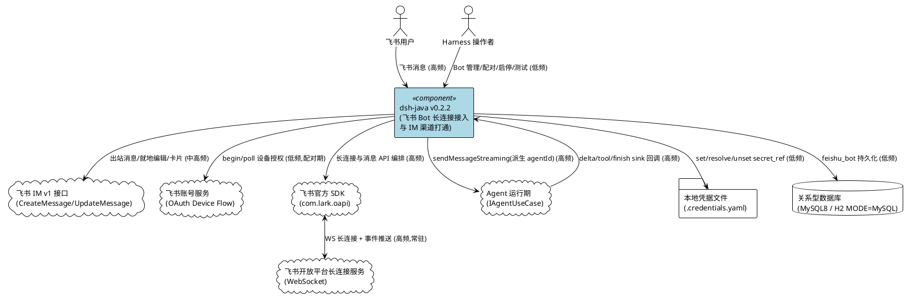
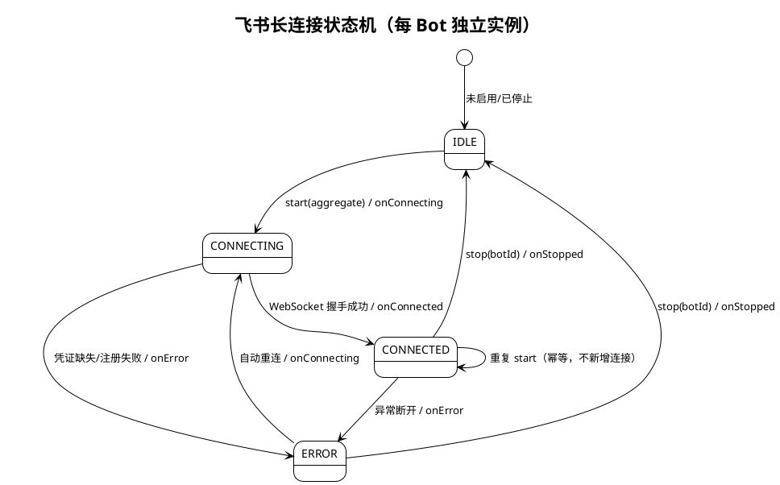
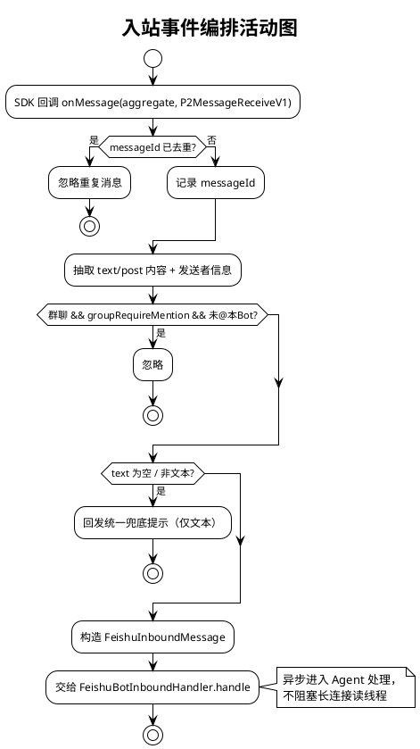
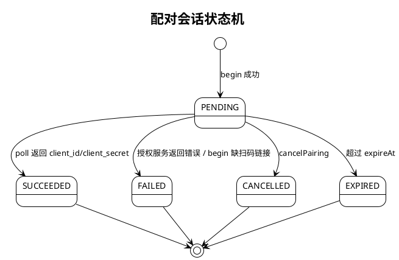
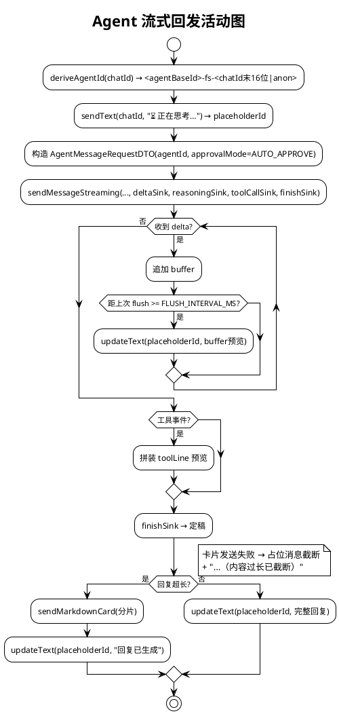
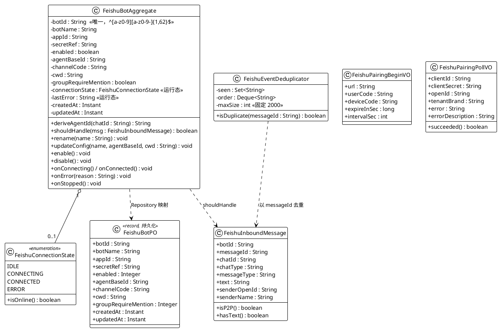
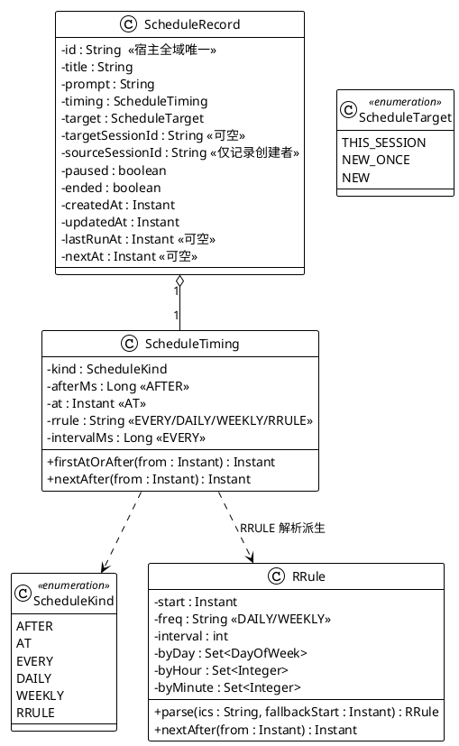

# DeepSeek Harness Java v0.2.2 实现方案文档

> 版本：`v0.2.2` | 基线：v0.2.1 | 架构：DDD 六边形架构（Maven 多模块 / Spring Boot 3.5.16 / Java 17）
>
> 本文档将 `docs/spec/0.2.2/spec.md` 中 **§5.1–§5.9 九大能力领域**、**§7 平台能力对齐**与 **§6 数据约束（含 §6.8/§6.9）** 的 EARS 需求转化为技术实现方案，主线为**飞书（Feishu / Lark）Bot WebSocket 长连接接入与 IM 会话渠道打通**；第三章补充与参考源 v0.2.2-alpha.2 升级项对齐的平台能力设计。
>
> 约束前提（沿用 spec §1.4 / §4.5 与命名隔离声明）：
> 1. **不新增 Maven 模块**，飞书相关类全部落在既有 6 个模块（domain / api / case / infrastructure / trigger / app）内，依赖方向保持"基础设施 → 领域"。
> 2. **仅新增两组第三方依赖**：`com.larksuite.oapi:oapi-sdk:2.8.3`、`com.larksuite.oapi:larksuite-oapi-shaded-protobuf:2.4.6`（传递引入 jackson 2.17.2、gson 2.10.1）。
> 3. **命名隔离**：既有 `domain/channel` 与 `harness_session.channel_code` 为**大模型渠道（LLM provider）**语义，飞书 IM 渠道采用独立命名（`feishu`/`im` + `feishu_bot` 表），不得复用 LLM channel 语义与数据对象。
> 4. **仅走 WebSocket 长连接**，不实现 HTTP webhook 回调路由；既有 GitHub Webhook 适配仅作**入站编排范式**参考，不做代码复用。
> 5. 存量事实基线：`schema.sql` 当前 30 张表；根 pom 与各模块 pom 版本已为 `0.2.2`；`IAgentUseCase.sendMessageStreaming` 已具备 delta / tool / finish 四类 sink。

---

# 一、需求与存量功能关系分析

本章以 v0.2.1 为基线，逐项对比 v0.2.2 九个能力领域的需求与存量代码的关系。飞书接入在存量代码中**无对应业务实现**，但存在多个可复用的**架构骨架**（入站编排范式、流式用例、凭据 seam、鉴权拦截、迁移机制、控制台外壳、装配风格），本分析明确"可直接复用 / 需扩展 / 需新增"的边界，为增量设计提供依据。

## 1.1 需求功能与存量功能对比

### 1.1.1 已实现功能（可直接复用的存量骨架）

下表列出飞书接入可**直接复用**的存量实现。匹配度按"接口契约覆盖度 + 是否需要改造"三维评估：即为飞书能力可直接调用的存量契约判定为高匹配度。

| 需求功能 | 存量功能 | 代码位置 | 匹配度 |
|---------|---------|---------|--------|
| 凭据写入/解析（§5.7） | `ICredentialProviderPort`（resolve/describe/set/unset） | `dsh-java-domain/src/main/java/net/linlan/dsh/domain/credentials/adapter/port/ICredentialProviderPort.java` | 100% |
| 凭据文件读写（§5.7） | `LocalCredentialProviderPort` + `CredentialsYamlStore`（`rw-------` 0600 权限） | `dsh-java-infrastructure/src/main/java/net/linlan/dsh/infrastructure/adapter/credentials/` | 100% |
| 凭据引用合规校验（§6.6） | `CredentialRef`（正则 `^[A-Za-z_][A-Za-z0-9_]*$`） | `dsh-java-domain/src/main/java/net/linlan/dsh/domain/credentials/model/valobj/CredentialRef.java` | 100% |
| 凭据主目录来源（§5.7） | `harness.credentials.home:${user.home}/.dsh` 注入点 | `dsh-java-infrastructure/.../config/HarnessApplicationConfig.java:224` | 100% |
| Agent 流式调用（§5.5） | `IAgentUseCase.sendMessageStreaming(command, deltaSink, reasoningSink, toolCallSink, finishSink)` | `dsh-java-case/src/main/java/net/linlan/dsh/cases/agent/IAgentUseCase.java:30-35` | 100% |
| Agent 请求载体（§5.5） | `AgentMessageRequestDTO`（含 `agentId`/`approvalMode`/`cwd`/`channelCode`） | `dsh-java-api/src/main/java/net/linlan/dsh/api/dto/AgentMessageRequestDTO.java` | 100% |
| 接口鉴权（§4.3） | `ApiKeyAuthInterceptor` + `WebMvcConfig`（`/**` 全路径拦截） | `dsh-java-trigger/src/main/java/net/linlan/dsh/trigger/filter/` | 100% |
| 统一响应包装（§5.1） | `Response<T>`（success/fail/invalidArgument） | `dsh-java-api/src/main/java/net/linlan/dsh/api/response/Response.java` | 100% |
| 迁移幂等机制（§5.8） | Spring SQL Init（`schema.sql`, mode=always）+ `SchemaMigrationRunner` | `dsh-java-app/src/main/resources/schema.sql`、`dsh-java-app/.../app/model/SchemaMigrationRunner.java` | 100% |
| SQL 三口径校验（§5.8） | `scripts/check-sql-parity.sh`（schema / dump / migration 表集一致性） | `dsh-java/scripts/check-sql-parity.sh` | 100% |
| 启动就绪钩子（§5.2） | `@EventListener(ApplicationReadyEvent)` 范式 | `dsh-java-app/.../app/StartupInfoRunner.java:36` | 100% |
| 条件装配范式（§4.5） | `@ConditionalOnProperty` 已在 OTLP 导出使用 | `dsh-java-infrastructure/.../adapter/otel/OtlpHttpExporter.java` | 100% |
| 手工 Bean 装配范式（§4.5） | `HarnessApplicationConfig`（`@Configuration` + `@Bean`，含 `credentialProviderPort`） | `dsh-java-infrastructure/.../config/HarnessApplicationConfig.java` | 100% |
| MyBatis 持久化范式（§5.1） | `IXxxDao`（`@Mapper`+`@Select/@Insert`） + `dao/po/*PO` record | `dsh-java-infrastructure/.../dao/IHarnessTaskDao.java`、`.../dao/po/HarnessTaskPO.java` | 100% |
| 应用扫描与 MapperScan（§5.1） | `@SpringBootApplication(scanBasePackages="net.linlan.dsh")` + `@MapperScan("net.linlan.dsh.infrastructure.dao")` | `dsh-java-app/src/main/java/net/linlan/dsh/app/Application.java` | 100% |
| 控制台静态外壳（§5.9） | 原生 HTML/CSS/JS（`index.html`/`app.js`/`app.css` + `lib/`） | `dsh-java-app/src/main/resources/static/` | 75% |
| 入站编排范式（§5.2） | `WebhookReceiver` / `GitHubWebhookHandler` / `IWebhookPort` / `HttpWebhookReceiver` | `dsh-java-domain/.../webhook/`、`dsh-java-infrastructure/.../adapter/webhook/` | 50% |
| 用例装配范式（§5.1） | `@Service` 用例 + `@Autowired` 端口注入 | `dsh-java-case/.../cases/agent/AgentUseCase.java` | 100% |

**复用结论**：飞书接入的**凭据、鉴权、响应、迁移、启动钩子、装配、持久化**七个横切关注点均有 100% 匹配的存量契约可直接调用，无需改造；**入站编排范式**（webhook）与**控制台外壳**为 50%~75% 匹配，仅借鉴结构，不直接复用业务类。

### 1.1.2 需要扩展的功能

下表列出与存量**部分匹配**、需在既有基础上改造或补强的内容。飞书接入整体不修改既有公开 API 签名（spec §4.5.2），扩展集中在工程治理与外壳侧。

| 需求功能 | 存量功能 | 差异说明 | 扩展方向 |
|---------|---------|---------|---------|
| 飞书 IM 渠道语义（§5.5/§6.1） | `harness_session.channel_code` + `domain/channel`（LLM provider 语义） | 既有 `channel_code` 取值服务于**模型渠道**（openai/anthropic/ollama/pi-ai），不可承载飞书 IM 会话渠道；`FeishuBot.channelCode` 为 IM 渠道标识 | **不修改** `domain/channel` 与 `harness_session.channel_code` 的既有取值与行为；飞书渠道码独立存于新表 `feishu_bot.channel_code`，取值 `feishu`/`im`；调用 Agent 时 `AgentMessageRequestDTO.channelCode` 语义保持模型渠道，飞书侧传空以走激活模型 |
| SQL 表数声明（§5.8） | `README.md:1226` / `README.en.md` 声明"共 30 张表"；`check-sql-parity.sh` 强校验 README 表数 == `schema.sql` 表数 | 新增 `feishu_bot` 后表数变为 31，README 两语文案与 `check-sql-parity.sh` 会立即失败 | 同步更新 `README.md`、`README.en.md` 表数声明为 31；`docs/dev-ops/mysql/sql/dsh_java.sql` 补同结构脚本以保持三方口径一致 |
| 控制台面板（§5.9） | `static/index.html` + `app.js` 单页外壳，无飞书面板 | 外壳已具备页面结构与请求能力，但无 Bot 列表/配对/启停/测试视图 | 在外壳内新增"飞书 Bot 管理"面板（原生 HTML + fetch，无前端框架），复用既有鉴权头与响应结构 |
| 启动期依赖检查（§5.2） | `StartupInfoRunner` 已用 `ApplicationReadyEvent` 打印启动信息 | 需新增"飞书长连接自动拉起"的启动动作，且须与模型检查解耦、失败不阻断启动 | 新增独立装配类，在 `ApplicationReadyEvent` 中调用 `autoStartEnabledBots()`，逐 Bot 隔离异常 |
| 版本标识（§5.8） | 根 pom / 7 个模块 pom / 2 个插件 pom 已为 `0.2.2`；`CHANGELOG.md`、`docker-compose-app.yml`、`start-app.sh` 仍为 `0.2.1` | pom 侧已升级，文档与部署脚本未同步 | 补齐 `CHANGELOG.md` 0.2.2 分模块分节、`docs/dev-ops/docker-compose-app.yml` 镜像 tag、`docs/dev-ops/start-app.sh` IMAGE 变量为 `0.2.2` |

### 1.1.3 需要新增的功能或接口

下表列出的功能在存量代码中**完全不存在**，v0.2.2 作为新增包/新增类引入。所有新增包落在既有模块内，不改变既有包公开 API。

**领域层（新增包 `net.linlan.dsh.domain.bot`）**
- **聚合根** `FeishuBotAggregate`：`botId`/`botName`/`appId`/`secretRef`/`enabled`/`agentBaseId`/`channelCode`/`cwd`/`groupRequireMention` + 运行态 `connectionState`/`lastError`；行为方法 `deriveAgentId(chatId)`、`shouldHandle(inbound)`、`rename`、`updateConfig`、`enable/disable`、`onConnecting/onConnected/onError/onStopped`。
- **值对象** `FeishuInboundMessage`（record，含 `isP2P()`/`hasText()`）、`FeishuConnectionState`（枚举 IDLE/CONNECTING/CONNECTED/ERROR + `isOnline()`）、`FeishuPairingBeginVO`、`FeishuPairingPollVO`（含 `succeeded()`）。
- **出站端口** `IFeishuBotRepository`（save/findByBotId/findAll/deleteByBotId）、`IFeishuBotConnectionPort`（start/stop/isConnected/stateOf/lastErrorOf）、`IFeishuMessagingPort`（sendText/updateText/sendMarkdownCard）、`IFeishuPairingPort`（begin/poll/larkBaseUrl）、`IFeishuInboundHandler`（handle(aggregate, inbound)）。
- **领域服务** `FeishuEventDeduplicator`（有界 `messageId` 去重，`ArrayDeque` + `HashSet`，**固定容量 2000**，见 §1.1.5.4 / §2.6）。

**API 层（新增包 `net.linlan.dsh.api`）**
- `IBotApi`：`startPairing` / `pairingStatus` / `cancelPairing` / `listBots` / `saveBot` / `deleteBot` / `enableBot` / `disableBot` / `testBot`。
- DTO（record）：`FeishuBotDTO`、`FeishuBotSaveDTO`、`FeishuPairingDTO`、`FeishuPairingStartDTO`。

**用例层（新增包 `net.linlan.dsh.cases.bot`）**
- `FeishuBotUseCase`（`@Service`，实现 `IBotApi`，依赖 `IFeishuBotRepository` / `IFeishuBotConnectionPort` / `ICredentialProviderPort` / `FeishuPairingUseCase`）。
- `FeishuPairingUseCase`（配对会话编排 + `PairingSession` 守护线程轮询）。
- `FeishuBotInboundHandler`（实现 `IFeishuInboundHandler`，桥接 `IAgentUseCase` 与 `IFeishuMessagingPort`，内含 `StreamReply` 流式回发状态）。

**基础设施层（新增包 `net.linlan.dsh.infrastructure.adapter.feishu` + `dao`）**
- `FeishuWsGateway`（实现 `IFeishuBotConnectionPort` + `DisposableBean`，持有 `com.lark.oapi.ws.Client` 连接表、`autoStartEnabledBots`）。
- `FeishuMessagingClient`（实现 `IFeishuMessagingPort`，按 appId 缓存 `com.lark.oapi.Client`）。
- `FeishuPairingClient`（实现 `IFeishuPairingPort`，`java.net.http.HttpClient` 调 OAuth 设备授权端点）。
- `FeishuBotRepository`（实现 `IFeishuBotRepository`，委托 `IFeishuBotDao`）；`IFeishuBotDao`（`@Mapper`，MyBatis 注解 SQL）；`dao/po/FeishuBotPO`（record）。

**触发层（新增 `net.linlan.dsh.trigger.http.BotController`）**
- `@RestController @RequestMapping("/api/harness/bots")`，11 个端点（list / pairing 3 个 / save / update / delete / enable / disable / test），全部委托 `IBotApi`。

**应用/工程层（新增装配与资源）**
- `dsh-java-infrastructure/.../config/FeishuBeanConfig`（`@Configuration` 手工装配飞书 Bean，`@ConditionalOnProperty` 开关）。
- `dsh-java-app/src/main/resources/db/migration/V20261102__feishu_bot.sql` + `schema.sql` 追补 `feishu_bot` 建表。
- `docs/dev-ops/mysql/sql/dsh_java.sql` 追补 `feishu_bot`；`README.md`/`README.en.md` 表数更新。
- 控制台飞书面板（`static/index.html` + `static/app.js` 追加）。

### 1.1.4 参考源实现逐一对位映射（总览）

参考源 `refer_source/deepseek-harness-java-app`（v0.1.9，包名 `cn.xiaofuge.deepseek.harness.*`，业务类在 `BOOT-INF/lib/*.jar`，经 `javap -p` 逐类核验）为飞书接入的原始实现。下表给出**参考源类 → 本项目落位类**的逐一对位，作为后续实现的权威映射基线。

| 参考源类（cn.xiaofuge.deepseek.harness.*） | 参考源所在层 | 本项目落位类 | 本项目包路径 |
|---------|---------|---------|---------|
| `trigger.http.BotController` | trigger | `BotController` | `net.linlan.dsh.trigger.http` |
| `api.IBotApi` | api | `IBotApi` | `net.linlan.dsh.api` |
| `api.dto.FeishuBotDTO` | api | `FeishuBotDTO` | `net.linlan.dsh.api.dto` |
| `api.dto.FeishuBotSaveDTO` | api | `FeishuBotSaveDTO` | `net.linlan.dsh.api.dto` |
| `api.dto.FeishuPairingDTO` | api | `FeishuPairingDTO` | `net.linlan.dsh.api.dto` |
| `api.dto.FeishuPairingStartDTO` | api | `FeishuPairingStartDTO` | `net.linlan.dsh.api.dto` |
| `cases.bot.FeishuBotUseCase` | case | `FeishuBotUseCase` | `net.linlan.dsh.cases.bot` |
| `cases.bot.FeishuPairingUseCase` | case | `FeishuPairingUseCase` | `net.linlan.dsh.cases.bot` |
| `cases.bot.FeishuBotInboundHandler` | case | `FeishuBotInboundHandler` | `net.linlan.dsh.cases.bot` |
| `cases.bot.FeishuPairingUseCase$PairingSession` | case | `PairingSession`（内部类） | `net.linlan.dsh.cases.bot` |
| `cases.bot.FeishuBotInboundHandler$StreamReply` | case | `StreamReply`（内部类） | `net.linlan.dsh.cases.bot` |
| `domain.bot.model.aggregate.FeishuBotAggregate` | domain | `FeishuBotAggregate` | `net.linlan.dsh.domain.bot.model.aggregate` |
| `domain.bot.model.valobj.FeishuInboundMessage` | domain | `FeishuInboundMessage` | `net.linlan.dsh.domain.bot.model.valobj` |
| `domain.bot.model.valobj.FeishuConnectionState` | domain | `FeishuConnectionState` | `net.linlan.dsh.domain.bot.model.valobj` |
| `domain.bot.model.valobj.FeishuPairingBeginVO` | domain | `FeishuPairingBeginVO` | `net.linlan.dsh.domain.bot.model.valobj` |
| `domain.bot.model.valobj.FeishuPairingPollVO` | domain | `FeishuPairingPollVO` | `net.linlan.dsh.domain.bot.model.valobj` |
| `domain.bot.service.FeishuEventDeduplicator` | domain | `FeishuEventDeduplicator` | `net.linlan.dsh.domain.bot.service` |
| `domain.bot.adapter.repository.IFeishuBotRepository` | domain | `IFeishuBotRepository` | `net.linlan.dsh.domain.bot.adapter.repository` |
| `domain.bot.adapter.port.IFeishuBotConnectionPort` | domain | `IFeishuBotConnectionPort` | `net.linlan.dsh.domain.bot.adapter.port` |
| `domain.bot.adapter.port.IFeishuMessagingPort` | domain | `IFeishuMessagingPort` | `net.linlan.dsh.domain.bot.adapter.port` |
| `domain.bot.adapter.port.IFeishuPairingPort` | domain | `IFeishuPairingPort` | `net.linlan.dsh.domain.bot.adapter.port` |
| `domain.bot.adapter.port.IFeishuInboundHandler` | domain | `IFeishuInboundHandler` | `net.linlan.dsh.domain.bot.adapter.port` |
| `infrastructure.adapter.feishu.FeishuWsGateway` | infrastructure | `FeishuWsGateway` | `net.linlan.dsh.infrastructure.adapter.feishu` |
| `infrastructure.adapter.feishu.FeishuMessagingClient` | infrastructure | `FeishuMessagingClient` | `net.linlan.dsh.infrastructure.adapter.feishu` |
| `infrastructure.adapter.feishu.FeishuPairingClient` | infrastructure | `FeishuPairingClient` | `net.linlan.dsh.infrastructure.adapter.feishu` |
| `infrastructure.adapter.repository.FeishuBotRepository` | infrastructure | `FeishuBotRepository` | `net.linlan.dsh.infrastructure.adapter.repository` |
| `infrastructure.dao.IFeishuBotDao` | infrastructure | `IFeishuBotDao` | `net.linlan.dsh.infrastructure.dao` |
| `infrastructure.dao.po.FeishuBotPO` | infrastructure | `FeishuBotPO` | `net.linlan.dsh.infrastructure.dao.po` |
| （参考源无独立开关配置类，装配散落在 `HarnessApplicationConfig` 风格） | infrastructure | `FeishuBeanConfig`（新增，条件装配） | `net.linlan.dsh.infrastructure.config` |

**对位差异说明**：
1. 参考源无 `domain.bot` 之外的独立装配类，飞书 Bean 由容器扫描 + 手工注册混合；本项目统一收敛到 `FeishuBeanConfig` 并通过 `dsh.feishu.enabled` 条件装配，便于默认关闭时零副作用。
2. 参考源使用旧包名与 Spring Boot 3.3.2；本项目对齐 Spring Boot 3.5.16 与 `net.linlan.dsh` 包名空间。
3. 参考源 `FeishuWsGateway` 的自动拉起由 Spring 生命周期触发；本项目对齐 `StartupInfoRunner` 的 `ApplicationReadyEvent` 范式。
4. 参考源 `IBotApi` 仅 9 个方法（**无 `updateBot`**），`BotController.update` 在控制器内重组 DTO 后复用 `saveBot`；本项目在 `IBotApi` 新增 `updateBot`（唯一契约扩展，PUT 语义显式化），逐类证据见 §1.1.5.1/§1.1.5.2。
5. 字段级/方法级对位详见 §1.1.5（含参考源常量：`FLUSH_INTERVAL_MS=1500`、`MAX_SIZE=2000`、`MAX_STREAM_TEXT=20000`、`MAX_CARD_MARKDOWN=28000`、`MAX_NETWORK_ERRORS=20` 等）。

### 1.1.5 参考源字段级 / 方法级对位映射（逐类）

> **核验口径**：对 `refer_source/deepseek-harness-java-app/BOOT-INF/lib/deepseek-harness-java-{trigger,api,case,domain,infrastructure}-0.1.9.jar` 逐类执行 `javap -p`（签名）、`javap -p -constants`（常量值）与 `javap -c -p`（分支/字面量）。下表"参考源签名/取值"均取自字节码，非源码推测。标注口径：**保留**＝同名同型直接迁移；**重命名**＝同义换名；**合并**＝多元素收敛为一；**省略**＝不迁移。本项目列统一为 `net.linlan.dsh.*` 包空间。

#### 1.1.5.1 trigger 层：BotController

- 对位类：`cn.xiaofuge.deepseek.harness.trigger.http.BotController` → `net.linlan.dsh.trigger.http.BotController`。

**字段映射（1 项）**

| 参考源字段 | 类型 | 本项目字段 | 标注 | 理由 |
|---|---|---|---|---|
| `botApi` | `IBotApi`（`private final`） | `botApi` | 保留 | 构造注入契约不变，仅换包名 |

**方法映射（10 项，含 Spring 注解）**

| 参考源方法（注解） | 本项目方法 | 标注 | 理由 |
|---|---|---|---|
| `list()` `@GetMapping` | `list()` | 保留 | 直投 `listBots` |
| `startPairing(FeishuPairingStartDTO)` `@PostMapping("/pairing")` | `startPairing` | 保留 | 配对发起 |
| `pairingStatus(String)` `@GetMapping("/pairing/{pairingId}")` | `pairingStatus` | 保留 | 配对状态轮询 |
| `cancelPairing(String)` `@DeleteMapping("/pairing/{pairingId}")` | `cancelPairing` | 保留 | 取消配对 |
| `save(FeishuBotSaveDTO)` `@PostMapping` | `save` | 保留 | 新增 Bot |
| `update(String,FeishuBotSaveDTO)` `@PutMapping("/{botId}")` | `update` | 保留（实现差异） | 参考源在 Controller 内重组 DTO（注入 `botId`）后复用 `botApi.saveBot`；本项目改由 `IBotApi.updateBot` 承接（见 1.1.5.2） |
| `delete(String)` `@DeleteMapping("/{botId}")` | `delete` | 保留 | 删除联动清密钥/断连 |
| `enable(String)` `@PostMapping("/{botId}/enable")` | `enable` | 保留 | 启用建连 |
| `disable(String)` `@PostMapping("/{botId}/disable")` | `disable` | 保留 | 停用断连 |
| `test(String)` `@PostMapping("/{botId}/test")` | `test` | 保留 | 连通性测试 |

#### 1.1.5.2 api 层：IBotApi 与 4 个 DTO

- 对位类：`api.IBotApi` → `net.linlan.dsh.api.IBotApi`；`api.dto.{FeishuBotDTO,FeishuBotSaveDTO,FeishuPairingDTO,FeishuPairingStartDTO}` → `net.linlan.dsh.api.dto.*`（均 `record`）。

**（1）IBotApi 方法映射（参考源 9 项）**

| 参考源方法签名 | 本项目方法 | 标注 | 理由 |
|---|---|---|---|
| `Response<FeishuPairingDTO> startPairing(FeishuPairingStartDTO)` | 同名 | 保留 | 配对发起契约 |
| `Response<FeishuPairingDTO> pairingStatus(String)` | 同名 | 保留 | 状态查询 |
| `Response<Void> cancelPairing(String)` | 同名 | 保留 | 取消 |
| `Response<List<FeishuBotDTO>> listBots()` | 同名 | 保留 | 列表 |
| `Response<FeishuBotDTO> saveBot(FeishuBotSaveDTO)` | 同名 | 保留 | upsert |
| `Response<Void> deleteBot(String)` | 同名 | 保留 | 删除 |
| `Response<FeishuBotDTO> enableBot(String)` | 同名 | 保留 | 启用 |
| `Response<FeishuBotDTO> disableBot(String)` | 同名 | 保留 | 停用 |
| `Response<FeishuBotDTO> testBot(String)` | 同名 | 保留 | 测试 |

> **差异项（新增，本项目唯一 API 契约扩展）**：`IBotApi` 新增 `Response<FeishuBotDTO> updateBot(String botId, FeishuBotSaveDTO request)`。理由：把 PUT 语义显式下沉到契约层，`BotController.update` 直接委托，无需重组 DTO（参考源无此方法，属本项目改进）。

**（2）DTO 字段级映射**

| 参考源 DTO | 字段（顺序与类型） | 本项目 DTO | 标注 |
|---|---|---|---|
| `FeishuBotDTO` | `botId:String`、`botName:String`、`appId:String`、`secretRef:String`、`secretConfigured:boolean`、`enabled:boolean`、`agentBaseId:String`、`channelCode:String`、`cwd:String`、`groupRequireMention:boolean`、`connectionState:String`、`lastError:String`、`updatedAt:String` | `net.linlan.dsh.api.dto.FeishuBotDTO`（13 字段） | 保留（逐字段同名同型） |
| `FeishuBotSaveDTO` | `botId:String`、`botName:String`、`appId:String`、`appSecret:String`、`agentBaseId:String`、`channelCode:String`、`cwd:String`、`groupRequireMention:Boolean` | `net.linlan.dsh.api.dto.FeishuBotSaveDTO`（8 字段） | 保留（`groupRequireMention` 为可空 `Boolean`，缺省不覆盖） |
| `FeishuPairingDTO` | `pairingId:String`、`status:String`、`url:String`、`userCode:String`、`expireIn:Long`、`botId:String`、`appId:String`、`error:String` | `net.linlan.dsh.api.dto.FeishuPairingDTO`（8 字段） | 保留 |
| `FeishuPairingStartDTO` | `botName:String`、`agentBaseId:String` | `net.linlan.dsh.api.dto.FeishuPairingStartDTO`（2 字段） | 保留 |

> DTO 字段**零删改**：`secretRef` 在 `FeishuBotDTO` 中回显、但 `appSecret` 仅出现在 `FeishuBotSaveDTO` 入参，符合 spec §4.3.1「密钥不入库、不回显」。

#### 1.1.5.3 case 层：三个用例类（含内部类）

**（1）FeishuBotUseCase（参考源 `cases.bot.FeishuBotUseCase implements IBotApi`）**

| 参考源字段 | 类型 | 本项目字段 | 标注 |
|---|---|---|---|
| `log` | `static final Logger` | `log` | 保留 |
| `BOT_ID_PATTERN` | `static final Pattern`＝`^[a-z0-9][a-z0-9-]{1,62}$` | `BOT_ID_PATTERN` | 保留（正则值一致） |
| `botRepository` | `IFeishuBotRepository` | `botRepository` | 保留 |
| `connectionPort` | `IFeishuBotConnectionPort` | `connectionPort` | 保留 |
| `credentialPort` | `ICredentialProviderPort` | `credentialPort` | 保留 |
| `pairingUseCase` | `FeishuPairingUseCase` | `pairingUseCase` | 保留（`startPairing/pairingStatus/cancelPairing` 委托） |

| 参考源方法 | 本项目方法 | 标注 | 理由 |
|---|---|---|---|
| `startPairing/pairingStatus/cancelPairing` | 同名 | 保留 | 委托 `pairingUseCase` |
| `listBots/saveBot/enableBot/disableBot/testBot` | 同名 | 保留 | 直接实现 |
| `deleteBot(String)` | 同名 | 保留 | 三联动删除 |
| `private resolveBotId(String)` | 同名 | 保留 | 空值生成的 `fbot-<hex>`、非空校验 |
| `private normalize(String)` | 同名 | 保留 | `trim().toLowerCase()` |
| `private secretConfigured(FeishuBotAggregate)` | 同名 | 保留 | 经 `credentialPort` 解析投影 |
| `private toDTO(FeishuBotAggregate)` | 同名 | 保留 | 聚合→DTO |

> **关键字面量（字节码核验）**：`secretRef` 派生模板 `FEISHU_BOT_<BOTID大写下划线化>_APP_SECRET`；自动 `botId` 为 `fbot-` ＋ `Long.toHexString(System.currentTimeMillis() & 0xFFFFL)`；校验文案「botId 只允许小写字母、数字与连字符（3~63 位，字母或数字开头）: <id>」；错误文案「新建 Bot 必须提供 appId」「Bot 不存在: <id>」「保存 Bot 失败：<原因>」「删除 Bot 失败：<原因>」「尚未配置 app_secret，请先在编辑中填写」。

**（2）FeishuPairingUseCase（参考源 `cases.bot.FeishuPairingUseCase`）**

| 参考源字段 | 类型 / 取值 | 本项目字段 | 标注 |
|---|---|---|---|
| `log` | `static final Logger` | `log` | 保留 |
| `BOT_ID_PATTERN` | `static final Pattern`＝`^[a-z0-9][a-z0-9-]{1,62}$` | `BOT_ID_PATTERN` | 保留 |
| `MAX_NETWORK_ERRORS` | `static final int`＝**20** | `MAX_NETWORK_ERRORS` | 保留（容错上限，见 §2.6） |
| `pairingPort` | `IFeishuPairingPort` | `pairingPort` | 保留 |
| `botRepository` | `IFeishuBotRepository` | `botRepository` | 保留 |
| `connectionPort` | `IFeishuBotConnectionPort` | `connectionPort` | 保留 |
| `credentialPort` | `ICredentialProviderPort` | `credentialPort` | 保留 |
| `sessions` | `final Map<String,PairingSession>` | `sessions` | 保留（配对会话表，按 `pairingId`） |

| 参考源方法 | 本项目方法 | 标注 |
|---|---|---|
| `startPairing / pairingStatus / cancelPairing` | 同名 | 保留 |

> 默认值（字节码核验）：`botName` 缺省为 `DeepSeek Bot`；`agentBaseId` 缺省为 `feishu-agent`（并 `toLowerCase()`）；`begin` 的 `desc` 固定为「手机上对话电脑端 Harness Agent，支持工具调用与流式回复」。守护线程名以 `pairingId` 拼接、`setDaemon(true)`。

**（3）`PairingSession`（`FeishuPairingUseCase` 内部类）**

| 参考源字段 | 类型 | 本项目 | 标注 |
|---|---|---|---|
| `pairingId/botName/agentBaseId` | `final String` | 同名 | 保留（会话标识） |
| `url/userCode/deviceCode` | `final String` | 同名 | 保留（来自 `FeishuPairingBeginVO`） |
| `expireAt` | `long`（`now + expireInSec*1000L`） | 同名 | 保留 |
| `intervalMs` | `volatile int`（`intervalSec*1000`；`slow_down` 时置 **5000**） | 同名 | 保留 |
| `baseUrl` | `volatile String`（默认 `https://accounts.feishu.cn`，Lark 租户切 `larkBaseUrl()`） | 同名 | 保留 |
| `status/error` | `volatile String` | 同名 | 保留 |
| `createdBotId/appId` | `volatile String` | 同名 | 保留 |
| `cancelled` | `volatile boolean` | 同名 | 保留 |

| 参考源方法 | 本项目方法 | 标注 |
|---|---|---|
| `run()` | 同名 | 保留（轮询主循环） |
| `private complete(FeishuPairingPollVO)` | 同名 | 保留 |
| `private deriveBotId(String)` | 同名 | 保留 |
| `private fail(String)` | 同名 | 保留 |
| `cancel()` | 同名 | 保留 |
| `toDTO()` | 同名 | 保留 |

**（4）FeishuBotInboundHandler（参考源 `cases.bot.FeishuBotInboundHandler implements IFeishuInboundHandler`）**

| 参考源字段 | 类型 / 取值 | 本项目字段 | 标注 |
|---|---|---|---|
| `log` | `static final Logger` | `log` | 保留 |
| `FLUSH_INTERVAL_MS` | `static final long`＝**1500L** | `FLUSH_INTERVAL_MS` | 保留（节流间隔，见 §2.7） |
| `STREAM_PREVIEW_LIMIT` | `static final int`＝**4000** | `STREAM_PREVIEW_LIMIT` | 保留 |
| `FINAL_IN_PLACE_LIMIT` | `static final int`＝**4000** | `FINAL_IN_PLACE_LIMIT` | 保留 |
| `CARD_LIMIT` | `static final int`＝**28000** | `CARD_LIMIT` | 保留 |
| `agentUseCase` | `IAgentUseCase` | `agentUseCase` | 保留（复用既有端口） |
| `messagingPort` | `IFeishuMessagingPort` | `messagingPort` | 保留 |
| `botExecutors` | `final Map<String,ExecutorService>` | `botExecutors` | 保留（每 Bot 单线程，线程名 `feishu-bot-<botId>`，daemon） |

| 参考源方法 | 本项目方法 | 标注 |
|---|---|---|
| `handle(FeishuBotAggregate,FeishuInboundMessage)` | 同名 | 保留（`@Override`，提交至 `botExecutors`） |
| `private process(FeishuBotAggregate,FeishuInboundMessage)` | 同名 | 保留（Agent 桥接主体） |
| `private buildUserText(FeishuBotAggregate,FeishuInboundMessage)` | 同名 | 保留（群聊回填发送者名） |
| `private safeReplyError(FeishuBotAggregate,FeishuInboundMessage,String)` | 同名 | 保留（异常兜底回发） |

**（5）`StreamReply`（`FeishuBotInboundHandler` 内部类）**

| 参考源字段 | 类型 | 本项目 | 标注 |
|---|---|---|---|
| `appId/chatId/placeholder` | `final String` | 同名 | 保留（占位消息句柄） |
| `buffer` | `final StringBuilder` | 同名 | 保留（增量缓冲） |
| `lastFlushAt` | `volatile long` | 同名 | 保留（上次 flush 时刻） |
| `toolLine` | `volatile String` | 同名 | 保留（工具调用预览行） |
| `finished` | `volatile boolean` | 同名 | 保留（定稿标记） |

| 参考源方法 | 本项目方法 | 标注 |
|---|---|---|
| `onDelta(String)` | 同名 | 保留（`deltaSink` 消费） |
| `onToolCall(AgentToolCallEventResponseDTO)` | 同名 | 保留（`toolCallSink` 消费） |
| `onFinish()` | 同名 | 保留（`finishSink` 消费） |
| `text()` | 同名 | 保留 |
| `finalizeWith(String)` | 同名 | 保留（定稿/卡片降级） |
| `private maybeFlush()` | 同名 | 保留（按 `FLUSH_INTERVAL_MS` 节流） |
| `private flush(boolean)` | 同名 | 保留 |

#### 1.1.5.4 domain 层：聚合、值对象、去重器与端口

**（1）FeishuBotAggregate（参考源 `domain.bot.model.aggregate.FeishuBotAggregate`）**

| 参考源字段 | 修饰 / 类型 | 本项目字段 | 标注 |
|---|---|---|---|
| `botId` | `private final String` | `botId` | 保留（唯一主键，不可变） |
| `botName` | `private String` | `botName` | 保留 |
| `appId` | `private final String` | `appId` | 保留（不可变） |
| `secretRef` | `private final String` | `secretRef` | 保留（不可变，不含明文） |
| `enabled` | `private boolean` | `enabled` | 保留 |
| `agentBaseId` | `private String` | `agentBaseId` | 保留 |
| `channelCode` | `private String` | `channelCode` | 保留（IM 渠道语义，与 LLM channel 隔离） |
| `cwd` | `private String` | `cwd` | 保留 |
| `groupRequireMention` | `private boolean` | `groupRequireMention` | 保留 |
| `connectionState` | `private FeishuConnectionState` | 同名 | 保留（运行态，不入库） |
| `lastError` | `private String` | 同名 | 保留（运行态，不入库） |
| `createdAt` | `private Instant` | 同名 | 保留 |
| `updatedAt` | `private Instant` | 同名 | 保留 |

| 参考源方法签名 | 本项目方法 | 标注 | 理由 |
|---|---|---|---|
| `<init>(String botId,String botName,String appId,String secretRef,boolean enabled,String agentBaseId,String channelCode,String cwd,boolean groupRequireMention,Instant createdAt,Instant updatedAt)` | 同名同参 | 保留 | 构造**不含** `connectionState`/`lastError`（运行态） |
| `String deriveAgentId(String chatId)` | 同名 | 保留 | `agentBaseId + "-fs-" + (chatId 末 16 位 | "anon")` |
| `boolean shouldHandle(FeishuInboundMessage)` | 同名 | 保留 | 单聊恒处理；群聊按 `groupRequireMention` 与 @ 判定 |
| `void rename(String)` | 同名 | 保留 | 改名 |
| `void updateConfig(String,String,String)` | 同名 | 保留 | (name, agentBaseId, cwd) |
| `void enable()/disable()` | 同名 | 保留 | 启停标记 |
| `void onConnecting()/onConnected()/onError(String)/onStopped()` | 同名 | 保留 | 状态迁移（见 §2.1.3.1） |
| getters + `setGroupRequireMention(boolean)` + `setUpdatedAt(Instant)` | 同名 | 保留 | 参考源聚合为可变（含 2 个 setter） |

**（2）值对象（均 `record` / `enum`）**

| 参考源类型 | 字段 / 取值 | 本项目 | 标注 |
|---|---|---|---|
| `FeishuInboundMessage` | `botId,messageId,chatId,chatType,messageType,text,senderOpenId,senderName`（8 个 `String`）+ `isP2P()`、`hasText()` | 同名 record | 保留 |
| `FeishuConnectionState` | enum `IDLE,CONNECTING,CONNECTED,ERROR` + `isOnline()` | 同名 enum | 保留（`isOnline()` 仅 `CONNECTED` 为真） |
| `FeishuPairingBeginVO` | `url:String,userCode:String,deviceCode:String,expireInSec:long,intervalSec:int` | 同名 record | 保留（**注意 `intervalSec` 为 `int`**，非 long） |
| `FeishuPairingPollVO` | `clientId,clientSecret,openId,tenantBrand,error,errorDescription`（6 个 `String`）+ `succeeded()` | 同名 record | 保留（`succeeded()` 当且仅当 `clientId`/`clientSecret` 非空） |

**（3）FeishuEventDeduplicator（参考源 `domain.bot.service.FeishuEventDeduplicator`）**

| 参考源成员 | 类型 / 取值 | 本项目 | 标注 |
|---|---|---|---|
| `MAX_SIZE` | `private static final int`＝**2000** | `MAX_SIZE` | 保留（**固定 2000**，无构造参数、无 setter） |
| `seen` | `private final Set<String>` | `seen` | 保留 |
| `order` | `private final ArrayDeque<String>` | `order` | 保留（有界淘汰顺序） |
| `isDuplicate(String)` | `public synchronized boolean` | 同名 | 保留（重复返回 `true` 并入队；超容淘汰最旧） |

**（4）出站端口与仓储（5 个接口，12 个方法，全保留）**

| 参考源接口 | 方法签名 | 本项目 | 标注 |
|---|---|---|---|
| `IFeishuBotRepository` | `void save(FeishuBotAggregate)`、`Optional<FeishuBotAggregate> findByBotId(String)`、`List<FeishuBotAggregate> findAll()`、`void deleteByBotId(String)` | 同名 | 保留 |
| `IFeishuBotConnectionPort` | `void start(FeishuBotAggregate)`、`void stop(String)`、`boolean isConnected(String)`、`String stateOf(String)`、`String lastErrorOf(String)` | 同名 | 保留 |
| `IFeishuMessagingPort` | `String sendText(String,String,String)`、`boolean updateText(String,String,String)`、`String sendMarkdownCard(String,String,String)` | 同名 | 保留 |
| `IFeishuPairingPort` | `FeishuPairingBeginVO begin(String,String)`、`FeishuPairingPollVO poll(String,String)`、`String larkBaseUrl()` | 同名 | 保留（**`begin` 为 2 参**；见 §2.2.2 修正） |
| `IFeishuInboundHandler` | `void handle(FeishuBotAggregate,FeishuInboundMessage)` | 同名 | 保留 |

#### 1.1.5.5 infrastructure 层：SDK 适配器、仓储与 DAO/PO

**（1）FeishuWsGateway（参考源 `infrastructure.adapter.feishu.FeishuWsGateway implements IFeishuBotConnectionPort, DisposableBean`）**

| 参考源字段 | 类型 | 本项目字段 | 标注 |
|---|---|---|---|
| `log` | `static final Logger` | `log` | 保留 |
| `feishuBotDao` | `IFeishuBotDao` | 同名 | 保留（启动拉起用 `findAll`） |
| `inboundHandler` | `IFeishuInboundHandler` | 同名 | 保留 |
| `messagingClient` | `FeishuMessagingClient` | 同名 | 保留（`register/unregister` client 缓存） |
| `credentialPort` | `ICredentialProviderPort` | 同名 | 保留（建连前 `resolve`） |
| `objectMapper` | `ObjectMapper` | 同名 | 保留（`post` 富文本扁平化） |
| `deduplicator` | `FeishuEventDeduplicator` | 同名 | 保留 |
| `connections` | `final Map<String, com.lark.oapi.ws.Client>` | 同名 | 保留（`botId → SDK Client`） |
| `activeBots` | `final Map<String, FeishuBotAggregate>` | 同名 | 保留（`botId → 聚合`） |
| `connectExecutor` | `final ExecutorService` | 同名 | 保留（`Executors.newCachedThreadPool(ThreadFactory)`） |
| `wsThreadSeq` | `final AtomicInteger` | 同名 | 保留（连接线程序号） |

| 参考源方法签名 | 本项目方法 | 标注 | 关键事实 |
|---|---|---|---|
| `<init>(IFeishuBotDao,IFeishuInboundHandler,FeishuMessagingClient,ICredentialProviderPort,ObjectMapper)` | 同名同参 | 保留 | 装配见 §2.8 |
| `void autoStartEnabledBots()` | 同名 | 保留 | `findAll().stream().filter(enabled==1).forEach(...)`，逐 Bot `start` |
| `void start(FeishuBotAggregate)` | 同名 | 保留 | `resolve`→`messagingClient.register`→建 `ws.Client` |
| `void stop(String)` / `boolean isConnected(String)` / `String stateOf(String)` / `String lastErrorOf(String)` | 同名 | 保留 | `stateOf` 缺省返回 `IDLE` |
| `void destroy()` | 同名 | 保留 | 遍历 `connections` 关闭 → `connectExecutor.shutdownNow()` |
| `private void onMessage(FeishuBotAggregate,P2MessageReceiveV1)` | 同名 | 保留 | 去重→@ 判定→抽取→`inboundHandler.handle` |
| `private String extractText(EventMessage)` / `flattenPost(JsonNode)` / `replaceMentions(String,EventMessage)` / `senderLabel(EventMessage,String)` | 同名 | 保留 | text/post 抽取与 @ 文本化 |
| `private FeishuBotAggregate toAggregate(FeishuBotPO)` | 同名 | 保留 | PO→聚合 |

> **建连与重连事实（字节码核验，纠正既有描述）**：`start` 内构造 `new Client.Builder(appId, secret).eventHandler(dispatcher).autoReconnect(Boolean.TRUE).build()`；连接线程由 `connectExecutor.submit(...)` 提交，`client.start()` 阻塞后 `awaitReady(15000L)`（**15s 握手等待**），成功后 `onConnected()`。**参考源未实现自定义退避/最大重试循环**——断线重连完全由 SDK `autoReconnect(true)` 内部承担；异常时仅当 `connections.get(botId)==client` 时 `onError(msg)`。因此"重连风暴"由 SDK 侧治理，本项目不叠加自研退避（见 §2.6/§2.12）。连接线程名固定为 `feishu-ws-connector`（**非** `feishu-ws-<botId>`），daemon。

**（2）FeishuMessagingClient（参考源 `infrastructure.adapter.feishu.FeishuMessagingClient`）**

| 参考源字段 / 常量 | 类型 / 取值 | 本项目 | 标注 |
|---|---|---|---|
| `log` | `static final Logger` | `log` | 保留 |
| `MAX_STREAM_TEXT` | `static final int`＝**20000** | 同名 | 保留（`send` 文本截断阈值） |
| `MAX_CARD_MARKDOWN` | `static final int`＝**28000** | 同名 | 保留（卡片 Markdown 截断阈值） |
| `credentialPort` | `ICredentialProviderPort` | 同名 | 保留 |
| `objectMapper` | `ObjectMapper` | 同名 | 保留 |
| `clients` | `final Map<String, com.lark.oapi.Client>` | 同名 | 保留（按 `appId` 缓存） |

| 参考源方法 | 本项目方法 | 标注 | 理由 |
|---|---|---|---|
| `String sendText(String,String,String)` | 同名 | 保留 | 发文本，返回 `messageId` |
| `boolean updateText(String,String,String)` | 同名 | 保留 | 就地编辑 |
| `String sendMarkdownCard(String,String,String)` | 同名 | 保留 | 交互式卡片 |
| `private String send(String,String,String,String)` / `private String jsonText(String)` / `private Client client(String)` | 同名 | 保留 | 内部实现 |
| `boolean register(String appId,String secretRef)` | 同名 | **保留（须在设计中显式化）** | 建连时预热并缓存 SDK `Client`；失败返回 `false` |
| `void unregister(String appId)` | 同名 | **保留（须在设计中显式化）** | `stop/delete` 时清理缓存 |

**（3）FeishuPairingClient（参考源 `infrastructure.adapter.feishu.FeishuPairingClient`）**

| 参考源字段 / 常量 | 类型 / 取值 | 本项目 | 标注 |
|---|---|---|---|
| `log` | `static final Logger` | `log` | 保留 |
| `ENDPOINT` | `static final String`＝`/oauth/v1/app/registration` | 同名 | 保留 |
| `FEISHU_BASE` | `static final String`＝`https://accounts.feishu.cn` | 同名 | 保留（默认域名） |
| `LARK_BASE` | `static final String`＝`https://accounts.larksuite.com` | 同名 | 保留（Lark 兜底域名） |
| `http` | `java.net.http.HttpClient` | 同名 | 保留（JDK 原生客户端） |
| `objectMapper` | `ObjectMapper` | 同名 | 保留 |

| 参考源方法 | 本项目方法 | 标注 | 关键事实 |
|---|---|---|---|
| `FeishuPairingBeginVO begin(String,String)` | 同名 | 保留（**2 参**） | 参数为 `(name, desc)`；请求体 `action=begin&archetype=PersonalAgent&auth_method=client_secret&request_user_info=open_id`，追加 `source=dsh-java`、`name`、`desc`；缺 `verification_uri_complete` 抛 `IllegalStateException` |
| `FeishuPairingPollVO poll(String,String)` | 同名 | 保留 | 参数为 `(baseUrl, deviceCode)` |
| `private FeishuPairingPollVO doPoll(...)` | 同名 | 保留 | 实际 HTTP 调用 |
| `String larkBaseUrl()` | 同名 | 保留 | 返回 `LARK_BASE` |
| `private JsonNode post(String,String)` / `private String enc(String)` | 同名 | 保留 | HTTP POST 与 URL 编码 |

**（4）FeishuBotRepository / IFeishuBotDao / FeishuBotPO**

| 参考源类型 | 结构 | 本项目 | 标注 |
|---|---|---|---|
| `FeishuBotRepository implements IFeishuBotRepository` | 字段 `feishuBotDao`；方法 `save/findByBotId/findAll/deleteByBotId` + `private toAggregate(FeishuBotPO)` | 同名 | 保留（纯委托 DAO） |
| `IFeishuBotDao` | `void save(FeishuBotPO)`、`Optional<FeishuBotPO> findByBotId(String)`、`List<FeishuBotPO> findAll()`、`void deleteByBotId(String)` | 同名 | 保留（`@Mapper` 注解 SQL） |
| `FeishuBotPO` | `record`，11 字段 | 同名 | 保留 |

**（5）表列 → PO 字段 → 聚合字段 映射（含类型转换）**

| `feishu_bot` 列 | 参考源 PO 字段 | 聚合字段 | 转换 / 标注 |
|---|---|---|---|
| `bot_id` | `botId:String` | `botId` | 保留（主键） |
| `bot_name` | `botName:String` | `botName` | 保留 |
| `app_id` | `appId:String` | `appId` | 保留 |
| `secret_ref` | `secretRef:String` | `secretRef` | 保留（仅引用键） |
| `enabled` | `enabled:Integer` | `enabled:boolean` | `0/1 ↔ boolean` |
| `agent_base_id` | `agentBaseId:String` | `agentBaseId` | 保留 |
| `channel_code` | `channelCode:String` | `channelCode` | 保留 |
| `cwd` | `cwd:String` | `cwd` | 保留 |
| `group_require_mention` | `groupRequireMention:Integer` | `groupRequireMention:boolean` | `0/1 ↔ boolean` |
| `created_at` | `createdAt:Instant` | `createdAt` | 保留 |
| `updated_at` | `updatedAt:Instant` | `updatedAt` | 保留 |
| （无对应列） | — | `connectionState` / `lastError` | **省略持久列**：运行态投影，仅内存 |

**映射结论**：参考源 14 组关键类（trigger 1、api 5、case 3+2 内部类、domain 13、infrastructure 6）**字段与方法逐一保留**，本项目仅两处偏离并已在表中标注：① `IBotApi` 新增 `updateBot`（扩展）；② 装配类由"散落注册"收敛为 `FeishuBeanConfig`（见 §2.8）。

## 1.2 存量功能详细分析

本节对 1.1.1 中关键复用点做契约级分析，聚焦接口契约、业务规则、扩展点与约束，不展开逐行实现细节。

### 1.2.1 入站编排范式（Webhook → 长连接）

- **接口契约**：`IWebhookPort.receive(event, payload, headers) -> String` 为出站端口；`WebhookReceiver` 为领域接收器；`HttpWebhookReceiver` 为 HTTP 适配器（构造注入 `WebhookReceiver`，纯委托）。
- **业务规则**：接收 → 交由领域处理器（`GitHubWebhookHandler.handle`）产出处理结果字符串。
- **复用边界**：飞书接入**不复用**本组类（其语义为 HTTP 回调），仅借鉴"**适配器持有领域处理器 → 长连接事件回调 → 领域编排**"的分层结构。
- **扩展约束**：飞书长连接的**事件解帧、鉴权、心跳**由 `oapi-sdk` 负责，本项目只做生命周期与编排；不得引入 HTTP 回调路由（spec §1.4.2）。

### 1.2.2 IAgentUseCase（Agent 流式用例）

- **接口契约**：`sendMessageStreaming(AgentMessageRequestDTO command, Consumer<String> deltaSink, Consumer<String> reasoningSink, Consumer<AgentToolCallEventResponseDTO> toolCallSink, Runnable finishSink) -> AgentMessageResponseDTO`；另有 `sendMessage`、`getAgentStatus`、`cancelAgent`。
- **请求载体**：`AgentMessageRequestDTO(agentId, channelCode, maxTokens, cwd, message, images, approvalMode, reasoningEffort, sandboxRoots)`，紧凑构造器强制 `agentId`/`message` 非空。
- **业务规则**：`channelCode` 为**模型渠道**；`approvalMode` 取 `REQUEST_APPROVAL`/`AUTO_APPROVE`/`FULL_OPEN`；流式过程通过三个 sink 回调增量与工具事件，`finishSink` 标记完成。
- **复用边界**：飞书侧**直接实现 4 个 sink 的消费**，无需改动 `IAgentUseCase`。
- **扩展约束**：飞书渠道固定以 `approvalMode=AUTO_APPROVE` 调用（spec §5.5.6）；`channelCode` 传空以沿用激活模型渠道，**不得**将飞书 IM 渠道码写入该字段（语义隔离）。

### 1.2.3 ICredentialProviderPort / LocalCredentialProviderPort（凭据 seam）

- **接口契约**：`resolve(CredentialRef) -> Optional<ResolvedCredentialVO>`、`describe(CredentialRef) -> CredentialInfoVO`、`set(CredentialRef, String)`、`unset(CredentialRef)`；`CredentialRef` 值对象校验 `^[A-Za-z_][A-Za-z0-9_]*$`。
- **业务规则**：解析优先级为"进程环境变量 > `.credentials.yaml` > `<cwd>/.env`"；`set` 前校验未被环境变量遮蔽（遮蔽时抛 `IllegalStateException`）；`set/unset` 后回写凭据文件。
- **文件约束**：`CredentialsYamlStore.write` 以 `PosixFilePermissions rw-------`（0600）落盘，符合 spec §4.3.2。
- **路径来源**：`HarnessApplicationConfig.credentialProviderPort(@Value("${harness.credentials.home:${user.home}/.dsh}") dshHome)` 构建 `LocalCredentialProviderPort(Path.of(dshHome))`。
- **复用边界**：飞书 `secret_ref`（`FEISHU_BOT_<BOTID>_APP_SECRET`）满足 `CredentialRef` 正则（全大写 + 下划线），**可直接复用**，无需扩展端口。
- **扩展约束**：`app_secret` 仅经此 seam 读写，**禁止**入库、回显或日志输出（spec §4.3.1/§4.3.4）。

### 1.2.4 ApiKeyAuthInterceptor / WebMvcConfig（鉴权）

- **接口契约**：`ApiKeyAuthInterceptor implements HandlerInterceptor`，`preHandle` 按 `harness.auth.api-keys` 校验 `X-API-Key` 或 `Bearer`；`WebMvcConfig.addInterceptors` 注册到 `/**`。
- **业务规则**：`api-keys` 为空（默认）时全放行（本地开发）；静态资源与 `/`、`/actuator`、`/.well-known/` 放行；否则未匹配返回 401 JSON。
- **复用边界**：飞书 Bot 管理接口路径 `/api/harness/bots/**` **已自动纳入** `/**` 拦截范围，**无需新增鉴权配置**（spec §4.3.3）。
- **扩展约束**：控制台静态面板已属放行白名单；**不得**为飞书接口单独豁免鉴权。

### 1.2.5 数据迁移机制

- **机制组合**：Spring SQL Init 执行 `schema.sql`（`spring.sql.init.mode=always`，30 张表）+ `SchemaMigrationRunner`（`ApplicationRunner`，`@Order(HIGHEST_PRECEDENCE)`，幂等补列/建表）；`db/migration/*.sql` 为**只读对照**（不在启动时执行，命名 `V<yyyymmdd>__<name>.sql`）。
- **幂等要求**：`CREATE TABLE IF NOT EXISTS`；`SchemaMigrationRunner` 通过 `DatabaseMetaData` 判列存在后再 `ADD COLUMN`。
- **双库兼容**：MySQL8 与 H2 `MODE=MySQL`；`INDEX(...)`、`COMMENT='...'`、列 `COMMENT` 均已用于既有表。
- **一致性校验**：`scripts/check-sql-parity.sh` 校验 `schema.sql` 与 `docs/dev-ops/mysql/sql/dsh_java.sql` 表集合差为 0、`db/migration/*.sql ⊆` 两者并集、且 `README.md`/`README.en.md` 声明表数 == `schema.sql` 表数。
- **扩展约束**：新增 `feishu_bot` 必须**成对**落 `schema.sql` + 新迁移文件 + `dsh_java.sql`，并把 README 表数由 30 改为 31（否则校验失败）。

### 1.2.6 装配与配置风格

- **配置来源**：`application.yml`（`spring.config.import` 引入 `harness.yml`）+ `harness.yml`（`harness.*` 命名空间）。
- **Bean 装配**：`@Configuration` + `@Bean` 手工装配于 `dsh-java-infrastructure/.../config/`；用例为 `@Service`，仓储为 `@Repository`，Dao 为 `@Mapper`，组件扫描根 `net.linlan.dsh`。
- **条件装配**：`@ConditionalOnProperty(name=..., havingValue="true")` 已在 OTLP 导出使用。
- **启动钩子**：`@Component` + `@EventListener(ApplicationReadyEvent.class)`（`StartupInfoRunner`）。

### 1.2.7 命名隔离约束（强制）

- 既有 `domain/channel`（`ChannelProtocol`：OPENAI/ANTHROPIC/OLLAMA/PI_AI）与 `harness_session.channel_code` 为**模型渠道**语义，飞书接入**禁止**复用。
- 飞书 IM 渠道独立命名：包 `domain.bot`、表 `feishu_bot`、字段 `channel_code`（取值 `feishu`/`im`）、派生标识 `-fs-` 段；不得与 LLM channel 的类名、字段名、包路径混用。

---

# 二、增量设计方案

本章将 §5.1–§5.9 九大能力与 §6 数据约束转化为技术方案。整体遵循六边形架构：**领域层定义聚合/值对象/出站端口**，**用例层编排**，**基础设施层提供 SDK 适配器与持久化**，**触发层暴露 HTTP**，**应用层装配**，依赖方向始终保持"基础设施 → 领域"，不反向。v0.2.2 **不引入新的 Maven 模块**。

## 2.1 实现模型

### 2.1.1 上下文视图

本视图展示 dsh-java v0.2.2（飞书接入）与外部系统的交互关系，标注通信协议与调用频率。



**关键交互说明**：
- **入站长连接链**：`FeishuWsGateway` 用 Bot 的 `app_id`/`app_secret` 建 `com.lark.oapi.ws.Client` → `EventDispatcher` 注册 `im.message.receive_v1` → 回调 `onMessage` → 去重 → 抽取 → `FeishuBotInboundHandler.handle`。常驻长连接，事件按飞书推送频率到达。
- **出站消息链**：`FeishuMessagingClient` 按 `appId` 缓存 `com.lark.oapi.Client` → `CreateMessageReq`/`UpdateMessageReq` → 飞书 IM v1。
- **Agent 桥接链**：`FeishuBotInboundHandler` → `IAgentUseCase.sendMessageStreaming` → sink 回调驱动占位消息就地编辑。
- **配对链**：`FeishuPairingUseCase` → `FeishuPairingClient`（`java.net.http.HttpClient`）→ `accounts.feishu.cn`/`accounts.larksuite.com` `/oauth/v1/app/registration`。
- **凭据链**：写 `app_secret` → `ICredentialProviderPort.set` → `.credentials.yaml`（0600）；建连前 `resolve`。

### 2.1.2 服务/组件总体架构

```plantuml
@startuml
!theme plain
skinparam package {
    BackgroundColor #F8F8F8
}
skinparam component {
    BackgroundColor #White
}

package "Domain 层 (net.linlan.dsh.domain.bot)" as Domain {
    package "model/aggregate" as Agg {
        [FeishuBotAggregate] as Bot
    }
    package "model/valobj" as Vo {
        [FeishuInboundMessage] as Msg
        [FeishuConnectionState] as State
        [FeishuPairingBeginVO] as Begin
        [FeishuPairingPollVO] as Poll
    }
    package "service" as Svc {
        [FeishuEventDeduplicator] as Dedup
    }
    package "adapter/port" as Port {
        [IFeishuBotConnectionPort] as ConnPort
        [IFeishuMessagingPort] as MsgPort
        [IFeishuPairingPort] as PairPort
        [IFeishuInboundHandler] as InboundPort
    }
    package "adapter/repository" as Repo {
        [IFeishuBotRepository] as BotRepo
    }
}

package "API 层 (net.linlan.dsh.api)" as Api {
    [IBotApi] as BotApi
    [FeishuBotDTO] as BotDTO
    [FeishuBotSaveDTO] as SaveDTO
    [FeishuPairingDTO] as PairDTO
    [FeishuPairingStartDTO] as StartDTO
}

package "Case 层 (net.linlan.dsh.cases.bot)" as Case {
    [FeishuBotUseCase] as BotUC
    [FeishuPairingUseCase] as PairUC
    [FeishuBotInboundHandler] as Inbound
}

package "Infrastructure 层 (net.linlan.dsh.infrastructure)" as Infra {
    [FeishuWsGateway] as Ws
    [FeishuMessagingClient] as MsgC
    [FeishuPairingClient] as PairC
    [FeishuBotRepository] as BotRepoImpl
    [IFeishuBotDao] as Dao
    [FeishuBotPO] as PO
    [FeishuBeanConfig] as Cfg
}

package "Trigger 层" as Trigger {
    [BotController] as Ctrl
}

package "既有复用 (不改签名)" as Existing {
    [IAgentUseCase] as Agent
    [ICredentialProviderPort] as Cred
    [ApiKeyAuthInterceptor] as Auth
}

BotApi <|.. BotUC
BotUC --> BotRepo
BotUC --> ConnPort
BotUC --> Cred
BotUC --> PairUC
PairUC --> PairPort
PairUC --> BotRepo
PairUC --> ConnPort
PairUC --> Cred
Inbound ..|> InboundPort
Inbound --> Agent
Inbound --> MsgPort
BotRepo <|.. BotRepoImpl
BotRepoImpl --> Dao
Dao --> PO
ConnPort <|.. Ws
MsgPort <|.. MsgC
PairPort <|.. PairC
Ws --> InboundPort
Ws --> MsgC
Ws --> Cred
Ws --> Dedup
Ctrl --> BotApi
Ctrl --> Auth
Cfg ..> Ws
Cfg ..> MsgC
Cfg ..> PairC
Cfg ..> BotRepoImpl
Cfg ..> BotUC
Cfg ..> PairUC
Cfg ..> Inbound
@enduml
```



**模块职责与依赖关系**：

| 组件群 | 职责 | 关键依赖 | 配置项 |
|---------|------|---------|--------|
| domain.bot.model.aggregate | Bot 聚合根与状态迁移、派生 agentId、可处理性判定 | `FeishuInboundMessage`、`FeishuConnectionState` | 无（纯领域） |
| domain.bot.model.valobj | 入站消息、连接状态、配对值对象 | 无 | 无 |
| domain.bot.service | 有界消息去重 | `messageId` | `MAX_SIZE`（固定 2000，不可配） |
| domain.bot.adapter.port | 连接/消息/配对/入站四类出站端口 | 聚合与值对象 | 无 |
| api（`net.linlan.dsh.api`） | 飞书 Bot 管理契约与 DTO | `Response<T>` | 无 |
| cases.bot | 用例编排（Bot 生命周期、配对、入站桥接） | 领域端口、`IAgentUseCase`、`ICredentialProviderPort` | 无 |
| infrastructure.adapter.feishu | SDK 适配（WS/消息/配对） | `com.lark.oapi`、`ObjectMapper` | `dsh.feishu.enabled` |
| infrastructure.adapter.repository + dao | 持久化适配与 MyBatis DAO | `feishu_bot` 表 | 无 |
| infrastructure.config.FeishuBeanConfig | 飞书 Bean 条件装配 | 上述适配器与用例 | `dsh.feishu.enabled` |
| trigger.http.BotController | REST 触发 | `IBotApi` | 无（走既有鉴权） |

### 2.1.3 实现设计文档

#### 2.1.3.1 连接状态机



**分支触发条件与处理策略**：
- **凭证缺失**：`resolve(secretRef)` 为空 → 不建连，`onError("Bot <id> 缺少 app_secret（凭据 <ref>）")`，保持应用运行（spec §4.2.6）。
- **重复启动幂等**：`Connections` 已含该 `botId` 且在线 → 直接返回，不建第二条连接（spec §5.2.4）。
- **异常断开重连**：SDK 客户端关闭回调 → `onError(原因)` → 重新 `onConnecting` → 重建连接；重连成功 `onConnected`（spec §4.2.2）。
- **停止/销毁**：`stop(botId)`/容器 `destroy()` → 关闭 `Client` → `onStopped` 回到 `IDLE`（spec §4.2.8）。
- **状态可查询**：`stateOf(botId)`/`lastErrorOf(botId)` 供列表与详情投影；`isConnected` 用于启用幂等判定。

#### 2.1.3.2 入站事件编排流程



**并发保护**：`FeishuBotInboundHandler` 按 botId 维护单线程 `ExecutorService`（每 Bot 一个）；同一会话处理中收到新消息时，直接回发"上一条消息还在处理中，请等它完成后再发～"（spec §5.5.7），不并行处理。

#### 2.1.3.3 配对状态机与设备授权时序



```plantuml
@startuml
!theme plain
actor "Harness 操作者" as Ops
participant "BotController" as Ctrl
participant "FeishuPairingUseCase" as UC
participant "FeishuPairingClient" as Client
cloud "飞书账号服务" as Feishu
participant "FeishuBotUseCase" as BotUC
participant "FeishuWsGateway" as Ws
participant "ICredentialProviderPort" as Cred

Ops -> Ctrl : POST /api/harness/bots/pairing (botName, agentBaseId)
Ctrl -> UC : startPairing
UC -> Client : begin()
Client -> Feishu : POST /oauth/v1/app/registration action=begin
Feishu --> Client : verification_uri_complete + user_code + device_code + expire_in + interval
Client --> UC : FeishuPairingBeginVO
UC -> UC : 创建 PairingSession + 派生 botId(fbot-xxx)
UC --> Ops : pairingId + url + userCode + expireIn
loop 守护线程每 interval 轮询
    UC -> Client : poll(deviceCode)
    Client -> Feishu : action=poll
    Feishu --> Client : authorization_pending 或 client_id/client_secret/open_id
end
alt 授权成功
    UC -> BotUC : saveBot(appId, appSecret) + 写 secret_ref
    BotUC -> Cred : set(secret_ref, appSecret)
    BotUC -> Ws : start(aggregate) 建长连接
    UC --> Ops : status=SUCCEEDED + botId + appId
else 过期或被取消
    UC --> Ops : status=EXPIRED/CANCELLED
end
@enduml
```

**轮询容错（数值取自参考源字节码）**：网络异常按 `authorization_pending` 处理并累计，超过 `MAX_NETWORK_ERRORS`（**= 20**）则失败（spec §5.3.3.1）；`slow_down` 时轮询间隔置为 **5000 ms**；`access_denied` 立即失败（「用户拒绝了授权」）；`expired_token` 置 `EXPIRED`；默认轮询间隔为 `intervalSec × 1000` ms，`expireAt = now + expireInSec × 1000L`；`begin` 缺 `verification_uri_complete` 立即失败（spec §5.3.3.2）。

#### 2.1.3.4 流式回发流程



**节流与降级设计（数值取自参考源字节码常量，见 §1.1.5.3）**：
- **节流**：`FLUSH_INTERVAL_MS = 1500L`（毫秒）限制 `updateText` 频次——`maybeFlush()` 在 `now - lastFlushAt >= 1500ms` 时才执行一次就地编辑，避免飞书接口限流（spec §4.1.4）。
- **预览截断**：流式预览 `STREAM_PREVIEW_LIMIT = 4000`（字符）；定稿就地编辑 `FINAL_IN_PLACE_LIMIT = 4000`；卡片 Markdown `CARD_LIMIT = 28000`。
- **卡片降级**：`sendMarkdownCard` 失败 → 占位消息改为截断文本 + "…（内容过长已截断）"（spec §5.6.5）。
- **空响应/异常兜底**：空内容回发"模型没有返回内容"；异常回发"⚠️ 处理失败：<原因>"（spec §5.5.8/§5.5.9）。
- **出站侧二次限长**：`FeishuMessagingClient` 内置 `MAX_STREAM_TEXT = 20000`（`sendText`/`updateText` 文本上限）与 `MAX_CARD_MARKDOWN = 28000`（卡片上限），作为端口层兜底截断（§1.1.5.5）。

## 2.2 接口设计

遵循六边形架构端口-适配器模式：领域层定义出站端口，基础设施层实现适配器；API 层定义对外契约，用例层实现。参数**全部类型安全**（record/DTO），不使用字符串 Map 传递业务数据。

### 2.2.1 总体设计

| 接口分类 | 接口/类 | 层 | 稳定性 | 说明 |
|---------|---------|---|--------|------|
| 对外契约 | `IBotApi` | API | 稳定 | 飞书 Bot 管理与配对 9 个方法 |
| 对外契约 | `IAgentUseCase` | Case(既有) | 稳定 | 复用，不改签名 |
| 出站端口 | `IFeishuBotRepository` | Domain | 稳定 | Bot 持久化（4 方法） |
| 出站端口 | `IFeishuBotConnectionPort` | Domain | 稳定 | 连接生命周期（5 方法） |
| 出站端口 | `IFeishuMessagingPort` | Domain | 稳定 | 出站消息（3 方法） |
| 出站端口 | `IFeishuPairingPort` | Domain | 稳定 | 设备授权（3 方法） |
| 出站端口 | `IFeishuInboundHandler` | Domain | 稳定 | 入站回调（1 方法） |
| 出站端口 | `ICredentialProviderPort` | Domain(既有) | 稳定 | 复用凭据 seam |
| 领域服务 | `FeishuBotAggregate` | Domain | 稳定 | 聚合根与状态迁移 |
| 领域服务 | `FeishuEventDeduplicator` | Domain | 稳定 | 有界去重 |
| 用例 | `FeishuBotUseCase`/`FeishuPairingUseCase`/`FeishuBotInboundHandler` | Case | 稳定 | 编排实现 |
| 适配器 | `FeishuWsGateway`/`FeishuMessagingClient`/`FeishuPairingClient`/`FeishuBotRepository` | Infra | 稳定 | SDK/JDBC 适配 |
| 触发 | `BotController` | Trigger | 稳定 | REST `/api/harness/bots` |

**接口变更策略**：v0.2.2 全部新增接口标记为"稳定"；不修改既有 `IBotApi` 之外的任何既有公开签名。后续版本新增字段采用可空/可选参数，保持向后兼容。

### 2.2.2 接口清单

#### （1）领域出站端口

```java
// net.linlan.dsh.domain.bot.adapter.repository.IFeishuBotRepository
void save(FeishuBotAggregate aggregate);
Optional<FeishuBotAggregate> findByBotId(String botId);
List<FeishuBotAggregate> findAll();
void deleteByBotId(String botId);
```

- 业务说明：Bot 聚合持久化；`save` 为 upsert。
- 前置条件：`aggregate.botId` 非空。
- 后置条件：`feishu_bot` 行新增或更新，`updated_at` 刷新。
- 异常映射：SQL 异常 → 用例层包装为 `Response.internalError("保存 Bot 失败：<原因>")`。

```java
// net.linlan.dsh.domain.bot.adapter.port.IFeishuBotConnectionPort
void start(FeishuBotAggregate aggregate);
void stop(String botId);
boolean isConnected(String botId);
String stateOf(String botId);
String lastErrorOf(String botId);
```

- 业务说明：长连接生命周期与状态查询。
- 前置条件：`start` 仅对 `enabled` 且凭证可解析的 Bot 生效。
- 后置条件：`stateOf` 返回 `IDLE/CONNECTING/CONNECTED/ERROR` 之一。
- 异常映射：凭证缺失不抛异常，落 `lastError` 并保持应用运行。

```java
// net.linlan.dsh.domain.bot.adapter.port.IFeishuMessagingPort
String sendText(String appId, String chatId, String text);
boolean updateText(String appId, String messageId, String text);
String sendMarkdownCard(String appId, String chatId, String markdown);
```

- 业务说明：以对应 Bot 凭证发文本/就地编辑/发卡片（spec §5.6.6）。
- 前置条件：`appId` 对应凭证可解析。
- 后置条件：`sendText`/`sendMarkdownCard` 返回 `messageId`（失败返回空并记日志）。
- 实现类扩展（非端口方法）：`FeishuMessagingClient` 另提供 `register(String appId, String secretRef)` / `unregister(String appId)`，用于 SDK `com.lark.oapi.Client` 缓存预热与清理；由 `FeishuWsGateway` 在建连/停连时调用（见 §1.1.5.5 / §2.6）。
- 异常映射：凭证不可解析 → `sendText` 记"凭据 <ref> 未配置 app_secret"并返回空。

```java
// net.linlan.dsh.domain.bot.adapter.port.IFeishuPairingPort
FeishuPairingBeginVO begin(String botName, String description);
FeishuPairingPollVO poll(String baseUrl, String deviceCode);
String larkBaseUrl();
```

- 业务说明：`begin(botName, description)` 取扫码链接与用户码（`botName`/`description` 作为设备授权登记的展示名与用途，默认 `DeepSeek Bot` / 「手机上对话电脑端 Harness Agent，支持工具调用与流式回复」）；`poll(baseUrl, deviceCode)` 推进授权；`larkBaseUrl()` 供 Lark 租户切换域名。
- 前置条件：`poll` 的 `deviceCode` 来自同一次 `begin`；`baseUrl` 默认 `https://accounts.feishu.cn`，Lark 租户由 `larkBaseUrl()` 提供。
- 后置条件：`poll.succeeded()` 为真当且仅当取得 `clientId`/`clientSecret`。
- 签名依据：参考源 `IFeishuPairingPort.begin(String,String)`、`poll(String,String)`（§1.1.5.4）。

```java
// net.linlan.dsh.domain.bot.adapter.port.IFeishuInboundHandler
void handle(FeishuBotAggregate aggregate, FeishuInboundMessage message);
```

- 业务说明：入站消息桥接到 Agent 并流式回发。
- 前置条件：`aggregate` 已通过 `shouldHandle` 判定。
- 后置条件：会话收到回复（占位/更新/卡片/错误提示之一）。

#### （2）对外契约 `IBotApi`

```java
// net.linlan.dsh.api.IBotApi
Response<FeishuPairingDTO> startPairing(FeishuPairingStartDTO request);
Response<FeishuPairingDTO> pairingStatus(String pairingId);
Response<Void> cancelPairing(String pairingId);
Response<List<FeishuBotDTO>> listBots();
Response<FeishuBotDTO> saveBot(FeishuBotSaveDTO request);
Response<FeishuBotDTO> updateBot(String botId, FeishuBotSaveDTO request);
Response<Void> deleteBot(String botId);
Response<FeishuBotDTO> enableBot(String botId);
Response<FeishuBotDTO> disableBot(String botId);
Response<FeishuBotDTO> testBot(String botId);
```

- 业务说明：控制台/API 的 Bot 管理契约。
- 前置条件：接口鉴权通过（`X-API-Key`/`Bearer`）。
- 后置条件：DB 与凭据文件的状态一致。
- 异常映射：校验失败 → `Response.invalidArgument("新建 Bot 必须提供 appId")` 等中文提示；不存在 → `"Bot 不存在: <botId>"`。

**调用示例**（trigger 层）：

```java
@PostMapping
public Response<FeishuBotDTO> save(@RequestBody FeishuBotSaveDTO request) {
    return botApi.saveBot(request);
}
```

#### （3）触发层 REST（`BotController`，`/api/harness/bots`）

| 方法 | 路径 | 说明 | 委托 |
|------|------|------|------|
| GET | `/api/harness/bots` | Bot 列表（含 `secretConfigured`/`connectionState`/`lastError`） | `listBots` |
| POST | `/api/harness/bots/pairing` | 发起一键配对 | `startPairing` |
| GET | `/api/harness/bots/pairing/{pairingId}` | 查询配对状态 | `pairingStatus` |
| DELETE | `/api/harness/bots/pairing/{pairingId}` | 取消配对 | `cancelPairing` |
| POST | `/api/harness/bots` | 新增 Bot | `saveBot` |
| PUT | `/api/harness/bots/{botId}` | 编辑 Bot（`botId` 不可变） | `updateBot` |
| DELETE | `/api/harness/bots/{botId}` | 删除 Bot（联动清理） | `deleteBot` |
| POST | `/api/harness/bots/{botId}/enable` | 启用（建连） | `enableBot` |
| POST | `/api/harness/bots/{botId}/disable` | 停用（断连） | `disableBot` |
| POST | `/api/harness/bots/{botId}/test` | 连通性测试 | `testBot` |

## 2.3 数据模型

### 2.3.1 设计目标

1. 以单表 `feishu_bot` 承载 Bot 聚合的持久属性（不含运行态 `connectionState`/`lastError`）。
2. **绝不明文存储** `app_secret`，仅存 `secret_ref`（spec §4.3.1）。
3. 兼容 MySQL8 与 H2 `MODE=MySQL`，脚本幂等（`CREATE TABLE IF NOT EXISTS`）。
4. 与存量数据零冲突：新表独立，不改既有表结构。
5. 支撑 `secretConfigured` 的运行态投影（由 `secret_ref` + 凭据解析结果派生，不入库）。

### 2.3.2 模型实现



**DDL（双库兼容、幂等、含列注释）**——需成对落入 `schema.sql` 与 `db/migration/V20261102__feishu_bot.sql`：

```sql
-- ── Feishu bot（飞书 Bot 长连接接入）────────────────────────
CREATE TABLE IF NOT EXISTS feishu_bot (
    bot_id VARCHAR(64) PRIMARY KEY COMMENT 'Bot 唯一标识（fbot- 前缀，创建后不可变）',
    bot_name VARCHAR(128) NOT NULL COMMENT 'Bot 显示名',
    app_id VARCHAR(64) NOT NULL COMMENT '飞书应用 app_id',
    secret_ref VARCHAR(128) NOT NULL COMMENT '密钥引用键 FEISHU_BOT_<BOTID>_APP_SECRET（不含明文密钥）',
    enabled TINYINT NOT NULL DEFAULT 0 COMMENT '启用标记：1=启用（启动时建连），0=停用',
    agent_base_id VARCHAR(64) NOT NULL COMMENT 'Agent 基础标识，用于按会话派生 agentId',
    channel_code VARCHAR(64) NULL COMMENT 'IM 渠道标识（飞书场景 feishu/im），区别于模型渠道',
    cwd VARCHAR(512) NULL COMMENT 'Agent 工作目录',
    group_require_mention TINYINT NOT NULL DEFAULT 1 COMMENT '群聊是否需 @ 本 Bot：1=需要，0=不需要',
    created_at TIMESTAMP(3) NOT NULL COMMENT '创建时间',
    updated_at TIMESTAMP(3) NOT NULL COMMENT '更新时间'
) COMMENT='飞书 Bot 表：承载长连接接入所需的 Bot 配置与密钥引用';
```

**逐列定义（类型 / 长度 / NULL / 默认 / 中文注释 / 取值依据）**

| 列名 | 类型 | 长度 | NULL | 默认 | 中文注释 | 取值依据 |
|---|---|---|---|---|---|---|
| `bot_id` | `VARCHAR` | 64 | `NOT NULL`（主键） | — | Bot 唯一标识（fbot- 前缀，创建后不可变） | 参考源 dump 同宽；`^[a-z0-9][a-z0-9-]{1,62}$` 最长 63，取 64 留 1 位余量 |
| `bot_name` | `VARCHAR` | 128 | `NOT NULL` | — | Bot 显示名 | 与参考源 dump 一致（spec §6.2.3） |
| `app_id` | `VARCHAR` | 64 | `NOT NULL` | — | 飞书应用 app_id | 与参考源 dump 一致；飞书 `cli_*` 约 20 字符，64 富余 |
| `secret_ref` | `VARCHAR` | 128 | `NOT NULL` | — | 密钥引用键（不含明文密钥） | 与参考源 dump 一致；`FEISHU_BOT_`(11)+`BOTID`(≤63)+`_APP_SECRET`(11)=85 ≤ 128 |
| `enabled` | `TINYINT` | — | `NOT NULL` | `0` | 启用标记：1=启用，0=停用 | 与参考源 dump 一致（spec §6.2.6 默认 0） |
| `agent_base_id` | `VARCHAR` | 64 | `NOT NULL` | — | Agent 基础标识，按会话派生 agentId | 与参考源 dump 一致 |
| `channel_code` | `VARCHAR` | 64 | `NULL` | — | IM 渠道标识（feishu/im） | 与 `harness_session.channel_code` 同宽 64，语义隔离（属于 IM 而非模型渠道） |
| `cwd` | `VARCHAR` | 512 | `NULL` | — | Agent 工作目录 | 与既有 `harness_plugin_installation.source_path` 同宽 512，容纳绝对路径 |
| `group_require_mention` | `TINYINT` | — | `NOT NULL` | `1` | 群聊是否需 @ 本 Bot：1=需要，0=不需要 | 与参考源 dump 一致（spec §6.2.10 默认 1） |
| `created_at` | `TIMESTAMP(3)` | 毫秒 | `NOT NULL` | — | 创建时间 | 与既有表时间列（`TIMESTAMP(3)`）一致 |
| `updated_at` | `TIMESTAMP(3)` | 毫秒 | `NOT NULL` | — | 更新时间 | 同上 |

**索引策略**

- **主键 `PRIMARY KEY (bot_id)`**：必需。支撑 `findByBotId` / `deleteByBotId` 的点查与 `botId` 唯一性（spec §6.1.12），并作为 DAO `save` upsert 的冲突键。
- **辅助索引：不建。** 理由：
  1. `feishu_bot` 为**配置表**，量级为个体级（个位至数十行）；`autoStartEnabledBots()` 与列表查询均走 `findAll()` **全表扫描 + 内存 `filter`**（参考源同此实现，§1.1.5.5），**不存在** `WHERE enabled=1` 之类过滤查询。
  2. `enabled` 选择性极低（仅 0/1 两极），B-tree 索引无收益。
  3. `agent_base_id` / `channel_code` 基数低，且当前**无**按此检索的查询路径（列表恒为 `findAll`）；如后续新增按 `enabled` 或 `agent_base_id` 的过滤 SQL，再以新迁移（`V<yyyymmdd>__*.sql`）补索引，避免提前引入无收益索引。
- **结论**：与参考源 dump 对齐——**仅主键，无其他索引**。

**字符集与存储引擎策略**

- 沿用项目 `schema.sql` 既有约定：建表语句**不显式声明** `ENGINE` / `CHARACTER SET` / `COLLATE`，由数据库与数据源默认决定（MySQL8 默认 `InnoDB` + `utf8mb4`；H2 `MODE=MySQL` 忽略该差异）。
- 参考源 `schema.sql` 同样**未声明**字符集，故本项目 **不新增任何字符集子句**，保证与 `check-sql-parity.sh` 三方口径及两库行为一致。
- 中文注释以 `COMMENT '...'`（列级）与表级 `COMMENT='...'` 表达，MySQL8 与 H2 `MODE=MySQL` 均支持（既有表普遍采用，见 §1.2.5）。
- 备注：`VARCHAR(512)` 在 `utf8mb4` 下占 2048 字节 < MySQL 索引上限 3072 字节，如需将来对 `cwd` 建索引亦无长度障碍。

**列宽一致性（与参考源 dump 对照）**

参考源 `BOOT-INF/classes/schema.sql` 第 276–288 行的 `feishu_bot` 定义列宽为：`bot_id`/`app_id`/`agent_base_id`/`channel_code` = `VARCHAR(64)`、`bot_name`/`secret_ref` = `VARCHAR(128)`、`cwd` = `VARCHAR(512)`、`enabled`/`group_require_mention` = `TINYINT`、`created_at`/`updated_at` = `TIMESTAMP(3)`。本项目与之**逐列一致**，仅在参考源基础上追加中文 `COMMENT`（非结构性变更），列宽取值依据见上表"取值依据"列。

**双库兼容与幂等方案**：
1. `TINYINT`/`TIMESTAMP(3)`/`COMMENT` 在 MySQL8 与 H2 `MODE=MySQL` 均支持（既有表已采用同类写法，如 `slash_command`、`agent_team`）。
2. 使用 `CREATE TABLE IF NOT EXISTS` 保证重复执行不报错。
3. **同步三处口径**以避免 `check-sql-parity.sh` 失败：
   - `dsh-java-app/src/main/resources/schema.sql` 追加上述建表（新增后表数 30 → 31）。
   - `dsh-java-app/src/main/resources/db/migration/V20261102__feishu_bot.sql` 新增同结构脚本。
   - `docs/dev-ops/mysql/sql/dsh_java.sql` 追加同结构脚本（MySQL dump 参考）。
4. `README.md` / `README.en.md` 的"共 N 张表"声明由 30 更新为 31。
5. `SchemaMigrationRunner` **无需**新增补列逻辑（新表由 SQL Init 幂等创建；若既有库未执行 `schema.sql` 的场景由迁移文件覆盖，保持与既有授权机制一致）。

**持久化对象与领域映射**：`FeishuBotPO` ↔ `FeishuBotAggregate` 由 `FeishuBotRepository` 完成；`enabled`/`groupRequireMention` 以 `Integer(0/1)` 与 `boolean` 双向转换；`connectionState`/`lastError` 为运行态，**不映射入库**。

## 2.4 分层落位清单（含包路径与职责）

以下为 v0.2.2 全部分层落位清单，逐类给出包路径与职责边界。所有新增包落在既有模块内，**不新增 Maven 模块**。

| 层 | 包路径 | 新增类 | 职责 |
|----|--------|--------|------|
| domain | `net.linlan.dsh.domain.bot.model.aggregate` | `FeishuBotAggregate` | 聚合根：属性、启停、状态迁移、派生 agentId、可处理性判定 |
| domain | `net.linlan.dsh.domain.bot.model.valobj` | `FeishuInboundMessage`、`FeishuConnectionState`、`FeishuPairingBeginVO`、`FeishuPairingPollVO` | 不可变值对象与状态枚举 |
| domain | `net.linlan.dsh.domain.bot.service` | `FeishuEventDeduplicator` | 有界 `messageId` 去重（可重入、线程安全） |
| domain | `net.linlan.dsh.domain.bot.adapter.port` | `IFeishuBotConnectionPort`、`IFeishuMessagingPort`、`IFeishuPairingPort`、`IFeishuInboundHandler` | 四类出站端口（领域定义、基础设施实现） |
| domain | `net.linlan.dsh.domain.bot.adapter.repository` | `IFeishuBotRepository` | 持久化出站端口 |
| api | `net.linlan.dsh.api` | `IBotApi` | 飞书 Bot 管理与配对对外契约 |
| api | `net.linlan.dsh.api.dto` | `FeishuBotDTO`、`FeishuBotSaveDTO`、`FeishuPairingDTO`、`FeishuPairingStartDTO` | 请求/响应 record |
| case | `net.linlan.dsh.cases.bot` | `FeishuBotUseCase`、`FeishuPairingUseCase`、`FeishuBotInboundHandler` | 用例编排；`@Service` 装配；内部 `PairingSession`/`StreamReply` |
| infrastructure | `net.linlan.dsh.infrastructure.adapter.feishu` | `FeishuWsGateway`、`FeishuMessagingClient`、`FeishuPairingClient` | SDK 适配：WS 长连接、IM 消息、设备授权 |
| infrastructure | `net.linlan.dsh.infrastructure.adapter.repository` | `FeishuBotRepository` | 端口实现，委托 DAO |
| infrastructure | `net.linlan.dsh.infrastructure.dao` | `IFeishuBotDao` | MyBatis `@Mapper` 注解 SQL（save/findByBotId/findAll/deleteByBotId） |
| infrastructure | `net.linlan.dsh.infrastructure.dao.po` | `FeishuBotPO` | 持久化 record |
| infrastructure | `net.linlan.dsh.infrastructure.config` | `FeishuBeanConfig` | 条件装配飞书 Bean（`dsh.feishu.enabled`） |
| trigger | `net.linlan.dsh.trigger.http` | `BotController` | REST `/api/harness/bots`，委托 `IBotApi` |
| app | `dsh-java-app/src/main/resources` | `schema.sql`、`db/migration/V20261102__feishu_bot.sql` | 建表脚本（双库幂等） |
| app | `dsh-java-app/src/main/resources/static` | `index.html`、`app.js`、`app.css` | 控制台飞书 Bot 面板（原生 HTML，无框架） |
| domain | `net.linlan.dsh.domain.llm.model.valobj` | `LlmRequestPurposes` | 用途声明注册表（`declare`/`require`/`declared`），共享 LLM 核心不内置键 |
| domain | `net.linlan.dsh.domain.schedule.model.valobj` | `ScheduleRecord`、`ScheduleTiming`、`ScheduleKind`、`ScheduleTarget`、`RRule` | 调度聚合与值对象（宿主范围、timing 带类型、RRULE 解析） |
| domain | `net.linlan.dsh.domain.schedule.service` | `ScheduleService`（`@Service`） | 调度领域服务：`create/list/view/edit/drive`，按 `id` 寻址、乐观并发 |
| domain | `net.linlan.dsh.domain.schedule.adapter.repository` | `IScheduleRepository` | 调度持久化端口 |
| domain | `net.linlan.dsh.domain.tool.schedule` | `ScheduleTools`（Create/ListAll/ViewOne/Edit） | 四个调度工具，注册于 `AgentToolCatalog` |
| domain | `net.linlan.dsh.domain.agent.service.subagent` | `SubagentSessions` | 子 agent 会话 ID 生成与判定（`child-` 前缀） |
| infrastructure | `net.linlan.dsh.infrastructure.adapter.schedule` | `InMemoryScheduleRepository` | `IScheduleRepository` 内存实现（`@Bean`） |

**依赖方向校验**：
- `domain.bot` 不依赖 api/case/infrastructure/trigger，只依赖 `domain.credentials`（复用 `ICredentialProviderPort`/`CredentialRef` 由 case 层调用，领域层不直接依赖）。
- `cases.bot` 依赖 `api`（DTO/契约）与 `domain.bot`，并经 `IAgentUseCase` 复用 Agent 流式。
- `infrastructure.adapter.feishu` 依赖 `domain.bot` 与 `com.lark.oapi`（SDK），实现四个端口。
- `trigger` 依赖 `api`；`FeishuBeanConfig` 位于 infrastructure，向上装配 case 用例与 infrastructure 适配器。

**参考源对位映射**：见 §1.1.4 表；每类均一一对应，唯一新增差异项为 `FeishuBeanConfig`（参考源以散落装配为主，本项目统一收敛）。

## 2.5 凭证保管落位

- **引用键派生规则**：`secretRef = "FEISHU_BOT_" + botId 转大写、非 [A-Z0-9_] 字符替换为 "_" 后 + "_APP_SECRET"`。例：`fbot-abc123` → `FEISHU_BOT_FBOT_ABC123_APP_SECRET`。
- **合规校验**：派生结果自然满足 `CredentialRef` 正则 `^[A-Za-z_][A-Za-z0-9_]*$`，可直接 `CredentialRef.of(ref)`。
- **写入路径**：`FeishuBotUseCase.saveBot` / 配对成功 → `ICredentialProviderPort.set(CredentialRef.of(secretRef), appSecret)` → `LocalCredentialProviderPort` → `.credentials.yaml`（0600）。
- **解析路径**：建连前 `resolve(CredentialRef.of(secretRef))`；为空 → `onError("Bot <id> 缺少 app_secret（凭据 <ref>）")`，不建连但不阻断启动。
- **清除路径**：`deleteBot` / 清密钥 → `unset(...)`；与记录删除、连接断开三联动（spec §5.1.5）。
- **`secretConfigured` 投影**：`describe` 或 `resolve().isPresent()` → DTO 布尔字段，**不回显密钥**。
- **凭据文件格式**：沿用 `CredentialsYamlStore` 的 `KEY: value` 单行格式；飞书条目形如 `FEISHU_BOT_FBOT_ABC123_APP_SECRET: <app_secret>`。
- **复用/扩展点**：v0.2.2 **不扩展** `ICredentialProviderPort`；若后续需按渠道分组凭据，可在 case 层增加命名规约而不改端口。
- **安全约束**：`app_secret` 仅出现在 `set` 入参与 `resolve` 出参；日志一律以 `secretRef` 代替明文（spec §4.3.4）。

## 2.6 长连接治理

- **启动拉起**：`FeishuWsGateway.autoStartEnabledBots()` 遍历 `IFeishuBotDao.findAll()` 中 `enabled==1` 的记录（内存 `filter`，参考源同此，§1.1.5.5），经 `connectExecutor` 异步 `start`；**逐 Bot 隔离异常**，单 Bot 失败不影响其他 Bot 与应用启动（spec §4.2.6）。
- **触发时机**：由装配层在 `ApplicationReadyEvent` 调用 `autoStartEnabledBots()`（对齐 `StartupInfoRunner` 范式；亦可由 `FeishuBeanConfig` 提供 `ApplicationListener<ApplicationReadyEvent>`），避免阻塞 Servlet 容器就绪。
- **幂等**：`connections` 以 `botId` 为键；已在线重复 `start` 直接返回（spec §5.2.4）。
- **SDK 用法**：`new com.lark.oapi.ws.Client.Builder(appId, secret).eventHandler(dispatcher).autoReconnect(Boolean.TRUE).build()`；`dispatcher = EventDispatcher.newBuilder("", "").onP2MessageReceiveV1(...).build()`；`client.start()` 阻塞调用后 `client.awaitReady(15000L)`，成功则 `onConnected()`。
- **重连**：**由 SDK `autoReconnect(true)` 内部承担**（参考源未实现自研退避/重试循环，见 §1.1.5.5）；网关在 `client.start()` 抛异常且 `connections.get(botId)==client` 时执行 `onError(reason)` 并记录，不再叠加自研重连，避免与 SDK 双重重连造成风暴。
- **去重**：`onMessage` 首先调用 `FeishuEventDeduplicator.isDuplicate(messageId)`，重复即忽略（spec §4.2.3）；去重器容量固定 **2000**（`MAX_SIZE`）。
- **优雅关闭**：`FeishuWsGateway implements DisposableBean.destroy()` → ① 遍历 `connections` 逐个 `Client.close()`；② `connectExecutor.shutdownNow()`；两条均为尽力关闭，**不配置 `awaitTermination` 等待超时（0s）**，依托 daemon 线程随容器退出（spec §4.2.8）。
- **状态可观测**：`stateOf`/`lastErrorOf`/`isConnected` 由 `activeBots` 与 `connections` 映射（缺失时 `stateOf` 返回 `IDLE`、`lastErrorOf` 返回 `null`）；`listBots` 投影到 DTO 的 `connectionState`/`lastError`。

**长连接与去重参数数值表（取值均取自参考源字节码常量/字面量，§1.1.5.3–1.1.5.5）**：

| 参数 | 确定取值 | 含义 / 来源 |
|---|---|---|
| `autoReconnect` | `Boolean.TRUE` | SDK `Client.Builder` 自动重连开关；参考源硬编码 `iconst_1` |
| 握手就绪等待 | `awaitReady(15000L)` → **15 秒** | `start()` 后等待 SDK 就绪上限，超时/异常走 `onError` |
| 自研退避/最大重试 | **不实现** | 断线重连完全交由 SDK `autoReconnect` 内部退避；本项目不叠加二次退避与最大重试计数 |
| `connectExecutor` | `Executors.newCachedThreadPool(ThreadFactory)` | 连接建立线程池；配合"每 Bot 单连接"幂等控制并发总量 |
| 连接线程名 / 生命周期 | `feishu-ws-connector`，`setDaemon(true)` | 参考源 `lambda$new$0` 固定名（非按 `botId` 命名） |
| 建连前置校验 | `resolve(secretRef)` 非空 **且** `messagingClient.register(appId,secretRef)==true` | 任一不满足即 `onError(...)` 且不建连；`register` 失败文案「注册飞书应用失败」 |
| 去重容量 | `FeishuEventDeduplicator.MAX_SIZE = 2000` | 有界去重上限，超容淘汰最旧 `messageId` |
| 关闭顺序 / 超时 | 逐个 `Client.close()` → `connectExecutor.shutdownNow()`；超时 **0s** | 参考源 `destroy()`，无 `awaitTermination` |
| 入站处理线程 | 每 Bot `Executors.newSingleThreadExecutor`，线程名 `feishu-bot-<botId>`，daemon | 参考源 `FeishuBotInboundHandler` |

**入站事件抽取**：`extractText` 处理 `text` 与 `post`（富文本扁平化 `flattenPost`），`replaceMentions` 将 @ 占位替换为可读文本，`senderLabel` 抽取发送者显示名（spec §5.2.8）。

## 2.7 Agent 会话桥接与流式回发

- **派生 agentId**：`FeishuBotAggregate.deriveAgentId(chatId)` → `agentBaseId + "-fs-" + (chatId 末 16 位 | "anon")`（spec §5.5.1）。
- **DTO 映射**：构造 `AgentMessageRequestDTO(agentId, channelCode=null, maxTokens=null, cwd=bot.cwd, message=builtText, images=null, approvalMode=AUTO_APPROVE, reasoningEffort=null, sandboxRoots=null)`；**飞书 IM 渠道码不写入 `channelCode`**（保持模型渠道语义）。
- **用户文本拼装**：`buildUserText` 在群聊场景回填发送者显示名（`senderName`），便于 Agent 感知发言人（spec §5.4.5）。
- **占位消息**：调用 Agent 前 `sendText(chatId, "⏳ 正在思考…")` 获取 `placeholderId`（spec §5.5.3）；占位发送失败 → 终止本轮并记日志。
- **流式刷新**：`deltaSink` → `StreamReply.onDelta` 追加 buffer，`maybeFlush()` 仅在 `now - lastFlushAt >= FLUSH_INTERVAL_MS`（**1500 ms**）时执行 `updateText(placeholderId, 预览)`，预览取 buffer 尾部 `STREAM_PREVIEW_LIMIT`（**4000** 字符）；`reasoningSink` 可用于预览推理摘要；`toolCallSink` → `onToolCall` 生成 `toolLine` 预览；`finishSink` → `onFinish`。
- **定稿策略**：`finalizeWith(text)`：内容超 `FINAL_IN_PLACE_LIMIT`（**4000** 字符）→ `sendMarkdownCard`（内容截 `CARD_LIMIT = 28000`）+ 占位改"回复已生成"；否则 `updateText(placeholderId, 完整回复)`。卡片发送失败则退化为占位消息截断 + "…（内容过长已截断）"。
- **并发保护**：`botExecutors` 按 botId 单线程执行 `process`；同会话处理中收到新消息 → 回发忙碌提示（spec §5.5.7）。
- **兜底**：空响应 → "模型没有返回内容"；异常 → `safeReplyError` 回发"⚠️ 处理失败：<原因>"。

**流式回发参数数值表（取值取自参考源 `FeishuBotInboundHandler` / `FeishuMessagingClient` 字节码常量）**：

| 参数 | 常量值 | 含义 |
|---|---|---|
| `FLUSH_INTERVAL_MS` | `1500L` | 两次就地编辑（`updateText`）之间的最小间隔（毫秒） |
| `STREAM_PREVIEW_LIMIT` | `4000` | 流式预览文本最大字符数 |
| `FINAL_IN_PLACE_LIMIT` | `4000` | 定稿就地编辑允许的最大字符数，超出改走卡片 |
| `CARD_LIMIT` | `28000` | 卡片 Markdown 最大字符数（分片/截断阈值） |
| `MAX_STREAM_TEXT` | `20000` | `FeishuMessagingClient` 文本发送上限（端口层兜底截断） |
| `MAX_CARD_MARKDOWN` | `28000` | `FeishuMessagingClient` 卡片上限（端口层兜底截断） |

## 2.8 配置项设计与 app 层装配

**配置项**（落 `harness.yml`，`harness.*` 命名空间，与既有配置风格一致）：

| 配置项 | 默认值 | 说明 |
|--------|--------|------|
| `dsh.feishu.enabled` | `true` | 飞书接入总开关；`false` 时不装配飞书 Bean（`@ConditionalOnProperty`），对既有功能零影响 |
| `harness.credentials.home` | `${user.home}/.dsh` | 凭据主目录（既有，复用）；`secret_ref` 条目落此目录下 `.credentials.yaml` |
| `dsh.feishu.dedup.max-size` | `2000` | 去重器容量；对齐参考源 `FeishuEventDeduplicator.MAX_SIZE=2000`（v0.2.2 保持无参构造，见下） |
| `dsh.feishu.stream.flush-interval-ms` | `1500` | 流式就地编辑节流间隔（毫秒）；对齐参考源 `FLUSH_INTERVAL_MS=1500L` |
| `dsh.feishu.stream.preview-limit` | `4000` | 流式预览字符上限；对齐 `STREAM_PREVIEW_LIMIT=4000` |
| `dsh.feishu.stream.final-in-place-limit` | `4000` | 定稿就地编辑字符上限；对齐 `FINAL_IN_PLACE_LIMIT=4000` |
| `dsh.feishu.stream.card-limit` | `28000` | 卡片 Markdown 字符上限；对齐 `CARD_LIMIT=28000` |
| `dsh.feishu.messaging.max-text` | `20000` | 文本发送上限；对齐 `FeishuMessagingClient.MAX_STREAM_TEXT=20000` |
| `dsh.feishu.messaging.max-card-markdown` | `28000` | 卡片上限；对齐 `FeishuMessagingClient.MAX_CARD_MARKDOWN=28000` |
| `dsh.feishu.ws.await-ready-ms` | `15000` | 长连接握手就绪等待上限（毫秒）；对齐参考源 `awaitReady(15000L)` |
| `dsh.feishu.ws.auto-reconnect` | `true` | SDK 自动重连开关；对齐参考源 `autoReconnect(Boolean.TRUE)` |
| `dsh.feishu.pairing.max-network-errors` | `20` | 配对轮询网络容错上限；对齐 `MAX_NETWORK_ERRORS=20` |
| `dsh.feishu.pairing.default-bot-name` | `DeepSeek Bot` | 配对缺省展示名；对齐参考源字面量 |
| `dsh.feishu.pairing.default-agent-base-id` | `feishu-agent` | 配对缺省 `agentBaseId`；对齐参考源字面量 |

> 上述因子的**默认值即参考源常量值**，保证行为等价；v0.2.2 将其中可注入项外提为配置（若某实现保持源码常量亦可，取值不得偏离上表默认值）。`FeishuEventDeduplicator` 在本版**保持无参构造**（容量固定 2000），配置项仅文档化对齐，不作为构造注入参数。

**装配设计**（`FeishuBeanConfig`，`@Configuration(proxyBeanMethods=false)` + `@ConditionalOnProperty(name="dsh.feishu.enabled", havingValue="true", matchIfMissing=true)`）：

- `@Bean IFeishuBotRepository` → `new FeishuBotRepository(iFeishuBotDao)`。
- `@Bean FeishuEventDeduplicator`（**无参构造**，容量固定 2000；对齐参考源 `MAX_SIZE`，v0.2.2 不引入构造注入参数）。
- `@Bean IFeishuMessagingPort` → `new FeishuMessagingClient(credentialProviderPort, objectMapper)`。
- `@Bean IFeishuPairingPort` → `new FeishuPairingClient(objectMapper)`。
- `@Bean IFeishuInboundHandler` → `new FeishuBotInboundHandler(agentUseCase, messagingPort)`。
- `@Bean IFeishuBotConnectionPort` → `new FeishuWsGateway(feishuBotDao, inboundHandler, messagingClient, credentialProviderPort, objectMapper)`。
- `@Bean PairingSession` 编排所需的 `FeishuPairingUseCase` 与 `FeishuBotUseCase` 由 `@Service` 组件扫描装配（`scanBasePackages="net.linlan.dsh"` 已覆盖 `cases.bot`）。
- 飞书启动拉起：`@Bean ApplicationListener<ApplicationReadyEvent>`（或复用 `FeishuWsGateway` 作为 `ApplicationReadyEvent` 监听者）调用 `autoStartEnabledBots()`。

**开关语义**：`dsh.feishu.enabled=false` 时，`FeshuBeanConfig` 不产出任何飞书 Bean，`BotController` 因缺少 `IBotApi` 而不注册（或以 `@ConditionalOnBean` 约束），保证默认关闭时应用上下文不因缺失 SDK 依赖而失败；同时**不新增 Maven 模块**、不改既有自动装配。

## 2.9 依赖引入方案

- **坐标与版本**：
  - `com.larksuite.oapi:oapi-sdk:2.8.3`（长连接客户端、事件分发、IM v1 消息 API）。
  - `com.larksuite.oapi:larksuite-oapi-shaded-protobuf:2.4.6`（SDK 依赖的 protobuf 运行时）。
  - 传递引入 `jackson 2.17.2`、`gson 2.10.1`；不额外新增其他第三方依赖。
- **版本集中声明**：在根 pom `<dependencyManagement>` 增加上述两组依赖并锁定版本；模块侧引用不带 `<version>`（spec §4.5.7）。
- **落位**：`oapi-sdk` 与 `shaded-protobuf` 声明在 `dsh-java-infrastructure`（适配器所在模块）；其余模块不直接依赖 SDK，保持 domain/case 对 SDK 零依赖。
- **可选性与打包影响**：
  - SDK 及其传递依赖随 fat jar 打包（`dsh-java-app` repackage），体积增加需在发布说明中记录。
  - 由于 `FeishuBeanConfig` 条件装配，即使依赖存在而功能关闭，也不建连、不加载完成初始化逻辑。
- **冲突规避**：`jackson 2.17.2` 可能低于 Spring Boot 3.5.16 管理的 Jackson 版本，**以 Spring Boot BOM 为准**，通过根 pom `<dependencyManagement>` 显式覆盖飞书 SDK 传递的 Jackson 版本（或不引入其传递的 Jackson，改用项目统一 Jackson）。`gson` 为 SDK 内部依赖，保留但不外泄。

## 2.10 v0.2.2 版本升级与发布治理

**版本升级文件清单（13 个）**：

| # | 文件 | 当前值 | 目标 | 状态 |
|---|------|--------|------|------|
| 1 | `pom.xml`（根） | 0.2.2 | 0.2.2 | 已升级 |
| 2 | `dsh-java-app/pom.xml`（parent 版本 + line 62 `sample-tools-plugin` 版本） | 0.2.2 | 0.2.2 | 已升级 |
| 3 | `dsh-java-trigger/pom.xml` | 0.2.2 | 0.2.2 | 已升级 |
| 4 | `dsh-java-api/pom.xml` | 0.2.2 | 0.2.2 | 已升级 |
| 5 | `dsh-java-case/pom.xml` | 0.2.2 | 0.2.2 | 已升级 |
| 6 | `dsh-java-domain/pom.xml` | 0.2.2 | 0.2.2 | 已升级 |
| 7 | `dsh-java-infrastructure/pom.xml` | 0.2.2 | 0.2.2 | 已升级 |
| 8 | `dsh-java-types/pom.xml` | 0.2.2 | 0.2.2 | 已升级 |
| 9 | `plugins/sample-tools-plugin/pom.xml` | 0.2.2 | 0.2.2 | 已升级 |
| 10 | `plugins/dsh-plugin-archetype/pom.xml` | 0.2.2 | 0.2.2 | 已升级 |
| 11 | `CHANGELOG.md` | 顶部为 0.2.1 | 新增 0.2.2 分模块分节 | **待更新** |
| 12 | `docs/dev-ops/docker-compose-app.yml` | `...dsh-java:0.2.1` | `0.2.2`（注释与 image tag） | **待更新** |
| 13 | `docs/dev-ops/start-app.sh` | `IMAGE=...:0.2.1` | `0.2.2` | **待更新** |

**升级方式**：根 pom 已配 `versions-maven-plugin`（`processAllModules=true`、`generateBackupPoms=false`），可用 `mvn -q versions:set -DnewVersion=0.2.2` 统一升级；本次 pom 侧已完成，仅需人工补齐第 11–13 项。

**CHANGELOG 分模块分节**：按既有 7 模块结构（app/trigger/api/case/domain/infrastructure/types）记录 v0.2.2：
- domain：新增 `domain.bot`（聚合/值对象/端口/去重器）。
- api：新增 `IBotApi` 与 4 个 DTO。
- case：新增 `cases.bot` 三个用例类。
- infrastructure：新增 `adapter.feishu` 三个适配器、`FeishuBotRepository`、`IFeishuBotDao`、`FeishuBotPO`、`FeishuBeanConfig`、新增依赖。
- trigger：新增 `BotController`（10 个端点）。
- app：新增 `feishu_bot` 迁移脚本、`schema.sql` 追补、控制台面板、README 表数更新。
- types：本版本无变更。

**四件套归档**：`docs/spec/0.2.2/` 齐备 `spec.md`、`design.md`、`tasks.md`、`release-v0.2.2-development-notes.md`，与 `contract/`、`dsh-java-architecture.drawio` 同目录（spec §5.8.6）。

## 2.11 测试策略

| 层级 | 范围 | 关键用例 | 落位 |
|------|------|---------|------|
| 单元 | 领域 | `FeishuBotAggregate.deriveAgentId`（末 16 位 / anon 回退）、`shouldHandle`（P2P 恒处理、群聊 @ 判定）、`FeishuConnectionState.isOnline`、`FeishuEventDeduplicator` 有界淘汰与重复判定、`FeishuInboundMessage.isP2P/hasText`、配对值对象 `succeeded()` | `dsh-java-domain/src/test/.../domain/bot/` |
| 单元 | 用例 | `FeishuBotUseCase` 校验（缺 appId、非法 botId、不存在提示、edit 不改 botId、密钥可空更新）、`secretRef` 派生规则 | `dsh-java-case/src/test/.../cases/bot/` |
| 单元 | 适配器（mock SDK） | `FeishuMessagingClient.sendText/updateText/sendMarkdownCard`（mock `com.lark.oapi.Client`）、`FeishuPairingClient.begin/poll`（mock `HttpClient`）、`FeishuWsGateway` 状态迁移与幂等 | `dsh-java-infrastructure/src/test/.../adapter/feishu/` |
| 集成 | 数据库双库 | `feishu_bot` 建表在 H2 `MODE=MySQL` 与 MySQL8 幂等执行；`IFeishuBotDao` CRUD；重复执行不报错 | `dsh-java-infrastructure` / `dsh-java-app` |
| 集成 | 上下文冒烟 | `dsh.feishu.enabled=true` 时飞书 Bean 装配成功；`=false` 时上下文无飞书 Bean 且启动正常 | `dsh-java-app` 冒烟测试 |
| 集成 | SQL 一致性 | 运行 `scripts/check-sql-parity.sh`，校验 schema/dump/migration 表集合一致且 README 表数为 31 | CI / 手动 |
| 长连接 mock | 入站编排 | 以 mock `P2MessageReceiveV1` 触发 `onMessage`：去重、@ 判定、text/post 抽取、非文本兜底；mock `IAgentUseCase` 驱动 sink，校验占位→节流更新→定稿/卡片降级 | `dsh-java-infrastructure` / `dsh-java-case` |
| 端到端 | 控制台 | 静态面板加载、列表/配对/启停/测试请求联通（无框架依赖校验） | 手动 / 冒烟 |

**测试约束**：单元测试不得访问真实飞书网络；长连接与消息 API 一律 mock；双库测试以 H2 `MODE=MySQL` 为主，MySQL8 由 CI 或本地 profile 覆盖。

## 2.12 风险与回滚

| 风险 | 影响 | 缓解措施 | 回滚策略 |
|------|------|---------|---------|
| SDK 传递 Jackson 版本与 Spring Boot 3.5.16 管理版本冲突 | 序列化行为不一致/运行期异常 | 根 pom 依赖管理显式对齐 Jackson 版本，以 Spring Boot BOM 为准 | 移除飞书依赖与 `FeishuBeanConfig`，功能开关置 `dsh.feishu.enabled=false` |
| 长连接重连风暴 | 飞书限流/资源耗尽 | 依托 SDK `autoReconnect(true)` 内置退避 + `connections` 单 Bot 单连接幂等 + `awaitReady(15000L)` 就绪门控；**不叠加自研重连**以免双重退避 | 关闭 `dsh.feishu.enabled` 停止全部建连 |
| 就地编辑高频触发飞书限流 | 流式刷新失败 | `FLUSH_INTERVAL_MS=1500ms` 节流 + 失败降级为定稿整段 | 调大 `dsh.feishu.stream.flush-interval-ms` 或关闭卡片降级策略 |
| `feishu_bot` 迁移遗漏三处口径 | `check-sql-parity.sh` 失败/环境不一致 | 成对维护 `schema.sql`/迁移/dump + README 表数 31；纳入校验 | 删除迁移文件与追补段落，恢复表数声明 |
| 凭据文件权限或目录不可写 | `app_secret` 保存失败 | 读写 0600；失败返回可读提示；不影响应用启动 | 回退用户手动提供环境变量密钥 |
| 飞书渠道 `AUTO_APPROVE` 被误解为全局策略 | 审批语义越界 | 文档与配置显式声明"仅飞书渠道硬编码"，不入既有审批策略 | 修改飞书侧 `approvalMode` 常量 |
| IM 渠道语义误写入 LLM `channel_code` | 模型渠道数据错乱 | 强制命名隔离；code review + 单测断言 `AgentMessageRequestDTO.channelCode` 不被 IM 码污染 | 清理被污染的 `harness_session.channel_code` 数据 |

**总体回退**：飞书接入为**纯增量**（新包、新表、新端点、新配置开关），回退方式为"设 `dsh.feishu.enabled=false` + 丢弃新增包/表/依赖/迁移文件"，对既有功能零影响。

---

# 三、参考源 v0.2.2-alpha.2 升级项对齐设计

> 来源：`refer_source/deepseek-harness/docs/upgrade-guide/v0.2.2-alpha.2/`
> 本章将参考源的破坏性变更与迁移步骤对照到 `dsh-java` 实现方案。六条升级项中，下述三条适用并已在 v0.2.2 落地；另三条（`context-menu-target` 桌面端插件体系、`forge-git-permissions` Forge 面板、`sdk-run-commands` Python/TS SDK）在本项目无对应模块，不适用。需求基线见 `spec.md` §7 与 §6.8/§6.9，任务拆解见 `tasks.md` 第十四节。

## 3.1 LLM 请求用途声明（对应 `llm-request-purpose-declarations`）

### 3.1.1 设计目标

1. `GenerateOptions.purpose` 由"共享联合字符串"改为"**生产方声明**"的用途键；构造请求时若用途未在生产方声明表中登记，直接拒绝。
2. 共享 LLM 核心（`domain.llm`）**不内置任何用途键**，键的登记完全由生产方（压缩引擎、协作规划器等）在其类型入口完成。
3. `null` purpose 透传放行（宿主核心 / 真实对话请求无需声明）。

### 3.1.2 类与接口布局

| 类 | 包路径 | 职责 |
|----|--------|------|
| `LlmRequestPurposes` | `net.linlan.dsh.domain.llm.model.valobj` | 用途声明注册表：`declare(purpose, owner)` / `require(purpose)` / `isDeclared(purpose)` / `declared()`；常量 `COMPACTION` / `COLLABORATION_PLANNING` / `SESSION_TITLE` |
| `GenerateOptions` | `net.linlan.dsh.domain.llm.model.valobj` | 构造时对 `purpose` 调 `LlmRequestPurposes.require(...)`：`null` 透传；空白/未声明抛 `IllegalArgumentException` |
| `BasicCompactionEngine` | `net.linlan.dsh.domain.llm.service.compaction` | 静态块 `declare("compaction", ...)` |
| `PlannerService` | `net.linlan.dsh.domain.agent.service.collaboration` | 静态块 `declare("collaboration-planning", ...)` |
| `DeepSeekAdapter` | `net.linlan.dsh.infrastructure.adapter.llm.deepseek` | 以 `LlmRequestPurposes.COMPACTION` 判定并加 `x-dsh-compact` 头 |

### 3.1.3 关键逻辑

- **声明**：共享 LLM 核心启动时**不预置**任何键；各生产方在类静态初始化块 `declare` 自身键（例：`BasicCompactionEngine`、`PlannerService`）。
- **校验**：`GenerateOptions` 构造 → `LlmRequestPurposes.require(purpose)`：`null` → 透传；`blank` 或 `!isDeclared` → 抛 `IllegalArgumentException`（携带键名，便于定位未声明生产方）。
- **冲突**：同键同 owner 重复 `declare` 幂等；同键不同 owner 拒绝（防止用途键被冒用）。
- **测试侧**：使用 `"test"` 用途的测试类同样需 `declare`（例：`LlmStreamWaterfallTest` 静态块声明 `"test"`），体现"生产方声明"机制对测试一致适用。
- **后续接入**：会话标题等新增辅助请求的生产方，接入时声明 `LlmRequestPurposes.SESSION_TITLE` 即可。

## 3.2 调度工具组（对应 `schedule-agent-tools`）

### 3.2.1 设计目标

1. 四个工具 `schedule_create` / `schedule_list` / `schedule_view` / `schedule_edit`，替代旧的 `Create`/`ListAll`/`Delete` 组合。
2. 创建仅收 `title`、`prompt`、`rrule`（一行 `DTSTART` + 一行 `RRULE`）、必填 `target`（`this_session | new_once | new`）；列表返回 `{ items, shown, total, limit, offset }`。
3. 编辑统一走 `schedule_edit`：`action=update`（改标题/提示词/规则/目标，或暂停/恢复）或 `action=delete`。
4. 被委派的子 agent 调用调度工具时返回错误码 `subagent_session`。

### 3.2.2 类与接口布局

| 类 | 包路径 | 职责 |
|----|--------|------|
| `ScheduleTools.Create` | `net.linlan.dsh.domain.tool.schedule` | 创建：缺 `title/prompt/rrule/target` 任一时返回 `MISSING_PARAM` |
| `ScheduleTools.ListAll` | 同上 | 列表：返回 `items/shown/total/limit/offset` |
| `ScheduleTools.ViewOne` | 同上 | 查看：未知 `id` 返回 `NOT_FOUND` |
| `ScheduleTools.Edit` | 同上 | 编辑：缺 `id/action` 返回 `MISSING_PARAM`；`action=update`→`Schedule updated`，`action=delete`→`Schedule deleted` |
| `AgentToolCatalog` | `net.linlan.dsh.domain.agent.service.run.tool` | 条件注册四工具（`scheduleService != null`） |
| `SubagentSessions` | `net.linlan.dsh.domain.agent.service.subagent` | `isSubagent(sessionId)`（`child-` 前缀）/ `newSessionId()` 统一生成子 agent 会话 ID |
| `SpawnInProcessProvider` / `ForkInProcessProvider` | `net.linlan.dsh.domain.agent.service.subagent` | 改用 `SubagentSessions.newSessionId()` 生成子 agent 会话 |

### 3.2.3 关键逻辑

- **参数校验**：`create` 校验四必填；`edit` 校验 `id` + `action`（且 `action∈{update,delete}`）。
- **子 agent 拦截**：工具执行入口先判 `SubagentSessions.isSubagent(sessionId)` → 命中即返回 `subagent_session` 错误，不再触达 `IScheduleService`。
- **注册条件**：`AgentToolCatalog` 仅在 `scheduleService` 非空时注册四工具，保持无调度能力时工具组为空。

## 3.3 调度宿主全域（对应 `schedule-remote-host-tasks`）

### 3.3.1 设计目标

1. 任务不再绑定"调用方会话"，改为**宿主全域按 `id` 管理**：`sourceSessionId` 仅记录创建者；`target` 决定触发后投递目的地。
2. `timing` 带类型 `ScheduleKind`（`AFTER`/`AT`/`EVERY`/`DAILY`/`WEEKLY`/`RRULE`）；上游 `Cron` 在 Java 侧统一由 `RRULE` 表达。
3. `edit` 支持乐观并发（`expectedUpdatedAt` 不一致抛 `ScheduleConflictException`，码 `schedule_conflict`）；`drive(now)` 推进重复任务、结束一次性任务。
4. standalone 模式仍为**内存**实现，无需新增数据库迁移。

### 3.3.2 数据模型



**RRULE 解析约束（与 spec §6.8.8 对齐）**：支持 `DTSTART[;TZID=<tz>]:<datetime>` + `RRULE:FREQ=...`；支持 `INTERVAL`/`BYDAY`/`BYHOUR`/`BYMINUTE`；**显式拒绝** `COUNT`/`UNTIL`/`BYMONTH` 等未实现部件（抛异常，避免静默错误）；未带 `DTSTART` 时回退 `fallbackStart`。`ScheduleKind` 由 `RRULE` 的 `FREQ` 派生（`DAILY`/`WEEKLY`/`RRULE`）。

### 3.3.3 类与接口布局

| 类 | 包路径 | 职责 |
|----|--------|------|
| `ScheduleRecord` | `net.linlan.dsh.domain.schedule.model.valobj` | 宿主范围调度记录值对象（含 `nextAt`/`ended`） |
| `ScheduleTiming` | 同上 | 带类型 timing，`firstAtOrAfter`/`nextAfter` |
| `RRule` | 同上 | RRULE 解析与展开（`parse`/`nextAfter`） |
| `IScheduleService` | `net.linlan.dsh.domain.schedule` | `create/list/view/edit/drive`，全部按 `id` 寻址 |
| `ScheduleService` | `net.linlan.dsh.domain.schedule.service` | `@Service` 实现；乐观并发（`ScheduleConflictException`）、`drive` 推进 |
| `IScheduleRepository` | `net.linlan.dsh.domain.schedule.adapter.repository` | 持久化端口（宿主范围） |
| `InMemoryScheduleRepository` | `net.linlan.dsh.infrastructure.adapter.schedule` | 内存实现（`@Bean`） |
| `ScheduleConflictException` | `net.linlan.dsh.domain.schedule` | `expectedUpdatedAt` 不一致，码 `schedule_conflict` |

### 3.3.4 关键逻辑

- **宿主可见性**：`list` 不再按会话裁剪，所有会话可见宿主全域任务；`sourceSessionId` 仅作来源标注。
- **乐观并发**：`edit` 若携带 `expectedUpdatedAt` 且与当前 `updatedAt` 不一致，抛 `ScheduleConflictException`（码 `schedule_conflict`），由上层转换为对应错误响应。
- **驱动推进**：`drive(now)` 扫描 `!ended && !paused && nextAt<=now` 的任务；重复任务（`EVERY`/`DAILY`/`WEEKLY`/`RRULE`）调用 `ScheduleTiming.nextAfter` 推进 `nextAt` 并刷新 `lastRunAt`；一次性任务（`AFTER`/`AT`）置 `ended=true`。

---

> **文档边界声明**：本文档仅定义"怎么做（How）"的架构与接口设计，不含逐行代码实现；任务拆解与实施顺序由后续 `tasks.md` 承接，开发说明由 `release-v0.2.2-development-notes.md` 随实现产出。三者与本文档统一归档于 `docs/spec/0.2.2/`。