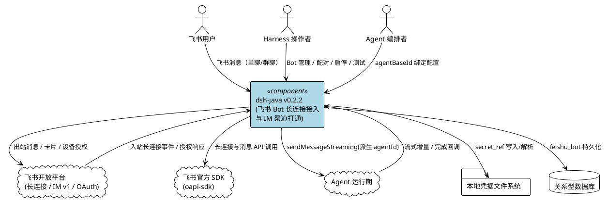
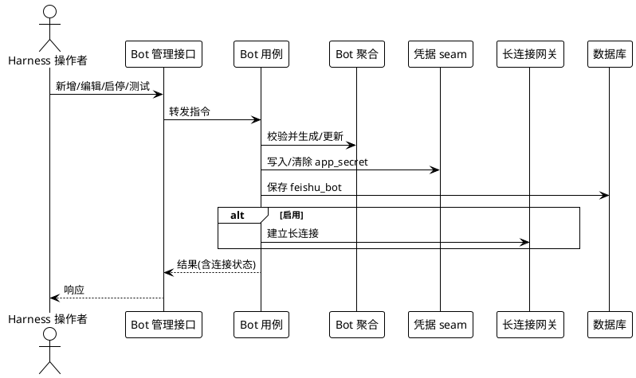
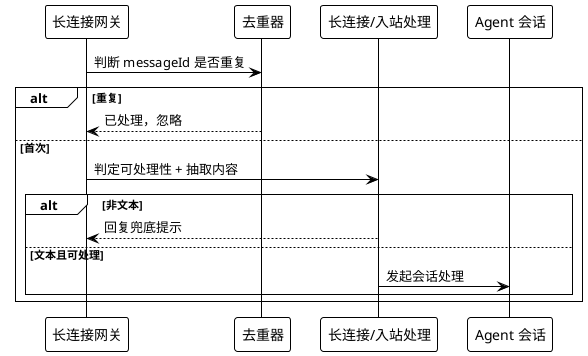
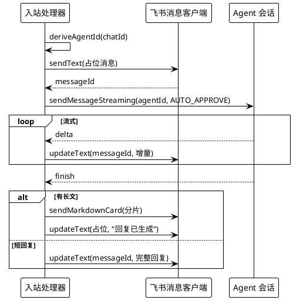
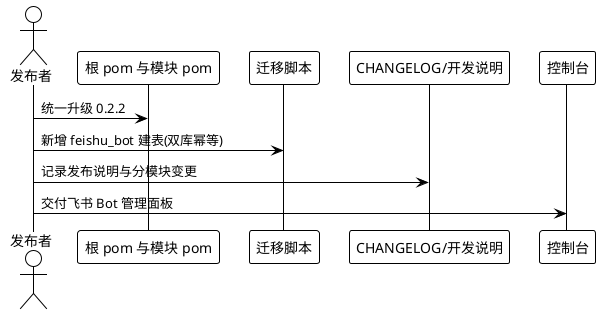
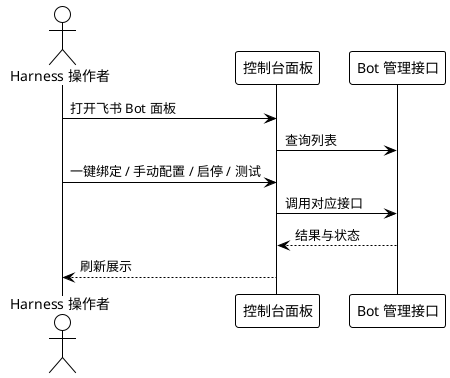

# DeepSeek Harness Java v0.2.2 需求规格

> 版本：`v0.2.2` | 主线：飞书（Feishu / Lark）Bot 长连接接入与 IM 会话渠道打通 | 基线：v0.2.1
>
> 本规格覆盖 v0.2.2 将飞书接入能力纳入本项目的全部需求领域，源事实来自参考应用 `refer_source/deepseek-harness-java-app`（Spring Boot 3.3.2 fat-jar，业务代码位于 `BOOT-INF/lib/*.jar`，经 `javap` 逐类核验）。
>
> **平台能力对齐补充**：除 §5.1–§5.9 飞书主线外，v0.2.2 还包含与参考源 `refer_source/deepseek-harness/docs/upgrade-guide/v0.2.2-alpha.2/` 升级指南对齐的平台能力——**LLM 请求用途声明（purpose）、调度工具组、调度宿主全域**，详见 **§7** 与数据约束 **§6.8 / §6.9**。其中调度在 standalone 模式仍为**内存实现**，无需新增数据库迁移。
>
> **版本范围声明**：本次飞书接入的**全部设计与任务**统一纳入 **v0.2.2**，并与本规格同目录归档。四件套内容分别为 `docs/spec/0.2.2/spec.md`（本需求规格）、`design.md`（技术方案，由后续设计阶段产出）、`tasks.md`（任务清单，由后续任务阶段产出）、`release-v0.2.2-development-notes.md`（开发说明，随实现产出）。前端管理界面、客户端契约（`docs/spec/0.2.2/contract/`）与架构图（`docs/spec/0.2.2/dsh-java-architecture.drawio`）同属 v0.2.2 版本范围。
>
> **依赖新增声明**：v0.2.2 为飞书接入新增第三方依赖组——`com.larksuite.oapi:oapi-sdk:2.8.3` 与 `com.larksuite.oapi:larksuite-oapi-shaded-protobuf:2.4.6`（两者传递引入 `jackson 2.17.2`、`gson 2.10.1`）。除此之外不引入其他新增第三方依赖，**不新增 Maven 模块**。
>
> **命名隔离声明**：本项目既有的 `domain/channel`、`harness_session.channel_code` 为**大模型渠道（LLM provider）**语义，飞书 IM 会话渠道**禁止复用**该语义，须采用独立命名（`feishu` / `im`）与独立数据对象。
>
> **本阶段边界**：本文档仅定义"做什么（What）"与验收标准，不包含数据库 DDL、类签名、算法与部署实现等"怎么做（How）"细节。

---

# **1. Component Positioning**

## **1.1 Core Responsibility**

本组件负责让 DeepSeek Harness Java 通过**飞书官方 SDK 的 WebSocket 长连接**接入飞书/Lark 即时通讯渠道，实现飞书 Bot 的注册、配对、连接治理，以及"飞书消息 → Agent 会话 → 流式回发"的端到端闭环。

## **1.2 Core Inputs**

1. **飞书 Bot 管理指令**：来自控制台或 API 的 Bot 列表查询、新增、编辑、删除、启用、停用、测试请求。
2. **一键配对指令**：配对发起、状态轮询、取消请求，含 Bot 名称与 `agentBaseId`。
3. **飞书长连接入站事件**：飞书开放平台经 WebSocket 推送的 `im.message.receive_v1` 消息接收事件（`P2MessageReceiveV1`），含 `messageId`、`chatId`、`chatType`、`messageType`、`content`、发送者信息。
4. **飞书 OAuth 设备授权响应**：`/oauth/v1/app/registration` 的 `action=begin` / `action=poll` 返回（`verification_uri_complete`、`user_code`、`device_code`、`client_id`、`client_secret`、`open_id`、`tenant_brand`、`error`）。
5. **飞书应用凭证**：`app_id` + `app_secret`，经凭据 seam 解析取得。
6. **Agent 流式响应**：来自 `IAgentUseCase.sendMessageStreaming` 的文本增量（delta）、工具调用事件与完成回调。
7. **外部配置信号**：`harness.credentials.home` 凭据主目录、`group_require_mention` 等 Bot 级配置。

## **1.3 Core Outputs**

1. **Bot 管理响应**：Bot 列表与详情（含 `secretConfigured`、`enabled`、`connectionState`、`lastError`、`updatedAt`）、保存/删除/启停/测试结果。
2. **配对响应**：配对会话标识 `pairingId`、状态、扫码链接 `url`、用户码 `userCode`、有效期 `expireIn`、成功后的 `botId`/`appId` 或错误信息。
3. **飞书出站消息**：面向单个会话的文本消息（返回 `messageId`）、占位消息的**就地编辑**、交互式 **Markdown 卡片**（长文分片）。
4. **飞书长连接**：以 `app_id`/`app_secret` 建立的 WebSocket 长连接，携带连接状态（IDLE/CONNECTING/CONNECTED/ERROR）与最后错误。
5. **Agent 会话调用**：按飞书会话派生的 `agentId` 调用 Agent 用例，并接收流式增量。
6. **持久化记录**：`feishu_bot` 数据对象的落库与更新。
7. **凭据写入**：以 `secret_ref` 为键向本地凭据文件写入 / 清除 `app_secret`。

## **1.4 Responsibility Boundaries**

本组件**不负责**：

1. **飞书开放平台侧应用创建与审核**：Bot 应用、权限、事件订阅的开通由用户在飞书后台或通过设备授权流程完成，本组件不代管飞书账号。
2. **HTTP Webhook 回调接入**：飞书接入**仅走 WebSocket 长连接**，不实现也不注册 HTTP webhook 回调路由；与既有 GitHub Webhook 适配互不复用。
3. **WebSocket 协议与加解密实现**：长连接握手、心跳、事件解帧、鉴权由飞书官方 `oapi-sdk` 负责，本组件只做生命周期与事件编排。
4. **IM 渠道复用为 LLM 渠道**：不将飞书 IM 会话渠道语义写入既有 `domain/channel` 或 `harness_session.channel_code`（后者为大模型渠道语义）。
5. **Agent 运行期核心能力**：消息理解、模型调用、工具执行、审批策略由既有 Agent 运行期负责，本组件仅做渠道适配与派生。
6. **多 IM 渠道通用抽象**：v0.2.2 仅落地飞书，不构建企业微信 / 钉钉 / Slack 等通用 IM 抽象层。
7. **飞书消息富媒体处理**：图片、语音、文件等非文本消息仅做兜底提示，不做转写、下载或再上传。
8. **凭据文件的跨端同步**：本地凭据文件为单机事实源，不提供多实例同步或集中式密钥托管。
9. **飞书 SDK 版本升级与协议变更适配**：仅声明当前锁定版本，不承担上游 SDK 主版本迁移。

---

# **2. Domain Terminology**

**飞书 Bot（FeishuBot）**
: 一个绑定到某飞书应用（`app_id`/`app_secret`）并可在长连接上收发消息的机器人实体，是聚合根，拥有 `bot_id`、`bot_name`、`agentBaseId` 等属性与启用/连接状态。
: 备注：`bot_id` 采用 `fbot-<后缀>` 形态，形如 `fbot-xxxx`。

**Bot 标识（botId）**
: 飞书 Bot 的稳定唯一标识，创建时生成，编辑与启停时不变；取值须匹配 `^[a-z0-9][a-z0-9-]{1,62}$`（字母或数字开头，3~63 位）。

**Agent 基础标识（agentBaseId）**
: Bot 绑定的 Agent 标识前缀，用于按飞书会话派生独立 `agentId`；新建 Bot 时必填。

**会话派生 Agent 标识（derived agentId）**
: 由 `agentBaseId` 与飞书 `chatId` 末段派生出的每会话独立 Agent 标识，形如 `<agentBaseId>-fs-<chatId末16位>`；当 `chatId` 不可用或不足以派生时回退为 `anon`。

**飞书连接状态（FeishuConnectionState）**
: 描述飞书长连接生命周期的枚举，取值 `IDLE`、`CONNECTING`、`CONNECTED`、`ERROR`；其中 `CONNECTED` 表示在线。

**一键配对（Feishu Pairing）**
: 通过飞书 OAuth 设备授权（OAuth Device Flow）让用户扫码授权、由系统自动换取 `app_id`/`app_secret` 并落库上线的"零手工录入"接入流程。

**配对会话（PairingSession）**
: 一次一键配对的运行态上下文，含 `pairingId`、状态、设备码、用户码、有效期、轮询间隔，由守护线程轮询推进，直至成功、过期或取消。

**配对状态（pairing status）**
: 配对会话的对外状态机取值，至少包含进行中（pending/waiting）与成功/失败/取消等终态；进行中表示尚未完成授权。

**入站消息（FeishuInboundMessage）**
: 从飞书长连接事件解析出的领域值对象，含 `botId`、`messageId`、`chatId`、`chatType`、`messageType`、`text`、`senderOpenId`、`senderName`。

**事件去重器（FeishuEventDeduplicator）**
: 基于 `messageId` 的有界去重组件，重复投递的同一消息只被处理一次，避免飞书重推造成重复回复。

**密钥引用（secret_ref）**
: 指向本地凭据文件中某个条目的引用键，飞书专用格式为 `FEISHU_BOT_<BOTID大写下划线化>_APP_SECRET`；数据库中只保存引用键，**不保存明文密钥**。

**凭据文件（.credentials.yaml）**
: 位于 `<harness.credentials.home>/.credentials.yaml`（默认 `${user.home}/.dsh/.credentials.yaml`）的本地密钥存储文件，仅本机文件系统可读。

**群聊需 @（group_require_mention）**
: Bot 级布尔配置，群聊场景下为 true 时仅处理显式 @ 到 Bot 的消息；单聊（p2p）场景不受该配置约束。

**占位消息（placeholder message）**
: 收到入站消息后立即回发的占位文本（形如"⏳ 正在思考…"），随后通过就地编辑持续刷新为流式增量内容，作为流式输出的承载。

**就地编辑（updateText）**
: 对已发送的占位消息按 `messageId` 覆盖式更新文本的能力，用于流式回发的逐段刷新。

**交互式卡片（Markdown Card）**
: 以飞书卡片形式发送的 Markdown 富文本消息，用于承载长回复；当卡片发送失败时退化为占位消息的截断展示。

**自动审批（AUTO_APPROVE）**
: 飞书渠道请求 Agent 时硬编码的审批模式，即飞书渠道调用默认自动放行，不弹出宿主侧人工审批。

---

# **3. Roles and Boundaries**

## **3.1 Core Roles**

1. **飞书用户**：在飞书单聊或群聊中与 Bot 对话的终端用户，其消息触发 Agent 会话。
2. **Harness 操作者**：通过控制台或 API 管理飞书 Bot（配对、增删改、启停、测试）的运维/配置人员。
3. **Agent 编排者**：维护 `agentBaseId` 与 Bot 绑定关系、关注每会话派生 `agentId` 行为的配置人员。

## **3.2 External Systems**

1. **飞书开放平台长连接服务**：承载 WebSocket 长连接并推送 `im.message.receive_v1` 等入站事件。
2. **飞书开放平台消息接口（IM v1）**：接收 `CreateMessageReq` / `UpdateMessageReq`（文本、就地编辑、卡片）请求并返回 `messageId`。
3. **飞书账号服务（OAuth 设备授权）**：`accounts.feishu.cn`（Feishu）/ `accounts.larksuite.com`（Lark）上的 `/oauth/v1/app/registration` 授权端点。
4. **飞书官方 SDK（oapi-sdk）**：进程内依赖，提供 `com.lark.oapi.ws.Client`、`com.lark.oapi.event.EventDispatcher`、`com.lark.oapi.Client`。
5. **Agent 运行期（本组件宿主）**：被调用的 `IAgentUseCase.sendMessageStreaming` 提供方，返回流式增量与完成事件。
6. **本地凭据文件系统**：`.credentials.yaml` 所在本地文件系统，提供密钥读写。
7. **关系型数据库（MySQL8 / H2 MODE=MySQL）**：持久化 `feishu_bot` 数据对象。

## **3.3 Interaction Context**



---

# **4. DFX Constraints**

## **4.1 Performance**

1. **事件去重有界**：`FeishuEventDeduplicator` 必须以有界缓存保存近期 `messageId`，超出容量时按淘汰策略释放，不得随消息量无界增长内存。
2. **入站响应不阻塞长连接**：收到入站事件后必须异步进入 Agent 处理，不得在长连接读线程内同步等待模型输出。
3. **占位消息即时回发**：收到入站消息后必须在可感知的极短时间内回发占位消息，先于模型输出产生。
4. **流式编辑节流**：就地编辑（`updateText`）频次必须可收敛，避免高频刷新触发飞书接口限流。
5. **单实例连接规模**：单实例须支持同时维持多个已启用 Bot 的长连接，连接数与内存占用须可预估。

## **4.2 Reliability**

1. **启动自动拉起**：应用就绪后必须自动为全部 `enabled` 的 Bot 建立长连接，非 `enabled` 的 Bot 不得建连。
2. **连接自动重连**：长连接异常断开后必须自动重连，重连期间连接状态须反映为 `CONNECTING`/`ERROR`，重连成功后回到 `CONNECTED`。
3. **消息幂等**：同一 `messageId` 的重复投递必须只处理一次，不得产生重复回复。
4. **并发消息保护**：同一会话在上一轮处理未完成时收到新消息，必须提示"上一条消息还在处理中"而非并行处理，避免会话状态错乱。
5. **卡片失败降级**：交互式卡片发送失败时，必须退化为占位消息截断展示，不得使整轮回复丢失。
6. **密钥缺失可诊断**：`app_secret` 未配置或解析失败时，必须给出明确原因并保持应用运行，不得因单个 Bot 失败导致启动中断。
7. **迁移幂等且双库兼容**：`feishu_bot` 建表脚本必须幂等（可重复执行），并同时兼容 MySQL8 与 H2 `MODE=MySQL`，不得破坏既有表。
8. **进程退出清理**：应用关闭时必须关闭全部长连接并释放资源。

## **4.3 Security**

1. **密钥不明文入库**：数据库中只允许保存 `secret_ref`，**禁止**保存 `app_secret` 明文。
2. **凭据文件最小权限**：`.credentials.yaml` 的读写权限必须为仅属主可读写（`rw-------` 等价）。
3. **接口鉴权**：飞书 Bot 管理接口必须纳入既有 API Key 鉴权拦截范围，未授权请求须被拒绝。
4. **日志脱敏**：日志中不得输出 `app_secret` 明文，凭据相关日志只允许出现 `secret_ref`。
5. **审批模式显式声明**：飞书渠道以 `AUTO_APPROVE` 调用 Agent 属既定渠道策略，须在文档与配置中显式声明，不得隐式作用于其他渠道。

## **4.4 Maintainability**

1. **连接状态可观测**：每个 Bot 的 `connectionState` 与 `lastError` 必须可查询，供控制台与排障使用。
2. **分层落位不越界**：飞书相关端口/聚合/值对象落于 domain，用例落于 case，控制器落于 trigger，SDK 适配器落于 infrastructure，依赖方向不得反向。
3. **命名独立**：飞书 IM 渠道相关类、字段、包名须与既有 LLM `channel` 语义区分，避免同义混用。
4. **迁移脚本成对维护**：`schema.sql` 与 `db/migration/*.sql` 必须成对新增同结构建表语句，保持双库一致。
5. **错误信息可读**：面向操作者的错误须为可读中文提示（如缺少 `app_secret`、`botId` 格式非法、Bot 不存在）。

## **4.5 Compatibility**

1. **不新增 Maven 模块**：飞书接入新增包全部落在既有模块内，依赖方向保持基础设施→领域。
2. **既有 API 不变**：新增飞书接口不得变更既有控制器、DTO、领域端口的公开签名与语义。
3. **渠道语义隔离**：`domain/channel` 与 `harness_session.channel_code` 的既有取值与行为不得被飞书接入改变。
4. **新增表不影响既有数据**：`feishu_bot` 表由幂等脚本新建，不得修改既有表结构。
5. **数据库双兼容**：新增建表语句须在 MySQL8 与 H2 `MODE=MySQL` 下均可执行。
6. **版本统一**：根 pom 及各模块 pom、插件 pom、`CHANGELOG.md`、`docker-compose-app.yml`、`start-app.sh` 等版本标识须统一升级为 `0.2.2`。
7. **依赖集中声明**：新增飞书依赖须在根 pom 的依赖管理统一声明版本，模块侧引用不散落硬编码版本。

---

# **5. Core Capabilities**

> 说明：本章各能力的"完成状态"以本需求规格为需求基线；实现落地情况在设计与任务阶段跟踪。全部能力纳入 v0.2.2 版本范围。

## **5.1 飞书 Bot 生命周期管理**

### **5.1.1 Business Rules**

1. **列表查询**：系统必须能返回全部飞书 Bot，且每条须包含 `botId`、`botName`、`appId`、`secretConfigured`、`enabled`、`agentBaseId`、`connectionState`、`lastError`、`updatedAt`。
   a. Acceptance criteria: [调用 Bot 列表接口] → [返回全部 Bot 及其连接状态与密钥配置标记]
2. **新增即生成标识**：新建 Bot 时必须由系统生成符合 `^[a-z0-9][a-z0-9-]{1,62}$` 的 `botId`，并必须要求 `appId` 非空。
   a. Acceptance criteria: [新增请求缺少 appId] → [拒绝并返回"新建 Bot 必须提供 appId"]
   b. Acceptance criteria: [新增请求合规] → [生成 `fbot-` 前缀的 `botId` 并落库]
3. **编辑不改标识**：编辑 Bot 时必须保持 `botId` 不变，仅更新可编辑属性（名称、`agentBaseId`、渠道码、工作目录、`group_require_mention`）。
   a. Acceptance criteria: [编辑已存在 Bot] → [`botId` 保持不变，其余属性更新]
4. **密钥配置可空更新**：编辑时若未提供 `appSecret`，必须保留原密钥引用；若提供，则更新密钥引用并写入凭据文件。
   a. Acceptance criteria: [编辑时 appSecret 为空且历史已配置] → [保留原 `secret_ref`，`secretConfigured` 仍为 true]
   b. Acceptance criteria: [编辑时提供 appSecret] → [写入凭据文件并更新 `secret_ref`]
5. **删除联动清理**：删除 Bot 时必须同时删除其持久化记录、停止其长连接、并清除对应密钥引用。
   a. Acceptance criteria: [删除某 Bot] → [记录删除、连接断开、凭据条目清除]
6. **启停建连解连**：启用 Bot 时必须触发长连接建立；停用 Bot 时必须断开其长连接。
   a. Acceptance criteria: [启用 Bot] → [发起长连接，状态进入 CONNECTING]
   b. Acceptance criteria: [停用 Bot] → [断开长连接，状态回到 IDLE]
7. **测试连通性**：测试 Bot 时必须校验其凭证可用并反映当前连接状态与错误。
   a. Acceptance criteria: [测试某 Bot] → [返回连通性结果与 `connectionState`/`lastError`]
8. **Bot 不存在**：对不存在的 `botId` 执行查询/编辑/启停/测试时必须返回"Bot 不存在"。
   a. Acceptance criteria: [操作不存在的 botId] → [返回"Bot 不存在: <botId>"]
9. **禁止项**：禁止创建 `botId` 不符合命名规则、或缺少 `appId`、或缺少 `agentBaseId` 的 Bot。
   a. Acceptance criteria: [提交不合规 botId 或缺少必填项] → [拒绝并返回对应校验错误]

### **5.1.2 Interaction Flow**



### **5.1.3 Exception Scenarios**

1. **缺少 app_secret 时启用**
   a. Trigger condition: Bot 已启用但凭据文件中不存在对应 `app_secret`
   b. System behavior: 不建立长连接，记录"尚未配置 app_secret，请先在编辑中填写"，并将状态置为 ERROR
   c. User perception: 控制台可见明确错误提示与 `lastError`
2. **持久化失败**
   a. Trigger condition: 数据库保存失败
   b. System behavior: 回滚该次变更并向上返回失败原因
   c. User perception: 收到"保存 Bot 失败：<原因>"

---

## **5.2 飞书长连接接入与连接治理**

### **5.2.1 Business Rules**

1. **启动自动拉起**：应用就绪后必须自动为全部 `enabled` 的 Bot 建立 WebSocket 长连接。
   a. Acceptance criteria: [应用启动完成且存在 enabled Bot] → [逐个发起长连接]
2. **仅长连接无回调**：飞书接入必须通过官方 SDK 的 WebSocket 长连接接收事件，不得注册 HTTP webhook 回调。
   a. Acceptance criteria: [启用飞书 Bot] → [建立 WS 长连接并接收 `im.message.receive_v1`]
3. **连接状态机**：每个 Bot 的连接状态必须在 IDLE/CONNECTING/CONNECTED/ERROR 之间按生命周期迁移，且可被查询。
   a. Acceptance criteria: [发起连接] → [状态 CONNECTING，成功后 CONNECTED，失败则 ERROR 并记录原因]
4. **重复启动幂等**：对已处于在线状态的 Bot 重复启动不得建立第二条连接。
   a. Acceptance criteria: [对已 CONNECTED 的 Bot 再次启用] → [不新增连接]
5. **自动重连**：长连接异常断开后必须自动重连，且记录异常原因。
   a. Acceptance criteria: [长连接异常断开] → [状态转 ERROR 并触发重连，成功后回到 CONNECTED]
6. **入站事件编排**：长连接收到消息事件后必须解析为入站消息并交由入站处理器处理。
   a. Acceptance criteria: [收到 `im.message.receive_v1`] → [解析出 `FeishuInboundMessage` 并触发处理]
7. **群聊 @ 判定**：当 Bot 的 `group_require_mention` 为 true 时，群聊消息必须仅在显式 @ 到该 Bot 时才被处理；单聊必须始终处理。
   a. Acceptance criteria: [群聊消息未 @ Bot 且 group_require_mention=true] → [忽略该消息]
   b. Acceptance criteria: [单聊消息] → [始终处理，不受 @ 配置影响]
8. **文本与富文本抽取**：必须能从 `text`（纯文本）与 `post`（富文本）消息中抽取可读文本；@ 占位与表情须转换为可读形式。
   a. Acceptance criteria: [收到 post 富文本消息] → [抽取其中的文本与 @ 信息]
9. **停止与销毁**：停止单个 Bot 必须断开其连接；应用关闭必须断开所有连接。
   a. Acceptance criteria: [应用关闭] → [全部长连接被关闭]

### **5.2.2 Interaction Flow**

```plantuml
@startuml
!theme plain
participant "应用就绪事件" as Ready
participant "长连接网关" as GW
participant "凭据 seam" as Cred
cloud "飞书开放平台" as Feishu
participant "入站处理器" as Handler

Ready -> GW : 拉起全部 enabled Bot
GW -> Cred : 解析 app_secret
Cred --> GW : 密钥
GW -> Feishu : 建立 WS 长连接
Feishu --> GW : CONNECTED
Feishu -> GW : im.message.receive_v1
GW -> GW : 去重 + @ 判定 + 内容抽取
GW -> Handler : 处理入站消息
alt 连接异常
    GW -> GW : 标记 ERROR 并重连
end
@enduml
```

### **5.2.3 Exception Scenarios**

1. **密钥解析失败**
   a. Trigger condition: `secret_ref` 对应凭据不存在或不可读
   b. System behavior: 不建立连接，标记 ERROR，记录"Bot <id> 缺少 app_secret（凭据 <secret_ref>）"
   c. User perception: 控制台显示错误与 `lastError`
2. **注册飞书应用失败**
   a. Trigger condition: 使用凭证注册长连接客户端失败
   b. System behavior: 标记 ERROR，记录"注册飞书应用失败"
   c. User perception: 测试/列表处可见失败原因
3. **入站消息解析失败**
   a. Trigger condition: 事件内容无法解析为文本
   b. System behavior: 记日志"解析消息内容失败 type=<type>"，丢弃该消息
   c. User perception: 无回复（消息被忽略）

---

## **5.3 一键配对（飞书设备授权）**

### **5.3.1 Business Rules**

1. **发起配对**：系统必须能发起配对会话，经飞书 OAuth 设备授权 `action=begin` 获取扫码链接与用户码，并返回 `pairingId`、`url`、`userCode`、`expireIn`。
   a. Acceptance criteria: [发起配对请求] → [返回配对会话与扫码链接、用户码]
2. **授权端点选择**：Feishu 与 Lark 必须分别使用各自账号域（`accounts.feishu.cn` / `accounts.larksuite.com`）的 `/oauth/v1/app/registration`。
   a. Acceptance criteria: [在 Lark 环境配对] → [使用 larksuite 端点]
3. **授权参数固定**：`begin` 请求必须携带 `action=begin`，并声明个人代理应用原型、以客户端密钥为鉴权方式、请求 `open_id` 用户信息。
   a. Acceptance criteria: [发起 begin] → [请求参数包含 archetype/auth_method/request_user_info 约定值]
4. **轮询推进**：系统必须由守护线程按授权返回的间隔轮询 `action=poll&device_code=<code>`，`authorization_pending` 表示继续等待。
   a. Acceptance criteria: [授权尚未完成] → [轮询返回 pending，会话保持进行中]
5. **成功落库上线**：轮询取得 `client_id`/`client_secret`/`open_id` 后，系统必须据此创建 Bot、写入密钥引用并启用其长连接。
   a. Acceptance criteria: [轮询成功] → [生成 Bot、写入 app_secret、发起长连接，配对会话转成功并返回 `botId`/`appId`]
6. **状态查询**：必须能按 `pairingId` 查询配对状态，进行中须返回当前 `url`/`userCode`/`expireIn`。
   a. Acceptance criteria: [查询进行中的配对] → [返回进行中状态与扫码信息]
7. **取消配对**：必须能取消配对会话，取消后不得再落库或启用。
   a. Acceptance criteria: [取消配对] → [守护线程停止，会话转取消，不产生 Bot]
8. **过期处理**：超过 `expireIn` 未完成的配对必须进入终态（过期/失败）。
   a. Acceptance criteria: [配对超时] → [会话结束并返回过期/失败]
9. **禁止项**：禁止将配对取得的 `app_secret` 明文写入数据库。
   a. Acceptance criteria: [配对成功落库] → [DB 记录仅含 `secret_ref`]

### **5.3.2 Interaction Flow**

```plantuml
@startuml
!theme plain
actor "Harness 操作者" as Ops
participant "配对用例" as UC
participant "配对客户端" as Client
cloud "飞书账号服务" as Feishu
participant "Bot 用例" as BotUC
participant "长连接网关" as GW

Ops -> UC : 发起配对
UC -> Client : begin
Client -> Feishu : action=begin
Feishu --> Client : url + user_code + device_code
Client --> UC : 配对信息
UC --> Ops : pairingId + url + userCode
loop 按间隔轮询
    UC -> Client : poll(device_code)
    Client -> Feishu : action=poll
    Feishu --> Client : pending 或 client_id/secret
end
alt 授权成功
    UC -> BotUC : 创建 Bot + 写密钥
    BotUC -> GW : 启用长连接
    UC --> Ops : 成功(botId/appId)
else 过期或被取消
    UC --> Ops : 失败/取消
end
@enduml
```

### **5.3.3 Exception Scenarios**

1. **轮询网络异常**
   a. Trigger condition: 轮询时网络异常
   b. System behavior: 按 pending 处理并继续，记录异常
   c. User perception: 配对保持进行中
2. **begin 响应缺少扫码链接**
   a. Trigger condition: begin 返回缺少 `verification_uri_complete`
   b. System behavior: 终止配对并返回错误
   c. User perception: 收到"发起飞书设备授权失败/响应缺少扫码链接"
3. **授权服务返回错误**
   a. Trigger condition: 授权端点返回错误码
   b. System behavior: 携带 `error`/`error_description` 结束配对
   c. User perception: 配对界面显示错误原因

---

## **5.4 入站消息接收、去重与内容抽取**

### **5.4.1 Business Rules**

1. **消息去重**：系统必须以 `messageId` 进行有界去重，重复消息不得重复处理。
   a. Acceptance criteria: [同一 messageId 重复到达] → [仅第一次被处理，后续被忽略]
2. **可处理性判定**：系统必须仅处理来自本 Bot 且属于可处理会话（单聊，或群聊中满足 @ 条件）的消息。
   a. Acceptance criteria: [消息不属于本 Bot 处理范围] → [忽略]
3. **文本可用性判定**：必须具备"是否含文本""是否单聊"的判定能力，用于后续回复策略。
   a. Acceptance criteria: [纯文本单聊消息] → [判定为含文本且单聊]
4. **非文本消息兜底**：对图片、语音、文件等非文本消息必须回复统一提示，不进入 Agent 处理。
   a. Acceptance criteria: [收到图片消息] → [回复"目前我只能看懂文字消息…"]
5. **发送者信息提取**：必须从事件中提取发送者标识（`senderOpenId`）与显示名（`senderName`），供显示与@回填。
   a. Acceptance criteria: [群聊消息] → [抽取发送者 openId 与显示名]
6. **禁止项**：禁止对未通过 @ 判定（群聊）或不属于本 Bot 的消息发起 Agent 调用。
   a. Acceptance criteria: [群聊未 @ 的消息] → [不发起 Agent 调用]

### **5.4.2 Interaction Flow**



### **5.4.3 Exception Scenarios**

1. **去重缓存容量**
   a. Trigger condition: 去重缓存达到容量上限
   b. System behavior: 按淘汰策略释放最旧记录，仍保持有界
   c. User perception: 无感知
2. **内容为空**
   a. Trigger condition: 抽取后文本为空
   b. System behavior: 不做 Agent 调用，回复兜底提示
   c. User perception: 收到统一提示

---

## **5.5 Agent 会话派生与流式回发**

### **5.5.1 Business Rules**

1. **会话派生 Agent 标识**：系统必须按飞书会话派生独立 `agentId`，形如 `<agentBaseId>-fs-<chatId末16位>`；无法派生时回退 `anon`。
   a. Acceptance criteria: [同一 Bot 下不同 chatId] → [派生不同 agentId]
   b. Acceptance criteria: [chatId 不可用] → [回退为 `<agentBaseId>-fs-anon`]
2. **调用 Agent 流式接口**：系统必须以派生 `agentId` 调用 Agent 流式消息接口，并实时消费文本增量。
   a. Acceptance criteria: [收到可处理文本消息] → [以派生 agentId 调用流式接口并接收 delta]
3. **占位消息先行**：发起 Agent 调用前必须先回发占位消息（形如"⏳ 正在思考…"）。
   a. Acceptance criteria: [开始处理消息] → [先发出占位消息]
4. **流式就地编辑**：必须用增量内容就地编辑占位消息，实现流式刷新。
   a. Acceptance criteria: [收到 delta] → [更新占位消息文本]
5. **完成定稿**：Agent 完成后必须定稿回复；若启用长文卡片，则发送卡片并保留占位消息为"回复已生成"提示。
   a. Acceptance criteria: [Agent 完成且有内容] → [定稿回复或发送卡片]
6. **审批模式**：飞书渠道调用 Agent 必须使用 `AUTO_APPROVE` 审批模式。
   a. Acceptance criteria: [飞书入站触发 Agent] → [请求审批模式为 AUTO_APPROVE]
7. **并发保护**：同一会话上一轮未完成时收到新消息必须提示"上一条消息还在处理中，请等它完成后再发～"。
   a. Acceptance criteria: [同会话处理中收到新消息] → [回发忙碌提示，不并发处理]
8. **空响应兜底**：Agent 返回空内容时必须回发兜底提示。
   a. Acceptance criteria: [Agent 无内容返回] → [回发"模型没有返回内容"]
9. **失败兜底**：处理过程异常必须向会话回发可读错误提示。
   a. Acceptance criteria: [处理抛异常] → [回发"⚠️ 处理失败：<原因>"]

### **5.5.2 Interaction Flow**



### **5.5.3 Exception Scenarios**

1. **发送占位失败**
   a. Trigger condition: 占位消息发送失败
   b. System behavior: 记录失败并终止本轮（无承载则不再回发）
   c. User perception: 无回复或错误提示
2. **增量更新失败**
   a. Trigger condition: 就地编辑失败
   b. System behavior: 记录并继续收集内容，最终以整段文本重发/卡片兜底
   c. User perception: 仍能看到最终回复
3. **处理异常**
   a. Trigger condition: Agent 调用或处理链路抛异常
   b. System behavior: 记录"Bot <id> 处理消息失败 msgId=<id>"并回发错误提示
   c. User perception: 收到"⚠️ 处理失败：<原因>"

---

## **5.6 出站消息与交互式卡片**

### **5.6.1 Business Rules**

1. **文本发送**：系统必须能向指定 `chatId` 发送文本消息并返回 `messageId`。
   a. Acceptance criteria: [发送文本] → [返回可用的 messageId]
2. **就地编辑**：系统必须能按 `messageId` 覆盖更新文本。
   a. Acceptance criteria: [更新文本] → [原消息内容被替换]
3. **卡片发送**：系统必须能发送 Markdown 卡片。
   a. Acceptance criteria: [发送卡片] → [返回卡片消息标识]
4. **长文分片**：当回复内容超长时，必须以卡片或多条消息分片承载，不得整段丢失。
   a. Acceptance criteria: [回复超过单消息上限] → [分片发送或卡片承载]
5. **卡片失败降级**：卡片发送失败必须退化为占位消息的截断展示。
   a. Acceptance criteria: [卡片发送失败] → [占位消息显示截断内容并标注"…（内容过长已截断）"]
6. **收发凭证绑定**：出站消息必须使用对应 Bot 的凭证，不得跨 Bot 混用。
   a. Acceptance criteria: [Bot A 发送消息] → [使用 Bot A 的凭证]

### **5.6.2 Interaction Flow**

```plantuml
@startuml
!theme plain
participant "入站处理器" as H
participant "飞书消息客户端" as Msg
participant "凭据 seam" as Cred
cloud "飞书 IM 接口" as Feishu

H -> Msg : 发送/更新/卡片请求
Msg -> Cred : 解析该 Bot 的 app_secret
Msg -> Feishu : CreateMessage / UpdateMessage
Feishu --> Msg : messageId 或错误
alt 卡片失败
    Msg --> H : 失败
    H -> Msg : 退化截断展示
end
@enduml
```

### **5.6.3 Exception Scenarios**

1. **凭证解析失败**
   a. Trigger condition: 发送时无法解析 Bot 密钥
   b. System behavior: 记录"凭据 <ref> 未配置 app_secret"并返回失败
   c. User perception: 消息未发出，日志有明确原因
2. **超长截断**
   a. Trigger condition: 内容超过消息上限且无法分片
   b. System behavior: 截断并追加"…（内容过长已截断）"
   c. User perception: 看到带截断标记的内容

---

## **5.7 凭证引用与密钥保管**

### **5.7.1 Business Rules**

1. **引用键格式**：飞书 Bot 密钥引用必须为 `FEISHU_BOT_<BOTID大写下划线化>_APP_SECRET`，其中 `botId` 经转大写并将非 `[A-Z0-9_]` 字符替换为 `_`。
   a. Acceptance criteria: [Bot 标识含连字符] → [引用键中连字符转为下划线且全大写]
2. **密钥本地存放**：`app_secret` 必须存放在 `<harness.credentials.home>/.credentials.yaml`，默认 `${user.home}/.dsh/.credentials.yaml`。
   a. Acceptance criteria: [保存密钥] → [写入本地凭据文件，DB 不含明文]
3. **仅存引用入库**：数据库必须只保存 `secret_ref`，且列表查询须以 `secretConfigured` 反映密钥是否可解析。
   a. Acceptance criteria: [查询 Bot 列表] → [返回 secretConfigured 而不返回密钥]
4. **清除联动**：删除 Bot 或清除密钥时必须同步移除凭据文件中的对应条目。
   a. Acceptance criteria: [删除 Bot] → [凭据条目被移除]
5. **解析失败可诊断**：解析不到密钥时必须返回明确提示（"尚未配置 app_secret，请先在编辑中填写"）。
   a. Acceptance criteria: [密钥缺失] → [返回明确提示且不影响应用运行]
6. **禁止项**：禁止在 API 响应、日志、数据库中以任何形式回显 `app_secret` 明文。
   a. Acceptance criteria: [查看列表/详情/日志] → [均只出现 secret_ref 或 secretConfigured]

### **5.7.2 Interaction Flow**

```plantuml
@startuml
!theme plain
participant "Bot 用例" as UC
participant "凭据 seam" as Cred
folder "凭据文件" as Fs
participant "数据库" as DB

UC -> Cred : set(secret_ref, app_secret)
Cred -> Fs : 写入/更新条目(仅属主可读写)
UC -> DB : 保存 secret_ref
Cred -> Cred : resolve(secret_ref)
Cred --> UC : 密钥或空
@enduml
```

### **5.7.3 Exception Scenarios**

1. **凭据文件不可写**
   a. Trigger condition: 凭据文件目录无写权限
   b. System behavior: 保存失败并返回原因
   c. User perception: 收到凭据保存失败提示
2. **凭据条目缺失**
   a. Trigger condition: `secret_ref` 在文件中不存在
   b. System behavior: 返回空解析结果并提示未配置
   c. User perception: 明确提示需先填写 app_secret

---

## **5.8 v0.2.2 版本发布与工程治理**

### **5.8.1 Business Rules**

1. **版本统一升级**：根 pom 及各模块 pom 的版本必须统一升级为 `0.2.2`，并同步更新示例插件与插件原型的 parent 版本、`CHANGELOG.md`、`docker-compose-app.yml`、`start-app.sh` 等版本标识文件。
   a. Acceptance criteria: [检查根 pom 与各模块/插件 pom] → [版本均为 0.2.2，部署脚本与镜像 tag 同步]
2. **双库幂等迁移**：`feishu_bot` 建表必须同时以幂等方式加入 `schema.sql` 与 `db/migration/*.sql`，兼容 MySQL8 与 H2 `MODE=MySQL`。
   a. Acceptance criteria: [全新库与既有库分别初始化] → [均可建表且重复执行不报错]
3. **迁移文件命名**：新增迁移文件必须遵循既有 `V<yyyymmdd>__<name>.sql` 命名约定。
   a. Acceptance criteria: [新增迁移文件] → [文件名符合约定且被迁移执行器识别]
4. **不新增 Maven 模块**：飞书接入新增包必须落在既有 module（domain/api/case/infrastructure/trigger/app）内。
   a. Acceptance criteria: [检查根 pom modules] → [模块列表不新增]
5. **依赖新增声明**：飞书依赖必须在根 pom 统一声明并仅新增 SDK 与 shaded-protobuf 两组。
   a. Acceptance criteria: [检查依赖树] → [新增项仅为 larksuite oapi-sdk 与其 shaded-protobuf（含其传递依赖）]
6. **开发说明归档**：v0.2.2 开发说明必须归档为 `docs/spec/0.2.2/release-v0.2.2-development-notes.md`，与四件套同目录。
   a. Acceptance criteria: [发布 v0.2.2] → [四件套与开发说明齐备于同一目录]
7. **CHANGELOG 分模块记录**：`CHANGELOG.md` 必须按 app/trigger/api/case/domain/infrastructure/types 分节记录 v0.2.2 变更。
   a. Acceptance criteria: [查看 CHANGELOG] → [存在 0.2.2 分节并按模块记录]
8. **前端纳入范围**：飞书 Bot 管理界面（配对、列表、新增编辑、启停、测试、删除）须作为 v0.2.2 交付内容之一。
   a. Acceptance criteria: [打开控制台] → [可见飞书 Bot 管理面板并可与后端接口联通]

### **5.8.2 Interaction Flow**



### **5.8.3 Exception Scenarios**

1. **版本遗漏**
   a. Trigger condition: 某模块或脚本版本未同步
   b. System behavior: 打包/部署出现版本不一致
   c. User perception: 发布校验发现版本不一致，须补齐
2. **迁移非幂等**
   a. Trigger condition: 建表语句未使用存在性判断
   b. System behavior: 既有库重复执行报错
   c. User perception: 启动迁移失败，须改为幂等

---

## **5.9 控制台飞书 Bot 管理界面**

### **5.9.1 Business Rules**

1. **一键扫码绑定**：界面必须支持发起一键配对、展示扫码链接与用户码、并轮询展示配对进展。
   a. Acceptance criteria: [点击一键绑定] → [展示扫码链接与用户码，轮询至成功或失败]
2. **手动配置**：界面必须支持手动录入 `appId`/`appSecret` 等创建 Bot。
   a. Acceptance criteria: [手动提交表单] → [创建 Bot 并展示于列表]
3. **列表管理**：界面必须展示 Bot 列表及其启用状态与连接状态，并支持新增、编辑、删除。
   a. Acceptance criteria: [打开面板] → [列表含状态列与操作入口]
4. **启停与测试**：界面必须支持对 Bot 执行启用、停用与测试。
   a. Acceptance criteria: [点击启用/停用/测试] → [调用后端接口并刷新状态]
5. **密钥不回显**：界面必须仅展示密钥是否已配置，不得回显 `app_secret` 明文。
   a. Acceptance criteria: [查看 Bot 详情] → [仅见"已配置/未配置"]
6. **轻量实现**：界面必须为轻量原生实现，不引入前端框架。
   a. Acceptance criteria: [构建控制台] → [无新增前端框架依赖]

### **5.9.2 Interaction Flow**



### **5.9.3 Exception Scenarios**

1. **接口失败**
   a. Trigger condition: 后端返回错误
   b. System behavior: 面板展示错误提示
   c. User perception: 看到失败原因

---

# **6. Data Constraints**

## **6.1 FeishuBot（飞书 Bot 聚合）**

1. **botId**：必填，Bot 唯一标识，取值须匹配 `^[a-z0-9][a-z0-9-]{1,62}$`，创建后不可变。
2. **botName**：必填，Bot 显示名，非空。
3. **appId**：必填，飞书应用标识，非空。
4. **secretRef**：必填，密钥引用键，格式 `FEISHU_BOT_<BOTID大写下划线化>_APP_SECRET`，**不得存放明文密钥**。
5. **enabled**：必填，启用标记，布尔（持久层以 0/1 表达），默认未启用。
6. **agentBaseId**：必填，Agent 基础标识，非空。
7. **channelCode**：可选，IM 渠道标识（飞书场景取值 `feishu`/`im` 语义），为空时按默认处理。
8. **cwd**：可选，Agent 工作目录。
9. **groupRequireMention**：必填，群聊是否需 @，布尔（持久层以 0/1 表达），默认需 @。
10. **connectionState**：运行态字段，取值 `IDLE`/`CONNECTING`/`CONNECTED`/`ERROR`，不作为持久列契约（由运行态投影）。
11. **createdAt / updatedAt**：必填，创建与更新时间戳。
12. **唯一性**：`botId` 必须唯一。

## **6.2 FeishuBotPO（feishu_bot 持久化对象）**

1. **持久化形态**：飞书 Bot 以数据对象 `feishu_bot` 持久化，字段与 `FeishuBot` 的业务属性对应（不含运行态连接状态）。
2. **bot_id**：主键，对应 `FeishuBot.botId`。
3. **bot_name**：必填，对应 `botName`。
4. **app_id**：必填，对应 `appId`。
5. **secret_ref**：必填，对应 `secretRef`；**禁止**存在明文密钥列。
6. **enabled**：必填，0/1，默认 0。
7. **agent_base_id**：必填，对应 `agentBaseId`。
8. **channel_code**：可空，对应 `channelCode`。
9. **cwd**：可空，对应 `cwd`。
10. **group_require_mention**：必填，0/1，默认 1。
11. **created_at / updated_at**：必填，时间戳。
12. **兼容性**：建表须在 MySQL8 与 H2 `MODE=MySQL` 下均成立且幂等。

## **6.3 FeishuInboundMessage（入站消息）**

1. **botId**：必填，接收消息的 Bot 标识。
2. **messageId**：必填，消息唯一标识，作为去重键。
3. **chatId**：必填，会话标识，用于派生 `agentId`。
4. **chatType**：必填，会话类型，取值至少区分 `p2p`（单聊）与群聊。
5. **messageType**：必填，消息类型，至少区分 `text` 与 `post`（富文本）。
6. **text**：可空，抽取出的可读文本；非文本消息为空。
7. **senderOpenId**：可空，发送者开放标识。
8. **senderName**：可空，发送者显示名。
9. **判定能力**：须支持"是否单聊"与"是否含文本"的判定。

## **6.4 FeishuConnectionState（连接状态）**

1. **取值**：必填，枚举 `IDLE`、`CONNECTING`、`CONNECTED`、`ERROR`。
2. **在线判定**：`CONNECTED` 表示在线，其余表示非在线。
3. **默认值**：无连接时为 `IDLE`。

## **6.5 FeishuPairingBeginVO / FeishuPairingPollVO（配对值对象）**

1. **FeishuPairingBeginVO.url**：必填，扫码授权链接（`verification_uri_complete`）。
2. **FeishuPairingBeginVO.userCode**：必填，用户码。
3. **FeishuPairingBeginVO.deviceCode**：必填，设备码，用于轮询。
4. **FeishuPairingBeginVO.expireInSec**：必填，有效期（秒），正整数。
5. **FeishuPairingBeginVO.intervalSec**：必填，轮询间隔（秒），正整数。
6. **FeishuPairingPollVO.clientId / clientSecret**：成功时必填，配对待落库的应用凭证。
7. **FeishuPairingPollVO.openId**：成功时必填，授权用户开放标识。
8. **FeishuPairingPollVO.tenantBrand**：可选，租户品牌（区分 Feishu/Lark）。
9. **FeishuPairingPollVO.error / errorDescription**：失败时填写的错误码与描述。
10. **成功判定**：`succeeded()` 为真当且仅当取得 `clientId`/`clientSecret`。

## **6.6 CredentialRef（飞书凭据引用）**

1. **value**：必填，引用键字符串，飞书格式为 `FEISHU_BOT_<BOTID大写下划线化>_APP_SECRET`。
2. **派生规则**：由 `botId` 转大写并将非 `[A-Z0-9_]` 字符替换为 `_` 后拼装。
3. **存储位置**：对应密钥存于 `<harness.credentials.home>/.credentials.yaml`，默认 `${user.home}/.dsh/.credentials.yaml`。
4. **文件权限**：凭据文件须仅属主可读写。
5. **禁止项**：引用键对应的明文密钥不得出现在数据库、响应或日志中。

## **6.7 新增依赖坐标（v0.2.2）**

1. **oapi-sdk**：必填，`com.larksuite.oapi:oapi-sdk:2.8.3`，提供长连接客户端、事件分发与 IM 消息 API。
2. **shaded-protobuf**：必填，`com.larksuite.oapi:larksuite-oapi-shaded-protobuf:2.4.6`，SDK 依赖的 protobuf 运行时。
3. **传递依赖**：随上述依赖引入 `jackson 2.17.2` 与 `gson 2.10.1`，不得额外新增其他第三方依赖。
4. **声明位置**：版本须在根 pom 依赖管理中统一声明。

---

## **6.8 ScheduleRecord / ScheduleTiming / RRule（调度数据约束）**

1. **ScheduleRecord.id**：必填，宿主全域唯一标识，创建时生成，不可变。
2. **ScheduleRecord.title / prompt**：必填，调度任务的标题与触发后执行的提示词，非空。
3. **ScheduleRecord.timing**：必填，`ScheduleTiming` 值对象，带类型 `ScheduleKind`（`AFTER`/`AT`/`EVERY`/`DAILY`/`WEEKLY`/`RRULE`）；`RRULE` 类型由 `RRule` 解析 `DTSTART`+`RRULE` 派生 `DAILY`/`WEEKLY`/`RRULE`；提供 `firstAtOrAfter(Instant)` / `nextAfter(Instant)` 计算触发时点。
4. **ScheduleRecord.target**：必填，`ScheduleTarget` 枚举（`THIS_SESSION`/`NEW_ONCE`/`NEW`），决定触发后投递目的地；`targetSessionId` 为投递目标会话（可空）。
5. **ScheduleRecord.sourceSessionId**：必填，记录创建者会话，仅作来源标注，不再用于可见性裁剪。
6. **ScheduleRecord.paused / ended**：必填，布尔；`paused` 暂停触发，`ended` 标记一次性任务已结束。
7. **ScheduleRecord.createdAt / updatedAt / lastRunAt / nextAt**：必填时间戳；`nextAt` 为下一次可触发时点（重复任务驱动后推进）。
8. **RRule 解析约束**：必须支持 `DTSTART[;TZID=<tz>]:<datetime>` 与 `RRULE:FREQ=...`；支持 `INTERVAL`/`BYDAY`/`BYHOUR`/`BYMINUTE`；**显式拒绝** `COUNT`/`UNTIL`/`BYMONTH` 等未实现部件（抛异常，避免静默错误）；未带 `DTSTART` 时回退 `fallbackStart`。
9. **内存实现约束**：standalone 模式 `InMemoryScheduleRepository` 为进程内存储，**不含数据库表**，无新增迁移。

## **6.9 LlmRequestPurposes（用途声明约束）**

1. **声明即注册**：任何"辅助 LLM 请求"的生产方必须先调用 `LlmRequestPurposes.declare(purpose, owner)` 登记用途键；共享 LLM 核心**不内置任何用途键**。
2. **构造期校验**：`GenerateOptions` 构造时对 `purpose` 调 `require(purpose)`——`null` 透传放行；空白或**未声明**键抛 `IllegalArgumentException`。
3. **幂等与冲突**：同键同 `owner` 重复声明幂等；同键不同 `owner` 视为冲突，应拒绝并告警（避免用途键被冒用）。
4. **预置常量**：`LlmRequestPurposes.COMPACTION`（压缩引擎）、`LlmRequestPurposes.COLLABORATION_PLANNING`（协作规划器）、`LlmRequestPurposes.SESSION_TITLE`（会话标题，预留）。
5. **可观测**：提供 `declared()` 返回当前已登记键集合，供诊断。

---

# **7. 参考源 v0.2.2-alpha.2 升级项（平台能力对齐）**

> 来源：`refer_source/deepseek-harness/docs/upgrade-guide/v0.2.2-alpha.2/`
> 说明：本节将参考源的破坏性变更与迁移步骤对照到 `dsh-java` 实现，标注适用性并给出需求基线。六条升级项中对齐三条（另三条 `context-menu-target`/`forge-git-permissions`/`sdk-run-commands` 在本项目无对应体系，不适用）；实现落地亦见 `design.md` 第三章与 `tasks.md` 第十四节。

## **7.1 LLM 请求用途声明（对应 `llm-request-purpose-declarations`）**

### **7.1.1 Business Rules**

1. **声明即注册**：任何"辅助 LLM 请求"的生产方必须先通过 `LlmRequestPurposes.declare(purpose, owner)` 登记用途键；未登记的键在构造 `GenerateOptions` 时直接拒绝。
   a. Acceptance criteria: [构造携带未声明 purpose 的 GenerateOptions] → [抛 IllegalArgumentException]
2. **null 透传**：`purpose` 为 `null` 时构造放行，兼容宿主核心与真实对话请求。
   a. Acceptance criteria: [构造 purpose=null 的 GenerateOptions] → [成功，无异常]
3. **空白拒绝**：`purpose` 为空白字符串视为非法，构造时拒绝。
   a. Acceptance criteria: [构造 purpose=" " 的 GenerateOptions] → [抛 IllegalArgumentException]
4. **冲突拒绝**：同一用途键被不同 `owner` 重复声明视为冲突，应拒绝并告警；同 `owner` 重复声明幂等。
   a. Acceptance criteria: [A 已声明 `x`，B 再次声明 `x`] → [拒绝/告警]
5. **适配器按用途微调**：`DeepSeekAdapter` 以 `LlmRequestPurposes.COMPACTION` 常量判定压缩请求并加 `x-dsh-compact` 头。
   a. Acceptance criteria: [compaction 用途请求] → [出站携带 `x-dsh-compact` 头]

## **7.2 调度工具组（对应 `schedule-agent-tools`）**

### **7.2.1 Business Rules**

1. **四工具注册**：`schedule_create` / `schedule_list` / `schedule_view` / `schedule_edit` 注册于 `AgentToolCatalog`（条件：`scheduleService != null`）。
   a. Acceptance criteria: [catalog 构建] → [含上述四工具，无旧 `Delete`]
2. **创建必填参数**：创建只接受 `title`、`prompt`、`rrule`（一行 `DTSTART` + 一行 `RRULE`）、必填 `target`；缺任一返回错误码 `MISSING_PARAM`。
   a. Acceptance criteria: [create 缺 target] → [MISSING_PARAM]
3. **查看不存在**：`view` 对未知 `id` 返回 `NOT_FOUND`。
   a. Acceptance criteria: [view 未知 id] → [NOT_FOUND]
4. **编辑统一入口**：`edit` 以 `action=update`（改标题/提示词/规则/目标，或暂停/恢复）或 `action=delete`；缺 `id`/`action` 返回 `MISSING_PARAM`；更新成功回 `Schedule updated`，删除成功回 `Schedule deleted`。
   a. Acceptance criteria: [edit action=delete] → [Schedule deleted]
5. **子 agent 拦截**：被委派的子 agent（会话 ID 以 `child-` 前缀）调用任意调度工具须返回错误码 `subagent_session`。
   a. Acceptance criteria: [child- 会话调用 schedule_create] → [subagent_session]

## **7.3 调度宿主全域（对应 `schedule-remote-host-tasks`）**

### **7.3.1 Business Rules**

1. **宿主范围按 id 管理**：任务不再绑定"调用方会话"，改为宿主全域按 `id` 管理；`sourceSessionId` 仅记录创建者，列表对所有会话可见。
   a. Acceptance criteria: [会话 A 创建任务，会话 B 列表] → [可见该任务]
2. **timing 带类型**：`ScheduleTiming` 带类型 `ScheduleKind`（`AFTER`/`AT`/`EVERY`/`DAILY`/`WEEKLY`/`RRULE`）；上游 `Cron` 类型在 Java 侧统一由 `RRULE` 表达，不单独引入 `ScheduleKind.CRON`。
   a. Acceptance criteria: [RRULE FREQ=DAILY] → [kind=DAILY]
3. **rrule 解析边界**：`RRule` 解析须支持 `DTSTART[;TZID=..]` 与 `RRULE:FREQ=..` 及 `INTERVAL`/`BYDAY`/`BYHOUR`/`BYMINUTE`；显式拒绝 `COUNT`/`UNTIL`/`BYMONTH` 等未实现部件。
   a. Acceptance criteria: [含 COUNT 的 RRULE] → [抛异常]
4. **乐观并发**：`edit` 携带 `expectedUpdatedAt` 与当前记录不一致时抛 `ScheduleConflictException`，错误码 `schedule_conflict`。
   a. Acceptance criteria: [版本不一致 edit] → [schedule_conflict]
5. **驱动推进**：`drive(now)` 扫描到期任务，重复任务推进 `nextAt`，一次性任务结束后 `ended=true`。
   a. Acceptance criteria: [到期 EVERY 任务 drive] → [nextAt 推进且 lastRunAt 更新]

---

## **附：v0.2.2 飞书接入能力清单与版本范围汇总**

| 序号 | 能力领域 | 归属环节 | 说明 |
| --- | --- | --- | --- |
| 1 | 飞书 Bot 生命周期管理 | §5.1 | 列表/新增/编辑/删除/启停/测试，`botId` 命名与校验 |
| 2 | 飞书长连接接入与连接治理 | §5.2 | WS 长连接、启动拉起、自动重连、状态机、@ 判定、内容抽取 |
| 3 | 一键配对（设备授权） | §5.3 | OAuth Device Flow begin/poll、守护轮询、落库上线、取消过期 |
| 4 | 入站消息接收、去重与抽取 | §5.4 | `messageId` 有界去重、文本/post 抽取、非文本兜底 |
| 5 | Agent 会话派生与流式回发 | §5.5 | `deriveAgentId`、占位消息、就地编辑、AUTO_APPROVE、并发保护 |
| 6 | 出站消息与交互式卡片 | §5.6 | 文本/就地编辑/卡片/分片/失败降级 |
| 7 | 凭证引用与密钥保管 | §5.7 | `secret_ref` 格式、本地凭据文件、不明文入库 |
| 8 | v0.2.2 版本发布与工程治理 | §5.8 | 版本统一 0.2.2、双库幂等迁移、依赖声明、四件套归档 |
| 9 | 控制台飞书 Bot 管理界面 | §5.9 | 一键扫码绑定、手动配置、列表与启停测试、不引入前端框架 |
| 10 | LLM 请求用途声明（purpose） | §7.1 / §6.9 | `LlmRequestPurposes` 声明式校验，未声明键构造即拒绝 |
| 11 | 调度工具组 | §7.2 | `schedule_create/list/view/edit` 四工具、子 agent 拦截 `subagent_session` |
| 12 | 调度宿主全域 | §7.3 / §6.8 | `ScheduleRecord` 宿主范围按 id 管理、`ScheduleTiming` 带类型、`RRule` 解析 |

> **版本归档约定**：本规格与后续 `design.md`、`tasks.md`、`release-v0.2.2-development-notes.md` 统一归档于 `docs/spec/0.2.2/`，与 `contract/`（客户端契约）及 `dsh-java-architecture.drawio`（架构图）同属 v0.2.2 版本范围。
>
> **与既有能力的关系**：本组件复用既有**凭据 seam**（`domain/credentials`、`CredentialRef`、`ICredentialProviderPort`）、**API Key 鉴权拦截**、**Agent 流式用例**（`IAgentUseCase.sendMessageStreaming`）、**迁移机制**（Spring SQL Init + `SchemaMigrationRunner`）与**控制台外壳**。所有新增端口/聚合/值对象落于 domain，用例落于 case，控制器落于 trigger，SDK 适配器落于 infrastructure，**不新增 Maven 模块**，依赖方向保持基础设施→领域。