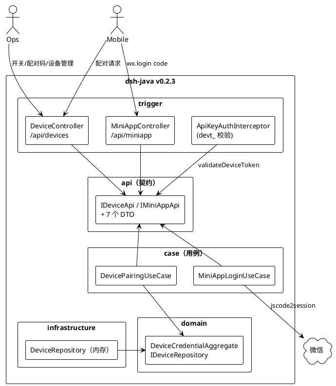
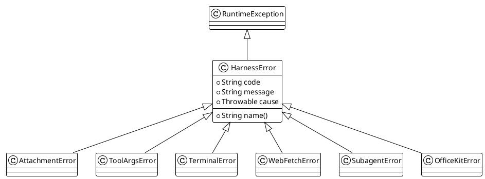

# DeepSeek Harness Java v0.2.3 实现方案文档

> 版本：`v0.2.3` | 主线：移动端接入（移动设备访问开关 + 设备配对重构回归 + 微信小程序登录） | 基线：v0.2.2
>
> 本方案将 `spec.md` 的 §5.1–§5.7 能力领域、§8 参考源平台能力对齐与 §6 数据约束转化为分层落位、接口清单与实现细节。**不新增 Maven 模块、不新增第三方依赖、不新增数据库表。**

---

# 一、需求与存量功能关系分析

## 1.1 需求功能与存量功能对比

### 1.1.1 已实现功能（可直接复用的存量骨架）

| 存量能力 | 复用方式 |
| --- | --- |
| `Response<T>` 响应封装（api 模块） | 全部新接口沿用统一响应结构，错误码/文案风格一致 |
| `ApiKeyAuthInterceptor` + `WebMvcConfig`（trigger） | 拦截器重新注入 `IDeviceApi`，恢复 `devt_` 前缀设备 token 校验分支 |
| ArchUnit 分层守护（`TriggerArchitectureTest`） | 持续约束 trigger→api/case 的依赖方向（v0.2.2 修订期修复的基础） |
| JDK `HttpClient` + Jackson | 小程序登录的 HTTP 与 JSON 处理，零新增依赖 |
| 内存仓储风格（`ConcurrentHashMap`） | 设备凭据与小程序会话的进程内存储 |
| 控制台外壳（原生 JS + `app.js`/`app.css`） | 移动访问开关与设备管理面板的落点 |

### 1.1.2 v0.2.2 修订期下线 → v0.2.3 重构回归差异表

| 维度 | v0.2.2（下线前） | v0.2.3（回归后） |
| --- | --- | --- |
| DTO 命名 | `DevicePairRequest` / `DevicePairResult`（无后缀） | `DevicePairRequestDTO` / `DevicePairResponseDTO`，全量 `*DTO` 后缀 |
| 领域模型 | `DeviceCredential`（record 直用） | `DeviceCredentialAggregate`（聚合命名，包路径 `domain/device/model/aggregate`） |
| 访问控制 | 无开关，`/api/devices/*` 常开 | `mobileAccess` 默认关闭，关闭时拒绝并清空配对码 |
| 仓储 | `InMemoryDeviceRepository`（`infrastructure/device/`） | `DeviceRepository`（`infrastructure/adapter/repository/`，明确"最小闭环，后续替换"注记） |
| 开关契约 | 无 | `IDeviceApi.getMobileAccess/setMobileAccess` + `MobileAccessDTO`，`GET/PUT /api/devices/mobile-access` |
| 测试 | 无 | `DevicePairingUseCaseTest` |
| 小程序登录 | 无 | 全新链路（见 §2.4） |

### 1.1.3 需要新增的功能或接口

- **api**：`IDeviceApi`（8 方法）、`IMiniAppApi`（2 方法）、`DeviceDTO`/`DevicePairRequestDTO`/`DevicePairResponseDTO`/`DevicePairingCodeDTO`/`MobileAccessDTO`/`MiniAppLoginRequestDTO`/`MiniAppLoginResponseDTO`
- **case**：`DevicePairingUseCase`（设备用例 + 单测）、`MiniAppLoginUseCase`（小程序用例）
- **domain**：`IDeviceRepository`、`DeviceCredentialAggregate`
- **infrastructure**：`DeviceRepository`
- **trigger**：`DeviceController`（6 端点）、`MiniAppController`（1 端点）、`ApiKeyAuthInterceptor` 恢复设备 token 校验
- **app**：`application.yml` 的 `dsh.miniapp.wechat.*` 配置；`app.js`/`app.css` 控制台适配
- **仓库根**：`AGENTS.md`、`llms.txt`、`docs/md/ai-discoverability.md`

## 1.2 存量功能详细分析（本版本涉及的横切点）

### 1.2.1 ApiKeyAuthInterceptor 鉴权链

既有链路：静态资源放行 → 提取 `X-API-Key` 或 `Bearer` → 主 Key 比对 → 未配置主 Key 放行（本地开发）。本版本在"主 Key 比对"之前恢复 `devt_` 分支：携带 `devt_` 前缀时无条件走 `IDeviceApi.validateDeviceToken`（摘要比对），失败 401，成功放行；不校验主 Key。

### 1.2.2 分层依赖约束

`trigger → api ← case → domain ← infrastructure`。本版本所有触发层类只 import api 契约；case 用例实现 api 接口并依赖 domain 端口；infrastructure 实现 domain 仓储。

---

# 二、增量设计方案

## 2.1 实现模型

### 2.1.1 上下文视图

### 2.1.2 状态与并发模型

- **mobileAccess**：`AtomicBoolean`，进程内开关；`setMobileAccess(false)` 时附带 `pairingCodes.clear()`。
- **pairingCodes**：`ConcurrentHashMap<String, Long>`（码 → 过期时间戳）；生成前执行 `purgeExpiredCodes()` 惰性清理；配对成功 `remove(code)` 实现一次性消费。
- **attempts**：`ConcurrentHashMap<指纹摘要, AttemptWindow(startedAt, count)>`；60 秒滑动窗口，超 10 次（`MAX_ATTEMPTS_PER_WINDOW`）拒绝 `42900`。
- **mini sessions**：`ConcurrentHashMap<String, Long>`（token → 过期时间戳）；校验时惰性清除过期条目。

## 2.2 接口清单

### （1）对外契约 `IDeviceApi`（8 方法，均返回 `Response<T>`）

| 方法 | 说明 |
| --- | --- |
| `getMobileAccess()` | 读取开关 |
| `setMobileAccess(MobileAccessDTO)` | 设置开关（关闭时清空配对码） |
| `createPairingCode()` | 生成 6 位一次性码（600s），`DevicePairingCodeDTO(code, expireAt, expireInSec)` |
| `pair(DevicePairRequestDTO)` | 消费配对码 → `DevicePairResponseDTO(deviceId, deviceName, token, issuedAt)` |
| `listDevices()` | `List<DeviceDTO>`（不含 token） |
| `revoke(String deviceId)` | 吊销设备 |
| `rotate(String deviceId)` | 轮换凭据，旧 token 即时失效 |
| `validateDeviceToken(String token)` | 摘要比对，供拦截器委托 |

### （2）对外契约 `IMiniAppApi`（2 方法）

| 方法 | 说明 |
| --- | --- |
| `login(MiniAppLoginRequestDTO)` | code 换 2h 会话令牌 → `MiniAppLoginResponseDTO(token, expireAt)` |
| `validateSession(String token)` | 会话有效性校验 |

### （3）触发层 REST

| 控制器 | 端点 | 委托 |
| --- | --- | --- |
| `DeviceController`（`/api/devices`） | `GET /mobile-access`、`PUT /mobile-access`、`POST /pairing-codes`、`POST /pair`、`GET /`、`DELETE /{deviceId}`、`POST /{deviceId}/rotate` | `IDeviceApi` |
| `MiniAppController`（`/api/miniapp`） | `POST /login` | `IMiniAppApi`（请求体缺失按 `code=null` 处理走校验） |

## 2.3 数据模型（进程内）

### 2.3.1 DeviceCredentialAggregate（聚合，record）

| 字段 | 说明 |
| --- | --- |
| `deviceId` | `dev-` + UUID 去 `-` 后前 16 位 |
| `deviceName` | 1–40 字符，trim 后保存 |
| `fingerprint` | 客户端指纹的 SHA-256 摘要前 32 hex |
| `tokenHash` | token 明文的 SHA-256 全量 hex |
| `createdAt` / `lastSeenAt` | ISO-8601 字符串 |

派生规则：`issueToken(deviceId) = "devt_" + deviceId + "_" + UUID.randomUUID() + UUID.randomUUID()`；`hash` 使用 JDK `MessageDigest(SHA-256)` + `HexFormat`，不可用时抛 `IllegalStateException`。

### 2.3.2 错误码表

| 错误码 | 场景 |
| --- | --- |
| `40300` | 移动设备访问未开启 |
| `40001` | 配对码无效或已使用 |
| `40002` | 配对码已过期 |
| `40003` | 该设备已配对（指纹重复） |
| `40004` | 设备不存在 |
| `42900` | 配对尝试过于频繁 |
| `50300` | 小程序登录未配置（appid/secret 缺失） |
| `40101` | 微信登录失败（errcode 非零） |
| `40102` | 微信未返回 openid |
| `50200` | 小程序登录请求异常 |

## 2.4 小程序登录链路

1. 配置读取：`@Value("${dsh.miniapp.wechat.appid:}")` / `secret`，均为空则登录直接 `50300`。
2. HTTP：静态 `HttpClient`（连接超时 5s），请求超时 8s；URL 参数经 `URLEncoder.encode(UTF_8)` 编码。
3. 响应解析：Jackson `readTree`；`errcode != 0` → `40101`（附 errmsg）；`openid` 空 → `40102`；异常 → `50200`（warn 日志）。
4. 签发：`"mini_" + RANDOM.nextInt(Integer.MAX_VALUE) + "_" + UUID.randomUUID()`，TTL 2 小时，存入会话表并返回 `expireAt`（ISO-8601）。

## 2.5 分层落位清单

| 层 | 包 / 文件 | 职责 |
| --- | --- | --- |
| api | `net.linlan.dsh.api`：`IDeviceApi`、`IMiniAppApi` | 对外契约 |
| api | `net.linlan.dsh.api.dto`：`DeviceDTO`、`DevicePairRequestDTO`、`DevicePairResponseDTO`、`DevicePairingCodeDTO`、`MobileAccessDTO`、`MiniAppLoginRequestDTO`、`MiniAppLoginResponseDTO` | 传输对象（Java 17 record） |
| case | `net.linlan.dsh.cases.device.DevicePairingUseCase` | 设备用例（含限流、配对码、token 生命周期） |
| case | `net.linlan.dsh.cases.miniapp.MiniAppLoginUseCase` | 小程序登录用例 |
| domain | `net.linlan.dsh.domain.device.model.aggregate.DeviceCredentialAggregate`、`domain.device.adapter.repository.IDeviceRepository` | 聚合与仓储端口 |
| infrastructure | `net.linlan.dsh.infrastructure.adapter.repository.DeviceRepository` | 内存仓储实现 |
| trigger | `net.linlan.dsh.trigger.http.DeviceController`、`MiniAppController`；`trigger.filter.ApiKeyAuthInterceptor` | REST 触发与鉴权 |
| app | `application.yml`（`dsh.miniapp.wechat.*`）、`static/app.js`、`static/app.css` | 配置与控制台 |
| 仓库根 | `AGENTS.md`、`llms.txt`、`docs/md/ai-discoverability.md` | AI 可发现性 |

## 2.6 测试策略

- **case 单元测试**：`DevicePairingUseCaseTest`——开关默认值与关闭拒绝（`40300`）、参数校验、配对码一次性/过期、指纹重复（`40003`）、限流（`42900`）、吊销后 token 失效、轮换后旧 token 失效、token 摘要校验。
- **架构守护**：既有 ArchUnit 规则回归（trigger 不依赖 domain/infrastructure）。
- **端到端（人工）**：桌面端开开关 → 生成配对码 → 移动端配对 → `devt_` 请求通过拦截器 → 吊销后 401；小程序真机 `wx.login` 链路。

## 2.7 风险与回滚

1. **内存态丢失**：设备凭据/小程序会话重启即丢（已知边界，数据库仓储为后续版本）。回滚成本低：重配对即可。
2. **单实例约束**：内存态不支持多实例；部署文档须注明。
3. **微信凭据泄露**：secret 仅经环境变量注入；代码与文档均不落盘。
4. **拦截器顺序**：`devt_` 分支位于主 Key 校验之前，未配置主 Key 时设备 token 依然强校验——保持 v0.2.2 修订前语义。

---

# 三、参考源平台能力对齐增量设计（迭代二）

## 3.1 适用性判定与总体策略

参考源最新发布 tag 为 `dsh-v0.2.2-rc.3`；该 tag 未新增升级指南。因此对齐范围取 `v0.2.2-alpha.3`、`v0.2.2-rc.1`、`v0.2.2-rc.2` 的 42 条升级项，按"Java 服务端是否存在对应体系"筛分为纳入与不纳入两组。

| 组 | 升级项 | 处理 |
| --- | --- | --- |
| 纳入 | `attachment-error-codes`、`experimental-tool-error-codes`、`shell-fs-tool-error-codes`、`terminal-backend-cleanup-error`、`web-fetch-transport-error-codes` | 统一到 `HarnessError` 与分类错误码 |
| 纳入 | `subagent-names`、`subagent-interrupt-default` | Subagent catalog 与工具参数改造 |
| 纳入 | `office-kit-package`、`office-operation-tools`、`office-skill-resources` | Office 工具化与配置收敛 |
| 纳入 | `web-search-billing` | 计费模式与凭据来源 |
| 纳入 | `archive-worktrees` | 归档清理与会话事件 |
| 纳入 | `runtime-context-reminders` | 上下文快照包装 |
| 纳入 | `plugin-update-method` | Bundle 更新语义 |
| 纳入 | `deepseek-files-timeout` | 文件上传超时策略 |
| 部分纳入 | `connection-page-peer`、`session-status-package`、`session-append-overloads`、`cua-agents-without-preset`、`ptc-inspect-output` | 仅服务端契约与装配部分 |
| 不纳入 | Cordis/包导出、Client/Desktop、macOS AX、Python/Node 运行时、Forge、账号、文档技能 | 见 `spec.md` §8.13 |

**总体策略**：优先收敛跨能力的错误码契约（一次改造覆盖全部工具），再做各能力域的参数/配置演进；所有破坏性改名在 Java 侧以**编译期失败**暴露，不做静默兼容。

## 3.2 统一错误码体系（HarnessError）

### 3.2.1 模型

- **落位**：`dsh-java-domain` 新增 `domain/common/error` 公共异常包（现有错误类散落在各子系统，本版收敛出统一基类），`code` 为稳定字符串常量，`name()` 返回具体错误类名。
- **幂等映射**：工具执行管线（`ToolPipeline` / `ToolCallExecutor`）捕获 `HarnessError` 时写入 `tool/result.error = {name, code}`；非 `HarnessError` 才归为内部错误，禁止统一写成 `UNKNOWN`。
- **码表归属**：各子系统维护自己的常量类（附件、终端、Web、Subagent、Office），由 `ToolErrorCodes` 只保留通用码（`INVALID_ARGS`、`TOOL_TIMEOUT` 等）。

### 3.2.2 关键码变更

| 场景 | 旧行为 | 新行为 |
| --- | --- | --- |
| 无沙箱执行器收到 `sandbox_permissions` | `SANDBOX_ESCALATION_UNAVAILABLE` | `ToolArgsError` / `INVALID_ARGS` |
| `run_in_background` 不支持 | `JOB_BACKGROUND_DISABLED` | `ToolArgsError` / `INVALID_ARGS` |
| 模型不支持图片 | `IMAGE_UNSUPPORTED_MODEL` | `MODEL_DOES_NOT_SUPPORT_IMAGES` |
| 本地抓取网络失败 | `WEB_PROVIDER_ERROR` | `WEB_FETCH_*` 六类 + `WEB_FETCH_NETWORK_ERROR` |
| 终端启动与清理双失败 | `AggregateError` | `TerminalBackendCleanupError` / `CLEANUP_FAILED` |
| 图像附件读取失败 | `UNKNOWN` | `ATTACHMENT_*` / 图像准入码 |

### 3.2.3 兼容性

错误码是模型可见契约，属于**破坏性变更**：既有按旧码分支的测试、前端文案与外部脚本需同步更新；Java 侧通过常量类集中引用，避免字符串散落。

完整码表、子系统归属与旧→新映射见 [error-codes.md](error-codes.md)。

## 3.3 Subagent 名称寻址

### 3.3.1 领域模型

| 概念 | 设计 |
| --- | --- |
| 名称 | 同级唯一；根 `lead`；后代路径名 `reviewer/checker` |
| 目录 | 每个创建者持有 `subagent/catalog`，写入第 3 版载荷；旧条目继续以 Session id 作为名称 |
| 寻址 | `send_message`/`interrupt_agent` 的 `agent` 参数接受名称或 Session id；`agent_id` 参数删除 |
| 列表 | `{name, status, description?}`；`status` 取 `running`/`done`/`corrupt`/`unsupported`/`unavailable` |
| 激活结果 | `SubagentActivation` 新增必填 `name`；`SubagentActivationSpec` 接受可选 `name` |

### 3.3.2 落位

| 层 | 改动 |
| --- | --- |
| domain | `SubagentRegistry` 增加名称索引与同级唯一校验；`SubagentSessions` 维护名称 → Session id 映射；`SubagentActivation`/Spec 增加 `name` |
| domain/tool/subagent | `SendMessageTool`、`InterruptTool` 参数改为 `agent`；`ListAgentsTool` 返回结构化行；`SubagentTool` 增加可选 `name` |
| case | Team 任务投影把 `ownerId` 改为 `owner`，无主任务用 `unowned` 查询 |
| 持久化 | 目录载荷版本升到 3；对旧载荷按 Session id 兼容读取 |

> Java 适配：当前无持久化 `subagent/catalog`，名称索引落在 `InProcessSubagentDriver`（名称→会话 id、同级唯一、默认名称为会话 id），`listAgents` 直接投影；`reviewer/checker` 等路径名按字面键解析。

## 3.4 Office 工具化

| 工具 | 职责 | 复用 |
| --- | --- | --- |
| `office_render` | 文档渲染为可预览产物 | `OfficeToPdfService` / `LibreOfficeConverter` |
| `office_convert` | 格式转换（docx/pptx/xlsx → PDF 等） | 同上 |
| `office_recalculate` | 表格重算 | 既有文档转换端口扩展 |

- **技能收敛**：`OfficeSkill` 只保留 `office` 路由与 `office-docx/pptx/xlsx` 三个编写技能，删除 `office-render`、`office-recalculate`、`office-export-pdf` 技能动作。
- **配置**：新增 `dsh.office.output-directory`（默认 `$DSH_HOME/office-kit/outputs`）、`output-retention-ms`、`max-output-store-bytes`；删除 `skill-office.node/cli` 与 `DSH_BUNDLED_OFFICE_*`。
- **缺 Kit 行为**：转换器缺失时工具返回 `OfficeKitError(unavailable)`，不阻止应用启动。
- **安全**：Office 工具在 Host 进程内解析不可信文档，输入仍受文件系统后端授权约束；需在工具说明中标注该信任边界。

## 3.5 Web 搜索/抓取计费

- 配置模型：`dsh.web.search-billing` 与 `dsh.web.fetch-billing`，枚举 `auto|account|api-key`。
- 凭据解析改为**有序来源列表**：每项包含地址与凭据提供方；顺序即优先级，移除顶层 `baseURL`。
- 未识别的取消异常统一映射 `WEB_ABORTED`；凭据读取异常保留原始 `cause`。
- 失败分类沿用 §3.2.2 的 `WEB_FETCH_*` 码，工具结果与日志共用同一码。

## 3.6 Worktree 归档清理

1. `WorktreeTool.create` 成功后写 `plugin:worktree/created` 会话事件（目录、仓库、分支、创建 Session）。
2. 归档用例监听会话归档事件：按目录反查引用，确认无其他未归档 Session 引用后执行 `git status --porcelain`、子模块、锁与 HEAD 检查。
3. 满足干净条件时调用 `git worktree remove`（不带 `force`）；失败仅提示，不阻断归档。
4. 配置 `dsh.worktree.retain-on-archive` 默认 `false`；分支与提交始终保留。
5. 旧版本创建的工作树没有事件记录，不纳入清理。

## 3.7 运行时上下文提醒

- `runtime-context` 消息统一由 `renderContextSnapshot()` 渲染，文本包在 `<system-reminder>...</system-reminder>`。
- 首份快照标注"介绍当前会话"；后续快照标注"覆盖摘要保留的上下文"。
- 清空提醒输出 `form=snapshot`、`sections=[]`。
- 旧快照缺少 `source.sections` 时，在下一次获准请求时刷新一次；不改写已有请求前缀，保证前缀缓存稳定。

## 3.8 Plugin Bundle 更新语义

- `BundleInfo` 增加可选 `update` 字段（`registry` / `git`），移除 `updatable`。
- `updateBundle` 支持 Git spec 指向同仓库较新提交；无法替换的 bundle 不返回 `update`。
- 管理错误新增 `unexpected-package`：带 `expected` 的安装若命中其他包或版本即失败。
- `plugin_manager` 工具契约不变，避免模型侧提示漂移。

## 3.9 DeepSeek 文件上传超时

- `filesApiTimeoutMs` 默认 20s（原 60s）；连接超时与请求超时分离配置。
- 超时后下一条需要上传图片的请求改用内联图片；连续超时按 2 倍退避跳过，成功后复位。
- 日志记录"上传超时 + 降级内联"事件，不记录图片内容。

## 3.10 WebServer 默认鉴权

- 路由注册模型增加 `auth` 维度，默认 `required`；静态资源、健康检查、连接页等公开路由必须显式 `anonymous`。
- Token 校验与 HTTP 登录交换从连接页逻辑中抽为认证提供方；Cookie 可同时认证页面与 API。
- 连接监听器活动时，匿名路由也执行来源检查。
- 与现有 `ApiKeyAuthInterceptor` 的关系：拦截器继续负责 API Key/设备 token；`auth` 维度负责"路由是否允许匿名"，二者叠加而非替代。

## 3.11 会话状态与事件写入

- `SessionStatus` 从 `IDLE/RUNNING` 扩展为可表达宿主阅读态与完成未读态；新增 `completionUnread`、`completionFailed` 投影字段。
- 宿主维护共享阅读记录：主视图切入会话自动清除手动未读标记；`mark(sessionId, unread)` 在 `readingReady` 前拒绝。
- 事件存储接口 `append` 增加数组重载，内部按顺序批量落库并可重放；单事件签名保留。

## 3.12 CUA / PTC 部分对齐

- **CUA**：未组合 preset 的 Agent 也注册 `cua_run_code`；按 `agentPreset` 决定暴露 `cua` 还是 `cua_run_code`；专用程序运行时缺失时创建 Agent 失败并给出可读原因。
- **PTC**：程序输出改为 `inspect(...)` 显式选择；CUA 观察方法与 `read_image` 返回可 `inspect` 的值/图片；不引入 scoped REPL 与 bootstrap v3。

## 3.13 分层落位清单

| 层 | 包 / 文件 | 职责 |
| --- | --- | --- |
| domain | `domain/common/error/HarnessError.java` 及子系统错误类 | 统一错误基类与码表 |
| domain | `domain/agent/service/subagent/*`、`domain/tool/subagent/*` | 名称索引、catalog v3、工具参数 |
| domain | `domain/document/office/*`、`domain/tool/office/*` | 三个 Office 工具与 Kit 治理 |
| domain | `domain/tool/web/*`、`domain/llm/*` | 计费模式、凭据来源、上传超时 |
| domain | `domain/tool/worktree/*`、`domain/session/*` | 工作树事件、归档清理、阅读态与批量 append |
| domain | `domain/plugin/*` | Bundle 更新语义 |
| case | `cases/plugin/*`、`cases/session/*`、`cases/agent/*` | 编排与投影 |
| api | `api/**` 中受影响的 DTO / 接口 | 字段与参数契约 |
| infrastructure | `adapter/*` | LibreOffice、HTTP、Git、事件存储实现 |
| trigger | `trigger/**` | 路由 `auth` 声明与错误映射 |
| app | `application.yml` / `harness.yml` | 新增配置项与默认值 |

## 3.14 兼容性、风险与回滚

| 风险 | 影响 | 缓解 |
| --- | --- | --- |
| 错误码改名破坏既有断言/脚本 | 中 | 码表集中管理；在 CHANGELOG 列出旧→新映射 |
| Subagent 参数改名 | 中 | 编译期暴露；文档与工具 schema 同步；不保留 `agent_id` 兼容 |
| Office 工具依赖 LibreOffice Kit | 高 | 缺失时返回 `unavailable`，不影响启动；文档标注部署前置 |
| Worktree 自动清理误删 | 高 | 仅清理干净树、无其他引用、非只读；默认不强制删除；`retainOnArchive` 可全局保留 |
| WebServer 默认 required | 中 | 上线前逐路由核对 `anonymous` 声明；本地开发使用既有 API Key |
| 上下文提醒改动前缀 | 低 | 旧快照仅刷新一次，不改写既有前缀 |

**回滚**：所有能力按配置开关可回退（`dsh.office.enabled`、`dsh.worktree.retain-on-archive`、`dsh.web.search-billing`、`dsh.webserver.auth-default`），回滚不需要数据库变更。
