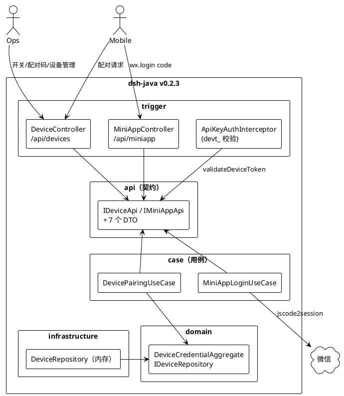

# DeepSeek Harness Java v0.2.3 实现方案文档

> 版本：`v0.2.3` | 主线：移动端接入（移动设备访问开关 + 设备配对重构回归 + 微信小程序登录） | 基线：v0.2.2
>
> 本方案将 `spec.md` 的 §5.1–§5.7 能力领域与 §6 数据约束转化为分层落位、接口清单与实现细节。**不新增 Maven 模块、不新增第三方依赖、不新增数据库表。**

---

# 一、需求与存量功能关系分析

## 1.1 需求功能与存量功能对比

### 1.1.1 已实现功能（可直接复用的存量骨架）

| 存量能力 | 复用方式 |
| --- | --- |
| `Response<T>` 响应封装（api 模块） | 全部新接口沿用统一响应结构，错误码/文案风格一致 |
| `ApiKeyAuthInterceptor` + `WebMvcConfig`（trigger） | 拦截器重新注入 `IDeviceApi`，恢复 `devt_` 前缀设备 token 校验分支 |
| ArchUnit 分层守护（`TriggerArchitectureTest`） | 持续约束 trigger→api/case 的依赖方向（v0.2.2 修订期修复的基础） |
| JDK `HttpClient` + Jackson | 小程序登录的 HTTP 与 JSON 处理，零新增依赖 |
| 内存仓储风格（`ConcurrentHashMap`） | 设备凭据与小程序会话的进程内存储 |
| 控制台外壳（原生 JS + `app.js`/`app.css`） | 移动访问开关与设备管理面板的落点 |

### 1.1.2 v0.2.2 修订期下线 → v0.2.3 重构回归差异表

| 维度 | v0.2.2（下线前） | v0.2.3（回归后） |
| --- | --- | --- |
| DTO 命名 | `DevicePairRequest` / `DevicePairResult`（无后缀） | `DevicePairRequestDTO` / `DevicePairResponseDTO`，全量 `*DTO` 后缀 |
| 领域模型 | `DeviceCredential`（record 直用） | `DeviceCredentialAggregate`（聚合命名，包路径 `domain/device/model/aggregate`） |
| 访问控制 | 无开关，`/api/devices/*` 常开 | `mobileAccess` 默认关闭，关闭时拒绝并清空配对码 |
| 仓储 | `InMemoryDeviceRepository`（`infrastructure/device/`） | `DeviceRepository`（`infrastructure/adapter/repository/`，明确"最小闭环，后续替换"注记） |
| 开关契约 | 无 | `IDeviceApi.getMobileAccess/setMobileAccess` + `MobileAccessDTO`，`GET/PUT /api/devices/mobile-access` |
| 测试 | 无 | `DevicePairingUseCaseTest` |
| 小程序登录 | 无 | 全新链路（见 §2.4） |

### 1.1.3 需要新增的功能或接口

- **api**：`IDeviceApi`（8 方法）、`IMiniAppApi`（2 方法）、`DeviceDTO`/`DevicePairRequestDTO`/`DevicePairResponseDTO`/`DevicePairingCodeDTO`/`MobileAccessDTO`/`MiniAppLoginRequestDTO`/`MiniAppLoginResponseDTO`
- **case**：`DevicePairingUseCase`（设备用例 + 单测）、`MiniAppLoginUseCase`（小程序用例）
- **domain**：`IDeviceRepository`、`DeviceCredentialAggregate`
- **infrastructure**：`DeviceRepository`
- **trigger**：`DeviceController`（6 端点）、`MiniAppController`（1 端点）、`ApiKeyAuthInterceptor` 恢复设备 token 校验
- **app**：`application.yml` 的 `dsh.miniapp.wechat.*` 配置；`app.js`/`app.css` 控制台适配
- **仓库根**：`AGENTS.md`、`llms.txt`、`docs/md/ai-discoverability.md`

## 1.2 存量功能详细分析（本版本涉及的横切点）

### 1.2.1 ApiKeyAuthInterceptor 鉴权链

既有链路：静态资源放行 → 提取 `X-API-Key` 或 `Bearer` → 主 Key 比对 → 未配置主 Key 放行（本地开发）。本版本在"主 Key 比对"之前恢复 `devt_` 分支：携带 `devt_` 前缀时无条件走 `IDeviceApi.validateDeviceToken`（摘要比对），失败 401，成功放行；不校验主 Key。

### 1.2.2 分层依赖约束

`trigger → api ← case → domain ← infrastructure`。本版本所有触发层类只 import api 契约；case 用例实现 api 接口并依赖 domain 端口；infrastructure 实现 domain 仓储。

---

# 二、增量设计方案

## 2.1 实现模型

### 2.1.1 上下文视图

### 2.1.2 状态与并发模型

- **mobileAccess**：`AtomicBoolean`，进程内开关；`setMobileAccess(false)` 时附带 `pairingCodes.clear()`。
- **pairingCodes**：`ConcurrentHashMap<String, Long>`（码 → 过期时间戳）；生成前执行 `purgeExpiredCodes()` 惰性清理；配对成功 `remove(code)` 实现一次性消费。
- **attempts**：`ConcurrentHashMap<指纹摘要, AttemptWindow(startedAt, count)>`；60 秒滑动窗口，超 10 次（`MAX_ATTEMPTS_PER_WINDOW`）拒绝 `42900`。
- **mini sessions**：`ConcurrentHashMap<String, Long>`（token → 过期时间戳）；校验时惰性清除过期条目。

## 2.2 接口清单

### （1）对外契约 `IDeviceApi`（8 方法，均返回 `Response<T>`）

| 方法 | 说明 |
| --- | --- |
| `getMobileAccess()` | 读取开关 |
| `setMobileAccess(MobileAccessDTO)` | 设置开关（关闭时清空配对码） |
| `createPairingCode()` | 生成 6 位一次性码（600s），`DevicePairingCodeDTO(code, expireAt, expireInSec)` |
| `pair(DevicePairRequestDTO)` | 消费配对码 → `DevicePairResponseDTO(deviceId, deviceName, token, issuedAt)` |
| `listDevices()` | `List<DeviceDTO>`（不含 token） |
| `revoke(String deviceId)` | 吊销设备 |
| `rotate(String deviceId)` | 轮换凭据，旧 token 即时失效 |
| `validateDeviceToken(String token)` | 摘要比对，供拦截器委托 |

### （2）对外契约 `IMiniAppApi`（2 方法）

| 方法 | 说明 |
| --- | --- |
| `login(MiniAppLoginRequestDTO)` | code 换 2h 会话令牌 → `MiniAppLoginResponseDTO(token, expireAt)` |
| `validateSession(String token)` | 会话有效性校验 |

### （3）触发层 REST

| 控制器 | 端点 | 委托 |
| --- | --- | --- |
| `DeviceController`（`/api/devices`） | `GET /mobile-access`、`PUT /mobile-access`、`POST /pairing-codes`、`POST /pair`、`GET /`、`DELETE /{deviceId}`、`POST /{deviceId}/rotate` | `IDeviceApi` |
| `MiniAppController`（`/api/miniapp`） | `POST /login` | `IMiniAppApi`（请求体缺失按 `code=null` 处理走校验） |

## 2.3 数据模型（进程内）

### 2.3.1 DeviceCredentialAggregate（聚合，record）

| 字段 | 说明 |
| --- | --- |
| `deviceId` | `dev-` + UUID 去 `-` 后前 16 位 |
| `deviceName` | 1–40 字符，trim 后保存 |
| `fingerprint` | 客户端指纹的 SHA-256 摘要前 32 hex |
| `tokenHash` | token 明文的 SHA-256 全量 hex |
| `createdAt` / `lastSeenAt` | ISO-8601 字符串 |

派生规则：`issueToken(deviceId) = "devt_" + deviceId + "_" + UUID.randomUUID() + UUID.randomUUID()`；`hash` 使用 JDK `MessageDigest(SHA-256)` + `HexFormat`，不可用时抛 `IllegalStateException`。

### 2.3.2 错误码表

| 错误码 | 场景 |
| --- | --- |
| `40300` | 移动设备访问未开启 |
| `40001` | 配对码无效或已使用 |
| `40002` | 配对码已过期 |
| `40003` | 该设备已配对（指纹重复） |
| `40004` | 设备不存在 |
| `42900` | 配对尝试过于频繁 |
| `50300` | 小程序登录未配置（appid/secret 缺失） |
| `40101` | 微信登录失败（errcode 非零） |
| `40102` | 微信未返回 openid |
| `50200` | 小程序登录请求异常 |

## 2.4 小程序登录链路

1. 配置读取：`@Value("${dsh.miniapp.wechat.appid:}")` / `secret`，均为空则登录直接 `50300`。
2. HTTP：静态 `HttpClient`（连接超时 5s），请求超时 8s；URL 参数经 `URLEncoder.encode(UTF_8)` 编码。
3. 响应解析：Jackson `readTree`；`errcode != 0` → `40101`（附 errmsg）；`openid` 空 → `40102`；异常 → `50200`（warn 日志）。
4. 签发：`"mini_" + RANDOM.nextInt(Integer.MAX_VALUE) + "_" + UUID.randomUUID()`，TTL 2 小时，存入会话表并返回 `expireAt`（ISO-8601）。

## 2.5 分层落位清单

| 层 | 包 / 文件 | 职责 |
| --- | --- | --- |
| api | `net.linlan.dsh.api`：`IDeviceApi`、`IMiniAppApi` | 对外契约 |
| api | `net.linlan.dsh.api.dto`：`DeviceDTO`、`DevicePairRequestDTO`、`DevicePairResponseDTO`、`DevicePairingCodeDTO`、`MobileAccessDTO`、`MiniAppLoginRequestDTO`、`MiniAppLoginResponseDTO` | 传输对象（Java 17 record） |
| case | `net.linlan.dsh.cases.device.DevicePairingUseCase` | 设备用例（含限流、配对码、token 生命周期） |
| case | `net.linlan.dsh.cases.miniapp.MiniAppLoginUseCase` | 小程序登录用例 |
| domain | `net.linlan.dsh.domain.device.model.aggregate.DeviceCredentialAggregate`、`domain.device.adapter.repository.IDeviceRepository` | 聚合与仓储端口 |
| infrastructure | `net.linlan.dsh.infrastructure.adapter.repository.DeviceRepository` | 内存仓储实现 |
| trigger | `net.linlan.dsh.trigger.http.DeviceController`、`MiniAppController`；`trigger.filter.ApiKeyAuthInterceptor` | REST 触发与鉴权 |
| app | `application.yml`（`dsh.miniapp.wechat.*`）、`static/app.js`、`static/app.css` | 配置与控制台 |
| 仓库根 | `AGENTS.md`、`llms.txt`、`docs/md/ai-discoverability.md` | AI 可发现性 |

## 2.6 测试策略

- **case 单元测试**：`DevicePairingUseCaseTest`——开关默认值与关闭拒绝（`40300`）、参数校验、配对码一次性/过期、指纹重复（`40003`）、限流（`42900`）、吊销后 token 失效、轮换后旧 token 失效、token 摘要校验。
- **架构守护**：既有 ArchUnit 规则回归（trigger 不依赖 domain/infrastructure）。
- **端到端（人工）**：桌面端开开关 → 生成配对码 → 移动端配对 → `devt_` 请求通过拦截器 → 吊销后 401；小程序真机 `wx.login` 链路。

## 2.7 风险与回滚

1. **内存态丢失**：设备凭据/小程序会话重启即丢（已知边界，数据库仓储为后续版本）。回滚成本低：重配对即可。
2. **单实例约束**：内存态不支持多实例；部署文档须注明。
3. **微信凭据泄露**：secret 仅经环境变量注入；代码与文档均不落盘。
4. **拦截器顺序**：`devt_` 分支位于主 Key 校验之前，未配置主 Key 时设备 token 依然强校验——保持 v0.2.2 修订前语义。
