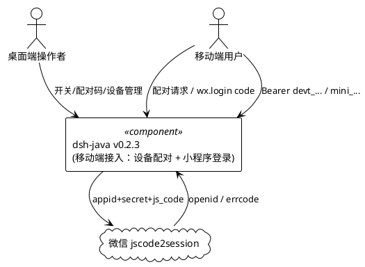
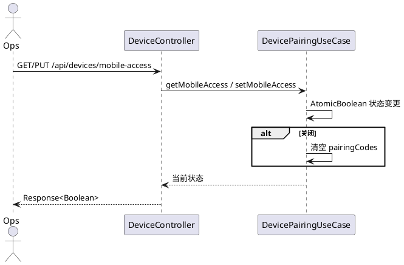
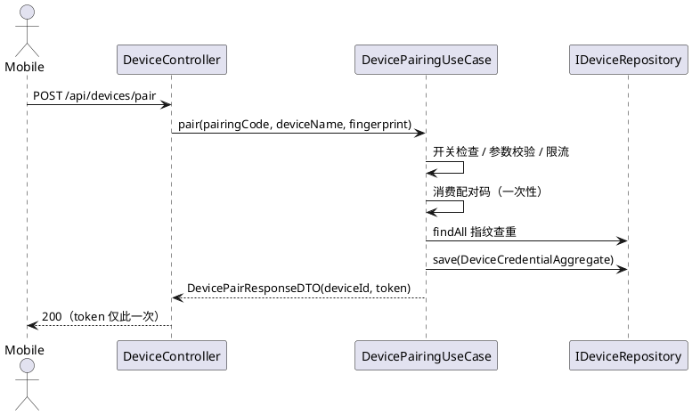

# DeepSeek Harness Java v0.2.3 需求规格

> 版本：`v0.2.3` | 主线：移动端接入（移动设备访问开关 + 设备配对重构回归 + 微信小程序登录） | 基线：v0.2.2 | 迭代二：参考源平台能力对齐（§8）
>
> **版本范围声明**：v0.2.3 全部设计与任务统一纳入本版本，与本规格同目录归档。四件套分别为 `docs/spec/0.2.3/spec.md`（本需求规格）、`design.md`（技术方案）、`tasks.md`（任务清单）、`release-v0.2.3-development-notes.md`（开发说明）。
>
> **历史背景**：移动设备配对功能曾在 v0.2.2 修订期（2026-11-05 ~ 11-06）整体下线；v0.2.3 按**聚合建模 + DTO 命名规范 + 移动访问开关默认关闭**的新架构重构回归，并新增微信小程序登录。下线记录见 `CHANGELOG.md` v0.2.2 修订记录。
>
> **依赖新增声明**：本版本**不新增任何第三方依赖**（小程序登录使用 JDK 内置 `java.net.http.HttpClient` 与 Jackson，均为既有能力）。
>
> **数据声明**：本版本**不新增数据库表**。设备凭据与小程序会话均为进程内存储（`ConcurrentHashMap`），为最小闭环实现；数据库持久化（`device_credential` 表等）留待后续版本，见"当前边界"。
>
> **本阶段边界**：本文档仅定义"做什么（What）"与验收标准，不包含类签名、算法与部署实现等"怎么做（How）"细节。
>
> **迭代二声明**：§8 为 v0.2.3 迭代二新增范围（参考源 `v0.2.2-alpha.3` ~ `v0.2.2-rc.2` 升级项对齐），与迭代一（§5 移动端接入）并行归档于本版本；其技术方案见 `design.md` 第三章、任务见 `tasks.md` 第十一节。迭代二仍遵守**不新增 Maven 模块、不新增数据库表**的边界，第三方依赖以复用既有能力为准。

---

# **1. Component Positioning**

## **1.1 Core Responsibility**

本组件负责让 DeepSeek Harness Java 以**受控开关 + 一次性配对码**的方式接受移动设备（手机端 App / 小程序）接入：

1. **移动设备访问开关**：宿主默认拒绝一切移动端接入，须由桌面端显式开启；
2. **设备配对与凭据生命周期**：桌面端生成一次性配对码，移动端以"配对码 + 设备指纹"换取设备级长期凭据（token），支持设备列表、吊销、凭据轮换；
3. **设备级 Bearer Token 鉴权**：`devt_` 前缀的设备 token 无需主 API Key 即可通过宿主统一鉴权拦截器，吊销后立即失效；
4. **微信小程序登录**：以 `wx.login` 临时 code 经微信 `jscode2session` 接口换取 `openid`，签发短期会话令牌（`mini_` 前缀，2 小时）。

## **1.2 Core Inputs**

1. **移动访问开关指令**：来自桌面端控制台/ API 的开关查询与设置请求（`{ enabled: boolean }`）。
2. **配对码生成请求**：桌面端发起，无参数。
3. **配对请求**：来自移动端，含一次性 `pairingCode`、设备名 `deviceName`（1–40 字符）、设备指纹 `fingerprint`（客户端生成，服务端只存摘要）。
4. **设备管理指令**：设备列表查询、按 `deviceId` 吊销、按 `deviceId` 轮换凭据。
5. **鉴权请求**：宿主拦截器对 `Authorization: Bearer devt_...` 的校验委托。
6. **小程序登录请求**：来自小程序端，含 `wx.login` 返回的临时 `code`。
7. **外部配置信号**：`dsh.miniapp.wechat.appid` / `dsh.miniapp.wechat.secret`（经环境变量 `DSH_MINIAPP_WECHAT_APPID` / `DSH_MINIAPP_WECHAT_SECRET` 注入）。

## **1.3 Core Outputs**

1. **开关状态响应**：设置/查询后的移动访问启用状态。
2. **配对码响应**：6 位数字码、过期时间戳（ISO-8601）、有效期秒数（600 秒）。
3. **配对响应**：服务端签发的 `deviceId`（`dev-` 前缀 16 位十六进制）、设备名、设备级 token（`devt_` 前缀，**仅签发时返回一次**）、签发时间。
4. **设备列表响应**：已配对设备清单（`deviceId`、`deviceName`、指纹摘要、创建/最近活跃时间）。
5. **轮换响应**：新 token（旧 token 立即失效）。
6. **小程序登录响应**：会话令牌（`mini_` 前缀）与过期时间戳（2 小时）。
7. **内存持久化记录**：设备凭据聚合（仅存 token 的 SHA-256 摘要）。

## **1.4 Responsibility Boundaries**

本组件**不负责**：

1. **设备凭据的数据库持久化**：v0.2.3 为进程内内存实现，重启即丢；数据库仓储为后续版本任务。
2. **设备 token 的细粒度权限**：设备 token 仅作身份准入（等价主 Key 放行），不做按设备的能力裁剪。
3. **微信开放平台侧的注册与审核**：小程序 AppID/AppSecret 的申请、域名白名单配置由用户在微信公众平台完成。
4. **小程序会话的数据库持久化**：`mini_` 会话为内存存储，重启失效后由小程序端重新登录。
5. **openid 与业务账号的绑定**：本版本仅完成登录换取会话令牌，不建立 openid ↔ 用户档案的映射。
6. **移动端 App / 小程序前端实现**：属 `dsh-java-mobile` 等姊妹仓库范围。
7. **配对码的跨实例共享**：内存实现不支持多实例部署下的配对码共享。
8. **设备指纹的生成规范**：指纹由客户端生成，服务端只存 SHA-256 摘要（截取前 32 hex），不校验其生成方式。

---

# **2. Domain Terminology**

**移动设备访问开关（mobileAccess）**
:: 宿主级布尔开关，默认 `false`。关闭时：生成配对码与配对请求均被拒绝（错误码 `40300`），且关闭动作会**清空全部未消费配对码**。

**设备（Device）**
:: 一次成功配对后由服务端签发的移动端身份，聚合根为 `DeviceCredentialAggregate`，拥有 `deviceId`、`deviceName`、指纹摘要、token 摘要与时间戳。

**设备标识（deviceId）**
:: 设备稳定唯一标识，配对成功时生成，形如 `dev-<16位hex>`；吊销后不可复用。

**设备指纹（fingerprint）**
:: 由移动端客户端生成的设备稳定标识；服务端只保存其 SHA-256 摘要的前 32 个十六进制字符，**不保存原文**。同一指纹已存在配对时拒绝重复配对（`40003`）。

**设备级 Token（device token）**
:: 形如 `devt_<deviceId>_<uuid><uuid>` 的长期凭据，**仅配对成功或轮换时返回一次**；服务端只保存其 SHA-256 摘要。轮换后旧 token 立即失效。

**一次性配对码（pairingCode）**
:: 桌面端生成的 6 位数字码，10 分钟有效、一次性消费（成功配对即删除）；关闭移动访问时全部清空。

**配对尝试限流（attempt window）**
:: 按设备指纹摘要限流的滑动窗口：60 秒内最多 10 次配对尝试，超出返回 `42900`。

**小程序会话令牌（mini session token）**
:: 形如 `mini_<随机>_<uuid>` 的短期凭据，2 小时有效；由登录签发，进程内存储。

**jscode2session**
:: 微信登录凭证校验接口（`https://api.weixin.qq.com/sns/jscode2session`），以 `appid` + `secret` + 临时 `js_code` 换取 `openid` 与 `session_key`；本项目只消费 `openid`，不使用 `session_key`。

---

# **3. Roles and Boundaries**

## **3.1 Core Roles**

1. **桌面端操作者**：通过控制台开启/关闭移动访问、生成配对码、管理已配对设备（查看、吊销、轮换）。
2. **移动端用户**：在手机 App 或微信小程序中输入配对码完成配对，或通过 `wx.login` 静默登录。
3. **平台运维**：通过环境变量注入微信小程序凭据（AppID/AppSecret）。

## **3.2 External Systems**

1. **微信登录凭证校验服务**：`api.weixin.qq.com/sns/jscode2session`。
2. **宿主鉴权拦截器（ApiKeyAuthInterceptor）**：统一校验 `X-API-Key` / `Bearer` / `devt_` 凭据。
3. **Agent 运行期（宿主）**：设备 token 与小程序令牌通过后的既有 API 能力。

## **3.3 Interaction Context**



---

# **4. DFX Constraints**

## **4.1 Performance**

1. **配对码过期惰性清理**：生成配对码前须清理已过期条目，避免无界增长。
2. **会话表有界性**：设备凭据表与小程序会话表须提供过期/删除路径，不得永久累积。
3. **token 校验开销**：`devt_` 校验为内存摘要比对，不得引入额外 IO。

## **4.2 Reliability**

1. **一次性消费**：配对码成功消费后必须立即删除，重放无效。
2. **轮换即失效**：轮换凭据后旧 token 必须立即无法通过校验。
3. **吊销即失效**：吊销设备后其 token 必须立即无法通过校验。
4. **开关联动**：关闭移动访问必须同时清空全部未消费配对码。
5. **登录失败可诊断**：微信接口返回 `errcode` 非零、缺少 `openid`、网络异常时，必须返回区分度明确的错误码（`40101`/`40102`/`50200`）并记录日志。

## **4.3 Security**

1. **凭据不明文落库**：token 与指纹均只保存 SHA-256 摘要；明文 token 仅在响应中出现一次。
2. **默认关闭**：移动访问默认 `false`，杜绝静默开放。
3. **AppSecret 仅服务端**：微信 `secret` 仅允许经环境变量在服务端注入，禁止出现在前端、日志或 API 响应中。
4. **限流防爆破**：按指纹 60 秒 10 次的配对尝试限流，防止配对码被暴力枚举。
5. **鉴权闭环**：`devt_` 请求纳入统一拦截器；校验失败返回 401。

## **4.4 Maintainability**

1. **分层落位不越界**：聚合/值对象落于 domain，用例落于 case，控制器与拦截器落于 trigger，仓储落于 infrastructure，契约落于 api。
2. **DTO 命名规范**：对外 DTO 统一 `*DTO` 后缀（本版本修正 `DevicePairRequest`/`DevicePairResult` 等历史命名）。
3. **端口隔离**：trigger 与 case 依赖 api 契约，不得反向依赖 domain 端口（ArchUnit `triggerMustOnlyDependOnApiAndCase` 持续守护）。
4. **错误信息可读**：面向用户的错误为中文可读提示 + 稳定错误码。

## **4.5 Compatibility**

1. **不新增 Maven 模块**：全部新增包落在既有模块内。
2. **不新增第三方依赖**：HTTP 调用使用 JDK HttpClient，JSON 使用既有 Jackson。
3. **既有 API 不变**：不得变更既有控制器、DTO、端口的公开签名与语义。
4. **版本统一**：根 pom、7 个模块 pom、2 个插件 pom 统一升级为 `0.2.3`。
5. **README 稳定性**：README 不随版本承载变更明细，变更统一记录于 `CHANGELOG.md`。

---

# **5. Core Capabilities**

## **5.1 移动设备访问开关**

### **5.1.1 Business Rules**

1. **默认关闭**：应用启动后移动访问必须为关闭状态。
   a. Acceptance criteria: [全新启动查询开关] → [返回 false]
2. **显式开启/关闭**：桌面端必须能设置开关并得到设置后的状态。
   a. Acceptance criteria: [PUT mobile-access {enabled:true}] → [返回 true]
3. **关闭清空配对码**：关闭开关时必须清空全部未消费配对码。
   a. Acceptance criteria: [生成配对码后关闭开关再配对] → [配对失败 `40300`]
4. **关闭拒绝配对**：开关关闭时生成配对码与配对请求必须被拒绝。
   a. Acceptance criteria: [关闭状态请求配对] → [返回"移动设备访问未开启"（`40300`）]

### **5.1.2 Interaction Flow**



### **5.1.3 Exception Scenarios**

1. **请求体缺失**
   a. Trigger condition: `PUT mobile-access` 无请求体
   b. System behavior: 视为关闭（`enabled=false`）
   c. User perception: 返回 false

---

## **5.2 设备配对码与配对**

### **5.2.1 Business Rules**

1. **生成配对码**：开关开启时必须生成 6 位数字一次性配对码，10 分钟有效，响应含码、过期时间与有效期秒数。
   a. Acceptance criteria: [开关开启生成] → [返回 6 位码 + expireAt + expireIn=600]
2. **开关关闭拒绝生成**。
   a. Acceptance criteria: [开关关闭生成] → [`40300`]
3. **配对参数校验**：配对码、设备名（1–40 字符）、指纹均必填。
   a. Acceptance criteria: [缺任一参数] → [invalidArgument 提示]
4. **限流**：同一指纹 60 秒内最多 10 次配对尝试，超出返回 `42900`。
5. **一次性消费**：配对码无效/已使用返回 `40001`；过期返回 `40002`；成功即删除。
6. **指纹唯一**：同一指纹（摘要相同）已配对时拒绝重复配对，返回 `40003`。
7. **签发凭据**：配对成功必须生成 `dev-` 前缀 deviceId 与 `devt_` 前缀 token，保存摘要并**仅在本次响应返回 token 明文**。

### **5.2.2 Interaction Flow**



### **5.2.3 Exception Scenarios**

1. **配对码重放**
   a. Trigger condition: 同一配对码第二次提交
   b. System behavior: `40001` 配对码无效或已使用
   c. User perception: 明确失败提示
2. **重复配对**
   a. Trigger condition: 指纹摘要已存在
   b. System behavior: `40003` 该设备已配对，请先吊销后再配对
   c. User perception: 引导先吊销

---

## **5.3 设备凭据管理（列表 / 吊销 / 轮换）**

### **5.3.1 Business Rules**

1. **列表**：必须返回全部已配对设备（deviceId、deviceName、指纹摘要、createdAt、lastSeenAt），**不含 token 任何形态**。
2. **吊销**：按 deviceId 删除凭据记录；删除后 token 立即失效；空 deviceId 返回 invalidArgument。
3. **轮换**：按 deviceId 签发新 token（旧 token 立即失效），保留设备名、指纹摘要与 createdAt，更新 lastSeenAt；设备不存在返回 `40004`。

### **5.3.2 Exception Scenarios**

1. **轮换不存在的设备**
   a. Trigger condition: deviceId 未找到
   b. System behavior: `40004` 设备不存在
   c. User perception: 明确提示

---

## **5.4 设备级 Bearer Token 鉴权**

### **5.4.1 Business Rules**

1. **统一拦截**：`Authorization: Bearer devt_...` 必须经 `ApiKeyAuthInterceptor` 校验，**无论主 API Key 是否配置**。
2. **摘要比对**：校验必须以 token 的 SHA-256 摘要与仓储中 `tokenHash` 比对。
3. **失败即拒**：校验失败必须返回 401 与"Device credential revoked or invalid"。
4. **通过放行**：校验通过等同主 Key 放行，进入后续处理。

### **5.4.2 Exception Scenarios**

1. **吊销后访问**
   a. Trigger condition: 设备已吊销仍携带旧 token
   b. System behavior: 401
   c. User perception: 客户端引导重新配对

---

## **5.5 微信小程序登录**

### **5.5.1 Business Rules**

1. **未配置拒绝**：`dsh.miniapp.wechat.appid` 或 `secret` 未配置时，登录必须返回 `50300`，**不得降级为匿名登录**。
   a. Acceptance criteria: [未配置 secret 调用登录] → [`50300` 小程序登录未配置]
2. **code 必填**：临时 code 为空返回 invalidArgument。
3. **jscode2session 调用**：必须以 URL 编码后的 appid/secret/code 请求微信接口，超时 8 秒。
4. **errcode 处理**：微信返回非零 `errcode` 时返回 `40101`（携带 errmsg）；缺少 `openid` 返回 `40102`；请求异常返回 `50200`。
5. **签发会话**：成功必须签发 `mini_` 前缀会话令牌，2 小时有效，响应含 token 与过期时间戳（ISO-8601）。
6. **会话校验**：必须提供令牌有效性校验能力（过期自动清除）。
7. **secret 不回显**：任何日志与响应不得出现 secret 明文。

### **5.5.2 Interaction Flow**

```plantuml
@startuml
actor "小程序" as MP
participant "MiniAppController" as C
participant "MiniAppLoginUseCase" as UC
cloud "api.weixin.qq.com" as WX

MP -> C : POST /api/miniapp/login {code}
C -> UC : login(request)
UC -> UC : appid/secret 配置检查
UC -> WX : jscode2session(appid, secret, js_code)
WX --> UC : openid / errcode
alt 成功
  UC -> UC : 签发 mini_ token（2h）
  UC --> C : MiniAppLoginResponseDTO(token, expireAt)
else 失败
  UC --> C : 40101 / 40102 / 50200
end
C --> MP : Response<...>
@enduml
```

### **5.5.3 Exception Scenarios**

1. **微信返回错误码**
   a. Trigger condition: `errcode != 0`（如 code 已使用）
   b. System behavior: `40101` 微信登录失败：<errmsg>
   c. User perception: 小程序提示重新登录
2. **微信网络异常**
   a. Trigger condition: 请求超时/连接失败
   b. System behavior: `50200` 小程序登录请求失败，记录 warn 日志
   c. User perception: 引导重试

---

## **5.6 v0.2.3 版本发布与工程治理**

### **5.6.1 Business Rules**

1. **版本统一升级**：根 pom、7 个模块 pom、2 个插件 pom 版本统一为 `0.2.3`。
   a. Acceptance criteria: [检查全部 pom] → [版本均为 0.2.3]
2. **CHANGELOG 分节**：`CHANGELOG.md` 必须存在 0.2.3 分节，区分"新增"与"更新"两类记录。
3. **四件套归档**：spec/design/tasks/release notes 归档于 `docs/spec/0.2.3/`。
4. **README 稳定**：README 不承载版本明细（v0.2.2 起约定），变更只进 CHANGELOG。

### **5.6.2 Exception Scenarios**

1. **版本遗漏**
   a. Trigger condition: 某模块 pom 版本未同步
   b. System behavior: 构建出现依赖版本不一致
   c. User perception: 构建失败，须补齐

---

## **5.7 AI 可发现性文档**

### **5.7.1 Business Rules**

1. **机器可读摘要**：仓库必须提供 `llms.txt`（面向 LLM 的项目摘要：定位、能力、技术栈、命令、模块、文档链接）。
2. **AI 编码助手约定**：仓库必须提供 `AGENTS.md`（构建/测试命令、模块布局、代码约定、禁止事项）。
3. **系列仓库清单**：必须提供 `docs/md/ai-discoverability.md`，记录 dsh-java 系列仓库（plugins/desktop/mobile/release）的 About 描述与 topics 建议。
4. **内容一致性**：`llms.txt` 与 `AGENTS.md` 中的版本号、命令须与实际一致。

---

# **8. 参考源升级项对齐（平台能力对齐 · 迭代二）**

> 来源：参考源 `deepseek-harness` 最新发布 tag `dsh-v0.2.2-rc.3`（该 tag 无新增升级指南），本版对齐基线取 `docs/upgrade-guide/v0.2.2-alpha.3/`、`v0.2.2-rc.1/`、`v0.2.2-rc.2/` 共 42 条升级项中**适用于 Java 服务端**的部分。
> 说明：v0.2.2 已对齐 `v0.2.2-alpha.2` 的 3 条平台能力；本节补齐其后新增能力。参考源 master 上尚未进入任何发布 tag 的改动（Timeline 实验插件、Forge Panel、CUA Windows 提供方、Plugin Market 等）不在本版范围。

## **8.1 统一错误码与 HarnessError 体系**

对应升级项：`attachment-error-codes`、`experimental-tool-error-codes`、`shell-fs-tool-error-codes`、`terminal-backend-cleanup-error`、`web-fetch-transport-error-codes`。

### **8.1.1 Business Rules**

1. **统一基类**：新增 `HarnessError` 作为可分类工具/后端错误基类，携带稳定 `code`、`name` 与可读消息；附件、CUA、浏览器、Worktree、Ralph、终端、OAR 子 agent、Liveshare、Hook 等错误均须继承。
   a. Acceptance criteria: [工具失败] → [结果含 `error.name` 与 `error.code`]
2. **禁止 UNKNOWN 丢失**：工具主体或模型请求失败时，持久化结果必须记录真实错误码，不得回落为 `UNKNOWN`。
   a. Acceptance criteria: [图像附件读取失败] → [`turn/end` 记录 `ATTACHMENT_READ_FAILED` 等真实码]
3. **附件错误码保持**：`AttachmentError` 的 `name` 与既有 `ATTACHMENT_*`、`INVALID_IMAGE`、`IMAGE_TOO_LARGE` 码不变，仅调整继承关系。
4. **Shell/FS 参数错误归并**：无沙箱执行器时传入 `sandbox_permissions`/`justification`、或 `enableRunInBackground=false` 时传入 `run_in_background=true`，统一报 `INVALID_ARGS`；消息以 `invalid arguments: ` 开头并点名涉事字段。
   a. Acceptance criteria: [无沙箱执行器 + sandbox_permissions] → [`INVALID_ARGS`]
5. **删除废弃码**：移除 `JOB_BACKGROUND_DISABLED`；`IMAGE_UNSUPPORTED_MODEL` 统一改为 `MODEL_DOES_NOT_SUPPORT_IMAGES`。
6. **Web 抓取传输分类**：本地 HTTP 抓取须区分 `WEB_FETCH_DNS_FAILED`、`WEB_FETCH_CONNECTION_REFUSED`、`WEB_FETCH_CONNECTION_TIMEOUT`、`WEB_FETCH_CERTIFICATE_INVALID`、`WEB_FETCH_CONNECTION_INTERRUPTED`、`WEB_FETCH_NETWORK_UNREACHABLE`，无法归类时回落 `WEB_FETCH_NETWORK_ERROR`；消息须包含故障类别、系统错误码与底层错误。
7. **终端清理失败**：`TerminalBackendCleanupError` 继承 `TerminalError`，`code=CLEANUP_FAILED`；Java 无 `AggregateError`，以 `cleanupFailure` 作为 `cause`、启动失败放入 suppressed，并通过 `isAggregate()`/`startFailure()` 暴露聚合语义。

> 完整码表与旧→新映射见 [error-codes.md](error-codes.md)。

## **8.2 Subagent 名称寻址与中断默认值**

对应升级项：`subagent-names`、`subagent-interrupt-default`。

### **8.2.1 Business Rules**

1. **目录与名称**：每个创建者的 `subagent/catalog` 内，新 subagent 拥有同级唯一名称；根为 `lead`，后代为 `reviewer/checker` 形式的路径名。
2. **控制工具按名称寻址**：`send_message` 与 `interrupt_agent` 参数由 `agent_id` 改为 `agent`，接受名称或 Session id；仍传 `agent_id` 必须参数校验失败。
   a. Acceptance criteria: [send_message 仅传 agent_id] → [参数校验失败]
3. **创建工具名称参数**：`subagent`、`subagent_fork`、`subagent_oar` 接受可选 `name`，返回 `started subagent <name>`，结果为 `{kind:'activation', name}`。
4. **列表契约**：`list_agents` 返回 `{name, status, description?}`；不可读分支以 `corrupt`/`unsupported`/`unavailable` 表示；文本行为 `<name> [<status>] — <description>`。
5. **Team 负责人**：`team_task_list`/`team_task_update` 以 `owner`（名称）取代 `ownerId`；无主任务用 `unowned: true` 查询。
6. **目录载荷版本**：`subagent/catalog` 写入第 3 版载荷；`SubagentActivation` 新增必填 `name`，`SubagentActivationSpec` 接受可选 `name`。
7. **中断默认关闭**：内置组合（base、standard、ptc 等）的 subagent 控制工具默认 `interrupt=false`，模型不再获得 `interrupt_agent`；中断 API 本身仍可用。
   a. Acceptance criteria: [内置组合构建工具目录] → [无 interrupt_agent]

## **8.3 Office 能力工具化**

对应升级项：`office-kit-package`、`office-operation-tools`、`office-skill-resources`。

### **8.3.1 Business Rules**

1. **工具替代技能动作**：注册 `office_render`、`office_convert`、`office_recalculate` 三个 Office 工具；不再注册 `office-render`、`office-recalculate`、`office-export-pdf` 技能。
   a. Acceptance criteria: [加载 Office 技能后的下一步] → [工具目录含 3 个 office_* 工具]
2. **技能保留**：保留 `office` 路由技能与 `office-docx`、`office-pptx`、`office-xlsx` 编写技能。
3. **配置收敛**：删除 `skill-office` 的 `node`/`cli` 配置键与 `DSH_BUNDLED_OFFICE_CLI`、`DSH_BUNDLED_OFFICE_NODE`、`DSH_BUNDLED_OFFICE_SKILLS`；`DSH_BUNDLED_PRIMARY_RUNTIME` 统一为 `DSH_PRIMARY_RUNTIME`。
4. **Python 环境声明**：`skill-office` 新增 `pythonEnvironment`，默认 `workspace-dependencies`；未挂载 workspace 依赖工具的组合须设为 `user`。
5. **转换治理**：`office-kit` 配置新增 `outputDirectory`（默认 `$DSH_HOME/office-kit/outputs`）、`outputRetentionMs`、`maxOutputStoreBytes`。
6. **缺 Kit 可诊断**：LibreOffice Kit 缺失时提供方仍注册，转换时返回 `OfficeKitError(unavailable)`，后续安装 Kit 无需重载提供方。
7. **技能内置加载**：Office 技能从包内 assets 加载，不再依赖外部 `office-skills/` 目录。

## **8.4 Web 搜索/抓取计费与凭据来源**

对应升级项：`web-search-billing`。

### **8.4.1 Business Rules**

1. **计费模式**：新增 `searchBilling` 与 `fetchBilling`，取值 `auto`（默认）/`account`/`api-key`；`auto` 下 DeepSeek 模型路由行为不变，其他会话在无密钥时改用已登录账号。
2. **凭据来源有序**：账号与 API 密钥来源各自携带地址，按列表顺序解析；顶层 `baseURL` 移除。
3. **显式覆盖优先**：非空 `*BaseURL`、`*ApiKeyEnv` 仍优先于计费模式。
4. **取消语义**：`AbortSignal` 取消时返回 `WEB_ABORTED`；凭据读取错误保留原始 `cause`。

## **8.5 Worktree 归档清理**

对应升级项：`archive-worktrees`。

### **8.5.1 Business Rules**

1. **创建记录**：工作树服务为每个创建的检出目录写入 `plugin:worktree/created` 会话事件。
2. **归档清理条件**：创建 Session 归档时，仅当无其他未归档 Session 引用、创建者策略非只读、且 Git 检查为干净（无跟踪改动/未跟踪文件/已初始化子模块/锁/分离 HEAD）时，执行不带 `force` 的 `git worktree remove`。
3. **保留语义**：分支与提交保留；`retainOnArchive` 默认关闭，开启后保留全部检出目录。
   a. Acceptance criteria: [干净工作树归档] → [目录删除、分支保留]
4. **失败提示**：Git 拒绝删除（如内嵌仓库）时保留目录，并在归档提示中显示清理失败。

## **8.6 运行时上下文提醒**

对应升级项：`runtime-context-reminders`。

### **8.6.1 Business Rules**

1. **提醒包装**：新写入的 `runtime-context` 用户消息文本必须包在 `<system-reminder>` 内。
2. **快照语义**：首份快照介绍当前会话，不宣称覆盖更早上下文；后续快照明确覆盖摘要保留的上下文。
3. **清空标记**：清空提醒携带 `form: 'snapshot'` 与 `sections: []`。
4. **旧快照刷新**：缺少 `source.sections` 的旧快照或清空标记，在下一次获准请求时刷新一次，不改写既有请求前缀。

## **8.7 Plugin Bundle 更新语义**

对应升级项：`plugin-update-method`。

### **8.7.1 Business Rules**

1. **更新能力字段**：`BundleInfo.updatable` 由可选的 `BundleInfo.update` 取代，取值 `registry`（registry 有更新版本）或 `git`（固定到完整提交的 Git spec 有更新）；无法更新的 bundle 不含该字段。
2. **Git 更新**：`updateBundle` 在 `options.spec` 指向同一仓库较新提交时接受 `git` bundle。
3. **新错误码**：管理错误新增 `unexpected-package`；带 `expected` 的安装若装到其他包或版本，以该码失败。
4. **工具契约不变**：`plugin_manager` 工具不返回该字段。

## **8.8 DeepSeek 文件上传超时**

对应升级项：`deepseek-files-timeout`。

### **8.8.1 Business Rules**

1. **默认超时**：`filesApiTimeoutMs` 默认值由 60 秒调整为 20 秒。
2. **超时降级**：上传超时后，下一次需要上传图片的请求直接使用内联图片。
3. **退避与恢复**：连续超时使跳过的请求次数翻倍；上传成功后清零。

## **8.9 WebServer 默认鉴权**

对应升级项：`connection-page-peer`（仅服务端部分）。

### **8.9.1 Business Rules**

1. **默认要求认证**：路由注册默认 `auth: required`；公开路由必须显式声明 `anonymous`，禁止隐式公开。
   a. Acceptance criteria: [新增路由未声明 auth] → [默认要求认证]
2. **Cookie 与连接页**：Token 校验与 HTTP 登录交换独立为认证提供方；有效 Cookie 可认证页面；移除页面/API 的 `purpose` 区分。
3. **来源检查**：连接监听器活动时，来源检查同样作用于匿名路由。

## **8.10 会话状态与事件写入**

对应升级项：`session-status-package`（服务端投影部分）、`session-append-overloads`。

### **8.10.1 Business Rules**

1. **宿主阅读记录**：完成未读状态跟随宿主内存中、由所有前端共享的阅读记录；主视图切换到该会话时自动清除手动标记。
2. **失败标记**：新增必填 `completionFailed`，标记最近一轮失败的未读会话。
3. **显式标记**：新增 `mark(sessionId, unread)`；在 `readingReady` 报告取得宿主基线前调用必须拒绝。
4. **事件批量写入**：`Session.append` 同时支持单事件与事件数组两种签名；既有单事件调用保持兼容。
   a. Acceptance criteria: [批量 append 事件数组] → [按顺序写入并可重放]

## **8.11 CUA 工具暴露一致性**

对应升级项：`cua-agents-without-preset`（仅服务端装配部分）。

### **8.11.1 Business Rules**

1. **无 preset Agent**：未组合 Agent preset 的 Agent 仍须获得 `cua_run_code` 及其操作指引。
2. **按 preset 区分**：使用配置 preset 的 Agent 获得原始 `cua`，使用其他 preset 的获得 `cua_run_code`；`agentPreset: false` 全局注册原始 `cua`。
3. **运行期缺失可诊断**：专用程序运行时或工作目录服务不可用时，Agent 创建失败并返回可读原因（如 `CUA program tool is unavailable`）。

## **8.12 PTC 程序输出选择**

对应升级项：`ptc-inspect-output`（不包含 scoped REPL 与 bootstrap v3）。

### **8.12.1 Business Rules**

1. **显式输出**：程序通过 `inspect(...values)` 展示选定值；函数返回值与末尾表达式不再自动进入结果。
2. **逐项渲染**：每个 `inspect` 参数独立渲染，字符串直出，其他值使用对象格式；不限制预览深度、数组项数或字符串长度。
3. **图片输出**：截图与 `read_image` 在程序中返回 `Image`（`path`、`width`、`height`），通过 `inspect` 按输出顺序附加。
4. **CUA 观察返回值**：`getCapabilities`/`listApps`/`findApps`/`getState`/`getWindows`/`getAccessibilityTree` 将结果返回程序，不再默认输出。

## **8.13 不纳入本版的升级项**

以下升级项与 Java 服务端无对应体系，明确不纳入：

| 类别 | 升级项 | 原因 |
| --- | --- | --- |
| Cordis / 包导出 | `cordis-root-and-intercept-metadata`、`package-export-cleanup` | Java 无 Cordis 运行期与 npm 导出体系 |
| Client / Desktop UI | `chat-process-activity-context`、`window-drag-regions`、`client-module-metadata`、`terminal-bundle-sidebar-backend`、`shared-search-filter` | 客户端渲染与桌面窗口行为 |
| macOS 原生 CUA | `cua-ax-read-limits`、`cua-hover-ax-only`、`cua-native-platform`、`cua-partial-observations`、`cua-macos-provider` | Java CUA 基于 AWT Robot，无 AX 树与 macOS 原生 helper |
| Python / Node 运行时 | `python-ptc-removal`、`ptc-bootstrap-protocol`、`ptc-scoped-repl-default` | Java PTC 无 Node REPL bootstrap 与 Python 绑定层 |
| Forge | `forge-change-request-overview`、`forge-pinned-diff`、`forge-review-reads` | Java 无 Forge 评审体系 |
| 账号体系 | `account-notification-fields`、`account-remote-provider` | Java 未实现 DeepSeek 账号与远程账号命名空间 |
| 文档技能 | `dsh-doc-skill` | 参考源内部文档工作流，不影响运行时能力 |

---

## 附：v0.2.3 能力清单与版本范围汇总

| 序号 | 能力领域 | 归属环节 | 说明 |
| --- | --- | --- | --- |
| 1 | 移动设备访问开关 | §5.1 | 默认关闭、显式开启、关闭清空配对码 |
| 2 | 设备配对码与配对 | §5.2 | 6 位一次性码（600s）、限流、指纹唯一、签发凭据 |
| 3 | 设备凭据管理 | §5.3 | 列表（不含 token）、吊销、轮换即失效 |
| 4 | 设备级 Token 鉴权 | §5.4 | `devt_` 统一拦截、摘要比对、吊销即 401 |
| 5 | 微信小程序登录 | §5.5 | jscode2session、`mini_` 会话（2h）、未配置 50300 |
| 6 | 版本发布与工程治理 | §5.6 | pom 统一 0.2.3、CHANGELOG、四件套归档 |
| 7 | AI 可发现性文档 | §5.7 | `llms.txt`、`AGENTS.md`、ai-discoverability.md |
| 8 | 统一错误码与 HarnessError | §8.1 | 真实错误码落结果、Shell/FS/Web/Terminal 分类码 |
| 9 | Subagent 名称寻址 | §8.2 | 名称/路径寻址、catalog v3、中断默认关闭 |
| 10 | Office 能力工具化 | §8.3 | `office_render`/`office_convert`/`office_recalculate` |
| 11 | Web 计费与凭据来源 | §8.4 | `searchBilling`/`fetchBilling`、有序凭据 |
| 12 | Worktree 归档清理 | §8.5 | `plugin:worktree/created`、干净树清理、分支保留 |
| 13 | 运行时上下文提醒 | §8.6 | `<system-reminder>` 包装、快照/清空语义 |
| 14 | Plugin Bundle 更新语义 | §8.7 | `BundleInfo.update`、`unexpected-package` |
| 15 | DeepSeek 文件上传超时 | §8.8 | 默认 20s、超时内联降级 |
| 16 | WebServer 默认鉴权 | §8.9 | 默认 required、显式 anonymous |
| 17 | 会话状态与事件写入 | §8.10 | 阅读记录、`completionFailed`、批量 append |
| 18 | CUA / PTC 部分对齐 | §8.11–§8.12 | 无 preset Agent 的 `cua_run_code`、`inspect` 输出 |

> **与 v0.2.2 修订记录的关系**：v0.2.2 修订期曾下线移动设备配对（原 `DevicePairRequest`/`DevicePairResult` 命名、`InMemoryDeviceRepository`、无开关控制）；v0.2.3 重构回归后 DTO 统一 `*DTO` 后缀、聚合建模（`DeviceCredentialAggregate`）、新增移动访问开关与单元测试。
